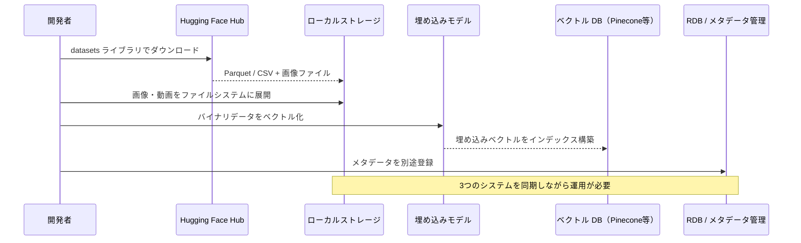
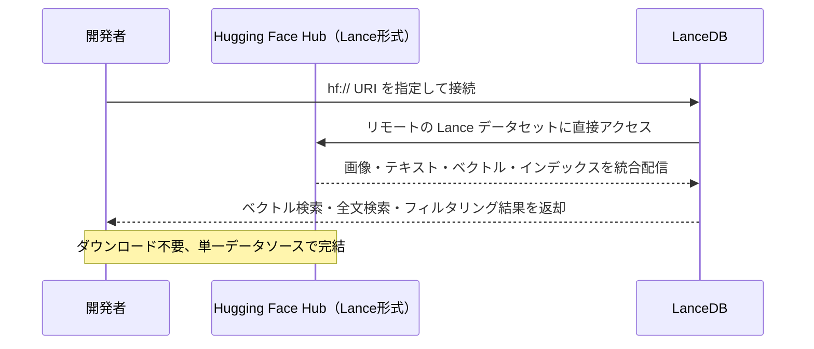
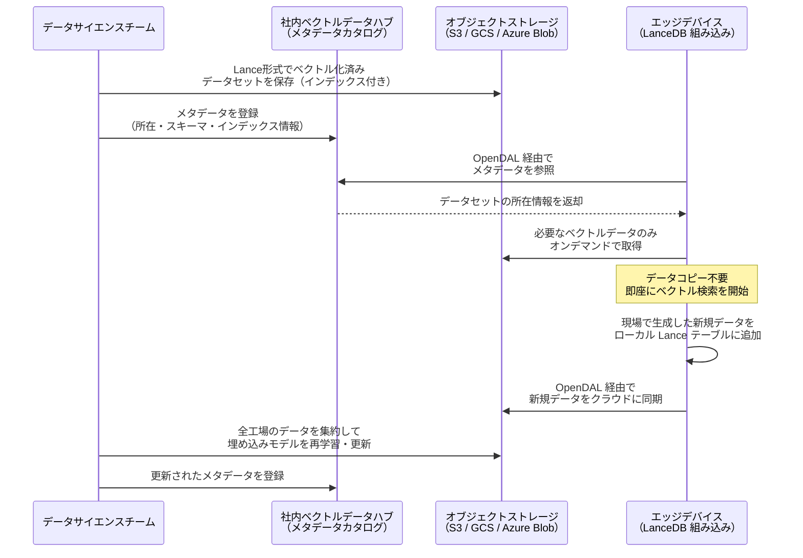

# はじめに

2026 年 2 月、 **Hugging Face Hub** において **Lance フォーマット**がネイティブにサポートされた。

https://lancedb.com/blog/lance-x-huggingface-a-new-era-of-sharing-multimodal-data/

この統合により、マルチモーダル AI の世界に大きな変化が起きている。「Hugging Face にある巨大な **マルチモーダルデータセット** （画像・動画・テキストなど複数種類のデータ）を、AI が扱いやすい数値表現（**埋め込みベクトル**）に変換し、**マルチモーダルベクトル DB** として高速に検索したい」——そんなニーズに応える土台が整ったのである。

本記事では、この統合の背景にある技術スタック（**Lance**、**LanceDB**、**Apache OpenDAL**）がそれぞれ何なのかを整理した上で、筆者が所属する **製造業** においてこれらの技術がどのような役割を果たすのかを紹介する。

# 筆者がHugging Face Hub における Lance フォーマットサポートに注目した背景

筆者がこの発表に注目したのは、Hugging Face と Lance の統合そのものだけでなく、そこで言及されている**要素技術群** —— **組み込み型ベクトル DB**、**マルチモーダル対応のレイクハウスフォーマット**、**ストレージ抽象化レイヤ** —— が、**エッジデバイスにおけるマルチモーダルベクトル DB の活用を爆発的に普及させるきっかけになるのではないか**と直感的に感じたからである。Hugging Face という巨大なエコシステムにこれらの技術が組み込まれることで、開発者の認知と採用が一気に加速する可能性がある。

ただし誤解のないように補足しておくと、筆者が所属する **製造業が Hugging Face Hub を本番システムのデータインフラとして直接使うことを想定しているわけではない**。Hugging Face はあくまで AI モデルやデータセットの共有・配布プラットフォームであり、製造現場の本番データを置く場所ではない。本記事で注目しているのは、Hugging Face 統合をきっかけに可視化された **Lance / LanceDB / OpenDAL という要素技術そのもの**が、製造業のエッジ〜クラウドにまたがるデータ基盤にどう活きるかという点である。

# 製造業におけるマルチモーダルベクトル DB の役割

筆者が所属する製造業では、テキスト（作業手順書、検査記録）、画像（外観検査写真、顕微鏡画像）、動画（製造ラインの稼働映像）、音声（設備の稼働音）、センサーデータなど、**多種多様なモダリティのデータ**が日々大量に発生している。これらを横断的に検索・分析できるマルチモーダルベクトル DB は、将来的に、製造業の AI 活用において中核的な役割を担う可能性がある。

具体的なユースケースとして、以下のようなシナリオが考えられる。

- **外観検査の異常検知**: 製造ラインのカメラが撮影した画像を即座にベクトル化し、過去の不良品画像との類似度検索を行う。「この傷に似た過去事例」をミリ秒単位で検索できる。
- **設備の予知保全**: 稼働音・振動データ・温度センサーのデータをマルチモーダルに統合し、異常パターンをベクトル検索で早期検知する。
- **熟練工のナレッジ継承**: 作業動画と手順書テキストを同一テーブルに格納し、「この工具の使い方」という自然言語クエリで該当する動画シーンを検索する。

これらのタスクは従来、データサイエンティストが**古典的な機械学習アルゴリズムや統計手法**を用いて、対象ごとに一つひとつテーラーメイドで実装するのが一般的であった。例えば外観検査であれば製品ごとに専用の画像分類モデルを学習させ、予知保全であれば設備ごとに閾値やルールを手動で調整する、といった具合である。高い精度を追求するがゆえに、個別最適化が前提となり、開発・保守コストが膨らみやすい構造にあった。

埋め込みベクトル DB を導入することで、このアプローチに根本的な変化が生まれる。

その核心にあるのは、**埋め込みベクトルが「データのモダリティを超えた共通言語」になる**という点だ。画像は画像処理の専門知識で、音声は信号処理で、テキストは自然言語処理で——従来は各モダリティごとに異なる手法・異なるツール・異なる専門家が必要であった。しかし、マルチモーダルな埋め込みモデル（CLIP、ImageBind 等）を用いれば、**どんな種類のデータも同じ次元のベクトル空間に写像される**。いったんベクトルになってしまえば、画像と音声の比較も、テキストと動画の検索も、すべて「ベクトル間の距離計算」という**たった一つの統一的なインタフェース**で実現できる。

このシンプルさが、従来のテーラーメイドなアプローチに対して以下のような具体的な変化をもたらす。

- **汎用的な埋め込みモデルによる横展開**: 個別にモデルを学習させる代わりに、マルチモーダルな汎用埋め込みモデル（CLIP、ImageBind 等）で画像・音声・テキストをベクトル化し、類似度検索で異常を検知できる。新しい製品や設備が追加されても、**埋め込みモデルを再学習させることなく、参照データをベクトル DB に追加するだけで対応可能**である。
- **複数モダリティの統合検索**: 従来は画像検査と音声検査がそれぞれ独立したシステムで運用されていたが、マルチモーダルベクトル DB なら画像・音声・センサー値を同一テーブルに格納し、**モダリティを横断した類似検索**が可能になる。「この異音に似た過去事例で、同時に外観異常が発生していたケース」といった複合的な検索が実現できる。
- **非データサイエンティストへの開放**: テーラーメイドの ML モデルは、その構築・運用にデータサイエンティストの専門知識が不可欠であった。一方、ベクトル DB による類似検索は「参照データを登録し、クエリを投げる」というシンプルなインタフェースで利用できるため、**現場のエンジニアや品質管理担当者が自ら検索・分析を行える**可能性が広がる。

ここで重要なのが、**LanceDB が「組み込み型」のベクトル DB** である点だ。製造現場のエッジデバイス（ラインサイドの産業用 PC やゲートウェイ機器）は、クラウドサーバーと比べてメモリや計算リソースが限られている。LanceDB はサーバープロセスを必要とせず、アプリケーションに直接組み込んで動作するため、こうした**省リソースなエッジ環境でもベクトル検索を実行できる**。

さらに、LanceDB は**ディスクベース（disk-first）** で設計されており、多くのベクトル DB のように**データベース全体をメモリにロードする必要がない**。検索時に必要なインデックスやデータの断片だけをディスクからオンデマンドで読み込み、Apache Arrow を活用した**ゼロコピーアクセス**でメモリコピーのオーバーヘッドも最小化する。つまり、数百万件規模のベクトルデータを持つ DB であっても、エッジデバイスの限られたメモリ（数 GB 程度）で問題なく動作させることが可能である。

さらに、Lance フォーマットは**レイクハウス・アーキテクチャ**を採用しており、ローカルファイルシステムでもクラウドオブジェクトストレージ（S3, GCS, Azure Blob Storage）でも同じフォーマットでデータを扱える。つまり、**エッジデバイスで生成・検索したデータを、そのままクラウドの大規模なデータレイクに統合できる**のである。エッジとクラウドの間でフォーマット変換やデータ移行の手間が発生しない点が、製造業のような分散環境において大きな利点となる。

以上が、筆者が製造業の立場からマルチモーダルベクトル DB に注目する理由である。ここで登場した Lance、LanceDB、OpenDAL などの技術用語については、次の「技術スタックの解説」セクションで前提知識がなくても理解できるよう、一つひとつ丁寧に解説する。

# 技術スタックの解説

## そもそも Hugging Face とは？

**Hugging Face** は、AI / 機械学習コミュニティにおける「GitHub のような存在」である。

https://huggingface.co

もともと自然言語処理（NLP）向けの Transformers ライブラリで広く知られるようになったが、現在では **Hugging Face Hub** というプラットフォームを通じて、AI 関連のあらゆるリソースを共有・配布する巨大なエコシステムに成長している。

- **モデル**: 学習済みの AI モデル（LLM、画像認識、音声認識など）を公開・ダウンロード可能
- **データセット**: 学習・評価用のデータセットを公開・ダウンロード可能
- **Spaces**: デモアプリを簡単にホスティング可能

AI 開発者にとって、Hugging Face Hub は「モデルとデータを探す最初の場所」と言えるほどの存在感を持っている。

## そもそもマルチモーダルとは？

**マルチモーダル (Multimodal)** とは、**複数の種類（モダリティ）のデータを同時に扱うこと**を指す。

従来の AI は、テキストならテキスト、画像なら画像と、単一の種類のデータを扱うものが主流であった。しかし、現実世界の情報は常に複数のモダリティが混在している。

| モダリティ | 具体例 |
| --- | --- |
| テキスト | ドキュメント、ログ、マニュアル |
| 画像 | 写真、X 線画像、顕微鏡画像 |
| 動画 | 監視カメラ映像、製造ラインの稼働映像 |
| 音声 | 設備の稼働音、音声指示 |
| 数値 | **センサーデータ、品質検査の計測値** |
| ベクトル（埋め込み） | 上記データを AI が数値ベクトルに変換したもの |

最近の AI は、これらを **まとめて理解** できるようになっている。例えば、Google の Gemini や OpenAI の GPT-4o は、画像とテキストを同時に入力して質問に答えることが可能である。

**マルチモーダル AI の時代には、これら多様なデータを「一箇所に、統一的に」保存・検索できるデータ基盤が不可欠** である。ここで登場するのが Lance と LanceDB だ。

## そもそも Lance（フォーマット）とは？

**Lance** は、マルチモーダル AI のためにゼロから設計されたオープンソースの **カラムナ型レイクハウス・フォーマット** である。

https://lance.org

「レイクハウス」とは、大規模なデータレイク（何でも放り込める大きな保管庫）と、データウェアハウス（整理された高速なクエリ基盤）の両方の利点を兼ね備えたアーキテクチャのことである。

Lance フォーマットの特徴を、馴染みのある技術と比較すると以下のようになる。

| 特性 | Parquet / Iceberg | Lance |
| --- | --- | --- |
| テキスト・数値の保存 | ✅ 得意 | ✅ 得意 |
| 画像・動画・音声の保存 | ❌ 別ストレージが必要 | ✅ 同一テーブルに保存可能 |
| ベクトル埋め込みの保存 | ⚠️ 可能だが最適化されていない | ✅ ネイティブサポート |
| ベクトル検索・全文検索 | ❌ 別のインデックスが必要 | ✅ フォーマット内にインデックスを内蔵 |
| ランダムアクセス性能 | ⚠️ 遅い（スキャン向け） | ✅ Parquet 比 最大 100 倍高速 |
| カラム単位の追加・更新 | ❌ 全体再書き込みが必要 | ✅ ゼロコピーで追加可能 |

つまり Lance は、**画像や動画のバイナリデータと、そのメタデータ、さらにベクトル埋め込みを、たった一つのテーブルに統合して保存できる**フォーマットである。従来なら「オブジェクトストレージに画像、RDB にメタデータ、ベクトル DB に埋め込み」とバラバラに管理していたデータを、一元管理できる。

### Lance と Iceberg / Delta Lake の関係

ここで一点、誤解を防いでおきたい。Lance は「レイクハウス・フォーマット」と位置づけられるが、**レイクハウス = Iceberg や Delta Lake というわけではない**。レイクハウスとはあくまで「データレイクの柔軟性とデータウェアハウスの管理性を両立させる」**アーキテクチャの思想**であり、それを実現するためのテーブルフォーマット / データフォーマットとして Iceberg、Delta Lake、そして Lance が存在する。

Lance は Iceberg や Delta Lake と**互換性はなく**、それぞれ独立したフォーマットである。しかし、両者は**競合ではなく補完関係**にある。

| フォーマット | 得意領域 | 主なデータ |
| --- | --- | --- |
| **Iceberg / Delta Lake** | 構造化データのテーブル管理（スキーマ進化、ACID トランザクション、タイムトラベル） | 売上データ、ログ、マスタデータなどの構造化テーブル |
| **Lance** | マルチモーダルデータと埋め込みベクトルの格納・検索 | 画像、動画、音声、ベクトル埋め込みとそのメタデータ |

実際の運用では、両者を組み合わせた構成が考えられる。例えば、**Lance で格納したマルチモーダルな埋め込みベクトルの管理メタデータ（いつ誰がどのモデルで生成したか、どの製品ラインに紐づくか等）を Iceberg / Delta Lake のテーブルで管理する**、という構成である。さらに、Delta Lake の開発元である Databricks が提供するメタデータカタログ **Unity Catalog** を用いれば、Lance テーブルと Iceberg / Delta Lake テーブルを横断的に管理し、アクセス制御やデータリネージを統一的に運用することも将来的に実現可能になるだろう。

## そもそも LanceDB とは？

**LanceDB** は、Lance フォーマットを基盤とした **サーバーレス・組み込み型のベクトルデータベース** である。

https://lancedb.com

「組み込み型」とはどういう意味か。データベースには大きく分けて 2 つのアーキテクチャがある。

| | クライアント-サーバー型 | 組み込み型 |
| --- | --- | --- |
| 代表例 | PostgreSQL, MySQL, Pinecone | **SQLite**, **DuckDB**, **LanceDB** |
| 動作方式 | 別プロセスでサーバーを起動し、ネットワーク経由でアクセス | **アプリケーションのプロセス内で直接動作** |
| 運用 | サーバーの管理・監視が必要 | サーバー不要（ゼロ運用） |
| 向いている環境 | クラウド上の大規模システム | **エッジデバイス、ノート PC、CI/CD パイプライン** |

SQLite がリレーショナルデータの組み込み DB、DuckDB が分析クエリの組み込み DB だとすれば、**LanceDB は「ベクトル検索の組み込み DB」** と位置づけられる。

LanceDB の主な特徴は以下の通りである。

- 🔍 **ベクトル類似検索・全文検索・ハイブリッド検索** をすべてサポート
- 📦 **マルチモーダルデータ** を直接保存・クエリ可能（画像、動画、テキスト、ベクトルをまとめて格納）
- 🦀 **Rust ベースの高性能アーキテクチャ** により低レイテンシを実現
- 🔄 **自動バージョニング**により、データの履歴管理（タイムトラベル）が可能
- 🐍 Python, JavaScript (Node.js), Rust の SDK を提供
- 🔗 LangChain, LlamaIndex など主要な AI フレームワークと統合可能

## そもそも Apache OpenDAL とは？

**Apache OpenDAL (Open Data Access Layer)** は、あらゆるストレージサービスへのアクセスを**統一的な API で抽象化する**オープンソースのデータアクセスレイヤーである。Apache Software Foundation のトップレベルプロジェクトとして開発されている。

https://opendal.apache.org

### なぜストレージの抽象化が必要なのか

現代のデータインフラでは、データの保存先が一箇所に収まることはほとんどない。例えば、以下のような状況が日常的に発生する。

- 開発環境ではローカルファイルシステムにデータを保存
- ステージング環境では AWS S3 を使用
- 本番環境では Azure Blob Storage を使用
- 一部のデータは GCS (Google Cloud Storage) に分散
- エッジデバイスではローカルの SSD に保存
- データセットの共有には Hugging Face Hub を使用

従来、これらのストレージにアクセスするコードは**ストレージごとに個別に書く**必要があった。S3 なら `boto3`、GCS なら `google-cloud-storage`、Azure なら `azure-storage-blob` と、それぞれ異なるライブラリ・異なる API を使い分けなければならない。ストレージを変更するたびにアプリケーションのコードを書き換える必要があり、マルチクラウドやハイブリッド環境への対応は大きな負担であった。

### OpenDAL が解決すること

OpenDAL は、これらのストレージサービスに対して**共通の read / write / list / delete API** を提供する。アプリケーションのコードは OpenDAL の API のみに依存し、接続先のストレージは設定の変更だけで切り替えられる。

```python
# OpenDAL の API イメージ（疑似コード）

# ローカルファイルシステムに書き込む場合
op = Operator("fs", root="/data/lance")
op.write("dataset.lance", data)

# まったく同じ API で S3 に書き込む場合
op = Operator("s3", bucket="my-bucket", region="ap-northeast-1")
op.write("dataset.lance", data)

# Hugging Face Hub も同じ API
op = Operator("huggingface", repo="my-org/my-dataset")
op.read("dataset.lance")
```

### 製造業におけるメリット

製造業は、マルチクラウド・オンプレミスが混在する環境の典型例である。

| 環境 | ストレージ例 | 用途 |
| --- | --- | --- |
| 工場のエッジデバイス | ローカル SSD / NAS | リアルタイム検査データの一時保存 |
| 国内クラウド | AWS S3 / Azure Blob | 工場データの集約・分析 |
| 海外拠点のクラウド | GCS / S3（別リージョン） | グローバル拠点間のデータ共有 |
| オンプレミスサーバー | HDFS / MinIO | セキュリティ要件の高いデータ |

OpenDAL があれば、Lance / LanceDB のデータアクセスコードを**一度書けば、どのストレージでもそのまま動作する**。エッジデバイスのローカル SSD に保存した Lance テーブルを、設定変更だけでクラウドの S3 に同期する、といった運用がコード変更なしに実現できるのである。

これは前述の「エッジとクラウドを統合的に扱えるレイクハウス」というビジョンを、**ストレージレイヤーで実現する鍵**となる技術である。Lance がデータフォーマットの統一を担い、OpenDAL がストレージアクセスの統一を担う——この二つが組み合わさることで、エッジからクラウドまでシームレスなデータパイプラインが構築できる。

# Hugging Face × Lance 統合がもたらすインパクト

ここまで紹介した技術要素を踏まえて、今回の Hugging Face × Lance 統合が何を変えるのかを整理する。

## 従来のワークフローの課題

これまで、Hugging Face Hub 上のマルチモーダルデータセットを活用しようとすると、以下のような煩雑なワークフローが必要であった。

まず、`datasets` ライブラリを使ってデータセットを Parquet や CSV 形式でローカルにダウンロードする。次に、画像や動画などのバイナリデータをローカルのファイルシステムに展開する。その上で、埋め込みモデルを用いてベクトル化し、生成された埋め込みベクトルを Pinecone や Weaviate などの専用ベクトル DB にインデックスとして構築する。さらに、メタデータ（ファイル名、ラベル、作成日時など）は別途 RDB やスプレッドシートで管理する必要があった。

つまり、**一つのデータセットを使うために、最低でも 3 つの異なるシステム**（ファイルストレージ、ベクトル DB、メタデータ管理）を同期させながら運用しなければならなかったのである。



このワークフローでは、データセットのバージョンが更新されるたびにすべての工程をやり直す必要があり、再現性の確保も困難であった。

## Lance 統合後のワークフロー

Hugging Face Hub が Lance フォーマットをネイティブにサポートしたことで、このワークフローは劇的に簡素化される。

Lance 形式で公開されたデータセットには、画像・動画などのバイナリデータ、テキスト、メタデータ、埋め込みベクトル、さらにはベクトル検索用のインデックスまでが**一つのデータセットに統合**されている。開発者は `hf://` URI を指定するだけで、ローカルにダウンロードすることなくリモートのデータセットに直接アクセスし、スキャン・フィルタリング・ベクトル検索を実行できる。



## インデックス共有の革新性

この統合の中でも特に重要なのが、**ベクトルインデックスをデータセットと一緒に共有できる**という点である。

従来、ベクトル検索を行うためには、データセットをダウンロードした後に自分で埋め込みモデルを実行してベクトル化し、さらにベクトルインデックスを一から構築する必要があった。データセットが大規模になるほど、この工程には膨大な計算リソースと時間がかかる。

Lance 形式であれば、データセットの作成者がベクトルインデックスをあらかじめ構築した状態で公開できる。利用者はインデックスの再構築を行うことなく、即座にベクトル検索を開始できるのである。これは、数百万件規模の画像データセットに対してベクトル検索を行いたい場合などに、数時間〜数日かかっていたセットアップ作業をゼロにできることを意味する。

## マルチモーダルベクトル DB としての活用

この統合は、**マルチモーダルベクトル DB としての LanceDB を使いたい開発者**にとって特に大きなインパクトを持つ。

例えば、Hugging Face Hub 上に公開されている大規模なマルチモーダルデータセット——画像とそのキャプション、さらに CLIP や ImageBind による埋め込みベクトルがセットになったデータ——を考えてみよう。従来であれば、このデータセットを活用するには前述の煩雑なワークフローが不可避であった。

Lance 統合後は、`hf://` URI を LanceDB に渡すだけで、そのデータセットがそのままマルチモーダルベクトル DB として機能する。「この画像に似た画像を検索」「このテキストに意味が近い画像を検索」といったクロスモーダル検索を、セットアップなしで即座に実行できるのだ。

データの提供者と利用者の間で、フォーマット変換もインデックス再構築も不要になる。この**摩擦の除去**こそが、Hugging Face × Lance 統合の最大のインパクトである。

## その先へ：エンタープライズ向け「マルチモーダルベクトルデータハブ」という未来

ここまで紹介した Hugging Face × Lance のワークフローは、現時点では Hugging Face Hub というパブリックなプラットフォーム上でのみ実現されている。しかし、この仕組みの本質——**マルチモーダルデータと埋め込みベクトル、インデックスを一体化して共有・配信する**——は、エンタープライズの社内インフラにも応用できる概念である。

仮に、企業内に**マルチモーダルベクトルデータハブ**——社内版の「Hugging Face Hub for multimodal vectors」とも言うべきもの——が構築されたとしよう。製造業における開発者のワークフローは、以下のように根本的に変わる可能性がある。

### 従来：エッジデバイスごとに個別構築

現状、製造現場のエッジデバイスでベクトル検索を行おうとすると、各デバイス・各ライン・各工場ごとに、データの収集からベクトル化、インデックス構築までを個別に行う必要がある。ある工場で構築した外観検査用のベクトル DB を別の工場に展開するにも、データの移行やインデックスの再構築が発生し、横展開には大きなコストがかかる。

### 未来：データハブにメタデータを登録し、必要なときだけベクトルデータを取得して即稼働

エンタープライズ向けのマルチモーダルベクトルデータハブが存在すれば、ワークフローは以下のようになる。

ここで重要なのは、レイクハウス・アーキテクチャでは**データのコピーが発生しない**という点である。データハブに登録されるのはあくまで**メタデータ**（データセットの所在、スキーマ、インデックス情報など）であり、画像や埋め込みベクトルといった実データはオブジェクトストレージ上にそのまま保持される。エッジデバイスが検索を実行する際に、必要な部分のみがオブジェクトストレージからオンデマンドで取得される仕組みだ。これにより、ペタバイト級のデータセットであっても、全データをコピー・同期する必要がなくなる。




このワークフローが実現すると、以下のような革命的な変化が起きる。

**1. 「ベクトル DB のデプロイ」がソフトウェアのデプロイと同じ感覚になる**

データサイエンスチームが新しい埋め込みモデルで生成したベクトルデータセットをデータハブに公開すれば、各エッジデバイスは URI を指定するだけでそれを取得できる。コンテナイメージを Pull するように、**ベクトル DB の中身を Pull して即座に稼働させる**ことが可能になる。新しい製品ラインの外観検査モデルを全工場に展開するのに、数週間かかっていた作業が数分で完了する。

**2. エッジとクラウドの間にフィードバックループが生まれる**

エッジデバイスで現場の新規データ（新たに検出された不良品画像、これまでにない異音パターンなど）をローカルの Lance テーブルに蓄積し、OpenDAL 経由でクラウドに同期する。データサイエンスチームは全工場から集約されたデータを用いて埋め込みモデルを継続的に改善し、更新されたベクトルデータセットを再びデータハブに公開する。この**エッジ → クラウド → モデル改善 → エッジ**という循環が、フォーマット変換なしに同一の Lance エコシステム内で完結する。

**3. データの民主化と再利用が進む**

ある工場の品質管理チームが構築した「溶接欠陥の埋め込みベクトルコレクション」を、データハブを通じて他の工場や他の部門が即座に利用できるようになる。従来は各チームが独自にデータを収集・加工・モデル構築していたが、ベクトルデータセットを共有資産として管理することで、**組織全体でのナレッジの蓄積と横展開**が加速する。

現時点では、このようなエンタープライズ向けマルチモーダルベクトルデータハブは一般に普及していない。しかし、Hugging Face × Lance 統合が実証したアーキテクチャパターンは、そのまま企業内に持ち込める設計になっている。Lance フォーマットはオープンソースであり、OpenDAL は S3 や GCS、Azure Blob Storage といったエンタープライズのオブジェクトストレージに対応している。**必要なピースはすでに揃っている**のだ。

# 始めてみよう

ここまで読んで Lance / LanceDB に興味を持った方は、まず公式ブログに掲載されているチュートリアルを試してみることをお勧めする。

https://lancedb.com/blog/lance-x-huggingface-a-new-era-of-sharing-multimodal-data/

このチュートリアルでは、Hugging Face Hub 上の Lance データセットに `hf://` URI でアクセスし、実際にベクトル検索やフィルタリングを体験することができる。本記事で紹介した「ダウンロード不要でリモートのマルチモーダルデータセットを即座に検索できる」体験を、手を動かしながら確認できるだろう。

チュートリアルの詳細な手順や、製造業のデータを使った実践的なハンズオンについては、別の記事で改めて紹介する予定である。

# おわりに

本記事では、Hugging Face Hub における Lance フォーマットのネイティブサポートをきっかけに、以下の技術スタックとその製造業における意味合いを紹介した。

- **Lance（フォーマット）**: マルチモーダルデータと埋め込みベクトルを同一テーブルに統合して保存できるレイクハウス・フォーマット。Iceberg / Delta Lake とは競合ではなく補完関係にある
- **LanceDB（組み込みDB）**: Lance フォーマットを基盤とした組み込み型ベクトル DB。サーバー不要で省リソースなエッジデバイスでも動作する
- **Apache OpenDAL（ストレージアクセス）**: ストレージアクセスを抽象化し、マルチクラウド・オンプレ混在環境でもコード変更なしにデータアクセスを統一する

これらの技術が組み合わさることで、**データフォーマットの統一（Lance）× ストレージアクセスの統一（OpenDAL）× エッジで動作するベクトル検索（LanceDB）** という、エッジからクラウドまでシームレスなマルチモーダルデータ基盤の構築が現実的になりつつある。

製造業においては、従来データサイエンティストが個別にテーラーメイドで構築してきた外観検査・予知保全・ナレッジ継承といったユースケースが、埋め込みベクトル DB の導入により汎用化・横展開可能な形へと進化する可能性がある。さらに将来的には、エンタープライズ向けのマルチモーダルベクトルデータハブが登場し、ベクトル DB のデプロイがソフトウェアのデプロイと同じ感覚で行える時代が来るかもしれない。

次回の記事では、**DuckDB と LanceDB の連携**について紹介する。Lance フォーマットのマルチモーダルレイクハウスに対して、SQL ベースのデータ検索・分析を組み合わせるアプローチを取り上げる予定である。

https://lancedb.com/blog/lance-x-duckdb-sql-retrieval-on-the-multimodal-lakehouse-format/
