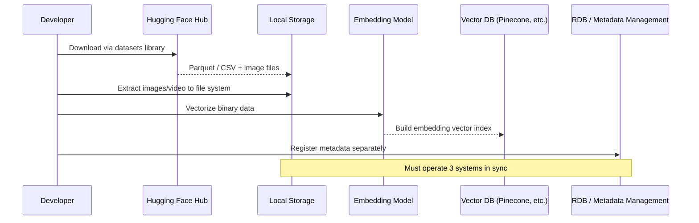
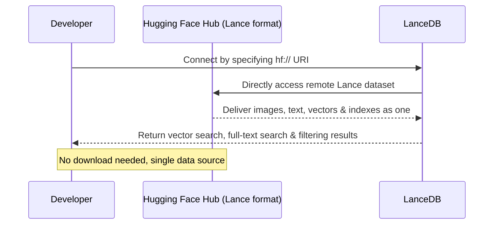
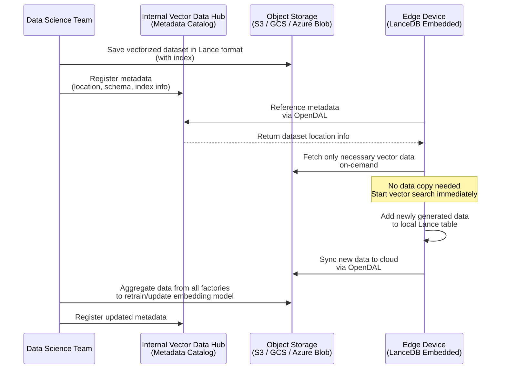

# Introduction

In February 2026, **Hugging Face Hub** announced native support for the **Lance format**.

https://lancedb.com/blog/lance-x-huggingface-a-new-era-of-sharing-multimodal-data/

This integration is bringing about a significant shift in the world of multimodal AI. The foundation is now in place to address a growing need: "Take the massive **multimodal datasets** (images, videos, text, and other data types) available on Hugging Face, convert them into AI-friendly numerical representations (**embedding vectors**), and search them at high speed as a **multimodal vector DB**."

This article provides an overview of the technology stack behind this integration — **Lance**, **LanceDB**, and **Apache OpenDAL** — and explores the role these technologies can play in the **manufacturing industry**, where the author works.

# Why I Paid Attention to Lance Format Support on Hugging Face Hub

What caught my attention about this announcement was not just the Hugging Face–Lance integration itself, but rather the **underlying technology components** mentioned — **embedded vector DB**, **multimodal lakehouse format**, and **storage abstraction layer** — which I intuitively felt could **trigger an explosive adoption of multimodal vector DBs on edge devices**. By embedding these technologies into the massive Hugging Face ecosystem, developer awareness and adoption could accelerate rapidly.

To be clear, however, **the manufacturing industry I work in is not expected to use Hugging Face Hub directly as a production data infrastructure**. Hugging Face is fundamentally a platform for sharing and distributing AI models and datasets — it is not a place to store production data from manufacturing floors. What this article focuses on is how the **underlying technologies themselves — Lance / LanceDB / OpenDAL** — which became visible through the Hugging Face integration, can benefit data infrastructure spanning edge to cloud in manufacturing.

# The Role of Multimodal Vector DB in Manufacturing

In manufacturing, where the author works, a **diverse range of data modalities** is generated in large volumes every day: text (work instructions, inspection records), images (visual inspection photos, microscope images), video (production line footage), audio (equipment operating sounds), sensor data, and more. A multimodal vector DB that can search and analyze across these modalities has the potential to play a central role in AI adoption in manufacturing going forward.

The following scenarios illustrate concrete use cases:

- **Anomaly detection in visual inspection**: Instantly vectorize images captured by production line cameras and perform similarity searches against past defective product images. "Past cases similar to this scratch" can be found in milliseconds.
- **Predictive maintenance of equipment**: Integrate operating sounds, vibration data, and temperature sensor data in a multimodal fashion, and detect anomalous patterns early through vector search.
- **Knowledge transfer from skilled workers**: Store work videos and procedure manual text in the same table, and search for relevant video scenes using natural language queries like "how to use this tool."

Traditionally, these tasks were implemented by data scientists on a **case-by-case basis using classical machine learning algorithms and statistical methods**. For example, a dedicated image classification model would be trained for each product in visual inspection, and thresholds or rules would be manually adjusted for each piece of equipment in predictive maintenance. Because the pursuit of high accuracy required individual optimization, development and maintenance costs tended to balloon.

Introducing embedding vector DBs fundamentally changes this approach.

At its core, **embedding vectors become a "universal language that transcends data modalities."** Images required computer vision expertise, audio required signal processing, text required NLP — traditionally, each modality demanded different methods, different tools, and different specialists. However, with multimodal embedding models (CLIP, ImageBind, etc.), **any type of data can be projected into the same vector space**. Once converted to vectors, comparing images and audio, or searching text against video, can all be accomplished through **a single, unified interface: distance computation between vectors**.

This simplicity brings the following concrete changes compared to the traditional tailor-made approach:

- **Horizontal scaling through general-purpose embedding models**: Instead of training individual models, images, audio, and text can be vectorized using general-purpose multimodal embedding models (CLIP, ImageBind, etc.) and anomalies detected via similarity search. Even when new products or equipment are added, **it is possible to respond simply by adding reference data to the vector DB without retraining the embedding model**.
- **Unified search across multiple modalities**: Previously, image inspection and audio inspection were operated as separate systems, but with a multimodal vector DB, images, audio, and sensor values can be stored in the same table, enabling **similarity searches that span modalities**. Complex searches such as "past cases with sounds similar to this abnormal noise where visual anomalies also occurred simultaneously" become possible.
- **Opening up to non-data-scientists**: Tailor-made ML models required data science expertise for both building and operating them. In contrast, similarity search via vector DB can be used through a simple interface of "register reference data and submit queries," **opening up the possibility for on-site engineers and quality control personnel to perform searches and analysis themselves**.

A key point here is that **LanceDB is an "embedded" vector DB**. Edge devices on the manufacturing floor (line-side industrial PCs and gateway equipment) have limited memory and computational resources compared to cloud servers. Since LanceDB operates directly embedded in the application without requiring a server process, **it can execute vector search even in resource-constrained edge environments**.

Furthermore, LanceDB is designed with a **disk-first** architecture, meaning it **does not need to load the entire database into memory** as many vector DBs do. Only the necessary index fragments and data are read from disk on demand during search, and **zero-copy access** leveraging Apache Arrow minimizes memory copy overhead. This means that even a DB with millions of vector records can operate without issue on edge devices with limited memory (around a few GB).

Additionally, the Lance format adopts a **lakehouse architecture**, allowing data to be handled in the same format on both local file systems and cloud object storage (S3, GCS, Azure Blob Storage). In other words, **data generated and searched on edge devices can be integrated directly into the cloud-scale data lake**. The fact that no format conversion or data migration overhead occurs between edge and cloud is a significant advantage in distributed environments like manufacturing.

The above explains why the author, from a manufacturing industry perspective, is paying attention to multimodal vector DBs. The technical terms introduced here — Lance, LanceDB, OpenDAL, etc. — will be explained one by one in the following "Technology Stack Overview" section, so that readers without prior knowledge can follow along.

# Technology Stack Overview

## What Is Hugging Face?

**Hugging Face** is the "GitHub of AI" in the AI / machine learning community.

https://huggingface.co

Originally known for its Transformers library for natural language processing (NLP), it has grown into a massive ecosystem for sharing and distributing all kinds of AI-related resources through **Hugging Face Hub**.

- **Models**: Pre-trained AI models (LLMs, image recognition, speech recognition, etc.) can be published and downloaded
- **Datasets**: Training and evaluation datasets can be published and downloaded
- **Spaces**: Demo applications can be easily hosted

For AI developers, Hugging Face Hub has become "the first place to look for models and data."

## What Is Multimodal?

**Multimodal** refers to **handling multiple types (modalities) of data simultaneously**.

Traditional AI primarily dealt with a single type of data — text for text, images for images. However, real-world information is always a mixture of multiple modalities.

| Modality | Examples |
| --- | --- |
| Text | Documents, logs, manuals |
| Images | Photographs, X-ray images, microscope images |
| Video | Surveillance footage, production line footage |
| Audio | Equipment operating sounds, voice instructions |
| Numerical | **Sensor data, quality inspection measurements** |
| Vectors (embeddings) | The above data converted into numerical vectors by AI |

Recent AI can **understand all of these together**. For example, Google's Gemini and OpenAI's GPT-4o can accept images and text simultaneously as input to answer questions.

**In the era of multimodal AI, a data platform that can "store and search" this diverse data "in one place, in a unified manner" is essential.** This is where Lance and LanceDB come in.

## What Is Lance (the Format)?

**Lance** is an open-source **columnar lakehouse format** designed from scratch for multimodal AI.

https://lance.org

A "lakehouse" is an architecture that combines the benefits of a large-scale data lake (a big repository where anything can be stored) and a data warehouse (an organized, high-performance query foundation).

The features of the Lance format, compared to familiar technologies, are as follows:

| Feature | Parquet / Iceberg | Lance |
| --- | --- | --- |
| Storing text & numbers | ✅ Strong | ✅ Strong |
| Storing images, video, audio | ❌ Requires separate storage | ✅ Can be stored in the same table |
| Storing vector embeddings | ⚠️ Possible but not optimized | ✅ Native support |
| Vector search & full-text search | ❌ Requires separate index | ✅ Index built into the format |
| Random access performance | ⚠️ Slow (scan-oriented) | ✅ Up to 100x faster than Parquet |
| Column-level append/update | ❌ Requires full rewrite | ✅ Zero-copy append |

In other words, Lance is a format that can **store binary data like images and video, their metadata, and vector embeddings all in a single table**. Data that was previously managed separately — "images in object storage, metadata in an RDB, embeddings in a vector DB" — can be unified.

### The Relationship Between Lance and Iceberg / Delta Lake

One point worth clarifying: while Lance is positioned as a "lakehouse format," **lakehouse ≠ Iceberg or Delta Lake**. Lakehouse is fundamentally an **architectural philosophy** of "combining the flexibility of a data lake with the manageability of a data warehouse," and Iceberg, Delta Lake, and Lance are table/data formats that implement this philosophy.

Lance is **not compatible with** Iceberg or Delta Lake — they are independent formats. However, they are **complementary, not competitive**.

| Format | Strength | Primary Data |
| --- | --- | --- |
| **Iceberg / Delta Lake** | Structured data table management (schema evolution, ACID transactions, time travel) | Sales data, logs, master data, and other structured tables |
| **Lance** | Storage and search of multimodal data and embedding vectors | Images, video, audio, vector embeddings and their metadata |

In practice, a combined configuration using both is conceivable. For example, **management metadata for multimodal embedding vectors stored in Lance (who generated them with which model, which product line they belong to, etc.) could be managed in Iceberg / Delta Lake tables**. Furthermore, using the metadata catalog **Unity Catalog** from Databricks (the developer of Delta Lake), it may become possible in the future to manage Lance tables and Iceberg / Delta Lake tables in a unified manner, with consistent access control and data lineage.

## What Is LanceDB?

**LanceDB** is a **serverless, embedded vector database** built on the Lance format.

https://lancedb.com

What does "embedded" mean? Databases broadly fall into two architectures:

| | Client-Server | Embedded |
| --- | --- | --- |
| Examples | PostgreSQL, MySQL, Pinecone | **SQLite**, **DuckDB**, **LanceDB** |
| How it works | Start a separate server process & access via network | **Runs directly within the application process** |
| Operations | Server management & monitoring required | No server needed (zero ops) |
| Best suited for | Large-scale cloud systems | **Edge devices, laptops, CI/CD pipelines** |

If SQLite is the embedded DB for relational data and DuckDB is the embedded DB for analytical queries, then **LanceDB can be positioned as the "embedded DB for vector search."**

Key features of LanceDB include:

- 🔍 Supports **vector similarity search, full-text search, and hybrid search**
- 📦 Can directly store and query **multimodal data** (images, video, text, and vectors stored together)
- 🦀 Low latency through a **high-performance Rust-based architecture**
- 🔄 **Automatic versioning** enables data history management (time travel)
- 🐍 SDKs for Python, JavaScript (Node.js), and Rust
- 🔗 Integrates with major AI frameworks such as LangChain and LlamaIndex

## What Is Apache OpenDAL?

**Apache OpenDAL (Open Data Access Layer)** is an open-source data access layer that **abstracts access to any storage service through a unified API**. It is developed as an Apache Software Foundation top-level project.

https://opendal.apache.org

### Why Storage Abstraction Is Needed

In modern data infrastructure, data is rarely stored in a single location. For example, the following situations commonly occur:

- Development environments store data on local file systems
- Staging environments use AWS S3
- Production environments use Azure Blob Storage
- Some data is distributed across GCS (Google Cloud Storage)
- Edge devices store data on local SSDs
- Dataset sharing uses Hugging Face Hub

Traditionally, code to access these storage services had to be **written separately for each storage provider**: `boto3` for S3, `google-cloud-storage` for GCS, `azure-storage-blob` for Azure — each requiring different libraries and different APIs. Every time the storage changed, application code had to be rewritten, making multi-cloud and hybrid environment support a significant burden.

### What OpenDAL Solves

OpenDAL provides a **common read / write / list / delete API** for these storage services. Application code depends only on the OpenDAL API, and the target storage can be switched by simply changing configuration.

```python
# OpenDAL API Image (pseudocode)

# Writing to a local file system
op = Operator("fs", root="/data/lance")
op.write("dataset.lance", data)

# Writing to S3 with the exact same API
op = Operator("s3", bucket="my-bucket", region="ap-northeast-1")
op.write("dataset.lance", data)

# Hugging Face Hub also uses the same API
op = Operator("huggingface", repo="my-org/my-dataset")
op.read("dataset.lance")
```

### Benefits for Manufacturing

Manufacturing is a textbook example of an environment where multi-cloud and on-premises coexist.

| Environment | Storage Example | Use Case |
| --- | --- | --- |
| Factory edge devices | Local SSD / NAS | Temporary storage for real-time inspection data |
| Domestic cloud | AWS S3 / Azure Blob | Aggregation and analysis of factory data |
| Overseas cloud | GCS / S3 (different region) | Data sharing across global sites |
| On-premises servers | HDFS / MinIO | Data with high security requirements |

With OpenDAL, data access code for Lance / LanceDB **only needs to be written once and works on any storage**. Operations like syncing a Lance table saved on a local SSD on an edge device to S3 in the cloud can be achieved without any code changes — just a configuration change.

This is the **key technology that realizes the vision** of "a lakehouse that integrates edge and cloud" **at the storage layer**. Lance handles the unification of data format, and OpenDAL handles the unification of storage access — when these two combine, a seamless data pipeline from edge to cloud becomes possible.

# The Impact of Hugging Face × Lance Integration

With the technology components introduced so far, let us now examine what the Hugging Face × Lance integration changes.

## Challenges with the Traditional Workflow

Previously, attempting to use multimodal datasets on Hugging Face Hub required the following cumbersome workflow.

First, use the `datasets` library to download the dataset in Parquet or CSV format to local storage. Next, extract binary data such as images and video to the local file system. Then, vectorize them using an embedding model and build the generated embedding vectors as an index in a dedicated vector DB such as Pinecone or Weaviate. Additionally, metadata (file names, labels, creation dates, etc.) had to be managed separately in an RDB or spreadsheet.

In other words, **using a single dataset required synchronizing at least three different systems** (file storage, vector DB, metadata management).



In this workflow, every time a dataset version was updated, all steps had to be repeated, making reproducibility difficult to ensure.

## Workflow After Lance Integration

With Hugging Face Hub's native support for the Lance format, this workflow is dramatically simplified.

A dataset published in Lance format contains binary data (images, video), text, metadata, embedding vectors, and even vector search indexes **all integrated in a single dataset**. Developers simply specify an `hf://` URI to directly access the remote dataset without downloading locally, and can execute scans, filtering, and vector search.



## The Innovation of Index Sharing

Particularly important in this integration is the ability to **share vector indexes together with the dataset**.

Traditionally, performing vector search required running an embedding model yourself to vectorize data after downloading the dataset, and then building a vector index from scratch. The larger the dataset, the more computational resources and time this process demanded.

With the Lance format, dataset creators can publish their work with the vector index pre-built. Users can begin vector search immediately without rebuilding the index. For cases like performing vector search on image datasets with millions of records, this means **setup work that previously took hours to days is reduced to zero**.

## Utilization as a Multimodal Vector DB

This integration has a particularly significant impact for **developers who want to use LanceDB as a multimodal vector DB**.

Consider, for example, a large-scale multimodal dataset published on Hugging Face Hub — images with their captions, plus embedding vectors generated by CLIP or ImageBind. Previously, using such a dataset required the cumbersome workflow described above.

After Lance integration, simply passing an `hf://` URI to LanceDB makes that dataset function as a multimodal vector DB as-is. Cross-modal searches like "search for images similar to this image" or "search for images semantically close to this text" can be executed immediately without any setup.

No format conversion or index rebuilding is needed between data providers and consumers. This **removal of friction** is the greatest impact of the Hugging Face × Lance integration.

# Looking Ahead: The Future of an Enterprise "Multimodal Vector Data Hub"

The Hugging Face × Lance workflow introduced so far is currently realized only on the public platform of Hugging Face Hub. However, the essence of this mechanism — **unifying multimodal data, embedding vectors, and indexes for sharing and distribution** — is a concept that can be applied to enterprise internal infrastructure as well.

Imagine if a **multimodal vector data hub** — what might be called an internal "Hugging Face Hub for multimodal vectors" — were built within an enterprise. Developer workflows in manufacturing could fundamentally change as follows.

## Current State: Building Individually for Each Edge Device

Currently, to perform vector search on edge devices at manufacturing sites, data collection, vectorization, and index building must be done individually for each device, each line, and each factory. Even deploying a visual inspection vector DB built at one factory to another requires data migration and index rebuilding, making horizontal scaling costly.

## Future: Register Metadata in the Data Hub, Fetch Vector Data On-Demand Only When Needed

If an enterprise multimodal vector data hub existed, the workflow would look like the following.

The key point here is that in a lakehouse architecture, **no data copying occurs**. What is registered in the data hub is purely **metadata** (dataset location, schema, index information, etc.) — the actual data such as images and embedding vectors remain on the object storage as-is. When an edge device executes a search, only the necessary portions are fetched on-demand from the object storage. This means that even petabyte-scale datasets do not need to be fully copied or synced.




This workflow, once realized, would bring about the following revolutionary changes.

**1. "Deploying a vector DB" becomes as natural as deploying software**

Once the data science team publishes a vector dataset generated with a new embedding model to the data hub, each edge device can retrieve it by simply specifying a URI. Like pulling a container image, **pulling the contents of a vector DB and running it immediately** becomes possible. Deploying a new product line's visual inspection model across all factories — previously taking weeks — could be completed in minutes.

**2. A feedback loop between edge and cloud emerges**

New data generated on-site at edge devices (newly detected defective product images, previously unseen abnormal sound patterns, etc.) accumulates in local Lance tables and is synced to the cloud via OpenDAL. The data science team continuously improves the embedding model using data aggregated from all factories and republishes the updated vector dataset to the data hub. This **edge → cloud → model improvement → edge** cycle completes within the same Lance ecosystem without format conversion.

**3. Data democratization and reuse accelerate**

A "welding defect embedding vector collection" built by one factory's quality control team becomes instantly available to other factories and departments through the data hub. Previously, each team independently collected, processed, and built models from their own data, but by managing vector datasets as shared assets, **organization-wide knowledge accumulation and horizontal scaling** accelerate.

At present, such enterprise multimodal vector data hubs are not widely available. However, the architecture pattern validated by the Hugging Face × Lance integration is designed to be brought directly into enterprises. The Lance format is open source, and OpenDAL supports enterprise object storage services such as S3, GCS, and Azure Blob Storage. **The pieces are already in place.**

# Getting Started

If reading this far has piqued your interest in Lance / LanceDB, I recommend starting with the tutorial published on the official blog.

https://lancedb.com/blog/lance-x-huggingface-a-new-era-of-sharing-multimodal-data/

This tutorial walks you through accessing Lance datasets on Hugging Face Hub via `hf://` URI and experiencing vector search and filtering firsthand. You can get a hands-on feel for the "searching remote multimodal datasets instantly without downloading" experience described in this article.

Detailed tutorial steps and practical hands-on exercises using manufacturing data will be covered in a separate article.

# Conclusion

This article introduced the following technology stack and its implications for manufacturing, prompted by the native support of the Lance format on Hugging Face Hub.

- **Lance (Format)**: A lakehouse format that can store multimodal data and embedding vectors in a single, unified table. It is complementary to, not competitive with, Iceberg / Delta Lake.
- **LanceDB (Embedded DB)**: An embedded vector DB built on the Lance format. It runs without a server and operates even on resource-constrained edge devices.
- **Apache OpenDAL (Storage Access)**: Abstracts storage access, unifying data access across multi-cloud and on-premises environments without code changes.

When these technologies combine, the construction of a seamless multimodal data platform from edge to cloud becomes realistic: **unified data format (Lance) × unified storage access (OpenDAL) × vector search running on edge (LanceDB)**.

In manufacturing, use cases such as visual inspection, predictive maintenance, and knowledge transfer — traditionally built individually by data scientists in a tailor-made fashion — have the potential to evolve into generalized, horizontally scalable forms through the adoption of embedding vector DBs. Looking further ahead, the emergence of enterprise multimodal vector data hubs may bring an era where deploying a vector DB feels as natural as deploying software.

In the next article, I will introduce **the integration of DuckDB and LanceDB** — an approach that combines SQL-based data retrieval and analysis with the multimodal lakehouse powered by the Lance format.

https://lancedb.com/blog/lance-x-duckdb-sql-retrieval-on-the-multimodal-lakehouse-format/
