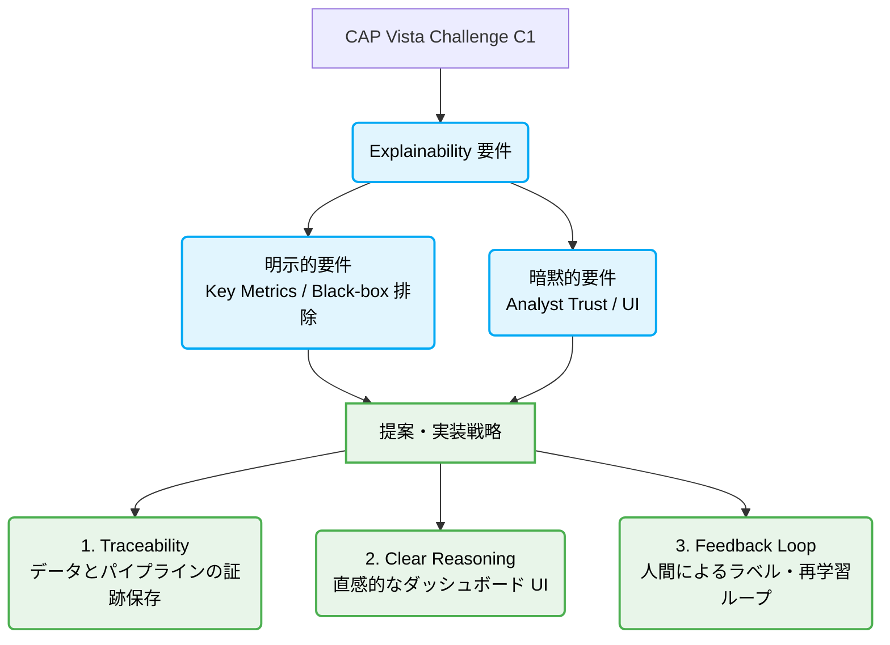

<!-- markdownlint-disable MD013 MD060 -->

## この記事について

**説明可能 AI（Explainable AI / XAI）** は、学術研究と実務運用の両面で広く議論されていますが、実は「学術的な XAI」と「政府調達・オープンチャレンジにおける XAI」の間には、実態として大きなギャップがあります。

政府調達やオープンチャレンジでは、`explainability` が評価指標（Key Metrics）に直接明記されたり、否定形で `black-box with no explainability` が排除されたり、あるいは明示されずに `analyst trust`（アナリストの信頼）という形で暗黙の要件として求められたりします。

本記事の目的は次のとおりです。

1. **XAI という分野** が扱う問いを最小限に整理する
2. 調達要件に説明可能性が **明示・暗黙** で現れたとき、**その要件をどう読み解くか** を具体例で考える
3. 具体例として、シンガポール国防省（MINDEF）系の **[CAP Vista AI Joint Challenge](https://accelerator.capvista.com.sg/en/challenges/ai-joint-challenge)** — 特に **Challenge 1: Anomaly Detection** — の公開文書を読み解く

:::message
**本記事のコア・メッセージ**
政府調達における「説明可能性（Explainability）」は、高度なモデル内部の数理的解釈（SHAPなど）そのものを指定しているわけではありません。本質的に求められているのは、**「意思決定の証跡（Traceability）」「アナリストの納得感（Reasoning）」「運用上の信頼（Analyst Trust）」** を結びつけるシステム設計です。
:::

 Challenge 1 は、「多ソース・大規模データから異常を検知し、ダッシュボード上でアナリストが素早く理解し、根拠を追える形で信頼して動ける AI」を、防衛・インテリジェンス向けに 6ヶ月のトライアルで実証する公募です。

*(注) 本記事で題材として使う、海上 AIS・制裁・ニュース OSINT などは、検証ドメインの例として筆者側が当てはめているものです。チャレンジ本文はドメイン中立で、防衛 OSINT や商用データストリームも Key Metrics に明示されています。*

ここでは「要件テキストの読解と解釈」に留め、同じチャレンジに応じて **「どのようなソリューションを構築したか」**（リポジトリ構成、バッチ分離、デモの魅せ方など）の実装詳細は別稿で紹介します。

---

## 説明可能 AI という分野（学術理論と調達要件のギャップ）

XAI には「モデル内部の数理的理解」から「判定結果を人間が運用できるレベルでの説明」まで、非常に広いグラデーションがあります。

| 問いのレイヤー | 典型的なアプローチ・表現 |
| :--- | :--- |
| **どの入力が効いたか** | SHAP、特徴重要度（Feature Importance）、部分依存（PDP） |
| **なぜその判定なのか** | 反実仮想（Counterfactuals）、類似事例の提示、ルール抽出 |
| **誰が説明責任を持つか** | 監査トレイル（Audit Trail）、バージョン固定、システムログ |
| **人間が現場で信頼できるか** | ダッシュボード可視化、自然言語による要約（※要約テキスト単体では不十分な場合が多い） |

調達文書で要求される **Explainability** は、単に「SHAP値を出力できること」を指しているわけではありません。実態は **「Clear Reasoning（明確な根拠の提示）」「Traceability（追跡可能性）」「Analyst Trust（アナリストの信頼）」** という実務・運用レイヤーに強く寄っています。

学術的な一般理論をそのまま提案するのではなく、**「現場のアナリストがどう納得し、次のアクションを起こせるか」** という視点が極めて重要です。

---

## 政府調達で「説明可能」が現れる二つの入り方

調達要件における説明可能性は、大きく分けて「明示的要件」と「暗黙的要件」の二つの形で現れます。

| 入り方 | 具体例 | 読み解きとアプローチのコツ |
| :--- | :--- | :--- |
| **明示的要件** | - Key Metrics 内の「Explainability」項目 - Looking For / NOT Looking For における「black-box 排除」 | 評価表に直接載るため、提案書内で **明確な対応表（Compliance Matrix）** を作成し、ダイレクトに応答する。 |
| **暗黙的要件** | - "trust and act" （信頼と行動） - "dashboard / visualization" - "iterative feedback" （反復的フィードバック） - Sovereign（主権）やオンプレミス前提の文脈 | 「説明（Explain）」という単語がなくても、**システムが運用に採用されるための必須条件** として説明可能性が要求されていると読む。 |

**対処の第一歩** は、チャレンジ全文を「精度の段落（Accuracy / Latency）」と「人間・監査の段落（Explainability / Trust）」に色分けすることです。この2つのバランスをどう取るかが提案の骨格になります。

---

## 具体例: CAP Vista AI Joint Challenge（一次ソース）

| 項目 | 内容 |
| :--- | :--- |
| **ポータル** | <https://accelerator.capvista.com.sg/en/challenges/ai-joint-challenge> |
| **主催（公開情報）** | シンガポール MINDEF **Future Systems & Technology Directorate** × フランス **AMIAD** |
| **対象文書** | 公式 [Challenge statements](https://accelerator.capvista.com.sg/en/challenges/ai-joint-challenge/pages/challenge-statements) の **Challenge 1 — Anomaly Detection in Complex Datasets** |

**免責:** 以下は公開チャレンジ要件の読解であり、MINDEF の公式ドクトリンの解説ではありません。ただし、この種のオープンチャレンジでは、提案・提出物はほぼこの文言に対する応答として評価されます。

---

### 1. Context（暗黙の前提：なぜ説明が必要なのか）

> **原文の趣旨:**
> オペレーターは多数のソースから得られる情報に圧倒されており、微細な警告（微妙なシグナル）を見落としがちである。行動分析や意図推論を用いた先制アラートにより、人間の認知負荷を下げることが求められる。

* **筆者の解釈:**
  ここでは単なる「高精度なアノマリースコアの一覧」ではなく、**「人間が認知負荷を下げて、迅速に行動に移れること」** が前提となっています。つまり説明可能性は、UXのオプショナルな機能ではなく、**「見落としを減らすための運用必須要件」** として定義されています。

---

### 2. What We Are Looking For（明示的な中心文）

> **原文のキーフレーズ:**
> **Approaches that balance detection accuracy with explainability, enabling human analysts to trust and act on outputs.**
> （検知精度と説明可能性のバランスを取り、人間のアナリストが出力を信頼し、それに基づいて行動できるようにするアプローチ。）

* **「balance accuracy with explainability」の解釈:**
  精度だけ、あるいは説明機能だけに偏った極端なモデルは不利になります。デモでは**「実用的な精度」と「納得感のある説明画面」の両輪**を示す必要があります。
* **「human analysts」の解釈:**
  最終利用者はデータサイエンティストではなく、ドメインの専門家である**アナリスト**です。専門的な機械学習用語ではなく、アナリストの文脈に沿った言葉で説明する必要があります。
* **「trust」の解釈:**
  再現可能な根拠やソースへのトレーサビリティがないと信頼されません。**「LLMが尤もらしく作文しただけの説明」は信頼性を損なうため避けるべき**です。
* **「act on outputs」の解釈:**
  報告書作成の支援に留まらず、**「次の調査やエスカレーションへの着手（アクション）」**に直接つながるトリガーとして機能することが求められます。

---

### 3. Key Metrics（明示的な評価指標）

| Metric | Description（原文） |
| :--- | :--- |
| **Explainability** | Clear reasoning or traceability of flagged anomalies |

* **「clear reasoning」の解釈:**
  「なぜフラグが立ったのか」が**構造化**されて可視化されていること（関与した特徴量名、異常値の閾値、ネットワーク上のホップ数など）。
* **「traceability」の解釈:**
  事後検証のために、**元データや推論パイプラインの特定バージョンへ遡れる（Audit Trail）**こと。その場のLLM生成テキストだけではこの要件を満たせません。
* **「flagged anomalies」の解釈:**
  説明の単位はモデル全体（Global Explainability）ではなく、**個別の検出アラート（Local Explainability）**である必要があります。

:::tip
**提案書の構成テクニック**
`Accuracy / Scalability / Latency` と `Explainability` が同列の Metric として並んでいます。提案書では、説明可能性を「付録」にするのではなく、**評価軸と同格の独立した章**として構成するのが鉄則です。
:::

---

### 4. Technology Should Demonstrate（技術実証の要件）

> **原文の趣旨:**
> - 非構造・半構造データを対象とした異常検知能力
> - **アナリストが異常を素早く解釈できる** 可視化およびダッシュボード（Visualization / Dashboard）
> - 既存プラットフォームへ統合可能なモジュラー設計

* **筆者の解釈:**
  「説明可能 AI」はバックエンドのアルゴリズム論に留まらず、**「アナリスト向けのUI/UX要件」**と直結しています。デモ動画でアノマリースコアのランキング表を見せるだけではアピールとして弱く、**「なぜこれが異常なのかが直感的に伝わるダッシュボード画面」**が不可欠です。

---

### 5. What A Trial Looks Like（実証段階の要件）

> **原文の趣旨:**
> - 実際の OSINT データを用いたパイロット運用
> - 敵対的なケースや、誤情報（misinformation）が含まれるケースの検証
> - **最大6ヶ月間**にわたる、**アナリストおよびステークホルダーとの反復的なフィードバックループ**

* **筆者の解釈:**
  説明可能性は**初回のデモだけで完結するものではありません**。実証計画には「アナリストがAIの出力を確認（Confirm）または却下（Clear）し、それが次のモデル改善サイクルにフィードバックされる」という**Human-in-the-Loop（HITL）の運用設計**を盛り込む必要があります。

---

### 6. What We Are NOT Looking For（拒否要件・否定形）

| 拒否される内容（原文の趣旨） | 筆者の解釈と提案のガードレール |
| :--- | :--- |
| 学術的なプロトタイプのみ（実用スケールがない） | スケール可能な構成（分散処理など）と再現デモをセットで提示する。 |
| **Black-box models with no explainability** | **最も強力な明示的拒否要件**。高精度だが中身が一切見えないディープラーニングモデル単体の提案は、それだけで一発アウトになるリスクがあります。 |
| 単一ソースのみに依存するアプローチ | 複数ソースの相関から「協調的なアノマリー」を説明できる設計にする。 |
| 単純なコンテンツモデレーション専用ツール | 防衛・インテリジェンス向けの「高度な異常検知支援」というフレーミングを外さない。 |

---

## 提案を成功に導く「よくある誤読」と「正しい重心」

要件と解釈を整理すると、提案段階でのアンサー設計は以下の優先順位になります。

1. **ブラックボックスの完全排除**：拒否要件に対する回避方針を一文で明記する。
2. **Key Metrics へのダイレクト応答**：`reasoning` と `traceability` の対応表を作る。
3. **アナリスト視点のシナリオ化**：ダッシュボード上で「誰が、どこを見て、どう動くか」のワークフローを示す。
4. **反復改善ループの提示**：6ヶ月のトライアルで説明可能性をどう向上させるか（人間によるフィードバック設計）を書く。

| よくある誤読 | チャレンジから読み取るべき「正しい重心」 |
| :--- | :--- |
| **LLMがそれらしい文章で説明すれば十分** | 評価指標に **Traceability（追跡可能性）** があるため、作文だけの説明は不十分。データやロジックまで遡れる証跡が必須。 |
| **精度さえ良ければ説明性は後回しでよい** | 求めるアプローチの主文に **Balance accuracy with explainability** が明記されており、二者択一ではない。 |
| **デモが1回動けば評価される** | トライアル期間中に **Iterative feedback（反復的なフィードバック）** が組み込まれており、運用中の改善ループが重視される。 |
| **有名アプローチの手法名を並べればよい** | 特定のXAI手法の指定はない。重要なのは「現場の**アナリストの信頼（Analyst Trust）**」を得られるかどうか。 |

---

## 暗黙要件: 主権・多ソース（説明可能さを支える文脈）

Challenge 1 の本文に "sovereign"（主権・内製）という単語が直接登場するわけではありません。しかし、共同主催者の顔ぶれや防衛 OSINT というドメインの性質上、**「データが外部の海外クラウドに出ないこと」** が極めて強い暗黙の前提になります。

例えば、説明文を生成するためだけに「外部のプロプライエタリなクラウド LLM API が必須」となる設計は、評価段階で大きなビハインドになり得ます。

| 暗黙の要請・圧力 | 説明可能性に与える影響 |
| :--- | :--- |
| **オンプレミス・エアギャップ環境** | 説明のための推論やログ生成も **完全にローカル環境内で完結** している必要がある。 |
| **マルチソース連携** | 単一データソース内の特徴量説明だけでなく、複数ソースにまたがる **相関関係のパスやシナリオ** を説明する必要がある。 |
| **モジュール性（Modular Integration）** | 説明可能なデータ（アトリビューション、根拠パス）を **標準的な API や構造化ファイル** で他システムに引き渡せる設計が求められる。 |

---

## 前プログラムとの比較（用語の提示方法・位置づけ）

同じ CAP Vista 系で以前実施された **[Solicitation 5.0](https://zenn.dev/yohei/articles/2026-05-24-cap-vista-accelerator-solicitation-5-0)**（海上保安領域）の要件と比較すると、今回の **AI Joint Challenge C1** では説明可能性の位置づけが以下のように進化しています。

| 変化点 | 提案における意味（解釈） |
| :--- | :--- |
| タイトルに **"Anomaly Detection"** が配置された | 単なる「説明つきの可視化ツール」ではなく、「検知能力の高さ」と「説明性」の**両立**が本質的な課題となった。 |
| **Explainability** が Key Metrics の独立行に昇格した | 評価表で明示的にスコアリングされ、**減点対象になり得る独立した軸**になった。 |
| **Black-box 否定** が明確に明文化された | 提案書の Compliance 項目にそのまま組み込める、最優先のガードレールとなった。 |
| **"trust and act"** のフレーズが前面に出た | 開発者の自己満足ではなく、**アナリストの現場の意思決定プロセス**に適合しているかが勝負の分かれ目になった。 |

---

## まとめ

* **説明可能 AI** は非常に広い概念ですが、**政府調達**においては「明示的要件（評価指標・否定形）」と「暗黙的要件（現場の信頼、UI、フィードバックループ、主権環境）」の組み合わせとして、極めて実務的に定義されます。
* **CAP Vista AI Joint Challenge C1** はその好例です。検知精度と説明性のバランス、アナリストが信頼して動けること（`trust and act`）、そしてブラックボックスの拒否が明確に示されています。
* **提案の勝ち筋** は、これらの要件を分解し、「学術的な手法の羅列」ではなく、**「アナリストが現場でどうデータと推論を追跡（Trace）し、信頼して動けるか」** という運用シナリオを提案の骨格に据えることです。

---

## 関連記事

https://zenn.dev/yohei/articles/2026-05-19-explainable-judgment-score-llm-separation
*本チャレンジへの応答として、実際に構築したソリューション（実装・OSS構成）の解説記事です。*

https://zenn.dev/yohei/articles/2026-05-24-cap-vista-accelerator-solicitation-5-0
*Cap Vista プラットフォーム全体の概要と傾向を整理しています。*

https://zenn.dev/yohei/articles/2026-05-19-reproducible-judgment-metrics
*traceability（追跡可能性）を実務レベルで担保するための「メトリクス・アーティファクト」の設計解説です。*

https://zenn.dev/yohei/articles/2026-05-19-tamper-evident-judgment-audit-chain
*監査可能性を保証する、改ざん検知可能な判断証跡（Audit Chain）の実装アプローチです。*

---
**公式情報ソース:**  
<https://accelerator.capvista.com.sg/en/challenges/ai-joint-challenge>
