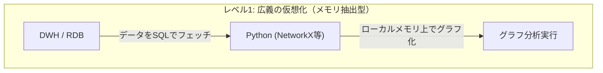
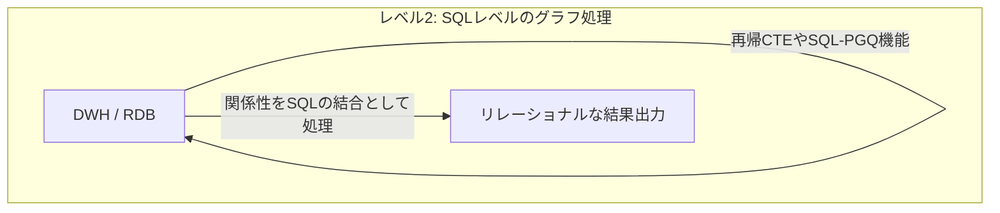
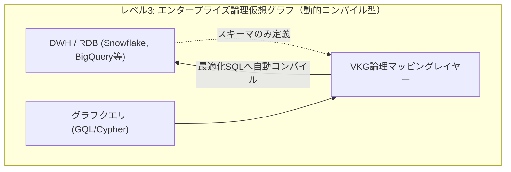

:::message
この記事は、Snowflake / Databricks / Google Cloud が推進する仮想グラフによる知識グラフをテーマにした、3部構成のシリーズ記事の **第1部** です。

* **第 1 部** ： Snowflake / Databricks / Google が挑む仮想グラフ戦略：AIエージェントを支える次世代データ基盤（本記事）
* **第 2 部** ：なぜセマンティックレイヤーだけでは足りないのか？
* **第 3 部** ：スキーマレスの地獄を回避するサステナブルな運用戦略

:::

## 概要

本記事では、近年データプラットフォームの巨人たち（Google Cloud、Snowflake、Databricks）やグラフデータベースのリーダー（Neo4j）が相次いで提供を開始した「仮想グラフ（Virtual Graph）」について解説します。

なぜ今、複数のプラットフォームが時を同じくして仮想グラフソリューションを打ち出しているのか、その背景にある「商機」と市場動向を分析します。また、そもそもグラフデータベースやグラフ分析とは何なのかという基本概念、古典から現代にわたるユースケースを整理した上で、Pythonによるインメモリ分析からエンティティマッピング型まで多様なアプローチが存在する「仮想グラフ」のメカニズムを解説します。

さらに、最も正当であるものの運用・保守コストが高い「物理グラフデータベース」との詳細比較、導入のメリット・制約事項、いつ使うべきか・使わないべきかの明確な選定基準を実務的な視点で提示します。

---

## 1. 時を同じくして出現した「仮想グラフ」製品群とその商機

近年、データウェアハウスやデータベースの主要プレイヤーが、データを物理的に移動させずにグラフ関係を扱う「仮想グラフ」機能を相次いでリリースしています。

**Google Cloud の Unified Graph Solution**: 分析用DWHの「BigQuery」とトランザクション用データベース「Cloud Spanner」の双方にグラフ機能（GQL規格対応）を統合。

<https://cloud.google.com/blog/products/data-analytics/introducing-bigquery-graph?hl=en>

<https://cloud.google.com/blog/products/databases/announcing-spanner-graph?hl=en>

**Neo4j x Snowflake / Databricks（Neo4j Virtual Graph）**: 業界標準のグラフDBであるNeo4jが、SnowflakeやDatabricksなどのレイクハウス内にあるデータを一切コピーせずにグラフ処理を行う統合を提供。

<https://neo4j.com/blog/graph-database/introducing-neo4j-virtual-graph-graph-reasoning-on-the-data-you-already-have/>

### なぜ今、主要データプラットフォームベンダーが時を同じくして仮想グラフを提供するのか？

この市場動向の背景には、明確な**エンタープライズの課題**と**生成AIの爆発的普及**という二大商機が存在します。

1. **AI エージェントや GraphRAG における「関係性」需要の急増**: LLM （大規模言語モデル）の精度を上げるための RAG（検索拡張生成）において、テキストの類似度検索（ベクトル検索）だけではビジネス上の複雑な関係性を解釈できないという課題が顕在化しました。「取引先やサプライチェーンのつながり」などを表現するためにグラフ構造が必須となったため、関係性を扱うテクノロジーの需要が急拡大しています。
2. **データの「物理移動（ETL）」と「ガバナンス崩壊」の限界**: 企業内の最も信頼性の高いデータは、すでに堅牢に管理されたDWH（Snowflake、BigQuery等）に格納されています。これらをグラフ分析のためだけに、別の物理的な専用グラフデータベースへ移行（コピー）することは、重いETL構築コストを強いるだけでなく、元のDWH側で細かく設定していた行レベルセキュリティ（RLS）や列レベルのマスクポリシーなどのデータガバナンスを断絶させることになります。

この「データは強固に保護されたDWHに置いたまま、AIや分析のためにグラフモデルを重ね合わせたい」というエンタープライズの強いニーズが最大の商機となり、プラットフォーム各社が「データを動かさずに関係性をクエリする」仮想グラフへの投資を加速させています。

### グラフベンダー（Neo4j）から見た「仮想グラフ」の正当性

一方で、DWHやクラウドの巨人だけでなく、専業のグラフデータベースリーダーである **Neo4j** にとっても、仮想グラフの提供は極めて合理的な戦略です。そこには以下の実務的な背景があります。

* **顧客のデータ分析の主戦場は「DWH」である現実**: 多くの企業において、データの統合・分析のための Single Source of Truth （信頼できる唯一の情報源）は、すでに Snowflake や Databricks などのDWH/レイクハウスに構築されています。グラフ分析のインプットとなるデータソースも、ほぼ例外なくこれらのDWH内にあるデータです。
* **データ移動が必須である限り、グラフは使われない**: たとえグラフ分析のビジネス価値が高くとも、「分析を実行するために、重いデータ複製（ETL）パイプラインを毎回構築して別システムへ転送しなければならない」というルールがある限り、エンタープライズの顧客は導入を躊躇します。データのコピーコストや管理負荷、何よりセキュリティ部門による拒絶が最大の障壁となるためです。

このため、Neo4jとしても、 **「顧客データを一切移動させることなく、最も使い慣れたDWHの上で、簡易的かつシームレスにグラフ分析ができるアプローチ」** を提供することが不可欠でした。「データを動かさない」仮想グラフは、DWHに蓄積されたペタバイト級のデータに対するアクセスの敷居をゼロにし、自社のグラフソリューションを市場全体に普及させるための極めて正当なステップとなっています。

---

## 2. そもそも「グラフ」データベース・アルゴリズム・分析とは何か？

データプラットフォームベンダーが仮想グラフに取り組む背景を説明したところで、ここからは、グラフテクノロジーの本質を理解するために、基本概念とそれぞれの特性を整理します。

### グラフデータベース（Graph Database）とは

従来のテーブルと外部キーによる結合の代わりに、実体を表す **「ノード（Node）」**、実体同士のつながりを表す **「エッジ（Edge）」**、およびそれぞれに付与される属性情報 **「プロパティ（Property）」** から構成されるデータモデルを採用したデータベースです。関係性を「第一級市民（First-class citizen）」として扱い、テーブル結合（JOIN）のコストを伴わずにエッジを辿る（トラバースする）ことができます。

### グラフアルゴリズム（Graph Algorithm）とは

グラフ構造上に配置されたノードやエッジを探索・解析するための数学的・計算的な処理手順です。

* **最短経路（Shortest Path）**: ノードAからノードBまでの最小ホップ数や最小コストのルートを特定する（例：Dijkstra法）。
* **重要度評価（PageRank / Centrality）**: 接続の集中度や経路上での位置から、ネットワーク内で最も影響力のあるノードを特定する。
* **コミュニティ検出（Community Detection）**: 接続の密度に基づいて、密接に関連し合っているノードのグループ（クラスタ）を自動検出する。
* **グラフ構造の類似性評価（Graph Similarity / Isomorphism）**: 特定のノードとエッジのパターン（部分グラフ）に極めて近い、あるいは同一の接続構造を持つ別のエリアをグラフ全体から検索する。

### グラフ分析（Graph Analytics）とは

エンティティ間の複雑な関係性や隠れた接続パターンを分析し、インサイトを導き出す手法です。単一のフラットテーブルや個別のレコードを検索するだけでは発見が難しい、「nホップ先の間接的なつながり」や「ネットワーク全体の構造的特徴」を捉えるために用いられます。

さらに、グラフ分析の本質は単に「関係性を1ホップずつ辿る（トラバースする）」ことだけにとどまりません。**「類似する関係性のパターン（グラフ構造そのもの）を探索・比較する」** という高度なメタ分析も可能にします。

---

## 3. グラフテクノロジーの古典〜現代のユースケース

グラフは、企業の基幹システムにおける静的な構造管理から、LLMを支える高度な意味理解まで、幅広い領域で活用されています。

### 古典的なユースケース

* **金融（不正検知・資金洗浄対策）**
  * **循環送金（Circular Payments）の検出**: A社→B社→C社→A社のように、資金がループして元の場所に戻るパターン（架空取引や資金洗浄）を検出。
  * **不正リング（Fraud Rings）の検知**: 異なる複数のアカウントが、同じ電話番号、メールアドレス、またはデバイスIDなどを3ホップや4ホップ先で共有しているパターンを特定。
* **製造業（BOM：部品構成表管理）**
  * 製品とパーツの複雑な親子・依存関係（製品Aを構成する部品B、部品Bを作るための原料Cなど）を多階層で保持・計算。
  * サプライチェーンで一次・二次サプライヤーに供給遅延が生じた際、影響を受ける最終製品がどれであるかを瞬時に特定。
* **IT・通信（ネットワークトポロジー）**
  * サーバー、ルーター、サービス間の物理的・論理的依存関係を「デジタルツイン」として可視化し、障害発生時の根本原因分析（Root Cause Analysis）をリアルタイムに実行。

:::message
**製造業における構造類似性分析とコスト最適化の具体例**

古典的ユースケースの例として筆者が属する製造業でのユースケースを説明します。例えば、製造業において「部品構成表（BOM）」に加え、「製造工程（プロセス）」や「コスト（価格/材料）情報」を統合してグラフ構造で管理しているケースを考えます。

特定の製品Aのコスト最適化を行う際、グラフ分析を用いることで **「製品Aと非常によく似た部品調達ルートやコスト構造、あるいは類似した製造工程プロセスを持つ別製品のグラフ構造（部分グラフ）」** をネットワーク全体から瞬時に探し出すことができます。これにより、「類似の構造を持つ他の製品ラインではどのようなコスト削減アプローチを取り、どれだけの成果が出たか」という知見を比較分析し、製品Aの最適化戦略に直接応用するメタ的な分析が可能になります。これは、フラットなテーブルの集計では実現が難しい、グラフ構造化データならではの強力な分析アプローチです。
:::

### 近年の活用ユースケース（LLM・生成AI時代）

* **知識グラフ（Knowledge Graph）**
  * 企業内の散らばった多様なソース（規約、製品ドキュメント、顧客履歴など）から意味的な関連性を抽出し、エンティティと概念のネットワークとして構造化したもの。LLMがビジネス定義やコンテキストを正しく理解するための「共通言語」として機能します。
* **GraphRAG（Graph Retrieval-Augmented Generation）**
  * テキストチャンクの「ベクトル類似度検索」だけに依存する標準RAGに対し、知識グラフの構造化コンテキストを組み合わせてLLMに与える手法。
  * ベクトル検索だけでは対応できない「テキスト上の類似度はないが、ビジネスルール上密接に関連する情報（例：親子会社、サプライチェーンの依存）」をグラフ沿いに網羅的に引き出すことで、ハルシネーション（嘘の出力）を抑え、正確な多ホップ推論を可能にします。

---

## 4. 「仮想グラフ（Virtual Graph）」とは何か？ - その多様なアプローチ

Neo4j のようにデータを「インデックスフリー隣接リスト」と呼ばれるグラフ専用の物理構造で保持する「物理グラフデータベース（Native Graph DB）」は、関係性を辿る（トラバースする）パフォーマンスにおいて最も正当かつ強力な存在です。

しかし実務における運用管理の観点では、「高額な専用インメモリDBのプロビジョニング」「ソースDBとグラフDB間を繋ぐリアルタイムな双方向ETLパイプラインの構築・維持」「アクセス権限やガバナンスポリシーの二重管理」など、保守・運用のハードルが極めて高いという課題を抱えています。これが多くのエンタープライズにとって、グラフ技術導入の巨大な障壁となってきました。

こうした物理的な構築と運用の高い壁を乗り越えるために登場したのが、**「仮想グラフ（Virtual Graph）」** です。仮想グラフとは、**「データを物理的に移動・コピーすることなく、既存のリレーショナルデータやフラットなデータ構造の上に、論理的なグラフ関係（ノードとエッジ）を重ね合わせる技術」** を指します。

一口に「仮想グラフ」と言っても、実装のレイヤーに応じて多様なアプローチが存在します。本記事では理解の便宜上、これらを以下の3つのレベルに分類・定義して整理します。

### レベル1：広義の仮想グラフ - Pythonライブラリによるクライアントサイド分析

* **仕組み**: データベースからSQL等でテーブルデータを取得し、アプリケーションサーバーやクライアントPCのメモリ上に展開して、Pythonの `NetworkX` などのグラフライブラリを用いてグラフオブジェクト（Network Graph）を一時的に構築・分析する手法。
* **特性**: 物理グラフDBを立ち上げる必要がないため簡易的ですが、分析可能なデータ量がクライアントのメモリサイズに制限され、データベースへのプッシュダウン処理や継続的なセキュリティ統制は行えません。

### レベル2：広義の仮想グラフ - SQLベースの関係性分析（再帰CTEや拡張SQL）

* **仕組み**: 既存のリレーショナルデータベースに対し、SQLの**再帰的共通テーブル式（Recursive CTE）**や、SQL標準のグラフ拡張規格である**SQL-PGQ**構文などを手書きで用いて、リレーショナルエンジン上で直接関係性を検索・JOIN処理する手法。
* **特性**: データベース内で実行されますが、再帰的なJOINを伴う複雑なSQLを人間が直接コーディングする難易度が非常に高く、ビジネスルールの変更に追従することが困難です。

### レベル3：論理レイヤーとしてのエンタープライズ仮想グラフ（スキーマ定義・動的プッシュダウン）

* **仕組み**: データを元のDWH/レイクハウスに置いたまま、メタデータとして「どのテーブルがノードで、どのリレーションがエッジか」を定義し、国際標準のグラフクエリ言語である**GQL**や**Cypher**などの宣言的クエリを、コンパイルエンジンが実行時に「高度に最適化されたリレーショナルSQL（複雑なJOINや再帰CTE）」へと自動変換し、DWH側でインプレース実行する手法（Google CloudのBigQuery Graphや、Neo4j Virtual Graphなど）。
* **特性**: ユーザーが直感的なグラフクエリ言語を記述するだけでよく、原則としてソース側のセキュリティ・ガバナンスポリシーをそのまま引き継ぎながら実行できます。記述の平易性とスケール性を高い次元で両立する現代的な仮想グラフ（VKG）の主流アプローチです。

本記事の冒頭で紹介したGoogle CloudやNeo4jによる先進的な取り組みは、この仮想グラフにおける **「レベル3（エンタープライズ論理仮想グラフ）」** に位置づけられるものです。DWHにあるデータに対してCypherやGQLといったグラフクエリを実行するだけで、即座にグラフ分析を行うことができます。これにより、**クライアント側でPythonコードを記述してインメモリでグラフ化する手間も不要（レベル1）であり、何百行にも及ぶ複雑な再帰SQLを自ら手書きする必要もありません（レベル2）**。この仕組みが、エンタープライズにおけるグラフ分析への取り組みのハードルを劇的に下げる役割を果たしています。

---

## 5. 物理グラフ（Stored/Native Graph）との比較

仮想グラフと、物理的にグラフデータを専用ストレージに保存する物理グラフ（Stored/Native Graph）の違いを整理します。

一言で言えば、 **「圧倒的なクエリ性能と引き換えに高い運用コストを支払う『物理グラフ』か、性能はDWHに依存するが運用・ガバナンスコストを抑える『仮想グラフ』か」** というトレードオフの関係にあります。

| 項目 | 物理グラフ（Stored/Native Graph） | 仮想グラフ（Virtual Graph） |
| :--- | :--- | :--- |
| **データの格納場所** | グラフ専用DB（通常のNeo4j、Amazon Neptune等） | 既存のRDB/DWH（Snowflake、BigQuery等。※Spannerは低レイテンシOLTPに最適化されたデータベース内統合） |
| **データ移動（ETL）** | 必須。ソースDBからグラフDBへの継続的な同期が必要 | 不要（Zero-copy）。データは元の場所に維持 |
| **データの重複** | 発生する（ストレージコストの増加） | 発生しない（Single Source of Truth） |
| **セキュリティポリシー** | グラフDB側で権限やマスク処理を再定義・同期 | 原則として移行元のセキュリティ境界やガバナンスポリシーを引き継ぐ |
| **クエリの変換** | グラフ専用のクエリ言語でネイティブ実行 | 実行時にグラフクエリをSQLへと動的コンパイル |
| **トラバース性能** | インメモリかつポインタ走査のため高速 | リレーショナルJOINに依存するためDWHのスケール依存 |
| **運用保守コスト** | 高い（インフラ二重管理、ETL維持） | 低い（論理スキーマの管理のみ） |

---

## 6. 仮想グラフのメリットと制約事項

「DWHにあるデータをそのまま活かし、グラフ専用のデータベースを別で立てることなくグラフ分析ができるのであれば、常に仮想グラフを使えば良いのではないか」と考える方もいるかもしれません。しかし、仮想グラフはその手軽さの反面、クエリを実行時にSQLへ変換してプッシュダウンするという仕組みの特性上、避けては通れないいくつかの制約事項が存在します。

これらの制約事項がご自身のユースケースにおいて大きな問題になる場合には、運用コストを支払ってでも「物理グラフデータベース」の構築を検討する必要があります。しかし逆に言えば、保守管理やETL構築のハードルが非常に高い物理グラフデータベースを最初から持ち出す前に、仮想グラフの範疇で十分にやれること、模索できる価値が非常に多く存在しているとも言えます。

以下に、仮想グラフを採用するメリットと、事前に把握しておくべき制約事項について整理します。

### メリット（得られる恩恵）

1. **ソース側のセキュリティポリシーやガバナンス境界の継承**
   データを別システムにコピーしない（Zero-copy）ため、原則として元のDWH/RDB側で設定されている「行レベルセキュリティ（RLS）」や「列レベルのマスキングポリシー」などのアクセス権限を尊重したクエリ実行が行えます。
2. **データ同期パイプラインの排除（Zero-ETL）**
   データの抽出・変換・転送を担う複雑なパイプラインを開発・保守するコストから解放されます。グラフとしてクエリされるデータ鮮度も、ソーステーブルの更新頻度にそのまま追随します。
3. **ストレージと運用コストの削減**
   大規模データの重複が発生しないため、不要な追加ストレージコストが発生せず、新たな「データサイロ」を作るリスクがありません。

### 制約事項（制限・課題）

1. **クエリ実行のレイテンシ・オーバーヘッド**
   グラフクエリを実行時にSQLへとコンパイルし、リレーショナル側のJOIN処理として分散実行するため、物理グラフDB（インメモリのネイティブエンジン）と比べてミリ秒単位の超高速レスポンスを保証することは難しくなります。
2. **書き込み処理の制限**
   仮想グラフのレイヤーで直接グラフデータに対してACIDトランザクションの書き込みを行うことは想定されていません。データの更新は、元のリレーショナルテーブル側を介して行う必要があります。
3. **超深層トラバースやグローバルアルゴリズムの実行負荷**
   再帰結合が何十回も発生するような深層の多ホップ探索や、グラフ全体をロードして数億回ループするような大規模グラフアルゴリズム（PageRankなど）は、SQL変換プッシュダウンだけではJOINが急増してDWHの計算コストを圧迫しやすくなります。

---

## 7. そもそも「グラフ」を使うべきか？（意思決定基準）

「仮想グラフか、物理グラフか」という技術選定に入る前に、**そもそも自社のビジネスにおいて「グラフ」というデータモデルを採用すべきか否か**を冷静に判断する必要があります。

**グラフデータベース（Graph DB）は、決して万能な汎用データベースではありません**。リレーショナルデータベース（RDB）のように、システム開発のあらゆる局面で幅広く使えるものではなく、不正検知、サプライチェーン分析、推薦エンジン、あるいは知識グラフの構築といった「エンティティ間の複雑な関係性そのものを高速にクエリ・分析する」特定の領域に特化したソリューションです。そのため、解くべき課題がこれらに明確に該当する場合にのみ導入を検討すべき技術と言えます。

### 流行のトレンド（オントロジー・知識グラフ・GraphRAG）との付き合い方

昨今、生成AIやLLMの急速な普及に伴い、「オントロジー」「知識グラフ（Knowledge Graph）」「GraphRAG」といったキーワードがバズワードとして非常に流行しています。技術メディアや製品ベンダーのプロモーションなどでは「これからのエンタープライズAIに不可欠な技術」と大々的に喧伝されることが増えており、「自社でも今すぐ取り組まなければならない」と焦りを感じる企業も少なくありません。

しかし結論から言えば、**一般的な企業がこのようなトレンドにいきなり本番運用レベルで手を出すべきではありません**。

* **PoCと本番運用の非対称性**: データを複製しない「仮想グラフ」を使えば、手元にあるDWHデータを用いてGraphRAGや知識グラフの価値検証（PoC）を低コストかつ迅速に進めることは十分に可能です。しかし、それを「本番のプロダクション環境で破綻なく運用・更新し続ける」となると話は別です。
* **技術および運用の未成熟**: 知識グラフやGraphRAGを実用に耐えうる品質で継続的に構築・メンテナンスするための標準的な運用設計やエコシステムは**まだ成熟していません**。現在発表されている成功事例の多くは、専任のAI/データエンジニアを多数擁する一部の最先端企業による検証レベルにとどまるものがほとんどです。
* **専念すべき現実解**: 普通の企業が取り組むべきなのは、まずこのような流行のグラフ技術を導入しなくとも解決でき、かつ確実にビジネス価値（成果）を上げられる他の重要な領域（リレーショナル設計の高度化、標準的な検索拡張生成（RAG）の最適化、データクレンジングなど）にリソースを集中することです。グラフという複雑な論理構造と認知負荷を背負い込む前に、地道であっても成果に直接つながる分野に専念する方が、ROI（投資対効果）の観点から遥かに合理的です。

### グラフ技術を採用すべき基準

具体的にグラフの採用を積極的に検討すべきなのは、以下の条件をいずれも満たす場合に限られます。

1. **業界で実証された明確なユースケースの存在**
   製造業における部品構成表（BOM）管理や複雑な工程・コストの影響波及分析、金融におけるマネーロンダリング（循環送金）や不正リングの検知、IT・通信における複雑なネットワークトポロジーやシステム間の依存関係管理など、RDBよりもグラフ構造を用いる方が圧倒的に合理的であると実証されている領域に自社の課題が該当すること。
2. **競争優位性（差別化）への直結**
   その関係性分析（多ホップ探索やネットワーク構造の類似性分析など）を実装・実用化することが、自社のサービスや製品における直接的な競争優位や付加価値向上につながること。

### 該当しない場合の推奨アプローチ

上記の条件に該当しない、あるいは「RDBのテーブル設計やSQLを工夫すれば要件を満たせる」レベルの課題であるならば、現段階で無理にグラフ構造を導入すべきではありません。そこには以下の実務的な理由があります。

* **グラフ人材の極端な不足**: グラフ特有のデータモデリング、グラフクエリ言語（CypherやGQL）、インメモリのグラフアルゴリズム設計を適切に扱い、プロダクション環境で運用保守できるエンジニアは市場に極めて少数しか存在しません。
* **RDBの優先**: 万能なリレーショナルデータベース（RDB）を駆使し、RDBで実現できる設計や集計処理を確実に遂行する方が、技術的なリスクが極めて低く、開発効率やシステムの持続可能性の観点から遥かに優先順位が高いと言えます。

---

## 8. 仮想グラフ（Virtual Graph）か、物理グラフ（Stored Graph）かの選定基準

「グラフを採用する」という意思決定がなされ、ビジネスユースケースと適用するグラフアルゴリズムが設計された後に、次に判断すべきは「論理的な仮想グラフ（Virtual Graph）」を選択すべきか、あるいは「物理的なネイティブグラフ（Stored Graph）」を構築すべきかという技術方式の選定です。

実務におけるそれぞれの選定基準を以下に整理します。

### 仮想グラフを「いつ使うか」

* **データがすでにDWHにあり、セキュリティ制限で動かせない場合**
  厳格なデータガバナンスやプライバシーポリシーにより、データを別システムにコピーまたは複製することが禁止されている環境。仮想グラフであれば、DWHに設定された行レベルセキュリティ（RLS）や列マスクポリシーをそのまま引き継ぐことができます。
* **秒〜分単位のクエリレイテンシが許容される場合**
  LLMのコンテキスト理解に用いる「GraphRAG」、週次・月次のビジネス分析、探索的なアナリストクエリ、あるいは夜間バッチ処理など、ミリ秒単位の超高速応答がビジネス要件として不要なユースケース。
* **低コスト・低リスクでクイックに検証（PoC）したい場合**
  ETLパイプラインを新規に構築することなく、既存のDWHテーブルをマッピングするだけで、数時間以内にグラフ分析の実行可能性とビジネス価値を検証したい場合。

### 仮想グラフを「いつ使わないか（物理グラフの検討が必要な場合）」

* **ミリ秒単位の超低遅延応答が必須である場合**
  オンライン決済時における瞬時の不正判定や、ユーザーのリアルタイムな行動に応じた動的レコメンデーションなど。この場合は、インメモリでポインタ走査を行う専用の物理グラフデータベース（Neo4j AuraDB等）や、トランザクション性能と低遅延トラバースをデータベース内部で両立するSpanner Graphなどを選択すべきです。
* **高頻度かつ高スループットなグラフ書き込みが必要な場合**
  大量のセンサーデータやユーザーのリアルタイムアクションストリームを、グラフ構造のノード・エッジとして直接かつ頻繁に作成・更新・削除するようなOLTP処理。
* **グラフ全体を対象とした大規模な計算処理を行う場合**
  数億ノード規模のグラフ全体をメモリ上にロードし、グローバルなコミュニティ検出やPageRank、グラフニューラルネットワーク（GNN）の学習など、極めて計算負荷の高いグラフデータサイエンス処理を本格的に実行する場合。

---

## 9. まとめ

本記事では、主要なデータプラットフォームベンダーやグラフデータベースリーダーが取り組む「仮想グラフ（Virtual Graph）」の本質と、実務における選定基準について多角的に解説しました。最後に、全体の要点を整理します。

* **「仮想グラフ」が切り拓く新たな選択肢**
  これまでグラフ分析を導入する際の最大の障壁であった「重い物理ETLの構築・維持」と「データガバナンスの断絶」という問題を、データを一切動かさない「Zero-copy（論理マッピング）」のアプローチによって解消する技術が仮想グラフです。CypherやGQLなどのグラフクエリを記述するだけで、エンジンが高度なリレーショナルSQLへと自動変換・プッシュダウン処理を行い、DWHの強固なセキュリティやガバナンス境界を引き継ぎながら関係性をクエリできます。
* **そもそもグラフを「使うべきか」の冷静な判断**
  生成AIやLLMのトレンドに乗って「オントロジー」や「GraphRAG」などの流行に無条件で飛びつくべきではありません。グラフデータベースは極めてニッチな技術であり、万能なRDBの代替にはなりません。エンジニア人材の極端な不足やエコシステムの未成熟さを踏まえ、まずはグラフを使わずに課題を解決できる確実な領域に専念し、ビジネス成果を最優先するのが賢明な意思決定です。業界で認知された強力なユースケース（製造業のBOMや金融の不正検知など）が自社に存在し、それが直接的な市場優位性をもたらす場合にのみ、導入を検討すべきです。
* **「仮想」と「物理」の技術トレードオフ**
  グラフモデルの導入が決まった際、最初から運用・インフラコストの重い「物理グラフDB」を構築するのではなく、DWHのデータを活かした「仮想グラフ」の範囲で価値検証（PoC）を進めるのが現代的なアプローチです。オンライン処理の超低遅延（ミリ秒単位）や高頻度なグラフ書き込みが極限まで求められる局面に至って初めて、インメモリ型などの物理グラフデータベースをプロビジョニングするというステップを踏む意思決定が、実務上のリスクを最小化します。

物理的なデータ移動を伴わずに「データモデルの切り口（ビュー）」として論理的な関係性の層を重ね合わせる仮想グラフは、DWHの堅牢性とグラフの表現力を両立する、現代のエンタープライズに向けた現実的かつ強力な最適解と言えます。

---

**連載一覧：**

* [第 1 部 Snowflake / Databricks / Google が挑む仮想グラフ戦略：AIエージェントを支える次世代データ基盤](https://zenn.dev/yohei/articles/2026-05-30-vkg-strategy-what) (本作)
* **第 2 部** ：なぜセマンティックレイヤーだけでは足りないのか？
* **第 3 部** ：スキーマレスの地獄を回避するサステナブルな運用戦略
