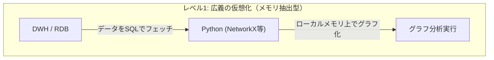
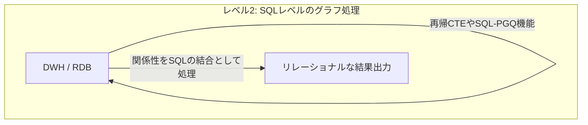
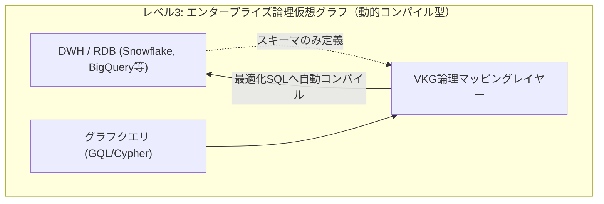

:::message
この記事は、Snowflake / Databricks / Google Cloud が推進する仮想グラフによる知識グラフをテーマにした、3部構成のシリーズ記事の **第1部** です。

* **第 1 部** ： Snowflake/Databricks/Google が挑む仮想グラフ戦略：AI エージェントを支える次世代データ基盤（本作）
* **第 2 部** ：なぜセマンティックレイヤーだけでは足りないのか？
* **第 3 部** ：スキーマレスの地獄を回避するサステナブルな運用戦略

:::

## 概要

本記事では、近年データプラットフォームの巨人たち（Google Cloud、Snowflake、Databricks）やグラフデータベースのリーダー（Neo4j）が相次いで提供を開始した「仮想グラフ（Virtual Graph）」について解説します。

なぜ今、複数のプラットフォームが時を同じくして仮想グラフソリューションを打ち出しているのか、その背景にある「商機」と市場動向を分析します。また、そもそもグラフデータベースやグラフ分析とは何なのかという基本概念、古典から現代にわたるユースケースを整理した上で、Pythonによるインメモリ分析からエンティティマッピング型まで多様なアプローチが存在する「仮想グラフ」のメカニズムを解説します。

さらに、最も正当であるものの運用・保守コストが高い「物理グラフデータベース」との詳細比較、導入のメリット・制約事項、いつ使うべきか・使わないべきかの明確な選定基準を実務的な視点で提示します。

---

## 1. 時を同じくして出現した「仮想グラフ」製品群とその商機

近年、データウェアハウスやデータベースの主要プレイヤーが、データを物理的に移動させずにグラフ関係を扱う「仮想グラフ」機能を相次いでリリースしています。

**Google Cloud の Unified Graph Solution**: 分析用DWHの「BigQuery」とトランザクション用データベース「Cloud Spanner」の双方にグラフ機能（GQL規格対応）を統合。

<https://cloud.google.com/blog/products/data-analytics/introducing-bigquery-graph?hl=en>

<https://cloud.google.com/blog/products/databases/announcing-spanner-graph?hl=en>

**Neo4j x Snowflake / Databricks（Neo4j Virtual Graph）**: 業界標準のグラフDBであるNeo4jが、SnowflakeやDatabricksなどのレイクハウス内にあるデータを一切コピーせずにグラフ処理を行う統合を提供。

<https://neo4j.com/blog/graph-database/introducing-neo4j-virtual-graph-graph-reasoning-on-the-data-you-already-have/>

### なぜ今、主要データプラットフォームベンダーが時を同じくして仮想グラフを提供するのか？

この市場動向の背景には、明確な**エンタープライズの課題**と**生成AIの爆発的普及**という二大商機が存在します。

1. **AI エージェントや GraphRAG における「関係性」需要の急増**: LLM （大規模言語モデル）の精度を上げるための RAG（検索拡張生成）において、テキストの類似度検索（ベクトル検索）だけではビジネス上の複雑な関係性を解釈できないという課題が顕在化しました。「取引先やサプライチェーンのつながり」などを表現するためにグラフ構造が必須となったため、関係性を扱うテクノロジーの需要が急拡大しています。
2. **データの「物理移動（ETL）」と「ガバナンス崩壊」の限界**: 企業内の最も信頼性の高いデータは、すでに堅牢に管理されたDWH（Snowflake、BigQuery等）に格納されています。これらをグラフ分析のためだけに、別の物理的な専用グラフデータベースへ移行（コピー）することは、重いETL構築コストを強いるだけでなく、元のDWH側で細かく設定していた行レベルセキュリティ（RLS）や列レベルのマスクポリシーなどのデータガバナンスを断絶させることになります。

この「データは強固に保護されたDWHに置いたまま、AIや分析のためにグラフモデルを重ね合わせたい」というエンタープライズの強いニーズが最大の商機となり、プラットフォーム各社が「データを動かさずに関係性をクエリする」仮想グラフへの投資を加速させています。

### グラフベンダー（Neo4j）から見た「仮想グラフ」の正当性

一方で、DWHやクラウドの巨人だけでなく、専業のグラフデータベースリーダーである **Neo4j** にとっても、仮想グラフの提供は極めて合理的な戦略です。そこには以下の実務的な背景があります。

* **顧客のデータ分析の主戦場は「DWH」である現実**: 多くの企業において、データの統合・分析のための Single Source of Truth （信頼できる唯一の情報源）は、すでに Snowflake や Databricks などのDWH/レイクハウスに構築されています。グラフ分析のインプットとなるデータソースも、ほぼ例外なくこれらのDWH内にあるデータです。
* **データ移動が必須である限り、グラフは使われない**: たとえグラフ分析のビジネス価値が高くとも、「分析を実行するために、重いデータ複製（ETL）パイプラインを毎回構築して別システムへ転送しなければならない」というルールがある限り、エンタープライズの顧客は導入を躊躇します。データのコピーコストや管理負荷、何よりセキュリティ部門による拒絶が最大の障壁となるためです。

このため、Neo4jとしても、 **「顧客データを一切移動させることなく、最も使い慣れたDWHの上で、簡易的かつシームレスにグラフ分析ができるアプローチ」** を提供することが不可欠でした。「データを動かさない」仮想グラフは、DWHに蓄積されたペタバイト級のデータに対するアクセスの敷居をゼロにし、自社のグラフソリューションを市場全体に普及させるための極めて正当なステップとなっています。

---

## 2. そもそも「グラフ」データベース・アルゴリズム・分析とは何か？

データプラットフォームベンダーが仮想グラフに取り組む背景を説明したところで、ここからは、グラフテクノロジーの本質を理解するために、基本概念とそれぞれの特性を整理します。

### グラフデータベース（Graph Database）とは

従来のテーブルと外部キーによる結合の代わりに、実体を表す **「ノード（Node）」**、実体同士のつながりを表す **「エッジ（Edge）」**、およびそれぞれに付与される属性情報 **「プロパティ（Property）」** から構成されるデータモデルを採用したデータベースです。関係性を「第一級市民（First-class citizen）」として扱い、テーブル結合（JOIN）のコストを伴わずにエッジを辿る（トラバースする）ことができます。

### グラフアルゴリズム（Graph Algorithm）とは

グラフ構造上に配置されたノードやエッジを探索・解析するための数学的・計算的な処理手順です。

* **最短経路（Shortest Path）**: ノードAからノードBまでの最小ホップ数や最小コストのルートを特定する（例：Dijkstra法）。
* **重要度評価（PageRank / Centrality）**: 接続の集中度や経路上での位置から、ネットワーク内で最も影響力のあるノードを特定する。
* **コミュニティ検出（Community Detection）**: 接続の密度に基づいて、密接に関連し合っているノードのグループ（クラスタ）を自動検出する。
* **グラフ構造の類似性評価（Graph Similarity / Isomorphism）**: 特定のノードとエッジのパターン（部分グラフ）に極めて近い、あるいは同一の接続構造を持つ別のエリアをグラフ全体から検索する。

### グラフ分析（Graph Analytics）とは

エンティティ間の複雑な関係性や隠れた接続パターンを分析し、インサイトを導き出す手法です。単一のフラットテーブルや個別のレコードを検索するだけでは発見が難しい、「nホップ先の間接的なつながり」や「ネットワーク全体の構造的特徴」を捉えるために用いられます。

さらに、グラフ分析の本質は単に「関係性を1ホップずつ辿る（トラバースする）」ことだけにとどまりません。**「類似する関係性のパターン（グラフ構造そのもの）を探索・比較する」** という高度なメタ分析も可能にします。

---

## 3. グラフテクノロジーの古典〜現代のユースケース

グラフは、企業の基幹システムにおける静的な構造管理から、LLMを支える高度な意味理解まで、幅広い領域で活用されています。

### 古典的なユースケース

* **金融（不正検知・資金洗浄対策）**
  * **循環送金（Circular Payments）の検出**: A社→B社→C社→A社のように、資金がループして元の場所に戻るパターン（架空取引や資金洗浄）を検出。
  * **不正リング（Fraud Rings）の検知**: 異なる複数のアカウントが、同じ電話番号、メールアドレス、またはデバイスIDなどを3ホップや4ホップ先で共有しているパターンを特定。
* **製造業（BOM：部品構成表管理）**
  * 製品とパーツの複雑な親子・依存関係（製品Aを構成する部品B、部品Bを作るための原料Cなど）を多階層で保持・計算。
  * サプライチェーンで一次・二次サプライヤーに供給遅延が生じた際、影響を受ける最終製品がどれであるかを瞬時に特定。
* **IT・通信（ネットワークトポロジー）**
  * サーバー、ルーター、サービス間の物理的・論理的依存関係を「デジタルツイン」として可視化し、障害発生時の根本原因分析（Root Cause Analysis）をリアルタイムに実行。

:::message
**製造業における構造類似性分析とコスト最適化の具体例**

古典的ユースケースの例として筆者が属する製造業でのユースケースを説明します。例えば、製造業において「部品構成表（BOM）」に加え、「製造工程（プロセス）」や「コスト（価格/材料）情報」を統合してグラフ構造で管理しているケースを考えます。

特定の製品Aのコスト最適化を行う際、グラフ分析を用いることで **「製品Aと非常によく似た部品調達ルートやコスト構造、あるいは類似した製造工程プロセスを持つ別製品のグラフ構造（部分グラフ）」** をネットワーク全体から瞬時に探し出すことができます。これにより、「類似の構造を持つ他の製品ラインではどのようなコスト削減アプローチを取り、どれだけの成果が出たか」という知見を比較分析し、製品Aの最適化戦略に直接応用するメタ的な分析が可能になります。これは、フラットなテーブルの集計では実現が難しい、グラフ構造化データならではの強力な分析アプローチです。
:::

### 近年の活用ユースケース（LLM・生成AI時代）

* **知識グラフ（Knowledge Graph）**
  * 企業内の散らばった多様なソース（規約、製品ドキュメント、顧客履歴など）から意味的な関連性を抽出し、エンティティと概念のネットワークとして構造化したもの。LLMがビジネス定義やコンテキストを正しく理解するための「共通言語」として機能します。
* **GraphRAG（Graph Retrieval-Augmented Generation）**
  * テキストチャンクの「ベクトル類似度検索」だけに依存する標準RAGに対し、知識グラフの構造化コンテキストを組み合わせてLLMに与える手法。
  * ベクトル検索だけでは対応できない「テキスト上の類似度はないが、ビジネスルール上密接に関連する情報（例：親子会社、サプライチェーンの依存）」をグラフ沿いに網羅的に引き出すことで、ハルシネーション（嘘の出力）を抑え、正確な多ホップ推論を可能にします。

---

## 4. 「仮想グラフ（Virtual Graph）」とは何か？ - その多様なアプローチ

Neo4j のようにデータを「インデックスフリー隣接リスト」と呼ばれるグラフ専用の物理構造で保持する「物理グラフデータベース（Native Graph DB）」は、関係性を辿る（トラバースする）パフォーマンスにおいて最も正当かつ強力な存在です。

しかし実務における運用管理の観点では、「高額な専用インメモリDBのプロビジョニング」「ソースDBとグラフDB間を繋ぐリアルタイムな双方向ETLパイプラインの構築・維持」「アクセス権限やガバナンスポリシーの二重管理」など、保守・運用のハードルが極めて高いという課題を抱えています。これが多くのエンタープライズにとって、グラフ技術導入の巨大な障壁となってきました。

こうした物理的な構築と運用の高い壁を乗り越えるために登場したのが、**「仮想グラフ（Virtual Graph）」** です。仮想グラフとは、**「データを物理的に移動・コピーすることなく、既存のリレーショナルデータやフラットなデータ構造の上に、論理的なグラフ関係（ノードとエッジ）を重ね合わせる技術」** を指します。

一口に「仮想グラフ」と言っても、実装のレイヤーに応じていくつかの異なるアプローチが存在します。

### レベル1：広義の仮想グラフ - Pythonライブラリによるクライアントサイド分析

* **仕組み**: データベースからSQL等でテーブルデータを取得し、アプリケーションサーバーやクライアントPCのメモリ上に展開して、Pythonの `NetworkX` などのグラフライブラリを用いてグラフオブジェクト（Network Graph）を一時的に構築・分析する手法。
* **特性**: 物理グラフDBを立ち上げる必要がないため簡易的ですが、分析可能なデータ量がクライアントのメモリサイズに制限され、データベースへのプッシュダウン処理や継続的なセキュリティ統制は行えません。

### レベル2：広義の仮想グラフ - SQLベースの関係性分析（再帰CTEや拡張SQL）

* **仕組み**: 既存のリレーショナルデータベースに対し、SQLの**再帰的共通テーブル式（Recursive CTE）**や、近年の標準規格である**SQL-PGQ**のグラフパターンマッチング構文を用いて直接関係性を検索する手法。
* **特性**: データベース内で実行されますが、再帰的なJOINを伴う複雑なSQLを人間が手書きするハードルが非常に高く、ビジネスルールの変更に追従することが困難です。

### レベル3：論理レイヤーとしてのエンタープライズ仮想グラフ（スキーマ定義・動的プッシュダウン）

* **仕組み**: データを元のDWH（Snowflake、Databricks、BigQuery）に置いたまま、メタデータとして「どのテーブルがノードで、どのリレーションがエッジか」を宣言的にマッピング（定義）する手法（Google Cloud Spanner/BigQuery Graph、Neo4j Virtual Graphなど）。
* **特性**: ユーザーが直感的なグラフクエリ言語（GQLやCypher）を記述すると、エンジンが実行時に「高度に最適化されたSQL（複雑なJOINやCTE）」へと自動変換し、DWH側でインプレース実行します。ガバナンスポリシーを100%継承しつつ、記述の平易性とスケール性を両立する現代的な仮想グラフの主流です。

---

## 5. 物理グラフ（Stored/Native Graph）との比較

仮想グラフと、物理的にグラフデータを専用ストレージに保存する物理グラフ（Stored/Native Graph）の違いを整理します。

一言で言えば、 **「圧倒的なクエリ性能と引き換えに高い運用コストを支払う『物理グラフ』か、性能はDWHに依存するが運用・ガバナンスコストを極小化する『仮想グラフ』か」** というトレードオフの関係にあります。

| 項目 | 物理グラフ（Stored/Native Graph） | 仮想グラフ（Virtual Graph） |
| :--- | :--- | :--- |
| **データの格納場所** | グラフ専用DB（通常のNeo4j、Amazon Neptune等） | 既存のRDB/DWH（Snowflake、BigQuery、Spanner等） |
| **データ移動（ETL）** | 必須。ソースDBからグラフDBへの継続的な同期が必要 | 不要（Zero-ETL）。データは元の場所に維持 |
| **データの重複** | 発生する（ストレージコストの増加） | 発生しない（シングルソースオブトゥルース） |
| **セキュリティポリシー** | グラフDB側で権限やマスク処理を再定義・同期 | 移行元のDWH/RDBが持つセキュリティを100%継承 |
| **クエリの変換** | グラフ専用のクエリ言語でネイティブ実行 | 実行時にグラフクエリをSQLへと動的コンパイル |
| **トラバース性能** | インメモリかつポインタ走査のため極めて高速 | リレーショナルJOINに依存するためDWHのスケール依存 |
| **運用保守コスト** | **極めて高い**（インフラ二重管理、ETL維持） | **極めて低い**（論理スキーマの管理のみ） |

---

## 6. 仮想グラフのメリットと制約事項

### メリット（得られる恩恵）

1. **ガバナンスとセキュリティポリシーの100%継承**
   データを別システムにコピーしない（Zero-Copy）ため、元のDWH/RDBで設定されている「行レベルセキュリティ（RLS）」や「列レベルのマスキングポリシー」などの厳格なアクセス権限が、グラフに対するクエリに対してもそのまま完全に適用されます。
2. **ETLパイプラインの排除（Zero-ETL）**
   データの抽出・変換・転送および同期のための複雑なパイプラインを開発・保守するコストが消失します。データは常にリアルタイムに新鮮（Fresh）に保たれます。
3. **ストレージと運用コストの削減**
   大規模データの重複が発生しないため、不要な追加ストレージコストが発生せず、新たな「データサイロ」を作るリスクがありません。

### 制約事項（制限・課題）

1. **クエリ実行のレイテンシ・オーバーヘッド**
   グラフクエリを実行時にSQLへとコンパイルし、リレーショナル側のJOIN処理として分散実行するため、物理グラフDB（インメモリのネイティブエンジン）と比べてミリ秒単位の超高速レスポンスを保証することは難しくなります。
2. **書き込み処理の制限**
   仮想グラフのレイヤーで直接グラフデータに対してACIDトランザクションの書き込みを行うことは想定されていません。データの更新は、元のリレーショナルテーブル側を介して行う必要があります。
3. **超深層トラバースやグローバルアルゴリズムの実行負荷**
   再帰結合が何十回も発生するような深層の多ホップ探索や、グラフ全体をロードして数億回ループするような大規模グラフアルゴリズム（PageRankなど）は、SQL変換プッシュダウンだけではJOINが急増してDWHの計算コストを圧迫しやすくなります。

---

## 7. いつ使うか・いつ使わないか（選定基準）

実務において「論理的な仮想グラフ」を選択すべきか、それとも「物理的なネイティブグラフ」を選択すべきかの判断基準を整理します。

### 仮想グラフを「いつ使うか」

* **データがすでにDWHにあり、外に出せない**: 厳格なポリシー（ガバナンス）によりデータを一歩も動かせない場合。
* **秒〜分単位のレイテンシが許容される**: LLMによる推論を介する「GraphRAG」、履歴分析、バッチ処理、アナリスト向けの探索的クエリなど。
* **既存テーブルを活用してすぐ検証したい**: ETLパイプラインを構築することなく、既存のビジネスデータに対して数分でグラフの価値（PoC）を試したい場合。

### 仮想グラフを「いつ使わないか」

* **ミリ秒単位の超低遅延応答が要求される**: オンライン決済時のリアルタイム不正スコアリングや、リアルタイム推奨エンジンなど。この場合は **物理グラフDB（Neo4j AuraDB等）** または **Spanner Graph（OLTP）** のようなネイティブなトラバース性能を持つエンジンを採用します。
* **高スループットなグラフ書き込みが必要**: センサーデータやユーザー行動ストリームなど、リアルタイムに直接グラフとして作成・更新・削除するOLTP処理。
* **巨大グラフ全体に対する複雑なデータサイエンス**: 全体構造のクラスタリングや、大規模なインメモリ・グラフアルゴリズム処理を行う場合（物理的な専用グラフデータサイエンスエンジンが適しています）。

---

## 8. まとめ

物理的に構造を再定義してデータを移行する「物理グラフ」は、低遅延な探索において今なお強力ですが、管理・保守および同期運用のハードルは極めて高いという現実があります。

これに対し、 Google Cloud や Neo4j が推進する「仮想グラフ」戦略は、「物理構造は頑健なリレーショナルデータのまま、切り口（ビュー）として論理的な関係性の層を重ね合わせる」というデータマネジメントの現実的な最適解を示しています。これにより、既存のガバナンスとスケール能力を手放すことなく、LLM 時代に必要な関係性の表現力を即座に獲得できるようになります。

---

**連載一覧：**

* [前編：What - 巨人が挑む仮想知識グラフ（VKG）戦略の正体](https://zenn.dev/yohei/articles/2026-05-30-vkg-strategy-what.md) (本作)
* 未公開 - 中編：Why - なぜセマンティックビューを超えてオントロジーなのか
* 未公開 - 後編：How - スキーマレスの地獄を回避するサステナブルな運用戦略
