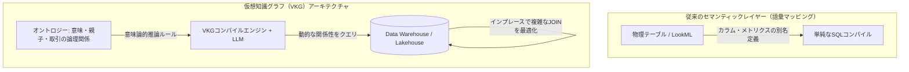

:::message
この記事は、Snowflake / Databricks / Google Cloud が推進する仮想知識グラフ（VKG）戦略をテーマにした、3部構成のシリーズ記事の **第2部（中編）** です。

* [第 1 部 Snowflake / Databricks / Google が挑む仮想グラフ戦略：AIエージェントを支える次世代データ基盤](https://zenn.dev/yohei/articles/2026-05-30-vkg-strategy1)
* **第 2 部** ：なぜセマンティックレイヤーだけでは足りないのか？（本記事）
* **第 3 部** ：スキーマレスの地獄を回避するサステナブルな運用戦略

本シリーズでは、論理マッピング技術である「仮想知識グラフ（VKG）」について解説します。第1部でその定義と選定フローを示したのに続き、本編では「なぜRDBやセマンティックレイヤーだけではLLMの推論を支えられないのか」という技術的・歴史的な背景と、グラフ化の数学的メリットに迫ります。
:::

## 概要

モダンなデータ基盤において、dbtやLookerなどの「セマンティックレイヤー」はビジネスメトリクスを定義する標準となっています。しかし、生成AI（LLM）を用いた高度な動的ビジネス推論やGraphRAGを実装しようとしたとき、従来のセマンティックレイヤーや静的なVerified Queries（検証済みクエリ）だけでは限界に突き当たります。

なぜAI向けの推論や意味理解の道具として、「物事の関係性（Relation）」で知識を記述するオントロジーや知識グラフが必要になるのでしょうか。

本記事では、1970年代の「知識表現と推論（KR）」から始まるAI研究の歴史的背景を紐解きながら、セマンティックビューが抱える根本的な限界を明らかにします。その上で、データを二次元のテーブルではなくグラフ構造として論理的にモデル化することの数学的・実利的なメリットを、探索パフォーマンスやパス探索アルゴリズムの観点から詳細に解説します。

---

## 1. セマンティックビューやVerified Queriesだけでは足りない理由

データ統合やText-to-SQL（自然言語からSQLへの変換）の実務において、広く利用されているのが「セマンティックレイヤー」および「Verified Queries（検証済みクエリ）」です。しかし、これらは本質的に「静的なルール」と「局所的な辞書」の域を出ないため、LLMによる動的な多ホップ推論を支えるには以下の決定的な限界が存在します。

### ① 単なる別名（エイリアス）と集計定義の限界

セマンティックレイヤー（dbt Semantic LayerやLookerのLookMLなど）の主な役割は、テーブルの物理的なカラム名に「ビジネス的な意味名」をマッピングし、あるいは売上や粗利といった「メトリクスの計算式（集計定義）」を中央管理することです。

しかし、これは「語彙の置き換え」に過ぎず、データ同士が織りなす**多階層の関係性（Context）**や**動的なビジネスルール**を推論する能力をLLMに与えることはできません。

例えば、ユーザーが「A社の売上実績を教えて」と自然言語で指示したとします。
セマンティックビューが存在するだけの場合、LLMは sales テーブルから `company_name = 'A社'` を抽出する単純なSQLを記述するだけです。しかし、現実のビジネス環境では、以下のような「関係性に基づいた暗黙の定義」が存在します。

* **階層（親子）関係の解決**: A社とは、親会社である「Aホールディングス」単体を示すのか、それとも100%出資している子会社B社やC社も含めるべきか。
* **時間的・履歴的な解決**: 今年度の組織改編で子会社B社は他グループへ売却されたが、過去の経年売上推移を比較する際、過去の売上高にB社分を含めるべきか、除外すべきか。

このような「組織関係」や「変化する依存関係」は、二次元のテーブル定義やフラットなセマンティックレイヤーには表現できず、LLMは正しくSQLを生成できません。

### ② Verified Queries（検証済みクエリ）の硬直性

Verified Queriesとは、データエンジニアが事前に動作確認・保証したSQLの「テンプレート」をカタログ化し、LLMにそれを参照させて呼び出させる手法です。

このアプローチは、事前に定めた質問（例：「昨日の売上は？」「先月の新規顧客数は？」）に対しては高い正確性を保証します。しかし、実務でユーザーが求めるのは「想定外の動的な関係性の追跡」です。

* 「特定の調達元で遅延が発生した際、影響を受ける主要な最終製品リストと、その代替サプライチェーン候補を洗い出す」
* 「特定の顧客のアカウント開設から始まり、デバイス共有、類似アドレス登録を経て、特定の銀行口座へ資金が流れる不正パターンを追跡する」

このようなアドホックな**動的トラバース（関係性の追跡）**が発生した瞬間、事前に定義されたVerified Queriesテンプレートは機能しなくなり、Text-to-SQLは破綻します。

LLMにビジネスロジックを自律的に推論させるには、語彙の定義だけでなく、データとオブジェクトがどのような「論理（オントロジー）」と「動的なつながり（グラフ）」を持っているかを解釈させる必要があります。

---

## 2. 1970〜80年代のAI研究「知識表現と推論（KR）」の歴史的背景

なぜ「関係性」によって意味や推論を記述するアプローチが、現代の生成AI/LLMの時代に復権しているのでしょうか。これには、半世紀以上にわたるAI研究の歴史的な変遷と挫折が存在します。

### ① 1970年代の知恵「セマンティックネットワーク」と「知識表現」

コンピュータに「意味」を理解させ、推論を行わせる研究は、1970〜80年代の「第2次AIブーム」において非常に盛んに研究されました。これが「**知識表現と推論（Knowledge Representation and Reasoning: KR）**」と呼ばれる分野です。

当時は、M. R. Quillianが提唱した「**セマンティックネットワーク（Semantic Network）**」や、Marvin Minskyによる「フレーム理論」など、実世界の実体（オブジェクト）を「概念」のノードとして表し、それらの間を「is-a（〜は〜である）」「part-of（〜の一部である）」などのラベル付きエッジで結ぶ手法が確立されました。

「事物の意味とは、それ単体で存在するのではなく、他の概念との関係性のネットワークによって初めて説明可能になる」というセマンティクスの基本思想は、この時代にほぼ完成していました。

### ② セマンティックウェブの挫折：「知識獲得のボトルネック」

1990年代から2000年代にかけて、この思想はW3C（World Wide Web Consortium）が推進する「**セマンティックウェブ（Semantic Web）**」へと引き継がれました。情報をRDF（Resource Description Framework）と呼ばれる「主語（Subject）・述語 (Predicate)・目的語 (Object)」のトリプル構造で記述し、OWL（Web Ontology Language）を用いて厳密な意味規則や論理推論を行うことで、機械が世界中のデータを自動で解釈・処理できる自律的なウェブシステムを目指したのです。

しかし、この壮大なビジョンは実務レベルで大きな挫折を味わうことになります。最大の原因は、**「知識獲得のボトルネック（Knowledge Acquisition Bottleneck）」**でした。

* **手動定義の限界**: 膨大かつ常に変化するビジネスルールや世界の意味構造を、人間が手作業でRDF/OWLとして論理矛盾なく定義し、入力し続けることは不可能でした。
* **ルールエンジンの限界**: 当時の論理推論エンジン（Reasoning Engine）は処理性能が低く、厳密なOWL論理式を大規模データに適用しようとすると計算量が爆発し、動作が完全に停止しました。

結果として、オントロジーやセマンティックウェブ技術は、ごく一部の学術分野や厳密なデータ統制が必要な製薬・医療情報を除いて、実ビジネスのメインストリームから消え去っていきました。

### ③ ボトルネックを破壊する「LLM」と「DWHの計算力」

この半世紀の挫折を歴史的に終わらせたのが、**「LLM（大規模言語モデル）」**と**「現代のDWH/レイクハウスの分散計算力（MPP）」**の登場です。

* **自動的な意味マッピング**: かつて人間が血のにじむような努力で手書きしていた「どの物理テーブルがどのようなビジネス概念（ノード）に対応し、どのカラムが関係性（エッジ）を記述しているか」というオントロジーへのマッピング（論理スキーマ構築）を、現代はLLMがリレーショナルメタデータから高い精度で自動推論・提案します（例：Neo4j Virtual Graphの自動スキーマ推論）。
* **計算処理のプッシュダウン**: 仮想知識グラフ（VKG）技術により、高度なオントロジー推論やパス探索の実行を、低スペックな専用の論理エンジンで行うのではなく、ペタバイト級のデータを処理できるSnowflake、Databricks、BigQueryなどのDWH側へ「最適化されたSQL」としてプッシュダウンし、並列分散処理（MPP）させることができるようになりました。

「人間の手作業」と「計算パワーの不足」という歴史的ボトルネックが完全に解消されたからこそ、今、DWHの巨人たちやAIエージェントの文脈において、オントロジーと知識グラフが不可欠なコア技術として復権しているのです。

---

## 3. グラフ構造にする数学的・実利的なメリット

データをリレーショナルテーブル（行と列）のまま扱うのではなく、「ノード」と「エッジ」からなるグラフ構造として論理表現・最適化することには、数学的・実務的なパフォーマンスの双方において決定的なメリットがあります。

### ① 計算複雑性と探索効率：JOINとトラバース（走査）の違い

リレーショナルデータベース（RDB）において、エンティティ間の間接的な関係性（例：5ホップ先までのネットワーク）を追跡しようとすると、クエリ処理の中でインデックス検索（B-Treeインデックス）とテーブル同士の結合（JOIN）を何度も繰り返す必要があります。

JOIN操作は数学的に重い処理です。特にB-Treeインデックスを用いた結合では、1回JOINするごとに $O(\log N)$ の計算量が必要となり、さらに多重JOINを行うと結合順序の最適化（クエリ実行計画の決定）の複雑性が指数関数的に上昇します。このため、3ホップ、4ホップと関係性を深く辿るほど、クエリの実行時間は指数関数的に増大し、最終的にパフォーマンスが破綻します。

これに対し、物理グラフデータベースは「**インデックスフリー隣接（Index-Free Adjacency）**」と呼ばれる物理アーキテクチャを採用しています。これは、各ノードが隣接するノードのメモリアドレスポインタを直接保持している構造を指します。
これにより、関係性を辿る（トラバースする）処理において、毎回インデックスの走査やテーブル結合を行う必要がなく、ポインタをメモリ上で直接ジャンプさせるだけで探索が行えます。その計算量は $O(1)$ であり、全体のデータ量 $N$ に依存せず、探索する深さ（ホップ数）のみに依存するため、大規模データであっても低遅延で多ホップ探索を実行できます。

#### 仮想知識グラフ（VKG）における数学的メリットの実現

物理的なグラフストレージを持たないDWH上の「仮想グラフ（VKG）」や「BigQuery Graph」などでは、実行時にグラフクエリがSQL（JOINや再帰CTE）へ変換されるため、物理的なインデックスフリー隣接の恩恵を直接受けることはできません。

しかし、データを「グラフモデル」として定義してプッシュダウンコンパイラに引き渡すことで、データプラットフォーム側が最適化した専用のクエリ実行計画を適用できます。
例えば、Google CloudのSpanner Graphでは、内部ストレージのテーブルインターリーブ（親子関係に基づく物理的並び替え）を活用し、仮想グラフであっても限りなくインデックスフリー隣接に近い超高速なポインタ走査をストレージエンジン側で直接実現しています。またBigQuery Graphでも、グラフパターンマッチング（MATCH文）を読み込むことで、通常のSQL結合オプティマイザが判断できない「関係性パスの最適なJOIN順序」を自動計算し、実行計画のクラッシュを防ぐ設計となっています。

### ② グラフアルゴリズムの実利的なパワー

グラフ構造を採用することで、単純なリレーショナルSQLでは実装が極めて難解な、数学的に定義された各種「グラフアルゴリズム」を即座に適用できるようになります。

1. **最短経路探索（Shortest Path / Dijkstra法など）**
   * **SQLでの難点**: RDBで動的に最短ルートを探しようとすると、再帰的CTEを何重にも手書きして全ルートのコストをテーブル比較する必要があり、クエリが破綻します。
   * **グラフでのメリット**: `SHORTEST PATH` の構文により一瞬で記述でき、バックエンドの数学的探索アルゴリズムが自動適用されます。サプライチェーンにおける代替供給網の特定や、不正循環取引のルート特定に直結します。
2. **中心性分析（Centrality / PageRankなど）**
   * **SQLでの難点**: 接続数や経路上の重要度をフラットな集計で算出しようとすると、数十回のテーブルフルスキャンが必要になります。
   * **グラフでのメリット**: ネットワーク内で「最も影響力や接続が集中している特異点（ハブ）」を自動特定します。GraphRAGにおいて「最も多くの周辺文脈を要約・集約している最重要ドキュメントノード」を検出する際に威力を発揮します。
3. **コミュニティ検出（Community Detection / Louvain法など）**
   * **SQLでの難点**: グループの関係密度（モジュラリティ）を動的に評価してクラスタ化することは、リレーショナルなクエリでは原理的に不可能です。
   * **グラフでのメリット**: 密接に繋がっている顧客群や不正アカウントの「密なコミュニティ」をアルゴリズムが一挙に検出します。金融の不正リング（Fraud Rings）の検出や、類似顧客セグメンテーションにそのまま応用可能です。

---

## 4. まとめ

セマンティックレイヤーが「データの個々の言葉（語彙）を定義・統一する」ものだとすれば、オントロジーや知識グラフは「データ同士のつながりとビジネスルール（論理・文脈）を定義する」ものです。

LLM単体や、静的なVerified Queriesだけに頼るAIシステムは、環境の変化に脆弱であり、動的な関係性の推論を行えません。仮想知識グラフ（VKG）という形でDWHのデータ上に論理的なグラフ表現の層を重ね合わせることにより、私たちは強固なデータガバナンスと、グラフモデルならではの数学的・アルゴリズム的な強力な探索パフォーマンスを同時に獲得できます。これこそが、データ巨人が仮想グラフへと大きく舵を切っている技術的・実理的な本質です。

しかし、グラフ構造は本質的にスキーマレス（あるいは柔軟なスキーマ定義）であり、関係性を無限に追加できる利便性がある一方、データ統制を誤ると一瞬で「何が正しいノードで、何が不要なエッジか分からない」という「スキーマレスの地獄」へと陥ります。

次回の最終編（後編）では、このサステナブルな運用を阻む運用リスク（スキーマレスの地獄）を回避し、実務で安全に運用するための具体的な3つの維持管理アーキテクチャ（How）を提示します。

---

**連載一覧：**

* [第 1 部 Snowflake / Databricks / Google が挑む仮想グラフ戦略：AIエージェントを支える次世代データ基盤](https://zenn.dev/yohei/articles/2026-05-30-vkg-strategy1)
* [第 2 部 なぜセマンティックレイヤーだけでは足りないのか？（中編）](https://zenn.dev/yohei/articles/2026-05-30-vkg-strategy2) (本作)
* **第 3 部** ：スキーマレスの地獄を回避するサステナブルな運用戦略
