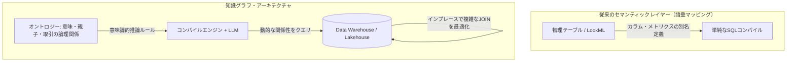

:::message
この記事は、Snowflake / Databricks / Google Cloud が推進する仮想グラフ戦略をテーマにした、3部構成のシリーズ記事の **第2部（中編）** です。

* [第 1 部 Snowflake / Databricks / Google が挑む仮想グラフ戦略：AIエージェントを支える次世代データ基盤](https://zenn.dev/yohei/articles/2026-05-30-vkg-strategy-what)
* **第 2 部** ：AI エージェントの知識表現と推論になぜグラフが使われるのか？（本記事）
* **第 3 部** ：スキーマレスの地獄を回避するサステナブルな運用戦略

本シリーズでは、論理マッピング技術である「仮想グラフ（Virtual Graph）」について解説します。第1部でその定義と選定フローを示したのに続き、本編では「なぜRDBやセマンティックレイヤーだけではLLMの推論を支えられないのか」という技術的・歴史的な背景と、グラフ化の数学的メリットに迫ります。
:::

## 概要

第1弾である [Snowflake / Databricks / Google が挑む仮想グラフ戦略：AIエージェントを支える次世代データ基盤](https://zenn.dev/yohei/articles/2026-05-30-vkg-strategy-what) では、主要なデータプラットフォームが「仮想グラフ（Virtual Graph）」をサポートし始めた動向を解説しました。

ベンダー各社が時を同じくして仮想グラフ技術に注力する背景には、**「AIエージェント向けの知識表現と推論において、データを関係性で結ぶグラフ構造が極めて有効である」** という技術的な確信が存在します。

特に対象領域のドメイン知識を体系的に表現する「知識グラフ（Knowledge Graph）」や、エージェントが過去に行った思考や意思決定の履歴を構造化して将来の文脈判断に活かす「コンテキストグラフ（Context Graph）」などの概念は、自律型エージェントの頭脳を支える必須のアーキテクチャとして知られるようになっています。

しかし、なぜAI向けの推論や意味・文脈理解の道具として、他でもない「グラフ構造」による表現が優れているのでしょうか。dbtやLookerなどの従来のセマンティックビューや、事前に動作検証されたSQLテンプレート（Verified Queries）だけでは不十分なのでしょうか。

本記事では、現在RAG（検索拡張生成）の実務で広く使われている代表的なアプローチ（ベクトルDB型、RDB型、Agentic Search型）と知識グラフ（GraphRAG）の違いを体系的に整理した上で、1970年代の「知識表現と推論（KR）」から2000年代の「セマンティックウェブ」に至るAI研究の歴史的背景を紐解きます。さらに、データを二次元のテーブルではなくグラフ構造として論理的にモデル化することの数学的・実利的な探索パフォーマンスのメリットを詳細に解説します。

---

## 1. AIエージェントを支える「RAG（検索拡張生成）」の3大アプローチと知識グラフ

AIエージェントに「ビジネスの文脈（Context）」や「共有知識」を理解させるためのアプローチは、外部から関連情報を検索してLLMのプロンプト（文脈）へ注入する **「RAG（Retrieval-Augmented Generation / 検索拡張生成）」** という設計パターンに集約されます。

現在実務で広く使われている3つの代表的なRAGアプローチ（知識取得パターン）を確認した上で、なぜそれらとは異なる「知識グラフ（GraphRAG）」やオントロジーが必要になるのかを整理します。

### 実務で使われている3つの代表的なRAGアプローチ

1. **ベクトルDB型（ベクトル検索ベースのRAG）**
   * **技術的仕組み**: 社内ドキュメント、規約、製品マニュアルなどの非構造化テキストを、固定文字数や意味論的な切れ目で「チャンク（断片）」に分割します。これを埋め込みモデル（Embedding Model）を用いて数百〜数千次元の高次元ベクトル空間に写像し、Pinecone、Milvus、pgvectorなどのベクトルデータベースにインデックス登録します。
   * **動作プロセス**: ユーザーから質問が入力されると、その質問文も同一の埋め込みモデルでベクトル化されます。ベクトルデータベース上で近似最近傍探索（ANN）を実行し、コサイン類似度などの距離基準で最も「意味が近い」と判定された上位N件のテキストチャンクを抽出します。抽出された生のテキストが、LLMのシステムプロンプトのコンテキスト窓（Context Window）にそのまま流し込まれ、回答生成の参照情報として使用されます。
   * **主な用途**: 社内Wiki、トラブルシューティングガイド、顧客対応マニュアルなどの「非構造化テキスト」から、曖昧な表現で関連情報を検索するユースケースに最適です。
2. **RDB型（Text-to-SQL / 構造化RAG）**
   * **技術的仕組み**: 売上トランザクション、顧客属性、在庫数といった企業のミッションクリティカルな構造化データ（表データ）を対象とします。dbt Semantic LayerやLooker（LookML）を用いてビジネスメトリクス（例：「当月のアクティブユーザー数」「リピート率」）の計算ロジックやリレーションを抽象化定義（セマンティックレイヤー）するか、あるいはデータエンジニアが事前に動作を担保した安全なSQLクエリ群（Verified Queries）をカタログ（辞書）として管理します。
   * **動作プロセス**: ユーザーが「先月のエリア別の売上トップ3を教えて」と要求すると、LLMはメタデータスキーマやカタログを参照し、対象のテーブル構造に適合した「SQL文」を動的に生成（Text-to-SQL）、または検証済みのクエリテンプレートを選択します。このクエリがDWHやRDBに対して直接実行され、完全に正確な数値レコードを抽出した上で、その構造化結果をLLMが日本語の自然言語へと成形して回答します。
   * **主な用途**: 売上計算、財務分析、在庫確認など、1円・1件のズレも許されない「構造化された業務数値」に対して、極めて高い正確性とトランザクション一貫性をもって回答する用途に使用されます。
3. **Agentic Search型（自律巡回テキストRAG）**
   * **技術的仕組み**: ナレッジ（知識）がマークダウンファイルやプログラムコードのように、相互にリンク（Wikiリンクや依存参照）されたネットワーク構造として管理されているリポジトリを対象とします。静的なデータベース検索とは異なり、LLMが「ツール（ファイル読み込みAPI、ファイルツリー検索、grepコマンドなど）」を自律的に呼び出せるエージェントループ（ReActフレームワークなど）を構築します。
   * **動作プロセス**: AIエージェントは、まず起点となるドキュメント（インデックスファイルなど）を読み込みます。LLMはそのテキスト内容を解析し、「次に読み進めるべきリンクファイル（例：コードベース内のインポート宣言や、Obsidianで相互リンクされたノート）」を動的に判定します。エージェントはプログラム的に次のファイルを読み込み、この巡回（ホップ）と内容の要約・推論をゴールに達するまで動的かつ再帰的に繰り返します。
   * **主な用途**: コーディングエージェント（DevinやCursor等）による大規模リポジトリの解析・リファクタリング、あるいはパーソナルアシスタントエージェントが個人のObsidianやNotionのメモ構造を辿ってアドホックに点と点を結びつける推論タスクで多用されます。

---

### 知識グラフ（GraphRAG）との比較

オントロジーや知識グラフを用いたRAG（一般に **GraphRAG** と呼ばれるアプローチ）は、ドキュメントや構造化エンティティの関係性そのものを第一級市民（First-class citizen）として扱い、概念間の関係性を明示的に定義する論理スキーマを持ちます。

これら4種類のアプローチの優位性、限界、およびトレードオフを以下の対比表にまとめます。

| 項目 | ① ベクトルDB（類似検索） | ② RDB（セマンティック層） | ③ Agentic Search（巡回テキスト） | ④ オントロジー / 知識グラフ |
| :--- | :--- | :--- | :--- | :--- |
| **データモデル** | 高次元ベクトル + テキスト | 二次元テーブル（行と列） | リンクされたテキストファイル群 | ノード（実体）とエッジ（関係性）の論理網 |
| **検索・クエリ方式** | 近似最近傍探索（ANN） | SQL（テーブル結合・集計） | エージェントによる再帰的巡回・読込 | 宣言的グラフクエリ（GQL/Cypher） |
| **推論・ロジック能力** | **低**（単語の近さしか追えない） | **中**（定義済みの集計式のみ正確） | **中〜高**（LLMがテキストを辿り推理） | **極めて高**（階層・包含・依存を論理処理） |
| **優位性（強み）** | スキーマ設計が不要。非構造化データをそのまま瞬時に扱える手軽さ。 | トランザクション一貫性。既存の堅牢な集計能力と高い信頼性。 | ドキュメントのゆるい関係性をマークダウン等の人間が書きやすい形で拡張可能。 | ビジネス定義（親子関係・履歴等）を厳密に表現でき、複雑な多ホップ探索が可能。 |
| **限界・制約事項** | 「キーワードの類似度」に依存するため、論理的な誤り（ハルシネーション）に極めて弱い。 | 関係性の探索パスが事前設計されていないと、アドホックな多ホップ探索でSQLが破綻する。 | 大規模データ（ペタバイト級）への対応が不可能。APIトークン消費と巡回レイテンシの増大。 | オントロジー設計（メタデータモデリング）の難易度が高く、初期構築・維持の運用負荷が大きい。 |

### 「オントロジー」と「知識グラフ」の違い

これらは混同されがちですが、データ工学および意味論（セマンティクス）において、両者は明確に異なる定義と役割を持ちます。

* **オントロジー（Ontology / 論理スキーマ）**:
  データ領域全体の「意味の枠組み」や「ビジネスルール」を厳密に定義した設計図（メタデータモデル）です。具体的には、「どのようなエンティティ（クラス）が存在し、それらはどのような属性を持ち、エンティティ同士がどういう関係性（親子関係、取引関係、依存関係など）で結ばれるべきか」という**論理的なルールや制約**を定義します。RDBでいう「論理データモデルやDDL」に相当します。
* **知識グラフ（Knowledge Graph / 実データ）**:
  オントロジーという設計図に従って、実際の「顧客A」「製品X」「部品Y」といった**具体的な実データ（インスタンスノードとエッジ）**をネットワーク構造として流し込み、相互に結びつけた実体そのものです。RDBでいう「テーブルに格納された具体的なレコード群」に相当します。

つまり、**オントロジーが「ルール（設計図）」を規定し、知識グラフがそのルールに基づいて「データ（実体）」を表現する**という関係性にあります。

### エンタープライズでオントロジーが脚光を浴びる契機：Palantir Technologiesの先見性

近年、オントロジーという概念がエンタープライズのデータ領域で再び大きな注目を集めるようになった極めて重要な契機の一つが、米 **Palantir Technologies（パランティア）** のデータ分析プラットフォーム（Palantir Foundry / Palantir AIP）における大成功です。

パランティアは、大企業の最も困難な課題である「社内の各部門の多様なデータベースに散らばる、何万ものバラバラな物理テーブルの統合」に対して、物理的にデータを一箇所にコピーして統合するのではなく、データモデルの上に共通の論理ビジネスモデルを定義する **「Palantir Ontology（パランティア・オントロジー）」** のアプローチを採用しました。

1. 物理テーブルの構成はそのままに、オントロジーレイヤー上で「顧客」「フライト」「工場」「出荷」といった**現実のビジネスオブジェクト（論理エンティティ）とその関係性**として論理的に再マッピングします。
2. 非技術的なビジネスユーザーや意思決定者は、複雑な物理テーブルのカラム名やSQL結合を知らなくとも、オントロジー化されたビジネス用語を組み合わせるだけで直感的に高度な探索やシミュレーションを行えます。
3. さらにLLMが登場した現代において、AIエージェントが複雑なビジネスルールやデータ構造を正しく理解し、自律的かつ安全に推論を実行するための「共通の文脈（頭脳）」として、このオントロジーレイヤーが極めて強固に機能しています。

DWHの巨人たちが推進する仮想グラフ（Virtual Graph）は、まさにこの「Palantirが培ってきたオントロジーによる仮想ビジネスレイヤーの価値」を、既存のモダンデータスタック（Snowflake、Databricks、BigQueryなど）の上で誰もが実装できるようにオープンかつ汎用化するアプローチと言えます。

### なぜ他の手法では「足りない」のか？

ベクトルDBは「概念の近さ」を曖昧に検索できますが、「A社はB社の親会社である」や「製品Xは部品Yに依存する」といった**厳密な論理規則や階層構造**を解釈できません。

また、RDBのセマンティックビューや検証済みクエリは、静的な集計（例：「先月の粗利は？」）には完璧に応答できますが、ユーザーが「特定の製品の調達遅延がどの下流製品に影響を及ぼし、代替調達先はどこか？」といったアドホックな**動的トラバース（関係性の追跡）**を求めた際、事前に用意されたSQLテンプレートやフラットな結合では対応しきれません。

さらに、Agentic Searchはエージェントのテキスト巡回によって柔軟に関係性を処理できますが、これはあくまでテキストファイル群を順次ロードする手法であり、ペタバイト規模の構造化エンティティに対してスケーラブルに探索したり、厳格な行レベルセキュリティ（RLS）やアクセス制御を効かせたりすることは困難です。

このように、**「スケーラブルかつセキュアな大規模データ基盤の上で、関係性の論理規則（オントロジー）に基づいた高度な多ホップ探索をエージェントに提供する」**ために、DWH上に「知識グラフ」を重ね合わせるアプローチが不可欠となります。

---

## 2. 人工知能の歴史から紐解く「オントロジーと知識表現（KR）」の変遷

なぜ「関係性」によって意味や推論を記述するアプローチが、現代の生成AI/LLMの時代に復権しているのでしょうか。これには、半世紀以上にわたるAI研究の歴史的な変遷と挫折が存在します。

### ① 古典的AIの時代：「意味ネットワーク」と「述語論理」

コンピュータに「知識」を表現させ、論理的な推論を行わせようとする研究は、1970〜80年代の「第2次AIブーム」において最も活発に行われました。これが「**知識表現と推論（Knowledge Representation and Reasoning: KR）**」と呼ばれる分野です。

当時は、M. R. Quillianが提唱した「**セマンティックネットワーク（Semantic Network）**」や、Marvin Minskyによる「フレーム理論」など、実世界の実体（オブジェクト）を「概念」のノードとして表し、それらの間を「is-a（〜は〜である）」「part-of（〜の一部である）」などのラベル付きエッジで結ぶ手法が確立されました。

「事物の意味とは、それ単体で存在するのではなく、他の概念との関係性のネットワークによって初めて説明可能になる」というセマンティクスの基本思想は、この時代にほぼ完成していました。

### ② 2000年代の構想：「セマンティックウェブ（RDF・OWL）」の挫折

この思想は、2000年代に入り、インターネットの創始者であるティム・バーナーズ＝リーらによって「**セマンティックウェブ（Semantic Web）**」という壮大なビジョンへと拡張されました。

世界中のウェブデータを機械が自律的に理解し、高度な処理を実行できるようにするため、情報を「主語（Subject）・述語（Predicate）・目的語（Object）」の3つの組み合わせで表現する「**RDF（Resource Description Framework）**」や、より厳密な意味規則や論理推論を行うための「**OWL（Web Ontology Language）**」といった要素技術がW3C主導で策定されました。

しかし、この2000年代のオントロジー・知識グラフの熱狂は、実務レベルで大きな挫折を味わうことになります。最大の原因は、**「知識獲得のボトルネック（Knowledge Acquisition Bottleneck）」**でした。

* **人力によるメタデータ作成の限界**: 膨大かつ常に流動的な実世界のビジネスルールや概念定義を、人間が手作業で論理矛盾がないようにRDFやOWL形式で定義し、タグ付けし続けることは実務的に不可能でした。
* **推論エンジンの計算量爆発**: 当時のルール推論エンジンは処理性能が低く、厳密なOWL論理式を大規模な実データセットに適用しようとすると計算量が爆発し、動作が完全に停止しました。

結果として、オントロジーやセマンティックウェブの技術は、ごく一部の学術研究や、厳密なデータ統制が必要な製薬・医療情報を除いて、実ビジネスの表舞台からフェードアウトしていきました。

### ③ LLMとAIエージェントの登場がもたらす「復権」

この歴史的ボトルネックを完全に破壊し、2000年代に挫折した技術を再び主役に引き上げたのが、**「LLM（大規模言語モデル）」**と**「AIエージェント」**の台頭です。

* **人間による定義コストの消失**: かつて人間が血のにじむような努力で手書きしていたオントロジーのマッピング（「どの物理テーブルがどの論理クラスに対応し、どの外部キーがどういう論理関係を示すか」）を、現代はLLMがリレーショナルスキーマやテーブル構造から高い精度で自動的に抽出し、知識グラフの骨格を自動構築します。
* **エージェントによる意味的理解の統合**: AIエージェント自身が、構造化されたオントロジーや知識グラフを「自分がビジネスのルールを正しく理解し、自律的にクエリを組み立てるための共通言語（世界のインプット）」として直接活用するようになりました。これにより、人間の手を介さない自律的な知識表現ループが完成しました。

さらに、仮想グラフ（Virtual Graph）技術により、かつての「推論エンジンのパワー不足」も解消されました。高度なオントロジー処理やパス探索を、低スペックな専用の論理エンジンで行うのではなく、ペタバイト級のデータを処理できるDWH/レイクハウス側へ「最適化されたリレーショナルSQL」としてプッシュダウンし、並列分散処理（MPP）させることができるようになったためです。

「人間によるメタデータ構築の限界」と「計算性能の限界」がLLMとモダンDWHによって解消されたことで、かつて日の目を見なかったオントロジーと知識グラフが、AIエージェントを動かす「最高のインテリジェント脳」として今、再び脚光を浴びています。

---

## 3. グラフ構造にする数学的・実利的なメリット

データをリレーショナルテーブル（行と列）のまま扱うのではなく、「ノード」と「エッジ」からなるグラフ構造として論理表現・最適化することには、数学的・実務的なパフォーマンスの双方において決定的なメリットがあります。

### ① 計算複雑性と探索効率：JOINとトラバース（走査）の違い

リレーショナルデータベース（RDB）において、エンティティ間の間接的な関係性（例：5ホップ先までのネットワーク）を追跡しようとすると、クエリ処理の中でインデックス検索（B-Treeインデックス）とテーブル同士の結合（JOIN）を何度も繰り返す必要があります。

JOIN操作は数学的に重い処理です。特にB-Treeインデックスを用いた結合では、1回JOINするごとに $O(\log N)$ の計算量が必要となり、さらに多重JOINを行うと結合順序の最適化（クエリ実行計画の決定）の複雑性が指数関数的に上昇します。このため、3ホップ、4ホップと関係性を深く辿るほど、クエリの実行時間は指数関数的に増大し、最終的にパフォーマンスが破綻します。

これに対し、物理グラフデータベースは「**インデックスフリー隣接（Index-Free Adjacency）**」と呼ばれる物理アーキテクチャを採用しています。これは、各ノードが隣接するノードのメモリアドレスポインタを直接保持している構造を指します。
これにより、関係性を辿る（トラバースする）処理において、毎回インデックスの走査やテーブル結合を行う必要がなく、ポインタをメモリ上で直接ジャンプさせるだけで探索が行えます。その計算量は $O(1)$ であり、全体のデータ量 $N$ に依存せず、探索する深さ（ホップ数）のみに依存するため、大規模データであっても低遅延で多ホップ探索を実行できます。

#### 仮想グラフ（Virtual Graph）における数学的メリットの実現

物理的なグラフストレージを持たないDWH上の「仮想グラフ（Virtual Graph）」や「BigQuery Graph」などでは、実行時にグラフクエリがSQL（JOINや再帰CTE）へ変換されるため、物理的なインデックスフリー隣接の恩恵を直接受けることはできません。

しかし、データを「グラフモデル」として定義してプッシュダウンコンパイラに引き渡すことで、データプラットフォーム側が最適化した専用のクエリ実行計画を適用できます。
例えば、Google CloudのSpanner Graphでは、内部ストレージのテーブルインターリーブ（親子関係に基づく物理的並び替え）を活用し、仮想グラフであっても限りなくインデックスフリー隣接に近い超高速なポインタ走査をストレージエンジン側で直接実現しています。またBigQuery Graphでも、グラフパターンマッチング（MATCH文）を読み込むことで、通常のSQL結合オプティマイザが判断できない「関係性パスの最適なJOIN順序」を自動計算し、実行計画のクラッシュを防ぐ設計となっています。

### ② グラフアルゴリズムの実利的なパワー

グラフ構造を採用することで、単純なリレーショナルSQLでは実装が極めて難解な、数学的に定義された各種「グラフアルゴリズム」を即座に適用できるようになります。

1. **最短経路探索（Shortest Path / Dijkstra法など）**
   * **SQLでの難点**: RDBで動的に最短ルートを探しようとすると、再帰的CTEを何重にも手書きして全ルートのコストをテーブル比較する必要があり、クエリが破綻します。
   * **グラフでのメリット**: `SHORTEST PATH` の構文により一瞬で記述でき、バックエンドの数学的探索アルゴリズムが自動適用されます。サプライチェーンにおける代替供給網の特定や、不正循環取引のルート特定に直結します。
2. **中心性分析（Centrality / PageRankなど）**
   * **SQLでの難点**: 接続数や経路上の重要度をフラットな集計で算出しようとすると、数十回のテーブルフルスキャンが必要になります。
   * **グラフでのメリット**: ネットワーク内で「最も影響力や接続が集中している特異点（ハブ）」を自動特定します。GraphRAGにおいて「最も多くの周辺文脈を要約・集約している最重要ドキュメントノード」を検出する際に威力を発揮します。
3. **コミュニティ検出（Community Detection / Louvain法など）**
   * **SQLでの難点**: グループの関係密度（モジュラリティ）を動的に評価してクラスタ化することは、リレーショナルなクエリでは原理的に不可能です。
   * **グラフでのメリット**: 密接に繋がっている顧客群や不正アカウントの「密なコミュニティ」をアルゴリズムが一挙に検出します。金融の不正リング（Fraud Rings）の検出や、類似顧客セグメンテーションにそのまま応用可能です。

---

## 4. まとめ

セマンティックレイヤーが「データの個々の言葉（語彙）を定義・統一する」ものだとすれば、オントロジーや知識グラフは「データ同士のつながりとビジネスルール（論理・文脈）を定義する」ものです。

LLM単体や、静的なVerified Queriesだけに頼るAIシステムは、環境の変化に脆弱であり、動的な関係性の推論を行えません。知識グラフという形でDWHのデータの上に論理的なグラフ表現の層を重ね合わせることにより、私たちは強固なデータガバナンスと、グラフモデルならではの数学的・アルゴリズム的な強力な探索パフォーマンスを同時に獲得できます。これこそが、データ巨人が仮想グラフへと大きく舵を切っている技術的・実理的な本質です。

しかし、グラフ構造は本質的にスキーマレス（あるいは柔軟なスキーマ定義）であり、関係性を無限に追加できる利便性がある一方、データ統制を誤ると一瞬で「何が正しいノードで、何が不要なエッジか分からない」という「スキーマレスの地獄」へと陥ります。

次回の最終編（後編）では、このサステナブルな運用を阻む運用リスク（スキーマレスの地獄）を回避し、実務で安全に運用するための具体的な3つの維持管理アーキテクチャ（How）を提示します。

---

**連載一覧：**

* [第 1 部 Snowflake / Databricks / Google が挑む仮想グラフ戦略：AIエージェントを支える次世代データ基盤](https://zenn.dev/yohei/articles/2026-05-30-vkg-strategy-what)
* [第 2 部 AI エージェントの知識表現と推論になぜグラフが使われるのか？](https://zenn.dev/yohei/articles/2026-05-30-vkg-strategy2) (本作)
* **第 3 部** ：スキーマレスの地獄を回避するサステナブルな運用戦略
