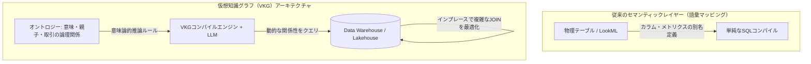

:::message
この記事は、Snowflake / Databricks / Google Cloud が推進する仮想知識グラフ（VKG）戦略をテーマにした、3部構成のシリーズ記事の **第2部（中編）** です。

* [第 1 部 Snowflake / Databricks / Google が挑む仮想グラフ戦略：AIエージェントを支える次世代データ基盤](https://zenn.dev/yohei/articles/2026-05-30-vkg-strategy1)
* **第 2 部** ：AI エージェントの知識表現と推論になぜグラフが使われるのか？（本記事）
* **第 3 部** ：スキーマレスの地獄を回避するサステナブルな運用戦略

本シリーズでは、論理マッピング技術である「仮想知識グラフ（VKG）」について解説します。第1部でその定義と選定フローを示したのに続き、本編では「なぜRDBやセマンティックレイヤーだけではLLMの推論を支えられないのか」という技術的・歴史的な背景と、グラフ化の数学的メリットに迫ります。
:::

## 概要

モダンなデータ基盤において、dbtやLookerなどの「セマンティックレイヤー」はビジネスメトリクスを定義する標準となっています。また、データエンジニアが事前に動作を検証したSQLカタログ（Verified Queries）や、非構造化データを扱うベクトル類似検索も、生成AI（LLM）アプリケーションの知識補強として広く使われています。

しかし、AIエージェントが高度な自律的ビジネス推論やGraphRAGを実装しようとしたとき、これらの手法は明確な壁に突き当たります。

なぜAI向けの推論や意味理解の道具として、「物事の関係性（Relation）」で知識を記述するオントロジーや知識グラフが必要になるのでしょうか。

本記事では、現在使われている代表的な知識表現手法（ベクトルDB、RDB、Agentic Search）と知識グラフの違いを体系的に整理した上で、1970年代の「知識表現と推論（KR）」から2000年代の「セマンティックウェブ」に至るAI研究の歴史的背景を紐解きます。さらに、データをグラフ構造として論理モデル化することの数学的・実利的な探索パフォーマンスのメリットを詳細に解説します。

---

## 1. AIエージェントを取り巻く「知識と文脈」の表現手法：現状手法との対比

AIエージェントに社内の「ビジネスの文脈（Context）」や「共有知識」を理解させるためのアプローチには、現在主に3つの手法が採用されています。それぞれの特性を確認した上で、なぜそれらとは異なる「オントロジー / 知識グラフ」という手法が必要なのかを整理します。

### 現在よく使われている3つの知識表現手法

1. **ベクトルDB（ベクトルデータベースによる意味類似検索）**
   * **概要**: テキスト（ドキュメント）を適切なサイズにチャンク分割し、高次元ベクトルに変換してベクトルDBに格納する手法。
   * **動作**: ユーザーの質問ベクトルとコサイン類似度などの数学的近接度を算出し、セマンティクス（意味合い）の近いテキストチャンクをLLMのプロンプトに注入します（一般的なRAG手法）。
2. **RDB（セマンティックレイヤーや検証済みクエリ / Verified Queries）**
   * **概要**: テーブル構造化データに対し、dbt等のセマンティックビューでメトリクス定義を中央管理したり、データエンジニアが作成した検証済みSQLテンプレート（Verified Queries）にLLMを適合させたりする手法。
   * **動作**: 自然言語の要請に基づいて、LLMが事前に定義されたビューやSQLテンプレートを呼び出し、構造化データを集計・抽出します。
3. **Agentic Search（相互リンクテキスト / Markdownによる探索・推論）**
   * **概要**: ドキュメント同士をWikiやObsidianのようにハイパーリンク（参照リンク）で相互に結びつけたテキストファイル群を知識源とする手法。主にコーディングエージェントやパーソナルアシスタントエージェントで好まれます。
   * **動作**: AIエージェントが「あるファイル」を読んだ後、その中に貼られている「別ファイルへのリンク」を動的・再帰的にクロール（巡回）してテキストを集め、LLMの文脈上で推論します。

---

### オントロジー・知識グラフとの比較

オントロジーや知識グラフ（VKGを含む）は、物事や概念の「関係性（Relation）」そのものを第一級市民（First-class citizen）として扱い、概念間の関係性を明示的に定義する論理スキーマを持ちます。

これら4種類のアプローチの優位性、限界、およびトレードオフを以下の対比表にまとめます。

| 項目 | ① ベクトルDB（類似検索） | ② RDB（セマンティック層） | ③ Agentic Search（巡回テキスト） | ④ オントロジー / 知識グラフ（VKG） |
| :--- | :--- | :--- | :--- | :--- |
| **データモデル** | 高次元ベクトル + テキスト | 二次元テーブル（行と列） | リンクされたテキストファイル群 | ノード（実体）とエッジ（関係性）の論理網 |
| **検索・クエリ方式** | 近似最近傍探索（ANN） | SQL（テーブル結合・集計） | エージェントによる再帰的巡回・読込 | 宣言的グラフクエリ（GQL/Cypher） |
| **推論・ロジック能力** | **低**（単語の近さしか追えない） | **中**（定義済みの集計式のみ正確） | **中〜高**（LLMがテキストを辿り推理） | **極めて高**（階層・包含・依存を論理処理） |
| **優位性（強み）** | スキーマ設計が不要。非構造化データをそのまま瞬時に扱える手軽さ。 | トランザクション一貫性。既存の堅牢な集計能力と高い信頼性。 | ドキュメントのゆるい関係性をマークダウン等の人間が書きやすい形で拡張可能。 | ビジネス定義（親子関係・履歴等）を厳密に表現でき、複雑な多ホップ探索が可能。 |
| **限界・制約事項** | 「キーワードの類似度」に依存するため、論理的な誤り（ハルシネーション）に極めて弱い。 | 関係性の探索パスが事前設計されていないと、アドホックな多ホップ探索でSQLが破綻する。 | 大規模データ（ペタバイト級）への対応が不可能。APIトークン消費と巡回レイテンシの増大。 | オントロジー設計（メタデータモデリング）の難易度が高く、初期構築・維持の運用負荷が大きい。 |

### なぜ他の手法では「足りない」のか？

ベクトルDBは「概念の近さ」を曖昧に検索できますが、「A社はB社の親会社である」や「製品Xは部品Yに依存する」といった**厳密な論理規則や階層構造**を解釈できません。

また、RDBのセマンティックビューや検証済みクエリは、静的な集計（例：「先月の粗利は？」）には完璧に応答できますが、ユーザーが「特定の製品の調達遅延がどの下流製品に影響を及ぼし、代替調達先はどこか？」といったアドホックな**動的トラバース（関係性の追跡）**を求めた際、事前に用意されたSQLテンプレートやフラットな結合では対応しきれません。

さらに、Agentic Searchはエージェントのテキスト巡回によって柔軟に関係性を処理できますが、これはあくまでテキストファイル群を順次ロードする手法であり、ペタバイト規模の構造化エンティティに対してスケーラブルに探索したり、厳格な行レベルセキュリティ（RLS）やアクセス制御を効かせたりすることは困難です。

このように、**「スケーラブルかつセキュアな大規模データ基盤の上で、関係性の論理規則（オントロジー）に基づいた高度な多ホップ探索をエージェントに提供する」**ために、DWH上に重ね合わせる「仮想知識グラフ（VKG）」というアプローチが不可欠となります。

---

## 2. 人工知能の歴史から紐解く「オントロジーと知識表現（KR）」の変遷

なぜ「関係性」によって意味や推論を記述するアプローチが、現代の生成AI/LLMの時代に復権しているのでしょうか。これには、半世紀以上にわたるAI研究の歴史的な変遷と挫折が存在します。

### ① 古典的AIの時代：「意味ネットワーク」と「述語論理」

コンピュータに「知識」を表現させ、論理的な推論を行わせようとする研究は、1970〜80年代の「第2次AIブーム」において最も活発に行われました。これが「**知識表現と推論（Knowledge Representation and Reasoning: KR）**」と呼ばれる分野です。

当時は、M. R. Quillianが提唱した「**セマンティックネットワーク（Semantic Network）**」や、Marvin Minskyによる「フレーム理論」など、実世界の実体（オブジェクト）を「概念」のノードとして表し、それらの間を「is-a（〜は〜である）」「part-of（〜の一部である）」などのラベル付きエッジで結ぶ手法が確立されました。

「事物の意味とは、それ単体で存在するのではなく、他の概念との関係性のネットワークによって初めて説明可能になる」というセマンティクスの基本思想は、この時代にほぼ完成していました。

### ② 2000年代の構想：「セマンティックウェブ（RDF・OWL）」の挫折

この思想は、2000年代に入り、インターネットの創始者であるティム・バーナーズ＝リーらによって「**セマンティックウェブ（Semantic Web）**」という壮大なビジョンへと拡張されました。

世界中のウェブデータを機械が自律的に理解し、高度な処理を実行できるようにするため、情報を「主語（Subject）・述語（Predicate）・目的語（Object）」の3つの組み合わせで表現する「**RDF（Resource Description Framework）**」や、より厳密な意味規則や論理推論を行うための「**OWL（Web Ontology Language）**」といった要素技術がW3C主導で策定されました。

しかし、この2000年代のオントロジー・知識グラフの熱狂は、実務レベルで大きな挫折を味わうことになります。最大の原因は、**「知識獲得のボトルネック（Knowledge Acquisition Bottleneck）」**でした。

* **人力によるメタデータ作成の限界**: 膨大かつ常に流動的な実世界のビジネスルールや概念定義を、人間が手作業で論理矛盾がないようにRDFやOWL形式で定義し、タグ付けし続けることは実務的に不可能でした。
* **推論エンジンの計算量爆発**: 当時のルール推論エンジンは処理性能が低く、厳密なOWL論理式を大規模な実データセットに適用しようとすると計算量が爆発し、動作が完全に停止しました。

結果として、オントロジーやセマンティックウェブの技術は、ごく一部の学術研究や、厳密なデータ統制が必要な製薬・医療情報を除いて、実ビジネスの表舞台からフェードアウトしていきました。

### ③ LLMとAIエージェントの登場がもたらす「復権」

この歴史的ボトルネックを完全に破壊し、2000年代に挫折した技術を再び主役に引き上げたのが、**「LLM（大規模言語モデル）」**と**「AIエージェント」**の台頭です。

* **人間による定義コストの消失**: かつて人間が血のにじむような努力で手書きしていたオントロジーのマッピング（「どの物理テーブルがどの論理クラスに対応し、どの外部キーがどういう論理関係を示すか」）を、現代はLLMがリレーショナルスキーマやテーブル構造から高い精度で自動的に抽出し、知識グラフの骨格を自動構築します。
* **エージェントによる意味的理解の統合**: AIエージェント自身が、構造化されたオントロジーや知識グラフを「自分がビジネスのルールを正しく理解し、自律的にクエリを組み立てるための共通言語（世界のインプット）」として直接活用するようになりました。これにより、人間の手を介さない自律的な知識表現ループが完成しました。

さらに、仮想知識グラフ（VKG）技術により、かつての「推論エンジンのパワー不足」も解消されました。高度なオントロジー処理やパス探索を、低スペックな専用の論理エンジンで行うのではなく、ペタバイト級のデータを処理できるDWH/レイクハウス側へ「最適化されたリレーショナルSQL」としてプッシュダウンし、並列分散処理（MPP）させることができるようになったためです。

「人間によるメタデータ構築の限界」と「計算性能の限界」がLLMとモダンDWHによって解消されたことで、かつて日の目を見なかったオントロジーと知識グラフが、AIエージェントを動かす「最高のインテリジェント脳」として今、再び脚光を浴びています。

---

## 3. グラフ構造にする数学的・実利的なメリット

データをリレーショナルテーブル（行と列）のまま扱うのではなく、「ノード」と「エッジ」からなるグラフ構造として論理表現・最適化することには、数学的・実務的なパフォーマンスの双方において決定的なメリットがあります。

### ① 計算複雑性と探索効率：JOINとトラバース（走査）の違い

リレーショナルデータベース（RDB）において、エンティティ間の間接的な関係性（例：5ホップ先までのネットワーク）を追跡しようとすると、クエリ処理の中でインデックス検索（B-Treeインデックス）とテーブル同士の結合（JOIN）を何度も繰り返す必要があります。

JOIN操作は数学的に重い処理です。特にB-Treeインデックスを用いた結合では、1回JOINするごとに $O(\log N)$ の計算量が必要となり、さらに多重JOINを行うと結合順序の最適化（クエリ実行計画の決定）の複雑性が指数関数的に上昇します。このため、3ホップ、4ホップと関係性を深く辿るほど、クエリの実行時間は指数関数的に増大し、最終的にパフォーマンスが破綻します。

これに対し、物理グラフデータベースは「**インデックスフリー隣接（Index-Free Adjacency）**」と呼ばれる物理アーキテクチャを採用しています。これは、各ノードが隣接するノードのメモリアドレスポインタを直接保持している構造を指します。
これにより、関係性を辿る（トラバースする）処理において、毎回インデックスの走査やテーブル結合を行う必要がなく、ポインタをメモリ上で直接ジャンプさせるだけで探索が行えます。その計算量は $O(1)$ であり、全体のデータ量 $N$ に依存せず、探索する深さ（ホップ数）のみに依存するため、大規模データであっても低遅延で多ホップ探索を実行できます。

#### 仮想知識グラフ（VKG）における数学的メリットの実現

物理的なグラフストレージを持たないDWH上の「仮想グラフ（VKG）」や「BigQuery Graph」などでは、実行時にグラフクエリがSQL（JOINや再帰CTE）へ変換されるため、物理的なインデックスフリー隣接の恩恵を直接受けることはできません。

しかし、データを「グラフモデル」として定義してプッシュダウンコンパイラに引き渡すことで、データプラットフォーム側が最適化した専用のクエリ実行計画を適用できます。
例えば、Google CloudのSpanner Graphでは、内部ストレージのテーブルインターリーブ（親子関係に基づく物理的並び替え）を活用し、仮想グラフであっても限りなくインデックスフリー隣接に近い超高速なポインタ走査をストレージエンジン側で直接実現しています。またBigQuery Graphでも、グラフパターンマッチング（MATCH文）を読み込むことで、通常のSQL結合オプティマイザが判断できない「関係性パスの最適なJOIN順序」を自動計算し、実行計画のクラッシュを防ぐ設計となっています。

### ② グラフアルゴリズムの実利的なパワー

グラフ構造を採用することで、単純なリレーショナルSQLでは実装が極めて難解な、数学的に定義された各種「グラフアルゴリズム」を即座に適用できるようになります。

1. **最短経路探索（Shortest Path / Dijkstra法など）**
   * **SQLでの難点**: RDBで動的に最短ルートを探しようとすると、再帰的CTEを何重にも手書きして全ルートのコストをテーブル比較する必要があり、クエリが破綻します。
   * **グラフでのメリット**: `SHORTEST PATH` の構文により一瞬で記述でき、バックエンドの数学的探索アルゴリズムが自動適用されます。サプライチェーンにおける代替供給網の特定や、不正循環取引のルート特定に直結します。
2. **中心性分析（Centrality / PageRankなど）**
   * **SQLでの難点**: 接続数や経路上の重要度をフラットな集計で算出しようとすると、数十回のテーブルフルスキャンが必要になります。
   * **グラフでのメリット**: ネットワーク内で「最も影響力や接続が集中している特異点（ハブ）」を自動特定します。GraphRAGにおいて「最も多くの周辺文脈を要約・集約している最重要ドキュメントノード」を検出する際に威力を発揮します。
3. **コミュニティ検出（Community Detection / Louvain法など）**
   * **SQLでの難点**: グループの関係密度（モジュラリティ）を動的に評価してクラスタ化することは、リレーショナルなクエリでは原理的に不可能です。
   * **グラフでのメリット**: 密接に繋がっている顧客群や不正アカウントの「密なコミュニティ」をアルゴリズムが一挙に検出します。金融の不正リング（Fraud Rings）の検出や、類似顧客セグメンテーションにそのまま応用可能です。

---

## 4. まとめ

セマンティックレイヤーが「データの個々の言葉（語彙）を定義・統一する」ものだとすれば、オントロジーや知識グラフは「データ同士のつながりとビジネスルール（論理・文脈）を定義する」ものです。

LLM単体や、静的なVerified Queriesだけに頼るAIシステムは、環境の変化に脆弱であり、動的な関係性の推論を行えません。仮想知識グラフ（VKG）という形でDWHのデータの上に論理的なグラフ表現の層を重ね合わせることにより、私たちは強固なデータガバナンスと、グラフモデルならではの数学的・アルゴリズム的な強力な探索パフォーマンスを同時に獲得できます。これこそが、データ巨人が仮想グラフへと大きく舵を切っている技術的・実理的な本質です。

しかし、グラフ構造は本質的にスキーマレス（あるいは柔軟なスキーマ定義）であり、関係性を無限に追加できる利便性がある一方、データ統制を誤ると一瞬で「何が正しいノードで、何が不要なエッジか分からない」という「スキーマレスの地獄」へと陥ります。

次回の最終編（後編）では、このサステナブルな運用を阻む運用リスク（スキーマレスの地獄）を回避し、実務で安全に運用するための具体的な3つの維持管理アーキテクチャ（How）を提示します。

---

**連載一覧：**

* [第 1 部 Snowflake / Databricks / Google が挑む仮想グラフ戦略：AIエージェントを支える次世代データ基盤](https://zenn.dev/yohei/articles/2026-05-30-vkg-strategy1)
* [第 2 部 AI エージェントの知識表現と推論になぜグラフが使われるのか？](https://zenn.dev/yohei/articles/2026-05-30-vkg-strategy2) (本作)
* **第 3 部** ：スキーマレスの地獄を回避するサステナブルな運用戦略
