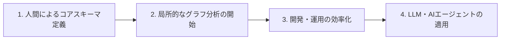
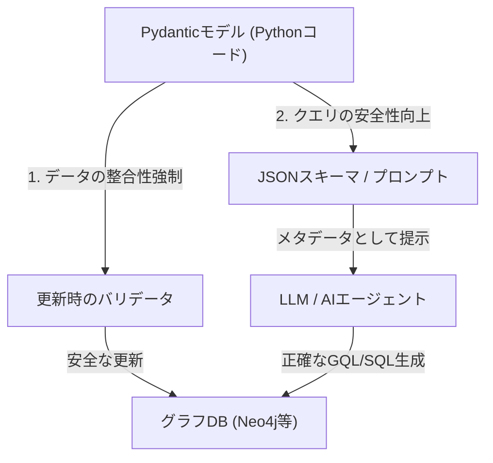

:::message
この記事は、Snowflake / Databricks / Google Cloud が推進する仮想グラフによる知識グラフをテーマにした、3部構成のシリーズ記事の **第3部** です。

* [第 1 部 AIエージェントを支える次世代データ基盤 - Snowflake / Databricks / Google が挑む仮想グラフ戦略](https://zenn.dev/yohei/articles/2026-05-30-vkg-strategy-what)
* [第 2 部 AI エージェントを支える次世代データ基盤 - AI エージェントの知識表現と推論になぜグラフが使われるのか？](https://zenn.dev/yohei/articles/2026-05-30-vkg-strategy2)
* **第 3 部** ：スキーマレスの地獄を回避するサステナブルな運用戦略（本記事）
:::

## 概要

本シリーズの第1部および第2部では、主要データプラットフォームが「仮想グラフ（Virtual Graph）」に注力する動向と、AIエージェントの知識表現や推論におけるグラフモデルの理論的優位性について解説しました。

最終章となる第3部では、これらのテクノロジーを実務で安全に稼働させ、持続可能（サステナブル）なものにするための **「運用と設計（How）」** にフォーカスします。

専用の物理グラフデータベース（Neo4j等）や仮想知識グラフ（VKG）を導入する際、直面するのが「スキーマレスがもたらす変更管理の地獄」と「LLMによるグラフ理解の不確実性」です。本記事では、この課題を解決するために、人間のドメイン定義と段階的な導入プロセス、とくにPythonの `Pydantic` を用いてグラフスキーマと制約を強制・提示する現実的なアーキテクチャを解説します。

---

## 1. 知識グラフとAIエージェント：期待と冷徹な現実（課題の整理）

本シリーズの第1弾では「物理データ移動のない仮想グラフの商機」を解説し、第2弾では「AIエージェントの推論を支えるグラフモデルの優位性」を歴史的・理論的な観点から紐解きました。しかし、いざこれらを企業の実務に適用しようとすると、美しき理論の裏にある **冷徹なエンジニアリング課題** に直面します。

第2弾の最後でも触れたように、「自動的な知識獲得と保守の困難性」や「LLMによる推論精度の限界」は依然として根深い問題です。これを理解するために、オントロジーや知識表現をAIエージェント開発に活用する際の対立構造を整理する必要があります。

### ① 「決定論的ルール」と「確率的LLM」のジレンマ

知識や推論をシステムに持たせるアプローチには、大きく分けて以下の2つの潮流があり、それぞれがトレードオフを抱えています。

* **ルールベース（記号AI）の限界**:
  人間が厳格な推論規則やオントロジーを定義するため、出力は常に100%正確（決定論的）です。しかし、実世界の例外的なビジネスルールや複雑なニュアンスへの追従が難しく、開発・保守の柔軟性に著しく欠けます。
* **LLM（統計的AI）の限界**:
  自然言語を曖昧なまま解釈・処理できるため極めて柔軟です。しかし、ハルシネーション（嘘の出力）を完全に抑え込むことができず、「本当にシステムが期待していた通りの推論や検索が行われたか」をエンジニアリング的に保証することが困難です。

### ② ユースケース不明瞭な領域への適用リスク

実務において最も高いリスクは、**「ユースケースが不明瞭で、かつ背後のデータモデルが十分に整理されていない領域」に対して、まだベストプラクティスが確立されていないグラフ／オントロジー技術を導入すること**です。

これは開発コストを浪費し、複雑で保守不能な巨大なグラフDB（または仮想グラフ）を構築して放置される結果（スキーマレスの地獄）を招きます。オントロジーや知識グラフを安全にビジネス価値に繋げるためには、導入するビジネス領域に以下の3つの厳格な境界線（前提条件）を引く必要があります。

1. **課題・問題が明確であること**: 解決すべき問い（例：「製品Aの調達遅延がどの下流製品に影響するか」など）が明確に定義されていること。
2. **ドメインエキスパートの存在**: ビジネス定義や型情報を正しく言語化・設計できる人間のドメインエキスパートが手元に存在すること。
3. **競争力・コアビジネスへの直結**: 他社に対する強力な差別化に直結し、継続的な管理コストを支払う価値があるコア領域であること。

これら3つの条件を満たす領域に限定した上で、LLMの柔軟な支援（非構造化データからのノード自動抽出等）を受けつつも、人間がオントロジー定義をガバナンスし、**「決定論的（厳格）」に構築を進める**ことこそが、最も現実的なアプローチです。

### ③ クエリ生成における「LLM丸投げ」からの脱却

AIエージェントに知識グラフをクエリさせる際、LLMに直接アドホックなCypherやGQLなどのクエリを自動生成させること（Text-to-Cypher）には精度的な限界が存在します。LLMがデータベースの物理的な構造や制約を100%正しく理解していない場合、エラークエリが発生しシステムは破綻します。

この課題を克服するためには、以下の2つのアプローチを組み合わせる必要があります。

* **グラフスキーマと制約の明示的な定義と提示**: LLMがクエリすべき正しい関係性のルール（型とドメイン制約）を、LLMが理解しやすい表現でプロンプトに明示的に定義・マッピングすること。
* **Agent Skill（エージェント・スキル）の事前定義**: グラフをどうクエリし、どのように分析すべきか（例：最短経路探索やハブのPageRank等）の定型的な処理ロジックやクエリテンプレートを「エージェント用のSkill（ツール）」として事前プログラムし、エージェントが自律的にそれを選択・実行できるようにすること。

これらを踏まえた上で、本章以降では「どのように厳格なスキーマを管理し（How）」、「どのように開発・運用の負担を低減するか」という具体的なアーキテクチャに迫ります。

---

## 2. スキーマレスがもたらす「変更管理の地獄」と専用グラフDBの限界

多くの専用グラフデータベース（とくにプロパティグラフDBの代表格であるNeo4jなど）は、物理的なテーブル定義を必要としない **「スキーマレス（あるいはスキーマライト）」** である柔軟性をメリットとしてアピールしてきました。データモデルが未確定な開発初期段階において、ノードやエッジ、プロパティをアドホックに追加できる手軽さは確かに強力です。

しかし、実業務の本番運用において、スキーマレスは **「変更管理の崩壊」** を引き起こす原因になり得ます。

### ① スキーマレス運用が直面する3つの壁

* **データ整合性の破壊**: 
  あるエンジニアが定義した `Employee` ノードに `email` プロパティが含まれている一方、別のエンジニアが追加したノードには `mail_address` として登録されたり、必須プロパティが欠落したノードが意図せずコミットされたりします。
* **関係性の制約崩壊**:
  「`Department` ノードと `Component` ノードの間には関係性（エッジ）を結んではならない」といったビジネスルール（ドメイン制約）が存在しても、スキーマレスの環境では、アプリケーションのバグにより無意味なエッジが容易に書き込まれてしまいます。
* **データベース移行（マイグレーション）の困難さ**:
  厳格なDDLやマイグレーションツール（Alembic等）が普及しているRDBとは異なり、無秩序にデータが追加されたグラフDB上で、整合性を保ったままデータ構造をマイグレーションすることは困難を極めます。

### ② Neo4jなどのデータベース単体での制約強制の限界

Neo4jなどのモダンなグラフデータベースにも、特定のラベルに対してプロパティの存在制約（`IS NOT NULL`）や一意性制約（`UNIQUE`）をかける機能（Schema Constraints）は存在します。しかし、これらは一部の単純なプロパティ制約に限定されており、以下のような **「関係性そのもののセマンティクスや複雑な型チェック」** をデータベースレベルで完全に強制することはできません。

* 「`label: Component` のノードから伸びる `edge: SUPPLIED_BY` は、必ず `label: Supplier` のノードに接続しなければならない（ノード間のペアリング制約）」
* 「`price` プロパティは必ず正の浮動小数点数でなければならず、特定のサプライヤータイプに応じてバリデーションルールを動的に変化させる（条件付き型チェック）」

したがって、スキーマレスなグラフDBをそのまま本番運用に投入すると、開発チームの拡大やAIエージェントによる動的な書き込みに伴って、データモデルが容易に崩壊し、持続的な保守が不可能になります。

---

## 3. ドメイン主導の段階的オントロジー設計とAIエージェント導入フロー

このスキーマの混沌を避けるために、「あらゆる社内データを網羅する巨大な知識グラフを最初に構築する」というビッグバンアプローチを取るべきではありません。オントロジー構築とグラフ活用の成功には、対象領域の絞り込みと段階的な導入プロセスが不可欠です。

### ① コアビジネス領域への絞り込み（人間のドメインエキスパートの役割）

知識グラフの核となる「オントロジー（スキーマ設計）」の定義は、LLMに全自動で丸投げするのではなく、 **自社に深いドメイン知識があり、コアビジネスに関連し、かつ他社に対する競争戦略のある領域** に厳密に限定して開始すべきです。

たとえば、製造業におけるサプライチェーンの依存関係や部品構成（BOM）、金融における特定の不正シナリオ、医療における独自の診断支援モデルなどです。これらのコア領域に対して、そのビジネスルールを熟知した **人間のドメインエキスパート** が直接介入し、オントロジー（どのノードがどう結ばれるべきかという論理制約）を注意深く定義します。ドメインの本質を反映した設計があって初めて、インフラとしてのグラフデータモデルはサステナブルなものになります。

### ② 段階的アプローチ：グラフ分析からAIエージェントへ

いきなり自律的に稼働する複雑なAIエージェントを構築するのではなく、以下のプロセスに沿って段階的にグラフテクノロジーを適用していくアプローチが現実的です。



1. **第1段階：人間によるコアスキーマの定義**: 競争力のある特定ビジネス領域に絞り、明確なオントロジー（スキーマ）を定義する。
2. **第2段階：インメモリや局所的なグラフ分析の開始**: 定義したスキーマに基づいてデータを収集し、まずは人間が「最短経路探索」や「PageRank」などの標準的なグラフアルゴリズムを用いて局所的なビジネス分析（グラフ分析）を行い、データ品質や運用負荷の感触を掴む。
3. **第3段階：開発・運用の効率化**: データの整合性を監視・担保するための仕組みをアプリケーションレイヤーに組み込み、運用の負荷を低減する。
4. **第4段階：LLMやAIエージェントの適用**: 安定したデータ基盤が確立されたのちに、エージェント認知層としての「GraphRAG」や、対話コンテキストを記録する「Context Graph」といった動的処理にLLMを順次導入していく。

この段階的フローを踏むことで、初期のPoC（概念実証）の失敗リスクを抑えつつ、システムの変更管理をコントロール配下に置くことができます。

---

## 4. Pydanticを活用した「グラフスキーマ＆制約強制」アーキテクチャ

データベース単体での厳格な制約強制が難しいスキーマレスなグラフDB（またはリレーショナルDWH上の仮想グラフモデル）に対して、アプリケーションレイヤーでスキーマと制約を強制するための極めて有効な解決策が、Pythonの型・制約定義ライブラリである **`Pydantic`** の活用です。

### ① 二重の役割を果たす「Pydanticモデル」

Pydanticを用いてグラフのノード（Node）、エッジ（Edge）、およびそれらの結合ルールを記述したPythonコードを作成し、これをシステム全体の **「セマンティックな共通言語」** として機能させます。このモデルは、以下の二重の目的を果たす強力なアセットとなります。



#### 役割1：グラフDB更新時の制約バリデータ（インフラ防衛）
アプリケーションがグラフDBを更新する（ノードを追加する、エッジを結ぶ）際、必ずPydanticモデルを通してバリデーションをかけます。
Pydanticモデルが、未定義のプロパティ、型の不一致、さらには「このノードラベル間には存在し得ない未定義のエッジラベル」を検知した時点で実行を遮断します。これにより、スキーマレスなデータベースの背後に厳格な防壁を築き、データの一貫性を100%維持します。

#### 役割2：LLMに対する認知的スキーマの提示（クエリ生成の支援）
AIエージェントがグラフ構造に対してCypherやGQLといったクエリを動的に生成する際、Pydanticモデルから自動エクスポートした「JSONスキーマ」や「オブジェクトモデル定義」を、LLMのシステムプロンプトのコンテキストにマッピングします。
これにより、LLMはグラフDB内の正しい型情報や関係性の許容ルールを完全に理解でき、存在しないプロパティや誤った接続パスをクエリしようとするハルシネーション（エラークエリの生成）を大幅に低減できます。

---

## 5. 実務コード例：Pydanticによるスキーマ強制とLLM連携

ここでは、製造業における「部品構成（BOM）」と「サプライヤーの依存関係」という、ドメイン知識に基づく競争領域をテーマにした具体的な実装例を示します。

Pydanticを用いてノードとエッジの厳密な型を定義し、それに基づいて安全な更新を実行し、LLMにスキーマを提示するプロトタイプコードです。

### ① Pydanticによるグラフスキーマ（ノード・エッジ）の定義

```python
from typing import Literal, Optional, List
from pydantic import BaseModel, Field, field_validator

# ----------------------------------------------------
# 1. ノード（Node）モデルの定義
# ----------------------------------------------------

class ComponentNode(BaseModel):
    """製造業の部品構成（BOM）を表現するノード"""
    id: str = Field(..., description="部品ID (例: COMP-100)")
    name: str = Field(..., description="部品の正式名称")
    material: str = Field(..., description="部品の主材質")
    cost: float = Field(..., gt=0.0, description="製造または調達コスト (正の数値のみ)")
    
    # ノードに付与される物理DB用ラベル
    label: Literal["Component"] = "Component"

class SupplierNode(BaseModel):
    """サプライヤーを表現するノード"""
    id: str = Field(..., description="サプライヤー識別ID")
    company_name: str = Field(..., description="企業名")
    country: str = Field(..., description="調達国 (ISOコード二文字等)")
    risk_level: Literal["Low", "Medium", "High"] = Field(..., description="BCP観点での供給リスク")
    
    label: Literal["Supplier"] = "Supplier"

# ----------------------------------------------------
# 2. エッジ（Edge / 関係性）モデルと結合制約の定義
# ----------------------------------------------------

class SuppliedByEdge(BaseModel):
    """ComponentがどのSupplierから供給されているかを結ぶエッジ"""
    source_label: Literal["Component"] = "Component"
    source_id: str
    target_label: Literal["Supplier"] = "Supplier"
    target_id: str
    
    edge_type: Literal["SUPPLIED_BY"] = "SUPPLIED_BY"
    lead_time_days: int = Field(..., ge=1, description="調達リードタイム (日数)")
```

### ② データベース更新時のバリデーションの強制（疑似コード）

上記のモデル定義を利用し、アプリケーションからデータベースへの安全な書き込み処理をカプセル化します。

```python
class GraphDatabaseClient:
    """スキーマと制約を強制するグラフデータベース更新クライアント"""
    def __init__(self, neo4j_driver):
        self.driver = neo4j_driver

    def add_component_node(self, node_data: dict):
        # 1. Pydanticによるデータ整合性検証の強制
        try:
            validated_node = ComponentNode(**node_data)
        except Exception as e:
            raise ValueError(f"スキーマ検証エラー: {e}")

        # 2. 検証済みのデータをデータベースに反映 (安全な Cypher パラメータ)
        query = (
            "MERGE (c:Component {id: $id}) "
            "SET c.name = $name, c.material = $material, c.cost = $cost "
            "RETURN c"
        )
        with self.driver.session() as session:
            session.run(query, validated_node.model_dump())

    def connect_supplied_by(self, edge_data: dict):
        # 1. 関係性の制約検証
        try:
            validated_edge = SuppliedByEdge(**edge_data)
        except Exception as e:
            raise ValueError(f"関係性ルール違反: {e}")

        # 2. 検証済みの接続関係を安全に作成
        query = (
            "MATCH (c:Component {id: $source_id}) "
            "MATCH (s:Supplier {id: $target_id}) "
            "MERGE (c)-[r:SUPPLIED_BY]->(s) "
            "SET r.lead_time_days = $lead_time_days "
            "RETURN r"
        )
        with self.driver.session() as session:
            session.run(query, validated_edge.model_dump())
```

### ③ LLMにPydanticスキーマをプロンプトとして提示する手法

LLMにクエリ生成タスクを指示する際、以下のように定義済みのPydanticスキーマをJSON Schema形式でエクスポートし、システムプロンプトに動的に注入します。

```python
import json

def generate_llm_system_prompt() -> str:
    # Pydanticモデルからスキーマ定義をJSONとして出力
    component_schema = ComponentNode.model_json_schema()
    supplier_schema = SupplierNode.model_json_schema()
    edge_schema = SuppliedByEdge.model_json_schema()
    
    prompt = f"""
あなたは弊社の製造サプライチェーン(BOM)とサプライヤーに関する知識グラフを探索するAIエージェントです。
ユーザーの自然言語による意図を理解し、正しいNeo4j Cypherクエリを生成してください。

【厳格な知識グラフスキーマ定義】
以下のJSONスキーマで定義されたノードとエッジの種類・属性ルールのみをクエリに使用してください。
存在しないプロパティや誤った関係性の接続をクエリした場合はシステムが破綻します。

■ Componentノード (部品定義):
{json.dumps(component_schema, indent=2, ensure_ascii=False)}

■ Supplierノード (調達先定義):
{json.dumps(supplier_schema, indent=2, ensure_ascii=False)}

■ SUPPLIED_BYエッジ (供給関係):
{json.dumps(edge_schema, indent=2, ensure_ascii=False)}
※注意: SUPPLIED_BYエッジは必ず Component から Supplier に向かって接続されます。逆向きに探索しないでください。

【クエリ生成ルール】
- データベースの更新(WRITE/CREATE)は行わず、MATCHおよびRETURNのみを用いた参照専用クエリを作成してください。
- markdownの ```cypher ... ``` ブロック内にクエリを出力してください。
"""
    return prompt
```

このアプローチにより、アプリケーションは **「データの一貫性防衛」** と **「LLMのコンテキスト理解の最大化」** を同一のPydanticモデル定義というシングル・ソースから実現でき、サステナブルな運用を確立することが可能になります。

---

## 6. まとめ - シリーズの完結

3部にわたり、AIエージェントのインフラとしての「知識グラフ」と、その普及を推し進める「仮想グラフ戦略」について考察してきました。本シリーズが提示したコアメッセージは以下のように集約されます。

* **第1部（What）**: 物理的に巨大なデータを専用DBにコピーする限界を突破し、データガバナンスとリアルタイム性を両立させるアプローチとして **「仮想グラフ（Virtual Graph）」** が次世代の必須アーキテクチャとなる。
* **第2部（Why）**: 単なる類似度検索（ベクトル検索）や静的SQLの限界を補い、AIエージェントが複雑な関係性のロジックや長期の文脈記憶を一貫性を持って処理するための「インテリジェント脳」として、オントロジーとグラフ構造による **「知識表現と推論」** が有効な選択肢となる。
* **第3部（How）**: スキーマレスなグラフDB単体での変更管理の崩壊を防ぐため、自社の競争優位性があるコア領域に絞って人間の専門家がオントロジーを定義し、Pythonの **`Pydantic`** などを仲介させてスキーマと制約を「インフラ更新時」および「LLMのクエリ生成時」の双方に厳密に強制することで、システムは初めて持続可能となる。

データを二次元テーブルとしてフラットに管理する時代から、意味と関係性のネットワークとして論理的に紡ぎ直す時代へ。
主要ベンダーによる「仮想グラフ」のインフラ統合が急速に進む中、この強力な意味統合レイヤーを安全かつ戦略的に操る設計力こそが、これからのAI主導のエンタープライズシステムにおいて核心的な競争優位性をもたらすものと確信しています。

---

**連載一覧：**

* [第 1 部 AIエージェントを支える次世代データ基盤 - Snowflake / Databricks / Google が挑む仮想グラフ戦略](https://zenn.dev/yohei/articles/2026-05-30-vkg-strategy-what)
* [第 2 部 AI エージェントを支える次世代データ基盤 - AI エージェントの知識表現と推論になぜグラフが使われるのか？](https://zenn.dev/yohei/articles/2026-05-30-vkg-strategy2)
* [第 3 部 AIエージェントを支える次世代データ基盤 - スキーマレスの地獄を回避するサステナブルな運用戦略](https://zenn.dev/yohei/articles/2026-05-30-vkg-strategy3) (本作)
