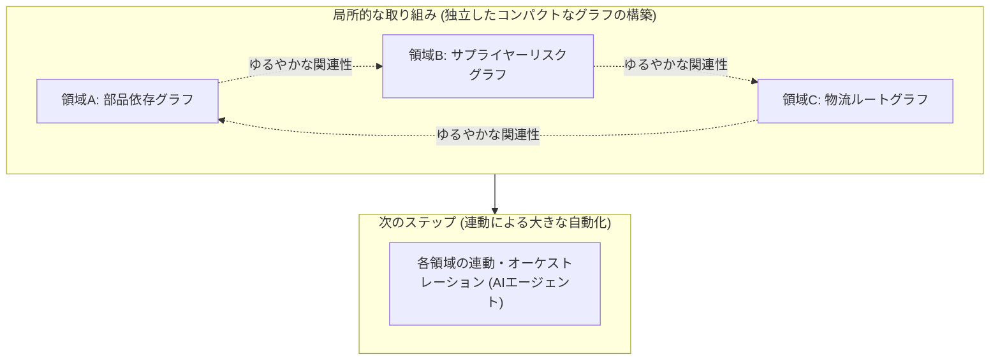
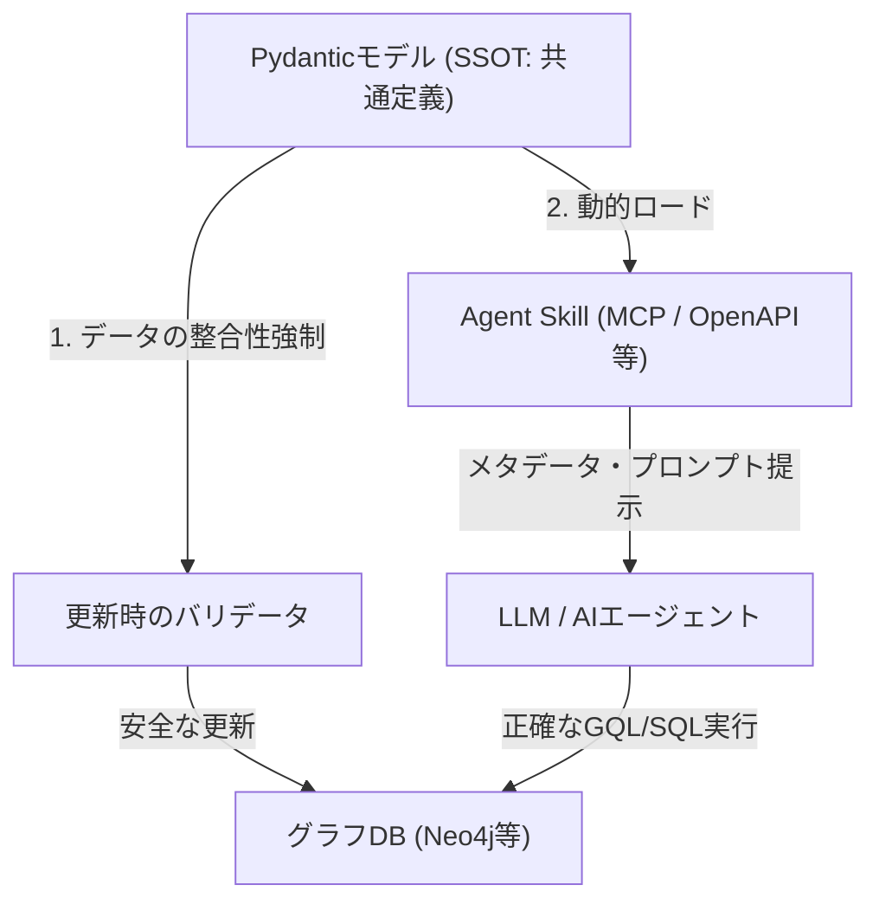

:::message
この記事は、Snowflake / Databricks / Google Cloud が推進する仮想グラフによる知識グラフをテーマにした、3部構成のシリーズ記事の **第3部** です。

* [第 1 部 Snowflake / Databricks / Google が挑む仮想グラフ戦略](https://zenn.dev/yohei/articles/2026-05-30-vkg-strategy-what)
* [第 2 部 AI エージェントの知識表現と推論になぜグラフが使われるのか？](https://zenn.dev/yohei/articles/2026-05-30-vkg-strategy2)
* **第 3 部** ：物理グラフDBを独自開発するための変更管理と安定運用戦略（本記事）
:::

## 概要

本シリーズの [第1部](https://zenn.dev/yohei/articles/2026-05-30-vkg-strategy-what) および [第2部](https://zenn.dev/yohei/articles/2026-05-30-vkg-strategy2) では、主要データプラットフォームが「仮想グラフ（Virtual Graph）」に注力する動向と、AIエージェントの知識表現や推論におけるグラフモデルの理論的優位性について解説しました。

第1部では物理的なデータコピーを避ける「仮想グラフ」の可能性を論じましたが、実際のビジネス要件や処理性能、システム構成によっては、専用の物理グラフデータベース（Neo4jなど）を自分たちでゼロから構築し、物理的なインフラとして本番稼働させる選択肢（物理グラフ開発）をとる場面も数多く存在します。

最終章となる第3部では、このように **「物理グラフを独自に開発・運用することになった場合」** を前提とし、現実的に安定した物理グラフデータベースを持続可能（サステナブル）に運用・保守していくための **「変更管理と設計の考え方（How）」** にフォーカスします。

スキーマレスな物理グラフDBを運用する際に直面する「変更管理の地獄」を回避し、アプリケーションコード側でスキーマと制約を強制しながら、LLMに対する認知的プロンプトやオープン標準のAgent Skillへと繋いでいく現実的なアーキテクチャを解説します。

---

## 1. 知識グラフとAIエージェント：期待と冷徹な現実（課題の整理）

本シリーズの第1弾では「物理データ移動のない仮想グラフの商機」を解説し、第2弾では「AIエージェントの推論を支えるグラフモデルの優位性」を歴史的・理論的な観点から紐解きました。しかし、いざこれらを企業の実務に適用しようとすると、美しき理論の裏にある **冷徹なエンジニアリング課題** に直面します。

第2弾の最後でも触れたように、「自動的な知識獲得と保守の困難性」や「LLMによる推論精度の限界」は依然として根深い問題です。これを理解するために、オントロジーや知識表現をAIエージェント開発に活用する際の対立構造を整理する必要があります。

### ① 「決定論的ルール」と「確率的LLM」のジレンマ

知識や推論をシステムに持たせるアプローチには、大きく分けて以下の2つの潮流があり、それぞれがトレードオフを抱えています。

* **ルールベース（記号AI）の限界**:
  人間が厳格な推論規則やオントロジーを定義するため、出力は常に100%正確（決定論的）です。しかし、実世界の例外的なビジネスルールや複雑なニュアンスへの追従が難しく、開発・保守の柔軟性に著しく欠けます。
* **LLM（統計的AI）の限界**:
  自然言語を曖昧なまま解釈・処理できるため極めて柔軟です。しかし、ハルシネーション（嘘の出力）を完全に抑え込むことができず、「本当にシステムが期待していた通りの推論や検索が行われたか」をエンジニアリング的に保証することが困難です。

### ② ユースケース不明瞭な領域への適用リスクと「あるある」の罠

グラフ技術やオントロジーの文脈で実務において最も頻発する「あるある」の罠は、**知識グラフを誤解した意思決定層（偉い人）が、「会社のすべての業務知識を一枚の巨大な知識グラフに統合し、なんでも自律的に判断できる万能なAIを作ろう」と言い出すこと**です。

しかし、このような目的もスコープも不明瞭な「ビッグバンアプローチ（万能AI構想）」は、確実に破綻します。結果として開発コストを浪費し、複雑で誰も保守できない巨大なグラフDBの残骸（あるいはスキーマレスの地獄）を構築して放置されるだけに終わります。

オントロジーや知識グラフを安全にビジネス価値に繋げるためには、まず「すべての知識をグラフ化する」といった幻想を捨て、以下の**4つの厳格な境界線（前提条件）**を引く必要があります。

1. **課題・問題が明確であること**:
   解決すべき問い（例：「製品Aの調達遅延がどの下流の構成部品に影響するか」など）が、現場やビジネスの視点から明確に定義されていること。
2. **グラフ構造とグラフアルゴリズムで解くべき問題であること**:
   その問題が「ネットワーク構造」に帰着でき、最短経路探索、影響範囲の依存関係追跡、中心性分析といった、グラフの理論とアルゴリズムを用いて解き、解を導く必然性があること（単なるキーバリューストアや関係データベースの単純なJOIN等で簡単に解ける問題ではないこと）。
3. **ドメインエキスパートの存在**:
   ビジネス定義や関係性の型情報を、正しく言語化・オントロジー設計できる人間のドメインエキスパート（外部コンサルタントでも可）が手元に存在すること。
4. **競争力・コアビジネスへの直結**:
   他社に対する強力な差別化に直結し、継続的な管理コストを支払う価値があるコア領域であること。

目的とスコープをシャープに絞り込み、これら4つの条件を満たす領域からスモールスタートする。そして、LLMの柔軟な支援を受けつつも、人間がオントロジー定義を厳格にガバナンスし、**「決定論的（厳格）」に局所的な構築を進める**ことこそが、実務における唯一現実的なアプローチです。

### ③ クエリ生成における「LLM丸投げ」からの脱却

AIエージェントに知識グラフをクエリさせる際、LLMに直接アドホックなCypherやGQLなどのクエリを自動生成させること（Text-to-Cypher）には精度的な限界が存在します。LLMがデータベースの物理的な構造や制約を100%正しく理解していない場合、エラークエリが発生しシステムは破綻します。

この課題を克服するためには、以下の2つのアプローチを組み合わせる必要があります。

* **グラフスキーマと制約の明示的な定義と提示**: LLMがクエリすべき正しい関係性のルール（型とドメイン制約）を、LLMが理解しやすい表現でプロンプトに明示的に定義・マッピングすること。
* **Agent Skill（エージェント・スキル）の事前定義**: グラフをどうクエリし、どのように分析すべきか（例：最短経路探索やハブのPageRank等）の定型的な処理ロジックやクエリテンプレートを「エージェント用のSkill（ツール）」として事前プログラムし、エージェントが自律的にそれを選択・実行できるようにすること。

これらを踏まえた上で、本章以降では「どのように厳格なスキーマを管理し（How）」、「どのように開発・運用の負担を低減するか」という具体的なアーキテクチャに迫ります。

---

## 2. 物理グラフDBの罠：スキーマレスがもたらす「変更管理の地獄」

第1部で解説した「仮想グラフ」であれば、背後にあるSnowflakeやDatabricks等のDWH製品が提供する厳格なテーブル定義やデータガバナンス機能を流用できました。しかし、Neo4jなどの専用「物理グラフデータベース」を自分たちで開発・運用する選択をした場合、既存の強固なDWHによるスキーマ保護を受けることはできません。

物理グラフDBを独自開発する際の最大の罠は、物理的なテーブル定義（DDL）を必要としない **「スキーマレス（あるいはスキーマライト）」** である点にあります。データモデルが確定していない開発初期段階において、ノードやエッジ、プロパティをアドホックに何でも追加できる柔軟性は、開発スピードを上げる強力な武器に見えます。

しかし、いざこれを本番運用に投入すると、この「スキーマレス」の特性が **物理グラフの変更管理の崩壊（スキーマレスの地獄）** を引き起こす決定的な要因となります。

### ① スキーマレス運用が直面する3つの壁

* **データ整合性の破壊**: 
  あるエンジニアが定義した `Employee` ノードに `email` プロパティが含まれている一方、別のエンジニアが追加したノードには `mail_address` として登録されたり、必須プロパティが欠落したノードが意図せずコミットされたりします。
* **関係性の制約崩壊**:
  「`Department` ノードと `Component` ノードの間には関係性（エッジ）を結んではならない」といったビジネスルール（ドメイン制約）が存在しても、スキーマレスの環境では、アプリケーションのバグにより無意味なエッジが容易に書き込まれてしまいます。
* **データベース移行（マイグレーション）の困難さ**:
  厳格なDDLやマイグレーションツール（Alembic等）が普及しているRDBとは異なり、無秩序にデータが追加されたグラフDB上で、整合性を保ったままデータ構造をマイグレーションすることは困難を極めます。

### ② Neo4jなどのデータベース単体での制約強制の限界

Neo4jなどのモダンなグラフデータベースにも、特定のラベルに対してプロパティの存在制約（`IS NOT NULL`）や一意性制約（`UNIQUE`）をかける機能（Schema Constraints）は存在します。しかし、これらは一部の単純なプロパティ制約に限定されており、以下のような **「関係性そのもののセマンティクスや複雑な型チェック」** をデータベースレベルで完全に強制することはできません。

* 「`label: Component` のノードから伸びる `edge: SUPPLIED_BY` は、必ず `label: Supplier` のノードに接続しなければならない（ノード間のペアリング制約）」
* 「`price` プロパティは必ず正の浮動小数点数でなければならず、特定のサプライヤータイプに応じてバリデーションルールを動的に変化させる（条件付き型チェック）」

したがって、スキーマレスなグラフDBをそのまま本番運用に投入すると、開発チームの拡大やAIエージェントによる動的な書き込みに伴って、データモデルが容易に崩壊し、持続的な保守が不可能になります。

---

## 3. ドメイン主導の段階的オントロジー設計とボトムアップ型グラフネットワーク

このスキーマの混沌や導入の失敗を避けるために、「あらゆる社内データを網羅する巨大な知識グラフを最初に構築する」あるいは「すべての業務プロセスにいきなりLLMを導入する」といったビッグバンアプローチを取るべきではありません。これらは極めて不確実性が高く、ハイリスクです。

オントロジー構築とAIエージェントの活用を成功させる鍵は、明確なユースケースの絞り込みと、段階的・ボトムアップな導入プロセスにあります。

### ① データエンジニアリングにおける「オントロジー」の再定義

一般的に「オントロジー」と聞くと、古典的な人工知能研究（記号AI）やセマンティックWeb（RDF、OWL、SPARQLなど）における学術的で厳格な概念体系の定義を思い浮かべるかもしれません。しかし、現代の実践的なデータエンジニアリングやアプリケーション開発の現場においては、オントロジーをもっと身近で実用的なものとして再定義する必要があります。

現代の知識グラフ運用におけるオントロジーとは、**「グラフスキーマ、データモデルが守るべき物理的・論理的制約、そしてそのデータが使われるビジネス文脈（Context）に関する明文化された説明」**そのものです。

古典的なセマンティックWebのように「世界中のあらゆる概念の定義」を目指すのではなく、以下のレイヤーで構築される「スキーマとバリデーションルール」の総体をオントロジーと捉えます。

* **データベース層の制約（緩やかなオントロジー）**:
  Neo4jなどのモダンなグラフDBがサポートする、プロパティの存在制約や一意性制約など。これらは不十分ながらも、データベース層が最低限維持すべき整合性のラインを引いてくれます。
* **データパイプライン／アプリケーション層の制約（厳格なオントロジー）**:
  データベースへデータを流し込む前段のデータパイプラインや、更新を行うアプリケーションコード側（PythonのPydanticやTypeScriptのZod、Go/Rustのバリデータ）に実装された、**「グラフ構造や結合ルールを強制するスキーマ定義と制約バリデーションロジックそのもの」**。

つまり、データベースの型ルールや接続ルール、さらにはそれをバリデーションするアプリケーションのコードこそが、実務における最も確実な「生きたオントロジー」となります。このデータエンジニアリング的な再解釈により、オントロジーは学術的な理想論から、変更管理可能でテスト可能な「ソフトウェア工学の対象」へと進化します。

### ② ユースケースを絞り込むための「4つの必須条件」

グラフ技術を最初に適用すべき領域は、以下の4つの条件をすべて満たすものに限定する必要があります。

1. **自社のコアビジネス領域であること**:
   他社との競争戦略において中核をなす業務プロセスであること。
2. **競争力に直結する領域であること**:
   その課題を解決することで、コスト削減や生産性向上、顧客価値の創出において明確な競争優位性が生まれること。
3. **モデリングを支援するドメインエキスパートの存在**:
   社内に深いビジネスロジックを理解したエキスパートがいること（外部の専門コンサルタントでも可）。彼らが存在して初めて、現実的でサステナブルなグラフスキーマ（オントロジー）が定義可能になります。
4. **グラフ構造とアルゴリズムで解くべき問題であること**:
   依存関係の解析、トレーサビリティの確保、最短経路の探索など、二次元のフラットなリレーショナルテーブルよりも、ネットワーク構造とグラフアルゴリズムを適用したほうが圧倒的に解きやすい問題であること。

### ③ 段階的アプローチ：コンパクトな問題からボトムアップ型連動へ

最初から巨大な統合グラフを目指すのではなく、**「よく理解しており、ステークホルダー間で合意できているコンパクトな問題」を局所的にいくつか解く**ことから始めます。



このアプローチは以下のプロセスで発展させます。

1. **独立したコンパクトなグラフの作成**:
   複数の異なる領域で、それぞれ「依存関係がなく独立した、しかし概念的・実務的に関連しあっている小さなグラフ」を複数構築します。各領域では、ステークホルダーとの合意が得られている小さな課題の解決だけに集中します。
2. **局所的なグラフ分析の成功**:
   定義したスキーマに基づいてデータを収集し、まずは人間が「最短経路探索」や「影響範囲分析」などの定型的なグラフアルゴリズムを用いてコンパクトな問題を解決し、実利を証明します。
3. **独立したグラフ同士の連動**:
   個別の領域で機能する独立したグラフが複数できてから、これらを「ゆるやかに関連」させ、連動させます。
4. **AIエージェントによる自動化と生産性向上**:
   これらの連動したグラフネットワークをAIエージェントやLLMの認知的知識ベースとして活用することで、領域をまたいだ高度な推論、さらなる自動化、そして飛躍的な生産性向上（例：部品遅延から物流ルート変更の自律的提案など）を実現します。

「全てを一度にグラフ化しよう」「全てをLLMで解決しよう」とするのは破綻のもとです。よく知っている、価値の大きい小さな問題を複数解き、それらを組み合わせることで、より大きな複雑な問題を安全に解決する。これこそが、エンタープライズにおける現実的なグラフ導入戦略です。

---

## 4. スキーマ検証モデルを活用した「グラフスキーマ＆制約強制」と疎結合Agent Skill

データベース単体での厳格な制約強制が難しいスキーマレスなグラフDB（またはリレーショナルDWH上の仮想グラフモデル）に対して、アプリケーションレイヤーでスキーマと制約を強制するための極めて有効な解決策が、各開発言語のエコシステムに存在する型・制約定義（スキーマ検証）ライブラリの活用です。

本記事では実装コードとしてPythonの **`Pydantic`** を用いた構成を紹介しますが、この設計思想は特定の言語やライブラリに限定されません。プロジェクトの技術スタックに応じて、適切な仕組みを選択できます。

* **TypeScript / JavaScript**: **`Zod`** や **`io-ts`** などのスキーマ検証ライブラリ
* **Rust**: **`serde`** によるシリアライズ/デシリアライズと各種検証クレートの組み合わせ
* **Go**: 構造体タグ（Struct Tags）とバリデータライブラリ（`go-playground/validator` 等）

このように、各言語やプラットフォームに依存した仕組みを用意し、アプリケーション層の入り口で厳格にデータ整合性を担保します。

### ① 二重の役割を果たす「スキーマ検証モデル」

共通の型・制約定義を用いてグラフのノード（Node）、エッジ（Edge）、およびそれらの結合ルールを記述したスキーマモデルを作成し、これをシステム全体の **「セマンティックな共通言語」** として機能させます。このモデルは、以下の二重の目的を果たす強力なアセットとなります。



#### 役割1：グラフDB更新時の制約バリデータ（インフラ防衛）
アプリケーションがグラフDBを更新する（ノードを追加する、エッジを結ぶ）際、必ずこのスキーマ検証モデルを通してバリデーションをかけます。
モデルが、未定義プロパティ、型の不一致、さらには「このノードラベル間には存在し得ない未定義のエッジラベル」を検知した時点でデータベースへの書き込みを遮断します。これにより、スキーマレスなデータベースの背後にアプリレイヤーで厳格な防壁を築き、データの一貫性を維持します。

#### 役割2：LLMに対する認知的スキーマの提示（クエリ生成の支援）
AIエージェントがグラフ構造に対してCypherやGQLといったクエリを動的に生成する際、スキーマ検証モデルからエクスポートした「JSON Schema」や「メタデータ定義」を、LLMのシステムプロンプトのコンテキストに提示します。
これにより、LLMはグラフDB内の正しい型情報や関係性の許容ルールを理解でき、存在しないプロパティや誤った接続パスをクエリしようとするハルシネーション（エラークエリの生成）を低減できます。

### ② ドメイン知識を内包する「Agent Skill」の疎結合設計

エージェントにグラフを操作・分析させるにあたり、単にスキーマ情報を渡すだけでは不十分です。LLMは「どのデータを、どういう手順で、どう分析すれば目的が達成できるか」というビジネスの文脈を理解できないからです。

そこで、特定のグラフ分析手続きを **「Agent Skill（エージェント・スキル）」** として定義し、以下の設計原則に沿って実装します。

#### 1. メタデータへの「ドメイン知識」の記述
Skillの説明（Description）やプロンプトテンプレートの中に、以下のような**分析のためのドメイン知識**を記述します。
* **どのようなビジネス上の文脈**（例：サプライチェーン途絶リスクのシミュレーション）で実行すべきか
* **どのノード**（例：`Component`, `Supplier`）および**エッジ**（例：`SUPPLIED_BY`）に着目すべきか
* **どのようなクエリやアルゴリズム**（例：影響範囲の探索）を組み合わせるべきか

この詳細なドメイン定義があることで、Skillをロードしたエージェントは「今はこの意思決定が必要だから、あのノードとエッジを利用するこのSkillを呼び出すべきだ」と適切に判断し、正確な分析を行えるようになります。

#### 2. オープン標準による汎用性（ポータビリティ）
これらのSkillは、特定の自社アプリケーション内だけで機能する閉じた仕組みにするのではなく、**Model Context Protocol (MCP)** や **OpenAPI / JSON Schema** などの「オープン標準」のツール仕様に準拠して定義します。
オープン標準で実装しておくことで、Web UIアプリ、バックエンドの自律ワークフロー、さらにはCLI型コーディングエージェント（Antigravity等）に至るまで、様々なプラットフォームやランタイムでそのまま汎用的に再利用できるようになります。

#### 3. Single Source of Truth (SSOT) の徹底
将来的にグラフスキーマやデータの物理的制約が変更された際、すべてのSkill定義を個別に手動で修正するのは「スキーマレスの地獄」を上層アプリケーション層に再現するのと同じです。
そのため、**「スキーマ情報や制約情報はSkill内に決してハードコードしない」**という原則を徹底します。
型定義や制約情報は、共通のPydanticモデルという **Single Source of Truth（信頼できる唯一の情報源）** に一元化し、Skillは実行時や初期化（ロード）時にその定義から動的にJSON Schemaやプロパティのルールをロードして、LLMへの提示用プロンプトを構築します。これにより、インフラ層のデータモデル変更が、上層のエージェントSkillへと安全かつ即座に伝播します。

---

## 5. 実務コード例：Pydanticによるスキーマ強制とLLM連携

ここでは、製造業における「部品構成（BOM）」と「サプライヤーの依存関係」という、ドメイン知識に基づく競争領域をテーマにした具体的な実装例を示します。

Pydanticを用いてノードとエッジの厳密な型を定義し、それに基づいて安全な更新を実行し、LLMにスキーマを提示するプロトタイプコードです。

### ① Pydanticによるグラフスキーマ（ノード・エッジ）の定義

```python
from typing import Literal, Optional, List
from pydantic import BaseModel, Field, field_validator

# ----------------------------------------------------
# 1. ノード（Node）モデルの定義
# ----------------------------------------------------

class ComponentNode(BaseModel):
    """製造業の部品構成（BOM）を表現するノード"""
    id: str = Field(..., description="部品ID (例: COMP-100)")
    name: str = Field(..., description="部品の正式名称")
    material: str = Field(..., description="部品の主材質")
    cost: float = Field(..., gt=0.0, description="製造または調達コスト (正の数値のみ)")
    
    # ノードに付与される物理DB用ラベル
    label: Literal["Component"] = "Component"

class SupplierNode(BaseModel):
    """サプライヤーを表現するノード"""
    id: str = Field(..., description="サプライヤー識別ID")
    company_name: str = Field(..., description="企業名")
    country: str = Field(..., description="調達国 (ISOコード二文字等)")
    risk_level: Literal["Low", "Medium", "High"] = Field(..., description="BCP観点での供給リスク")
    
    label: Literal["Supplier"] = "Supplier"

# ----------------------------------------------------
# 2. エッジ（Edge / 関係性）モデルと結合制約の定義
# ----------------------------------------------------

class SuppliedByEdge(BaseModel):
    """ComponentがどのSupplierから供給されているかを結ぶエッジ"""
    source_label: Literal["Component"] = "Component"
    source_id: str
    target_label: Literal["Supplier"] = "Supplier"
    target_id: str
    
    edge_type: Literal["SUPPLIED_BY"] = "SUPPLIED_BY"
    lead_time_days: int = Field(..., ge=1, description="調達リードタイム (日数)")
```

### ② データベース更新時のバリデーションの強制（疑似コード）

上記のモデル定義を利用し、アプリケーションからデータベースへの安全な書き込み処理をカプセル化します。

```python
class GraphDatabaseClient:
    """スキーマと制約を強制するグラフデータベース更新クライアント"""
    def __init__(self, neo4j_driver):
        self.driver = neo4j_driver

    def add_component_node(self, node_data: dict):
        # 1. Pydanticによるデータ整合性検証の強制
        try:
            validated_node = ComponentNode(**node_data)
        except Exception as e:
            raise ValueError(f"スキーマ検証エラー: {e}")

        # 2. 検証済みのデータをデータベースに反映 (安全な Cypher パラメータ)
        query = (
            "MERGE (c:Component {id: $id}) "
            "SET c.name = $name, c.material = $material, c.cost = $cost "
            "RETURN c"
        )
        with self.driver.session() as session:
            session.run(query, validated_node.model_dump())

    def connect_supplied_by(self, edge_data: dict):
        # 1. 関係性の制約検証
        try:
            validated_edge = SuppliedByEdge(**edge_data)
        except Exception as e:
            raise ValueError(f"関係性ルール違反: {e}")

        # 2. 検証済みの接続関係を安全に作成
        query = (
            "MATCH (c:Component {id: $source_id}) "
            "MATCH (s:Supplier {id: $target_id}) "
            "MERGE (c)-[r:SUPPLIED_BY]->(s) "
            "SET r.lead_time_days = $lead_time_days "
            "RETURN r"
        )
        with self.driver.session() as session:
            session.run(query, validated_edge.model_dump())
```

### ③ LLMにPydanticスキーマをプロンプトとして提示する手法

LLMにクエリ生成タスクを指示する際、以下のように定義済みのPydanticスキーマをJSON Schema形式でエクスポートし、システムプロンプトに動的に注入します。

```python
import json

def generate_llm_system_prompt() -> str:
    # Pydanticモデルからスキーマ定義をJSONとして出力
    component_schema = ComponentNode.model_json_schema()
    supplier_schema = SupplierNode.model_json_schema()
    edge_schema = SuppliedByEdge.model_json_schema()
    
    prompt = f"""
あなたは弊社の製造サプライチェーン(BOM)とサプライヤーに関する知識グラフを探索するAIエージェントです。
ユーザーの自然言語による意図を理解し、正しいNeo4j Cypherクエリを生成してください。

【厳格な知識グラフスキーマ定義】
以下のJSONスキーマで定義されたノードとエッジの種類・属性ルールのみをクエリに使用してください。
存在しないプロパティや誤った関係性の接続をクエリした場合はシステムが破綻します。

■ Componentノード (部品定義):
{json.dumps(component_schema, indent=2, ensure_ascii=False)}

■ Supplierノード (調達先定義):
{json.dumps(supplier_schema, indent=2, ensure_ascii=False)}

■ SUPPLIED_BYエッジ (供給関係):
{json.dumps(edge_schema, indent=2, ensure_ascii=False)}
※注意: SUPPLIED_BYエッジは必ず Component から Supplier に向かって接続されます。逆向きに探索しないでください。

【クエリ生成ルール】
- データベースの更新(WRITE/CREATE)は行わず、MATCHおよびRETURNのみを用いた参照専用クエリを作成してください。
- markdownの ```cypher ... ``` ブロック内にクエリを出力してください。
"""
    return prompt
```

このアプローチにより、アプリケーションは **「データの一貫性防衛」** と **「LLMのコンテキスト理解の最大化」** を同一のPydanticモデル定義というシングル・ソースから実現でき、サステナブルな運用を確立することが可能になります。

### ④ SSOT原則に基づくAgent Skillの動的構築（MCP / OpenAPI Tool 準拠）

オープン標準であるMCPやOpenAPI Tool仕様に準拠し、かつPydanticから動的にスキーマをロードしてドメイン知識をメタデータにバインドする、疎結合なAgent Skillの実装例です。

```python
# ----------------------------------------------------
# 3. SSOT原則に基づくAgent Skill (ツール定義) の動的構築
# ----------------------------------------------------

class SupplyChainRiskAnalysisSkill:
    """
    サプライチェーン途絶リスク分析を行うエージェント用Skill (オープン標準準拠ツール)
    スキーマ情報をハードコードせず、Pydanticモデルから動的にロードする (SSOT原則)
    """
    def __init__(self):
        # SSOT定義から動的にJSON Schemaをロード (ハードコードの排除)
        self.component_schema = ComponentNode.model_json_schema()
        self.edge_schema = SuppliedByEdge.model_json_schema()

    def get_tool_metadata(self) -> dict:
        """
        MCPやOpenAPIなどのオープン標準でエージェントに公開するツールのメタデータ。
        エージェントが適切に分析・クエリ選択を行えるよう、詳細なドメイン知識を記述する。
        """
        return {
            "name": "analyze_supply_chain_disruption_risk",
            # エージェント向けの「ドメイン知識」「実行文脈」「着目ノード/エッジ」の明記
            "description": (
                "【ドメイン知識に基づくサプライチェーン途絶影響の分析ツール】\\n"
                "文脈: 特定のサプライヤーに供給遅延や災害が発生した際の下流部品(BOM)への影響範囲を評価します。\\n"
                "分析ロジック: 指定された Supplier ノードの ID から出発し、関係性 'SUPPLIED_BY' のエッジを逆向きに辿り、"
                "影響を受けるすべての Component ノードと累積コスト・最大リードタイムを算出します。\\n"
                "スキーマ参照:\\n"
                f" - 対象ノード: Component ({list(self.component_schema['properties'].keys())})\\n"
                f" - 対象エッジ: {self.edge_schema['properties']['edge_type']['default']} "
                f"(リードタイム: {self.edge_schema['properties']['lead_time_days']['description']})"
            ),
            "parameters": {
                "type": "object",
                "properties": {
                    "supplier_id": {
                        "type": "string",
                        "description": "起点となる Supplier ノードのID (例: SUP-001)"
                    }
                },
                "required": ["supplier_id"]
            }
        }

    def execute(self, supplier_id: str, db_client: GraphDatabaseClient) -> list:
        """
        エージェントやアプリが呼び出す決定論的実行ロジック。
        アドホックなCypher生成に頼らず、最適化されたクエリを実行する。
        """
        # 決定論的なクエリによって、LLMのText-to-Cypherにおける不確実性を排除
        query = (
            "MATCH (s:Supplier {id: $supplier_id}) "
            "MATCH (c:Component)-[r:SUPPLIED_BY]->(s) "
            "RETURN c.id AS component_id, c.name AS component_name, "
            "c.cost AS component_cost, r.lead_time_days AS lead_time"
        )
        # 実際のDBクライアントを実行 (validated_node/edge同様に安全にクエリを実行)
        # return db_client.execute_read(query, {"supplier_id": supplier_id})
        return []
```

この設計により、スキーマ変更（例：`cost` の型変更やプロパティの追加）が発生しても、`SupplyChainRiskAnalysisSkill` のソースコードに一切手を加えることなく、エージェントが参照するメタデータやツール仕様が自動的に最新の状態に保たれます。

---

## 6. まとめ - シリーズの完結

3部にわたり、AIエージェントのインフラとしての「知識グラフ」と、その普及を推し進める「仮想グラフ戦略」について考察してきました。本シリーズが提示したコアメッセージは以下のように集約されます。

* **第1部（What）**: 物理的に巨大なデータを専用DBにコピーする限界を突破し、データガバナンスとリアルタイム性を両立させるアプローチとして **「仮想グラフ（Virtual Graph）」** が次世代の必須アーキテクチャとなる。
* **第2部（Why）**: 単なる類似度検索（ベクトル検索）や静的SQLの限界を補い、AIエージェントが複雑な関係性のロジックや長期の文脈記憶を一貫性を持って処理するための「インテリジェント脳」として、オントロジーとグラフ構造による **「知識表現と推論」** が有効な選択肢となる。
* **第3部（How）**: スキーマレスなグラフDB単体での変更管理の崩壊を防ぐため、自社の競争優位性があるコア領域に絞って人間の専門家がオントロジーを定義し、**`Pydantic` などのスキーマ検証ライブラリ** を仲介させてスキーマと制約を「インフラ更新時」および「LLMのクエリ生成時」の双方に厳密に強制することで、システムは初めて持続可能となる。

データを二次元テーブルとしてフラットに管理する時代から、意味と関係性のネットワークとして論理的に紡ぎ直す時代へ。
主要ベンダーによる「仮想グラフ」のインフラ統合が急速に進む中、この強力な意味統合レイヤーを安全かつ戦略的に操る設計力こそが、これからのAI主導のエンタープライズシステムにおいて核心的な競争優位性をもたらすものと確信しています。

---

**連載一覧：**

* [第 1 部 Snowflake / Databricks / Google が挑む仮想グラフ戦略](https://zenn.dev/yohei/articles/2026-05-30-vkg-strategy-what)
* [第 2 部 AI エージェントの知識表現と推論になぜグラフが使われるのか？](https://zenn.dev/yohei/articles/2026-05-30-vkg-strategy2)
* [第 3 部 物理グラフDBを独自開発するための変更管理と安定運用戦略](https://zenn.dev/yohei/articles/2026-05-30-vkg-strategy3) (本作)
