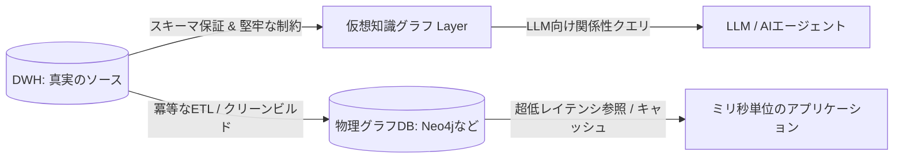

:::message
この記事は、SnowflakeやGoogle Cloudが推進する「仮想知識グラフ（VKG）」戦略をテーマにした、3部構成のシリーズ記事の **第3部（後編：How編）** です。

* **前編：What編** ：巨人が挑む仮想知識グラフ（VKG）戦略の正体
* **中編：Why編** ：AI エージェントの知識表現と推論になぜグラフが使われるのか？
* **後編：How編** ：スキーマレスの地獄を回避するサステナブルな運用戦略（本作）

:::

## 物理グラフDBが陥る「運用の崩壊」

関係性の表現力に優れるグラフデータベース（Neo4jなど）は、データモデリングの柔軟性が非常に高く、初期のモックアップ作成や少人数のプロトタイプ開発においては圧倒的なスピード感をもたらします。

しかし、スキーマ定義が緩く、制約が緩い（あるいは存在しない）物理グラフデータベースをエンタープライズの商用環境で大規模に運用し始めると、多くのデータエンジニアは **「スキーマレスの地獄」** と呼ばれる運用の崩壊に直面します。

* **表記ゆれとデータ品質の低下** ：
  「株式会社A」「（株）A」「A inc」といった同一企業を表すノードが別々に作成され、グラフ内に乱立する。
* **プロパティ型の不整合** ：
  ある `ユーザー` ノードでは `age` プロパティが数値型（`30`）で格納されているのに、別のノードでは文字列型（`"30"`）で格納され、クエリが予期せぬエラーを起こす。
* **孤立ノード（迷子データ）の大量発生** ：
  親子関係のエッジが物理的に削除された後、どことも紐づかない孤立した `従業員` ノードや `取引` ノードがデータベース内にゴミとして残り続け、ストレージを圧迫するだけでなく検索クエリのノイズになる。

グラフモデルは「つなぐこと」が簡単な半面、データの無法地帯（カオス）化を招きやすく、これを綺麗に維持管理（メンテナンス）し続けるETLやデータクリーニングのコストは、通常のRDB（リレーショナルデータベース）の比ではありません。

---

## 「グラフはビューである」というパラダイムシフト

この維持管理コストを劇的に下げるための強力な設計思想が、 **「基本のデータ構造は硬く（DWH側で型と制約を100%保証）、切り口（ビュー）は柔らかく（必要な時にだけ仮想グラフとして解釈）」** という割り切りです。

データのライフサイクルと品質の担保は、主キー（PK）や外部キー（FK）、および厳密な型制約をネイティブにサポートしているデータウェアハウス（DWH）側に100%任せます。これにより、使い慣れたSQLやdbt tests、データ品質監視ツール（SodaやGreat Expectationsなど）を使ったデータガバナンスの仕組みをそのまま流用できます。

そして、その頑強なテーブルの上に **仮想知識グラフ（VKG）のマッピング** を被せることで、必要な時だけ「関係性」としてデータを取り出します。
「実データは四角いテーブル（RDB）のまま綺麗に管理し、解釈の時だけ丸いネットワーク（グラフ）として見せる」というこのアプローチは、運用の堅牢性とグラフの表現の柔軟性を両立させる極めて現実的な解となります。

---

## サステナブルなアプリケーションを維持する3つの仕組み

さらに、この仮想グラフ・物理グラフの仕組みを実務で持続可能（サステナブル）にするために、最新の製品仕様（Neo4j Virtual GraphやGoogle Cloud Spanner/BigQuery Graph）が提供する具体的なアーキテクチャパターンを導入します。

### 1. 「AuraDB（物理）」と「Virtual Graph（仮想）」の秒・ミリ秒での役割分担

実務において、物理的なグラフDB（Native Graph DB）と仮想グラフ（VKG）はどちらか一方を選ぶトレードオフではなく、 **役割に応じたハイブリッド運用（Co-existence）** が正解です。

そのシンプルな判断基準は、 **「ミリ秒（Milliseconds）の行動」か「秒（Seconds）の思考」か** にあります。

* **物理グラフ（AuraDB / Spanner Graph）** ：
  ミリ秒単位の超低レイテンシが必要なリアルタイム決済の不正検知や、AIエージェントの会話履歴・メモリ管理などは、ネイティブに保存された物理グラフDB（AuraDBなど）で行います。
* **仮想グラフ（Neo4j Virtual Graph / BigQuery Graph）** ：
  データ量が膨大でリアルタイム同期が現実的ではない取引履歴、顧客の購買ログ、サプライチェーンのマスターデータなどは、DWH（Snowflake / Databricks / BigQuery）上のデータを動かさずに、仮想グラフを介してエージェントに「思考（Reasoning）のコンテキスト」として秒単位で参照させます。

最新の **Neo4j** では、物理的なAuraDB上のナレッジグラフと、Snowflake/Databricks上の大容量トランザクション仮想グラフに対して、 **単一のCypherクエリで横断検索（Composite Queries）** を行うことができ、これによって2つの世界を完全に統合したハイブリッドアーキテクチャが実現します。

* [Neo4j Blog: Introducing Neo4j Virtual Graph: Graph reasoning on the data you already have](https://neo4j.com/blog/graph-database/introducing-neo4j-virtual-graph-graph-reasoning-on-the-data-you-already-have/)
* [Neo4j Docs: Getting Started with Aura & Snowflake](https://neo4j.com/docs/virtual-graph/aura/getting-started-snowflake/)
* [Neo4j Docs: Getting Started with Aura & Databricks](https://neo4j.com/docs/virtual-graph/aura/getting-started-databricks/)
* [Neo4j Virtual Graph Private Preview Technical Document (Google Docs)](https://docs.google.com/document/d/1N_4vsHdbQsg7RZlcqF5gZBo6qkcSR7k5CCUnwnQGaPs/edit?tab=t.0#heading=h.fq6gmlq7bnjf)

### 2. 重複クエリコストを破壊する「適応型キャッシュ（Adaptive Caching）」

適応型キャッシュは、関係性をたどる度にDWH側で大量のJOINや再帰クエリが発生し、DWHの「外部クエリコンピュートコスト」を消費し続けるというコスト面の問題を解決します。

この課題に対し、 **Neo4j Virtual Graph** では **「Adaptive Caching（適応型キャッシュ）」** 機能を提供しています。
頻繁にトラバース（探索）されるホットなサブグラフをインテリジェントに検知し、物理キャッシュとして自動でマテリアライズ化（具現化）します。これにより、同じグラフ探索を千回繰り返すようなAIエージェントのワークロードにおいても、DWH側のコンピュート消費を劇的にスラッシュし、超低レイテンシの探索性能を引き出します。

### 3. 「使い捨てのキャッシュ」としての物理グラフ運用

適応型キャッシュや、低レイテンシのために構築した物理グラフDBは、あくまで **「DWH（真実のソース）の読み込み専用キャッシュ」** として徹底的に割り切ります。

* 物理グラフDB側で直接データを更新（Write）しない。
* 物理グラフ側でデータ品質の表記ゆれやインデックスの不整合が発生した場合は、 **キャッシュを完全に破棄し、いつでもDWHから一瞬で冪等に再構築（クリーンビルド）** できるデータ同期ジョブ（dbtやETLパイプラインなど）を用意しておく。

「壊れてもいつでもDWHから一瞬で綺麗に再構築できる」という運用設計にしておくことで、物理グラフDBのバックアップや整合性メンテナンスに費やしていた膨大な運用コストから解放されます。

---

## 結論：私たちが本当に欲しかったもの

私たちが長年データマネジメントの現場で本当に欲しかったものは、管理やメンテナンスに膨大な手間がかかる「自由なデータ構造（物理グラフデータベース）」そのものではありませんでした。

本当に必要だったのは、ビジネスの整合性が保証された安全なデータを、コンテキストに応じて自由かつ柔軟に解釈できる **「自由な切り口（仮想知識グラフ）」** だったのです。

Googleの「BigQuery/Spanner Graph」や、Neo4jがSnowflake/Databricks向けに提供する「Virtual Graph」は、これまでのデータモデリングにおけるETLの多重化やデータの腐敗といった宿命的な苦労から私たちを解放してくれます。そして、LLMに対して「企業の真の文脈（頭脳）」を安全に提供するための、最も現実的でサステナブルなモダン・データスタックの最終到達点と言えるでしょう。

---

**連載一覧：**

* [第 1 部 Snowflake / Databricks / Google が挑む仮想グラフ戦略：AIエージェントを支える次世代データ基盤](https://zenn.dev/yohei/articles/2026-05-30-vkg-strategy-what)
* [第 2 部 AI エージェントの知識表現と推論になぜグラフが使われるのか？](https://zenn.dev/yohei/articles/2026-05-30-vkg-strategy2)
* [第 3 部 スキーマレスの地獄を回避する：仮想グラフと物理グラフをサステナブルに維持管理する戦略](https://zenn.dev/yohei/articles/2026-05-30-vkg-strategy3) (本作)
