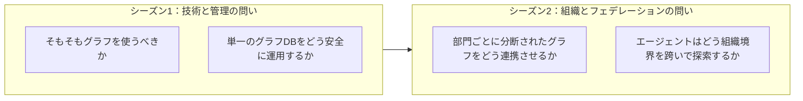
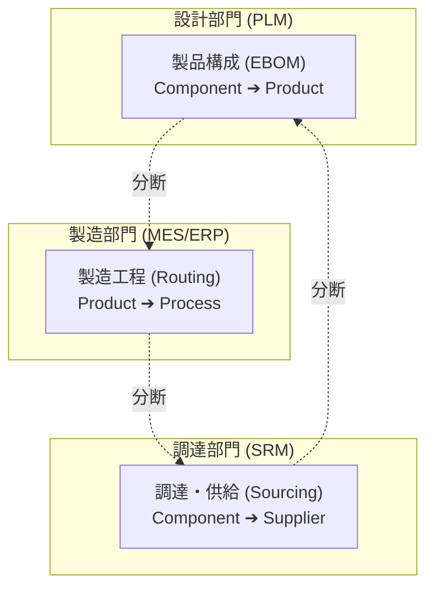

:::message
この記事は、エンタープライズにおける組織分断された複数データドメインの連携と、AIエージェントによるクエリ時論理フェデレーションをテーマにした、3部構成のシリーズ（シーズン2）の **第1部** です。

* **第 1 部**：[分断されたグラフと影響分析の課題（背景編）](https://zenn.dev/yohei/articles/2026-06-06-supply-chain-impact-analysis-agent)（本記事）
* **第 2 部**：[組織境界を維持する論理フェデレーション（設計編）](https://zenn.dev/yohei/articles/2026-06-06-supply-chain-impact-analysis-agent2)
* **第 3 部**：サプライチェーン影響分析エージェントの実装（実装編）（予定）

※ 仮想グラフの基本概念、AIエージェントでの有効性、変更管理などを解説した三部作シーズン 1 は以下からご覧いただけます。
* [第1部 Snowflake / Databricks / Google が挑む仮想グラフ戦略](https://zenn.dev/yohei/articles/2026-05-30-vkg-strategy-what)
* [第2部  AIエージェントの知識表現と推論になぜグラフが使われるのか？](https://zenn.dev/yohei/articles/2026-05-30-vkg-strategy2)
* [第3部 物理グラフDBを独自開発するための変更管理と安定運用戦略](https://zenn.dev/yohei/articles/2026-05-30-vkg-strategy3)
:::

## 概要

前回の[シーズン 1](https://zenn.dev/yohei/articles/2026-05-30-vkg-strategy-what) では、DWH上のデータを物理的に動かさずにグラフビューを重ね合わせる「仮想グラフ（Virtual Graph）」の市場動向や、スキーマレスなグラフデータベースにおける変更管理（Pydanticによる防壁）を解説しました。

※「DWH上の単一の仮想グラフでは足りないのか？」という疑問が生じるかもしれませんが、シーズン1で扱った仮想グラフは **単一のDWH上の論理的なビュー統合** に適しています。それに対し、本シーズン（シーズン2）で扱うのは、**組織ごとに所有権や書き込み権限が完全に分かれた独立した複数データストア** を大前提とする——前提が異なるシナリオです。

シーズン2では、さらに踏み込んだエンタープライズの「組織の現実」に焦点を当てます。

多くの大企業において、データは一つの巨大なデータベースに美しく統合されていません。設計、製造、調達といった各ドメインのデータは、**それぞれ異なる部門が、 異なるシステムで、独自のライフサイクルをもって管理**しています。これらを「一つの巨大な統合グラフデータベース」に物理集約することは、組織的にも技術的にも極めて困難です。

それにもかかわらず、経営判断や有事の意思決定に必要な問いは、常にこれらの組織境界をまたぎます。例えば、「特定の国での震災によりサプライヤーAが停止した場合、どの製品の出荷が遅れ、どの工場の組立工程にボトルネックが発生するか？」という問いです。

本記事（第1部）では、この「組織分断された複数データドメイン」の現実を整理し、従来の物理統合アプローチが直面する限界と、AIエージェントを実務に適用する上で解決すべき本質的な課題について掘り下げます。

:::message
**他業界への適用性について**
本シリーズでは、筆者が属する製造業の一般的なシナリオ（部品構成：EBOM、製造工程：Routing、調達：Sourcing）を題材に進めますが、ここで提示する「物理分断・論理結合」の課題や設計思想は、製造業に限定されるものではありません。

例えば、金融における「顧客属性、取引履歴、不正検知（AML）リスク」、医療・製薬における「治験、化合物構造、サプライチェーン」、あるいは小売における「在庫、物流、販売チャネル」など、**部門やシステムごとにデータが分断されつつも、横断的なパス探索が不可欠なあらゆるドメイン**において、同様のインサイトをそのまま適用可能です。
:::

---

## 1. シーズン1からの問題設定の転換

[シーズン1第3部](https://zenn.dev/yohei/articles/2026-05-30-vkg-strategy3) では、1つのグラフDBに対する変更管理（Pydanticによる制約定義、Agent Skillによる定義提示）を中心に議論しました。しかし、実務の現場にこれを適用しようとすると、すぐに「誰がそのグラフデータベースを所有し、どのように更新し、誰がスキーマの変更権限を持つのか」という**組織論的な壁**にぶつかります。

:::message
**本シリーズにおける「オントロジー」とは（用語の整理）**

* **古典的な意味（哲学・知識工学）**: ある領域の **概念とその関係の形式的な体系**（クラス、属性、論理制約など）。「何が存在しうるか」「用語同士がどう関係するか」を記述する。
* **[シーズン1第3部](https://zenn.dev/yohei/articles/2026-05-30-vkg-strategy3) での再定義（実務）**: 上記に加え、**グラフが守るべき型・接続制約** と、**エージェントが参照する利用文脈** を含め、Pydantic 等のコードとして **テスト可能な SSOT** として管理するもの。
* **本シリーズ（シーズン2）でのスコープ**: シーズン1が **1つのグラフDB** を前提としたのに対し、ここでは **組織別に物理分離された複数グラフ** を前提とする。そのため、オントロジーは単一スキーマだけでなく **Bridge Keys（共有ID）** と **Graph Contract（フェデレーション契約）** まで拡張される（詳細は第2部）。

第1部ではオントロジーの定義そのものには踏み込まず、なぜ組織分断下で「全社合意の型と制約」が必要になるかを課題として整理します。
:::



### 1.1 「全社統合データベース」という幻想からの脱却

データプラットフォームの理想論として「全社のあらゆるデータを一つの巨大なデータレイク/データウェアハウスに統合し、単一のマスターオントロジーでグラフ化する」という構想がしばしば語られます。しかし、これは実務においては以下の理由からほとんど実現しません。

* **責任境界の不一致**: 設計変更を管理するエンジニアリング部門と、サプライヤー契約を管理する購買部門では、データの「正しさ」を担保する責任者が異なります。一つのDBに物理統合すると、誰かがスキーマを変更した際に他部門のシステムが予期せず破綻するリスク（結合度の上昇）が生じます。
* **ライフサイクルと更新頻度の違い**: 部品構成（BOM）は製品開発のリリースサイクルに同期しますが、サプライヤーの取引リスクは日々変動し、工場の製造工程やサイクルタイムは日々の設備稼働状況や要員計画によって変化します。これらを単一のインジェストパイプラインで同期し続けることは、運用コストの観点から非合理的です。

したがって、シーズン2では **「データは各ドメイン（部門）が物理的に分離して所有・運用し続ける」** ことを大前提とします。その上で、AIエージェントがどのように組織境界を跨いで探索を行うか、次回（第2部：設計編）以降で扱う解決への方向性を探ります。

---

## 2. 製造業における「三つのデータドメイン」と分断の現実

製造業におけるデータには、マーケティングやセールス、財務など多岐にわたる重要ドメインが存在しますが、本シリーズでは製品の供給・生産体制における影響分析に焦点を当てます。このシナリオを説明するための「典型的な一例」として、以下の3つのシステムおよび組織にデータが分断されているケースを取り上げます。

| データドメイン | 主なソースシステム | 所有組織（所有者） | 更新頻度 / SLA | 管理されるデータの特徴 |
| :--- | :--- | :--- | :--- | :--- |
| **製品構成 (EBOM)** | PLM (Windchill, Teamcenter等) | 設計・開発部門 | 不定期 (設計変更リリース時) | 部品と製品の親子関係、設計仕様、材質 |
| **製造工程 (Routing)** | MES (製造実行システム), ERP PP | 生産技術・製造部門 | 日次〜週次 (工程改善や設備更新時) | 組立工程の流れ、使用する設備やワークセンター、基準サイクルタイム |
| **調達・供給 (Sourcing)** | SRM (購買管理), ERP MM | 調達・購買部門 | 日次〜随時 (サプライヤー契約、リスク変動) | 部品ごとの供給サプライヤー、調達リードタイム、サプライヤーの所在国やBCPリスク |

これらのシステムは、物理的にも論理的にも完全に独立して構築されているのが一般的です。



### 2.1 組織間データ連携を阻む具体的な壁

1. **アクセス権限とガバナンス**: Supply & Sourcing のグラフに含まれる「サプライヤーの単価」や「取引ボリューム」「サプライヤーごとの信用リスクスコア」などは、極めてセンシティブな社外秘情報です。これらを設計部門や工場の現場作業者が閲覧できるデータベースに格納することは、セキュリティポリシー上許されません。
2. **意味論（セマンティクス）の不一致**: 同じ「部品」であっても、設計部門は「CADデータ上の形状や材質（Component）」として捉え、調達部門は「仕入先コードと契約単価（Item / Part）」として捉え、製造部門は「組立ラインに供給される供給ビン（Material）」として捉えます。スキーマを一元化しようとすると、どの定義に寄せるかで組織間のコンセンサス構築（政治）が発生し、プロジェクトが長期化します。

---

## 3. ビジネスの要求：ドメインをまたぐ「有事の影響波及分析」

データがどれほど美しく組織別に分離されていたとしても、ビジネスが直面するトラブルや経営判断に必要な問いは、**常にこれらのドメインをまたぎます**。

特に近年の地政学的リスクの高まりや災害の多発において、サプライチェーンの途絶は企業の死活問題です。

### 3.1 途絶発生時のシナリオ

たとえば、以下のようなニュースやアラートが入ったとします。

> 「東アジアの特定地域で大規模な地震が発生し、半導体や特殊ネジの港湾出荷が停止した」

この時、経営陣や事業責任者が知りたいのは、以下のような一連の問いです。

> 1. **[調達]** 対象の地域に位置するサプライヤーは誰か？影響を受ける部品はどれか？
> 2. **[設計]** それらの部品は、どの最終製品（親製品）に使用されているか？
> 3. **[製造]** 影響を受ける最終製品は、どの工場のどのワークセンターで組み立てられているか？
> 4. **[全体]** 代替調達先はあるか？工程の変更（迂回）は可能か？影響を受ける総売上はいくらか？

この問いに答えるためには、調達（Sourcing）のデータからスタートし、製品構成（EBOM）を駆け上がり、最終的に製造工程（Routing）に辿り着くという、**3つのドメインを横断するパス探索**が必要不可欠です。

```
[Sourcing 領域]
Supplier X ──(SUPPLIED_BY)──► Component A
                                   │
                                   ▼ [EBOM 領域での ID 結合]
                             Component A ──(USED_IN)──► Product Y
                                   │
                                   ▼ [Routing 領域での ID 結合]
                             Product Y ──(PRODUCED_BY)──► Process Z
```

### 3.2 手作業による分析の限界

現在、多くの企業ではこのような有事の際、以下のように手作業で分析が行われています。

1. 調達管理システムから影響を受ける取引先と部品リストをExcelでエクスポートする。
2. PLMシステムにアクセスし、それらの部品が使われている製品BOM（部品構成表）を力任せに逆引きし、別のExcelにまとめる。
3. 生産管理システムから、それらの製品が現在どこの工場で組み立てられているかの工程表をダウンロードし、突き合わせる。
4. ExcelのVLOOKUPや手動の突合でこれらを結合し、ようやく影響範囲を可視化する。

この一連の作業には数日から数週間を要します。これでは、代替部品の確保や顧客への早期通知といった「先手を打つ対策（BCP）」を実行する頃には、競合他社に代替サプライヤーのキャパシティを抑えられてしまうなど、決定的な遅れをとることになります。

---

## 4. なぜ「一元管理（セントラル・グラフDB）」は破綻するのか？

「それなら、データを夜間バッチ（ETL）ですべて1つのグラフデータベース（Neo4jやAmazon Neptuneなど）に集約し、そこで横断分析を行えばよいのではないか」と考えるのは自然です。しかし、このアプローチが実務で破綻するのには明確な技術的・運用的な理由があります。

### 4.1 物理統合に伴う「3つの罠」

1. **データ重複と同期ズレ（SLAの不一致）**:
   製造工程のルーティングデータはMES側でリアルタイムに更新されている一方で、PLM側のEBOMは週次のリリース判定でしか更新されない場合、物理的に一つのDBに集約しようとすると「どのドメインのデータがどの時点で最新なのか」が曖昧になり、分析の信頼性が低下します。
2. **巨大なETLパイプラインの保守地獄**:
   3つのシステムからデータを抽出し、グラフのノードやエッジの関係性に変換して一つのDBへ流し込むための大規模なデータパイプライン（ETL）の構築が必要です。PLMのマイナーアップデートや調達システムのフィールド変更が発生するたびにこのETLが破損し、その復旧とデータクレンジングに追われることになります。
3. **データセキュリティ（アクセス制限）の断絶**:
   元のSRM（調達システム）で設定されていた「この購買担当者はこのベンダーのデータしか見てはならない」といった行レベルのアクセス制限（Row-Level Security）や、「契約金額は非公開」という列レベルのマスクポリシーが、物理統合先の共有グラフDBへ移行した瞬間に失われてしまいます。グラフDB側でこれらと同等の動的アクセス制限を再実装することは、開発コストを著しく増大させます。

### 4.2 リレーショナルデータベース（RDB）でのJOIN処理の限界

統合の選択肢は物理的なグラフ統合だけではありません。既存のDWHやRDB内のテーブル同士をJOINやビューで連結するアプローチも考えられますが、BOMのような「階層構造（多ホップ）」が絡むとやはり限界を迎えます。

* **再帰的クエリの記述難易度**: 製品構成表の「どこに使われているか（Where-Used）」の探索は、何階層あるか事前には分かりません。これをRDBで処理するには、何重もの再帰CTE（Common Table Expressions）や複雑な自己結合（Self-Join）を手書きする必要があります。
* **メンテナンス性の低さ**: ビジネスルールや構成の定義が少し変わるだけでSQLが容易に崩壊し、データアナリストやAIエージェントがアドホックにクエリを実行して探索することが事実上不可能になります。

---

## 5. 生成AIによる「クエリの動的生成（Text-to-SQL/Cypher）」が直面する新たな壁

前述したデータベースの物理的一元管理や、RDBにおけるJOIN処理の難しさを踏まえると、近年の生成AI（LLM）の発展を受けて以下のようなアイデアが浮上します。

> 「データは各部門に置いたままでよい。その代わり、LLMに各システムのスキーマを読み込ませ、ユーザーの質問に応じてSQLやCypherといったクエリをその場で動的に生成させれば、物理統合しなくても横断分析ができるのではないか」

この「Text-to-SQL」や「Text-to-Cypher」と呼ばれるアプローチは、一見すると物理統合やETL構築の手間をすべてLLMの柔軟性によってバイパスできるように思えます。しかし、組織分断されたエンタープライズの複雑なデータ構造に対してLLMにクエリ生成を「丸投げ」することは、実務においては新たな決定的な壁に直面します。

### 5.1 なぜ「LLMに直接クエリを書かせる」と失敗するのか

1. **スキーマ理解の限界（コンテキスト窓の浪費）**:
   設計、製造、調達の3つの巨大なシステムのデータベーススキーマ情報をすべてLLMのプロンプトに詰め込むと、それだけで数万トークンを消費し、推論の精度が急激に低下します。
2. **関係性のハルシネーション（嘘の接続）**:
   LLMは、物理的に定義されていない関係性を「頭の中で」勝手に繋ぎ合わせる傾向があります。たとえば、スキーマ上は「Component ➔ Supplier」と接続されているにもかかわらず、「Process ➔ Supplier」という存在しないエッジをクエリに書いてしまい、エラーを発生させます。
3. **セキュリティ境界の無視**:
   LLMに直接CypherやSQLの実行権限を与えると、本来アクセスしてはならないデータ（調達単価など）をクエリ結果から引き出してしまうといった、ガバナンス上の重大な問題を引き起こします。

したがって、AIエージェントを実用に耐えうるものにするためには、**「LLMに直接巨大なクエリを書かせるのではなく、各部門が管理するデータへのアクセス手段を『安全で決定論的なツール（API）』としてカプセル化し、エージェントにはそのツールのオーケストレーション（計画と実行順序の整理）だけを担わせる」** という構造的な責務分離が必要になります。

---

## 6. シーズン2の全体像

> **データは統合しない**（各部門のシステム内に分離したまま維持する）。
> その代わり、全社で合意した「共通ID（`Component.id`, `Product.id`）」をフェデレーション契約（Bridge Keys）とし、**AIエージェントがクエリ時にそれらを結合して探索を行う**。

この「物理分離・論理結合」のアーキテクチャこそが、エンタープライズの組織構造とガバナンスを尊重しながら、瞬時に有事の影響分析を行うための現実的な解となります。

次回（第2部：設計編）では、この logical federation（論理フェデレーション）を実現するための「共有オントロジー契約」や、各ドメインの独立性を保つための「境界設計」について、詳細なシーケンスを交えて詳しく解説します。

---

**連載一覧：**

* **第 1 部**：[分断されたグラフと影響分析の課題（背景編）](https://zenn.dev/yohei/articles/2026-06-06-supply-chain-impact-analysis-agent)（本記事）
* **第 2 部**：[組織境界を維持する論理フェデレーション（設計編）](https://zenn.dev/yohei/articles/2026-06-06-supply-chain-impact-analysis-agent2)
* **第 3 部**：サプライチェーン影響分析エージェントの実装（実装編）（予定）
