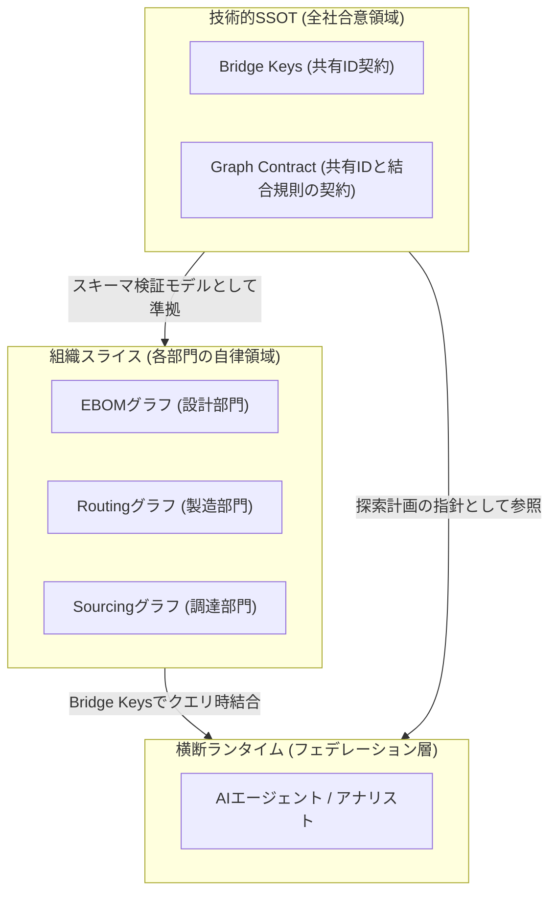
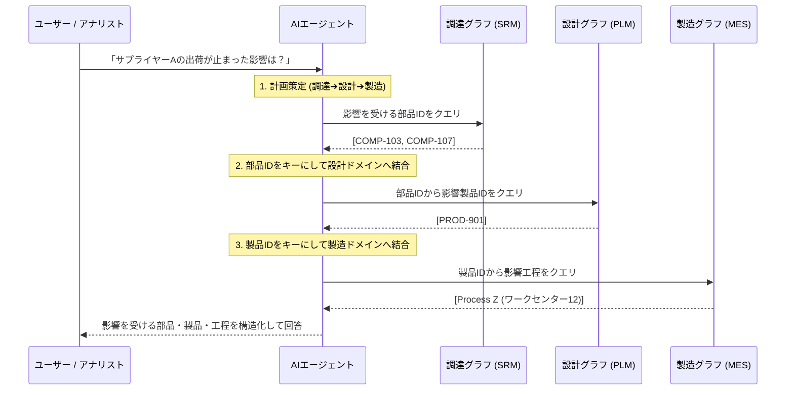

:::message
この記事は、エンタープライズにおける組織分断された複数データドメインの連携と、AIエージェントによるクエリ時論理フェデレーションをテーマにした、3部構成のシリーズ記事（シーズン2）の **第2部** です。

* **第 1 部**：[分断されたグラフと影響分析の課題（背景編）](https://zenn.dev/yohei/articles/2026-06-06-supply-chain-impact-analysis-agent)
* **第 2 部**：[組織境界を維持する論理フェデレーション（設計編）](https://zenn.dev/yohei/articles/2026-06-06-supply-chain-impact-analysis-agent2)（本記事）
* **第 3 部**：サプライチェーン影響分析エージェントの実装（実装編）（予定）

※ シーズン1（仮想グラフの基本概念、AIエージェントでの有効性、変更管理）は以下からご覧いただけます。
* [第1部 Snowflake / Databricks / Google が挑む仮想グラフ戦略](https://zenn.dev/yohei/articles/2026-05-30-vkg-strategy-what)
* [第2部  AIエージェントの知識表現と推論になぜグラフが使われるのか？](https://zenn.dev/yohei/articles/2026-05-30-vkg-strategy2)
* [第3部 物理グラフDBを独自開発するための変更管理と安定運用戦略](https://zenn.dev/yohei/articles/2026-05-30-vkg-strategy3)
:::

## 概要

前回の [第1部：背景編](https://zenn.dev/yohei/articles/2026-06-06-supply-chain-impact-analysis-agent) では、大企業内において設計（EBOM）、製造（Routing）、調達（Sourcing）などのデータが組織的・システム的に分断されている現実と、それらを1つの巨大なデータベースに物理統合するアプローチがなぜ破綻するのかを解説しました。

本アーキテクチャの根底にある基本的な考え方は極めてシンプルです。
**「データを最初に物理的に分割して統治し、必要に応じて論理的に結合する」**
そして、結合するための約束事（共通ルール）を事前に定義し、その約束事を守るためのデータ整合性維持の責務は、それぞれのドメインを所有する各チームが負うというアプローチです。

本記事（第2部）では、この思想を具現化する **「論理フェデレーション（Logical Federation）」の設計原則** について詳しく解説します。各部門が自律的にデータを統治しながら、AIエージェントと連携して安全かつ決定論的にドメインをまたぐ推論を行うための「契約（Contract）」と「ツール境界」の設計思想に迫ります。

---

## 1. 論理フェデレーションの基本コンセプト：「物理分離・論理結合」

物理的な一元管理データベースを作らないのであれば、代替案は **「各組織がそれぞれのデータを個別のグラフ（またはデータストア）として保持し、クエリを実行する瞬間にのみ、共通の識別子で論理的に繋ぎ合わせる」** アプローチになります。

これが **「物理分離・論理結合（Physical Separation, Logical Federation）」** の原則です。

```
[調達ドメインのローカルグラフ]
Supplier X ──(SUPPLIED_BY)──► Component A (ID: COMP-103)
                                  │
                                  │ ◄── クエリ実行時に ID で論理結合
                                  ▼
[設計ドメイン / PLM]
Component A (ID: COMP-103) ──(USED_IN)──► Product Y (ID: PROD-901)
                                            │
                                            │ ◄── クエリ実行時に ID で論理結合
                                            ▼
[製造ドメイン / MES]
Product Y (ID: PROD-901) ──(PRODUCED_BY)──► Process Z (ID: PROC-10)
```

### 1.1 「物理分離・論理結合」によるアプローチの選択

物理一元管理DBの不可能性（第1部で解説した組織的・技術的限界）を踏まえ、本設計では具体的に以下の3つのアプローチを採用し、横断分析を実現します。

1. **データストアの物理分離とドメイン境界の維持**:
   設計・製造・調達のデータは各ドメイン（部門）が自律的に管理する個別のデータストアに配置し、勝手な「越境書き込み」をアプリケーション境界で遮断します。
2. **Bridge Keys（共有ID）による契約の合意**:
   全社共通で用いるID（`Component.id` や `Product.id`）を「フェデレーション契約」として定義し、クエリ時の結合の架け橋とします。
3. **決定論的ツールとAIプランナーの責務分離**:
   LLMに直接データベースクエリを生成させず、各データベースからデータを安全に引くAPI（ツール）をプログラムとして定義し、LLMにはその実行計画（オーケストレーション）のみを委ねます。

### 1.2 ドメイン横断分析と「契約（Contract）」の必要性

一方で、有事の影響分析（例：サプライヤー途絶が最終製品や組立プロセスに与える影響）を瞬時に行うためには、ドメインをまたいだ論理フェデレーションが不可欠です。

ドメインが物理的・組織的に分離された状態で、クエリ実行時に正しく結合して関係性を走査（トラバース）するためには、**「ドメイン横断で結合するための約束事」** をあらかじめ厳格に定めておく必要があります。

この共通のルールや約束事を **「契約（Contract）」** と位置づけ、各チームは自部門のデータを更新・登録する際、この契約を守れるように努める責任を持ちます。契約に基づくことで、アドホックに巨大な統合DBを作ることなく、必要な瞬間に安全かつ決定論的に論理フェデレーションを実行することが可能になります。

### 1.3 組織境界（チーム）と技術境界（全社）の二層アーキテクチャ

論理フェデレーションを長期にわたって安定運用するためには、「全社で合意・共有すべき領域」と「各部門が独立して変更・保守すべき領域」を技術的かつ組織的に分離する必要があります。



- **技術的SSOT（全社）**: Bridge Keysの定義や共通データ型を定義する共有スキーマレイヤー。
- **組織スライス（チーム）**: 各ドメインが物理的に所有し、自チームのライフサイクルで更新する個別データベース。
- **横断ランタイム（エージェント）**: Graph Contract の接続ルールをもとに、決定論的ツールを用いて必要時にのみ各組織スライスを横断探索する実行レイヤー。

---

## 2. フェデレーション契約（Bridge Keys）の設計

論理フェデレーションを成立させるためには、異なる組織が管理するデータの間で **「このIDだけは同じものを指し、同じルールで命名する」** という最低限の約束事（フェデレーション契約）を結ばなければなりません。

:::message
**フェデレーション契約**とは、全社合意のもとで定義された **Bridge Keys（共有ID）** と、それらを結合するルールの総称です。
後述する **Graph Contract** はこのフェデレーション契約全体の機械可読な定義（スキーマ・メタデータ）であり、**Bridge Keys** はその契約を具現化する Identity Bindings（同一性識別子）に相当します。
:::

この契約となる共通IDを **「ブリッジキー（Bridge Keys）」** と呼びます。

### 2.1 典型的なブリッジキーの役割

製造業における製品供給・生産体制のシナリオでは、以下のIDがブリッジキーとして機能します。

| ブリッジキー | IDの表記例 | ドメイン横断の結合ルール |
| :--- | :--- | :--- |
| `Component.id` | `COMP-103` | **最重要の結合キー**。<br>設計のEBOM、製造の工程、調達の仕入情報すべての橋渡しを行います。 |
| `Product.id` | `PROD-901` | 設計ドメイン（EBOM）と製造ドメイン（Routing）を結合し、製品と組立プロセスの紐付けを行います。 |

### 2.2 ドメイン内に閉じるローカルID

逆に、他のドメインに露出させる必要がないデータは、ドメイン内ローカルなIDとして管理し、スコープを隠蔽します。

* `Supplier.id`（例: `SUP-001`）: 調達ドメイン内にのみ存在し、外部ドメインが直接このIDに関係性を結ぶことはありません。サプライヤー起点の問い合わせであっても、調達ドメインの決定論的ツール内で `Supplier.id` ➔ `Component.id` までのマッピングを自己解決し、ドメイン境界を越えて他ドメインへ渡すのは共通の Bridge Key（`Component.id`）のみとします。
* `Process.id`（例: `PROC-10`）: 製造ドメイン内に閉じ、他のドメインからは「どの製品・部品がどの工程に関係しているか」というインターフェースでのみ参照されます。

### 2.3 アイデンティティ解決とマスターの責務

実務において「同じ部品なのに、システムによって型番の表記が揺れている」という問題（アイデンティティ解決）は頻出します。これをグラフの結合ルール側でアドホックに解決しようとすると、クエリが著しく複雑化します。

設計思想として、**「アイデンティティ解決や属性マスタの参照は、各グラフとは別層の『正規コンポーネントレジストリ（マスターデータベース）』が担う」** ように責務を分離します。これは、1.3節の二層アーキテクチャにおける「技術的SSOT（全社合意領域）」の下支え、あるいは独立したマスターデータストアとして位置づけられます（具体的なデータストア構造や実装の詳細は、第3部にて紹介します）。各ドメインのグラフは、このマスターレジストリが保証するクリーンなブリッジキー（`Component.id`）を参照・利用することだけを前提とします。

### 2.4 エッジ（関係性）の所有権マッピング

Bridge Keys を用いてドメインを跨ぐ関係性を構築する際、**どのドメインがどのエッジ（関係性）を記述・管理する責任を持つか**を明確にする必要があります。

| 所有ドメイン | 起点ノードタイプ | エッジ（関係性） | 終点ノードタイプ | 管理・保守するデータ / 所有チーム |
| :--- | :--- | :--- | :--- | :--- |
| **設計 (EBOM)** | `Component` | `USED_IN` | `Product` | 部品構成、設計仕様 / 設計・開発部門 |
| **製造 (Routing)** | `Product` | `PRODUCED_BY` | `Process` | 組立工程、サイクルタイム / 生産技術部門 |
| **製造 (Routing)** | `Component` | `INPUT_OF` | `Process` | 工程への部品投入ルール / 生産技術部門 |
| **調達 (Sourcing)** | `Component` | `SUPPLIED_BY` | `Supplier` | 供給サプライヤー、リードタイム / 調達・購買部門 |

※ 有事の影響分析における代表的な探索パスは、Product を介した `USED_IN` ➔ `PRODUCED_BY` の流れを基本とします。`INPUT_OF` は、どの工程でどの部品が直接投入されるかを詳細にトラバースするための補助的なエッジとして位置づけています。

---

## 3. 機械読み取り可能な契約書：グラフ・コントラクト（Graph Contract）

共通IDのルールや、どのドメインがどのノード・エッジの管理責任を持つかという定義は、人間の合意形成書としてだけでなく、システムやAIエージェントが自律的に解釈できる **「メタデータ（スキーマ定義）」** として構造化されていなければなりません。

これを本設計では **「グラフ・コントラクト（Graph Contract）」** と定義します。

:::message
**古典的オントロジーと、本設計の Graph Contract の違い**

| | 古典的オントロジー（OWL/RDF 等） | シーズン1第3部の再定義 | 本シリーズの Graph Contract |
| :--- | :--- | :--- | :--- |
| **主な内容** | 概念・関係の **語彙体系** | 型・制約・利用文脈の **SSOT（コード）** | 上記に **組織間フェデレーション** を追加 |
| **文脈（Context）** | 通常は含まない | Agent Skill 等に載せる **利用設計** を含む | Federation Joins・Quality Gates として **契約化** |
| **スコープ** | 領域全体の概念モデル | **1グラフDB** の変更管理 | **3組織グラフ** の Bridge Keys + 結合経路 |
| **表現** | OWL/RDF 等 | Pydantic モデル（型・制約の SSOT） | 契約マニフェスト（YAML）+ 生成 JSON |

**スコープが一段広がる背景**: シーズン1第3部は「1つの物理グラフを安全に持続運用する」How でした。本シリーズは **組織がグラフを分離して所有する** 前提のため、型・制約（オントロジー）に加え、**どの ID で・どの順序で・どのドメインを横断するか** まで全社合意が必要になります。Graph Contract は、その追加要件を機械可読にしたものです。詳細な定義は [シーズン1第3部 §3①](https://zenn.dev/yohei/articles/2026-05-30-vkg-strategy3) を参照してください。
:::

### 3.1 グラフ・コントラクトに必要な4つの定義要素

グラフ・コントラクトは、主に以下の定義を内包するマニフェストファイルとして機能します。

1. **アイデンティティの定義（Identity Bindings）**:
   全ドメインで共通して使用するマスターエンティティとブリッジキーの指定（例: `Component` の `id` は全グラフで同一の現実世界のパーツを指すというルール）。
2. **ドメインの境界定義（Domain Scopes）**:
   各組織（ドメイン）が管理権限を持つエンティティの種類と関係性の厳格なマッピング（例：設計（EBOM）ドメインは部品（Component）と製品（Product）をエンティティとして持ち、使用（USED_IN）関係のみを新規追加・編集できる）。
3. **フェデレーション経路（Federation Joins）**:
   有事の影響分析時などに、どのような順序でキーを受け渡して結合すべきかという「あらかじめ検証された走査テンプレート」。
4. **品質・データガバナンスのルール（Quality Gates）**:
   各組織が書き込んだグラフデータの品質検証ルール、および論理結合時にデータ鮮度の差（SLA Skew）を許容する許容範囲の定義（例：有事の影響分析において、調達リスクデータは最新（T+0）を必須とするが、設計BOMデータは1週間前（T-7）の変更リリース時点の鮮度でも結合を許容する、などのポリシー）。

### 3.2 境界における「参照整合性」の担保と検証ポリシー

物理的に分断された複数のデータベース間で論理結合を行う際、最も致命的な問題となるのが **「参照整合性（Referential Integrity）の崩壊」** です。たとえば、調達グラフに「仕入先と部品A」の関係性が追加されたものの、設計グラフに「部品A」が登録されていなければ、クエリ時のID結合（フェデレーション）は失敗し、影響分析に抜け落ちが生じます。

このリスクを防ぐため、本設計では以下の二段階の検証ポリシーを定義し、各ドメインに「契約の遵守」を義務付けます。

* **更新時の同期バリデーション（スキーマ検証モデルによる型・制約の検証）**:
  各部門が自ドメインのデータベースにデータを新規登録・更新する際、必ず共通のスキーマ検証モデル（シーズン1第3部で解説した、Pydantic等のクラス定義で型や接続制約を定義したSSOT防壁）を通じたデータ構造検証を実行します。存在しないエンティティタイプや、境界を越えた不正な関係性（例：調達ドメインに製品の使用関係を書き込むなど）が検知された時点で書き込みを即座にブロックします。これにより、ローカルデータベース内の完全性を担保します。
* **境界における非同期の参照整合性チェック**:
  「追加された部品IDが、マスタデータベースや他ドメインのグラフにも存在するべきである」というドメインをまたぐ参照整合性の検証は、インジェスト処理時に同期的に行うのではなく、**非同期の監査パイプライン（または夜間バッチなど）**によって検証します。これは、各部門のシステムが持つ異なる更新頻度（SLA）やネットワーク的な結合を疎結合に保つためです。非同期で定期チェックを実行し、欠落しているブリッジIDを検知してデータ管理者へアラートを出すことで、フェデレーション時のエラーを防ぎます。

  > **具体例**: 調達（Sourcing）ドメインに部品 `COMP-999` とサプライヤーの関係性が追加されたものの、設計（EBOM）ドメインの製品構成表（マスタ）に `COMP-999` が未登録である場合、非同期の監査処理がこれを検知し、データ管理チームへ不整合の警告（アラート）を発行します。

この契約定義と検証ポリシーが存在することで、AIエージェントは「調達システムで影響部品を特定したら、次は設計システムで `Component.id` を使って製品を特定し、最後に製造システムで `Product.id` から工程を特定する」というロードマップを、データの整合性を信頼しながら自動的に組み立てることが可能になります。

---

## 4. AIエージェントと「ツール境界」の設計

論理フェデレーションをAIエージェントに自律実行させる際、定義した **Graph Contract（特に Federation Joins）** と **実行ツール** には明確な対応関係が存在します。

- **Federation Joins**: AIプランナー（LLM）がゴールを達成するための「ツールの実行順序（探索計画）」を組み立てる指針となります。
- **決定論的ツール**: ツール内部に「名前付きクエリカタログ（検証済みの安全なクエリ）」をカプセル化し、LLMからはIDなどの引数を受け取って実行するだけに留めます。シーズン1で解説した「Agent Skill」は、このGraph Contractのフェデレーション定義や検証済みのクエリカタログを、LLMが理解可能なプロンプト（API定義）としてカプセル化したものとして位置づけられます（具体的な実装は第3部で扱います）。

[第1部](https://zenn.dev/yohei/articles/2026-06-06-supply-chain-impact-analysis-agent)で述べた通り、LLMにデータベースのスキーマを直接渡してクエリ（SQLやCypher）をアドホックに生成させるアプローチ（Text-to-SQL）は、ハルシネーションや構文エラーのリスクが高く、実務では破綻します。

そこで、本アーキテクチャでは **「決定論的ツール（Deterministic Tools）」** と **「AIプランナー（LLM Planner）」** の責務を厳格に切り分けるツール境界（Tool Boundary）を導入します。

```
               [ ユーザーの質問 ]
                      │
                      ▼
┌──────────────────────────────────────────────────┐
│              AIプランナー (LLM Planner)            │
│  - ユーザーの意図（Goal）を解釈                      │
│  - ドメイン仕様や制約から手順（Plan）を組み立て         │
│  - 決定論的ツールを選択し、IDを受け渡して順次実行.       │
└─────────────────────────┬────────────────────────┘
                          │ 実行指示 (API Call)
                          ▼
┌──────────────────────────────────────────────────┐
│           決定論的ツール (Deterministic Tools)     │
│  - カタログ化された安全なデータベースクエリの実行        │
│  - プログラムによるIDの結合やグラフ探索                │
│  - 結果を構造化データ (JSON) で返却                  │
└─────────────────────────┬────────────────────────┘
                          │ 結果返却
                          ▼
               [ グラウンディングされた回答 ]
```

### 4.1 役割の境界線

* **AIプランナー（LLM）の役割**:
  * ユーザーの曖昧な入力から「何が起きているか（途絶の地域、サプライヤー等）」を解釈。
  * グラフ・コントラクトから「どのツールを、どの順番で呼ぶべきか」の計画（Plan）を策定。
  * ツールから返ってきた構造化データ（JSON）に基づいて、嘘のない根拠（エビデンス）を伴う自然言語の回答要約を生成。
* **決定論的ツール（アプリケーション層）の役割**:
  * 各ドメインデータベースに対するクエリの実行（事前に定義・最適化されたクエリを実行）。
  * ツール内部におけるIDの結合処理や、再帰的な多ホップ探索アルゴリズムの計算実行。
  * **LLMに対して、クエリの直接記述（Text-to-SQLやText-to-Cypherなど）は一切許可しない。**

この設計により、LLMが誤ったCypherを書いてクエリがエラーになったり、セキュリティ制限を無視してデータを引っこ抜くリスクを完全に抑え込むことができます。エージェントは高度な判断（計画と要約）に専念し、グラフ探索の実行は、定義および検証済みの決定論的ツールに限定して実行されます。

### 4.2 フェデレーション探索の実行プロセス

以下は、AIエージェントが各ドメインの「境界」を越え、ブリッジキーをバトンリレーのように受け渡して影響波及分析を行うシーケンス設計です。



### 4.3 非構造入力からフェデレーションへのアンカリング経路

実務におけるインプットは「サプライヤーID」といった構造化データだけではなく、「〇〇地域での地震」「〇〇の工場火災」などの非構造なニューステキストである場合がほとんどです。このため、AIプランナーは以下の **3段階パターン** に従って探索をアンカリング（起点登録）します。

1. **LLMによる意図解釈（ニュース解析）**: 
   ニューステキストから影響のある「地域」「事象」を抽出し、調達（Sourcing）データベースの属性情報（サプライヤーの所在国など）とマッチングできる形に変換します。
2. **入口ドメインでのアンカリング (ID特定)**:
   抽出した地域情報等をもとに、調達ドメインのツールを呼び出して、影響を受ける具体的な `Supplier.id` および `Component.id` を特定します。
3. **フェデレーション展開 (ID連携)**:
   特定された `Component.id` をブリッジキーとして、設計（EBOM）や製造（Routing）ドメインへと順次フェデレーションクエリを展開します。

---

## 5. まとめ - 設計の着地点

本記事で解説した「論理フェデレーション」モデルは、単なる技術的な妥協策ではなく、大企業の組織・システム現実に適応するための合理的な設計判断の結晶です。

本アーキテクチャの評価基準となる **「4つのコア論点」** と、設計判断の根拠（Rationale）を整理します。

### ① データ所有権（Data Ownership）の保証
* **課題と根拠**: 全社のデータを1箇所に集約しようとすると「スキーマの変更権限」や「マスターデータのメンテナ責任」が曖昧になり、部門間の調整（政治）でプロジェクトが停滞します。
* **設計判断**: 本設計思想では、ドメイン別にデータスキーマと管理責任（境界づけられたコンテキスト）を完全に分離します。各チームは、自ドメインのデータ構造とクレンジング/インジェスト処理を完全に独立してメンテする権利と義務を有します。

### ② セキュリティ境界（Security）の維持
* **課題と根拠**: 調達部門が管理する「仕入先の信用リスク」や「単価」などは機密性が高く、全社共有のグラフデータベースに平文で配置することはポリシー上許されません。
* **設計判断**: データを1つの物理DBに統合するのではなく、ドメインごとに物理データベースインスタンスやストレージディレクトリを分離します。これにより、各データストアに対するアクセス制御（アクセス権限設定やネットワーク境界など）をそのまま適用し、セキュリティ境界を守ります。

### ③ クエリの品質（Query Quality）と信頼性
* **課題と根拠**: LLMに直接アドホックなクエリ（Text-to-SQL/Cypher）を生成させると、存在しない関係性をクエリするハルシネーション（嘘の接続）や構文エラーが頻発し、実運用に耐えません。
* **設計判断**: LLMにデータベースのクエリやグラフ走査を直接記述・実行させるのではなく、事前に開発・検証されたAPIや決定論的ツール群をLLMプランナーが順次選択して実行する「ツール境界」を導入しました。これにより、ハルシネーションや構文エラーを排除した安全なデータ抽出と、高い推論品質を保証します。

### ④ 運用の容易さ（Ease of Operation）
* **課題と根拠**: 専用の分散型グラフデータベースを全社共有用に新規プロビジョニングし、常時稼働・管理するのはインフラ運用の負担や初期コストが大きすぎます。
* **設計判断**: ドメインを横断する巨大なデータベースクラスタを常時共有インフラとしてプロビジョニング・運用することを避けます。各ドメインがそれぞれ最適な手段（既存のデータレイクやファイルストレージなど）でデータを保持し、クエリ時に疎結合に連携できる軽量なフェデレーション手法を志向します。具体的な技術選定やプロビジョニングの詳細は第3部で扱います。

| 評価軸 | 物理統合（セントラルDB）の限界 | 論理フェデレーション（本設計）の優位性 |
| :--- | :--- | :--- |
| **① データ所有権** | 1つのチームが代表して所有（他チームの自由度が下がる） | ドメイン分離によるチーム別の完全な所有権の維持 |
| **② セキュリティ** | 共有DB側でのACLの再実装・複雑な権限管理が必要 | 物理ストレージの分離による境界制御の流用 |
| **③ クエリの品質** | LLMが直接全体クエリを書く（ハルシネーションの温床） | 決定論的ツールの連鎖によるアドホッククエリ生成エラーの排除 |
| **④ 運用の容易さ** | 巨大ETLの構築・常時稼働するグラフサーバーの保守 | 共有データベースクラスタの常時運用を避ける軽量なフェデレーション設計 |

この「物理分離・論理結合」のデザインパターンにより、大企業の組織構造を歪めることなく、AIエージェントを用いたサプライチェーン影響分析のインフラを最小限の運用コストで構築することが可能になります。

次回（第3部：実装編）では、この設計原則に基づき、ローカル環境で物理分離されたグラフを構築し、Pythonによるフェデレーションとエージェント連携をどのようにコーディングしたのか、具体的な実装案を解説します。

---

**連載一覧：**

* **第 1 部**：[分断されたグラフと影響分析の課題（背景編）](https://zenn.dev/yohei/articles/2026-06-06-supply-chain-impact-analysis-agent)
* **第 2 部**：[組織境界を維持する論理フェデレーション（設計編）](https://zenn.dev/yohei/articles/2026-06-06-supply-chain-impact-analysis-agent2)（本記事）
* **第 3 部**：サプライチェーン影響分析エージェントの実装（実装編）（予定）
