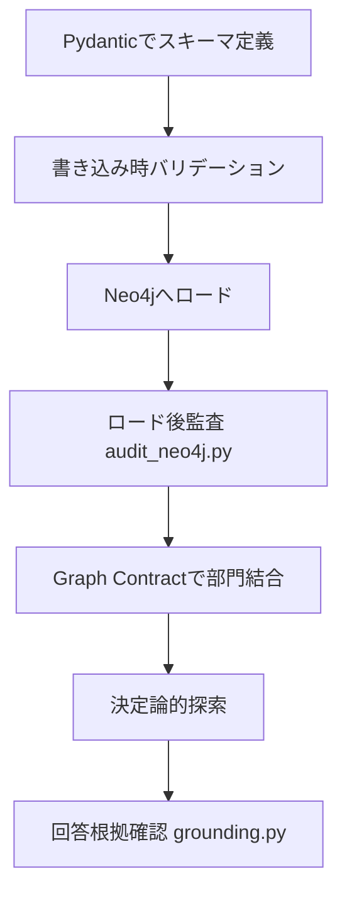

:::message
**連載の位置づけ（[シーズン1](https://zenn.dev/yohei/articles/2026-05-30-vkg-strategy-what) → [シーズン2](https://zenn.dev/yohei/articles/2026-06-06-supply-chain-impact-analysis-agent) → [シーズン3](https://zenn.dev/yohei/articles/2026-06-17-databricks-genie-ontology-ontorank) → [シーズン4](https://zenn.dev/yohei/articles/2026-06-28-kg-ontology-redefinition)）**

本連載全体の主題は、エンタープライズ AI に必要な **「意味の層」**（ビジネス定義・関係・信頼すべき資産）の設計です。

| シーズン | 問い |
| :--- | :--- |
| [シーズン1](https://zenn.dev/yohei/articles/2026-05-30-vkg-strategy-what)（仮想グラフ・3部作） | ① データをどう辿り、型を固定するか |
| [シーズン2](https://zenn.dev/yohei/articles/2026-06-06-supply-chain-impact-analysis-agent)（論理フェデレーション・3部作） | ② 部門別データをどう結ぶか |
| [シーズン3](https://zenn.dev/yohei/articles/2026-06-17-databricks-genie-ontology-ontorank)（[前編](https://zenn.dev/yohei/articles/2026-06-17-databricks-genie-ontology-ontorank)・[本編](https://zenn.dev/yohei/articles/2026-06-24-snowflake-cortex-sense-genie-ontology)） | ③ どの定義を信頼するか（PF 上の意味レイヤー自動構築） |
| [シーズン4](https://zenn.dev/yohei/articles/2026-06-28-kg-ontology-redefinition)（現代の知識グラフとオントロジー・3部作） | ④ グラフの品質検証からエージェント回答の根拠確認まで、どう実装するか |

**本記事**は **シーズン4「現代の知識グラフとオントロジー」** の **第3部** です。題材の **BOM・サプライチェーン影響分析** と **論理フェデレーション**（物理分離・論理結合、Bridge Keys、Graph Contract、決定論的ツール）は、同じ参照実装を題材に [シーズン2 第2部](https://zenn.dev/yohei/articles/2026-06-06-supply-chain-impact-analysis-agent2)（設計）・[第3部](https://zenn.dev/yohei/articles/2026-06-06-supply-chain-impact-analysis-agent3)（実装）で扱い済みです。本記事はその上に、第1・2部で整理した **検証段階（L0〜L4、G\***）** の視点でコードを追います。

* **第 1 部** ： [「推論」から「契約」へ：データ品質保証と回答検証の全体像](https://zenn.dev/yohei/articles/2026-06-28-kg-ontology-redefinition)
* **第 2 部** ： [インジェストから監査まで、DE/AIの検証タイミング設計](https://zenn.dev/yohei/articles/2026-06-28-kg-ontology-modern-architecture)
* **第 3 部** ： [PydanticからSHACL、Agent Groundingにいたる実装ハンズオン](https://zenn.dev/yohei/articles/2026-06-28-kg-ontology-implementation-walkthrough)（本記事）

:::

## 概要

本記事は、サプライチェーン影響分析の参照実装 **[supply-chain-impact-analysis-agent](https://github.com/yohei1126/supply-chain-impact-analysis-agent)** を、 **データ品質の担保** から **エージェント回答の根拠確認** まで一気通貫で読み解くハンズオンです。

**題材の位置づけ（シーズン2 との関係）** — 設計（EBOM）・製造（Routing）・調達（Sourcing）の部門別グラフを Bridge Keys で **クエリ時のみ論理結合** する **論理フェデレーション**、およびサプライヤー途絶などの **BOM 影響分析** シナリオ自体は、[シーズン2 第2部「組織境界を維持する論理フェデレーション」](https://zenn.dev/yohei/articles/2026-06-06-supply-chain-impact-analysis-agent2) と [第3部「サプライチェーン影響分析エージェントの実装」](https://zenn.dev/yohei/articles/2026-06-06-supply-chain-impact-analysis-agent3) で設計・実装まで述べています。**シーズン4 第3部（本記事）** は同じリポジトリを対象に、シーズン2 が扱わなかった **オントロジー契約の検証段階**（Pydantic → 書き込み拒否 → SHACL 監査 → Grounding）に焦点を当てます。

第1・2部で述べた概念（オントロジーを「契約」とみなす考え方、いつ誰が検証するかの設計）を知っていればより深く読めますが、 **この記事単体でも実装の流れは追えます** 。

扱うのは大きく2つのレイヤーです。

* **データ側（DE）**: スキーマ定義 → 書き込み時の拒否 → ロード後の全体監査 → 部門グラフの結合
* **AI側**: 決定論的な探索ツール → LLM 要約 → 回答がツール出力と一致するかの検証（Grounding）

以下、上記の順にコードを追います。

---

## 0. セットアップと全体シナリオ

まずは手元でコードを動かすためのセットアップ手順です。本プロジェクトは、Pythonの高速パッケージマネージャーである `uv` および グラフデータベース `Neo4j` を前提としています。

```bash
# リポジトリのクローンとパッケージ同期
git clone https://github.com/yohei1126/supply-chain-impact-analysis-agent.git
cd supply-chain-impact-analysis-agent
uv sync
```

Neo4j は、SHACL（W3C標準の検証定義）を適用するために **Neosemantics（n10s）** プラグインがインストールされた状態のDockerコンテナなどを使用します。

全体の実行ジャーニーは以下のようになります。データエンジニア（DE）がデータを安全にインジェスト・監査した基盤に対し、AIエンジニア（AI）が探索ツールと回答の根拠確認（Grounding）を被せます。



---

## 1. Pydantic によるスキーマのコード化（語彙・型・接続ルール）

本プロジェクトでは、次の3つを **`ontology/schema.py`** という単一の Python コードで一元管理（SSOT）します。参照リポジトリの [ontology-levels.md](https://github.com/yohei1126/supply-chain-impact-analysis-agent/blob/main/docs/ontology-levels.md) では、それぞれ **L0（語彙）・L1（型）・L2（接続ルール）** と呼んでいます。

* **語彙**: ノードや関係の名前（例: `Component`, `SUPPLIED_BY`）
* **型**: 各ノードが持つ属性とその型（例: `component_id`, `cost`）
* **接続ルール**: どのノード同士をどの関係で結んでよいか

以下は、ノードモデルおよびリレーションシップ（エッジ）の定義の抜粋です。

```python
# ontology/schema.py （簡略化した概念抜粋）
from pydantic import BaseModel, Field
from typing import ClassVar, List, Tuple

# ノードのプロパティ定義（L1: 型）
class Component(BaseModel):
    label: ClassVar[str] = "Component"
    component_id: str = Field(..., description="部品ID (例: COMP-101)")
    name: str = Field(..., description="部品名")
    cost: float = Field(..., description="単価")

class Supplier(BaseModel):
    label: ClassVar[str] = "Supplier"
    supplier_id: str = Field(..., description="サプライヤーID (例: SUP-001)")
    name: str = Field(..., description="会社名")

# リレーションの接続定義（L2: 接続ルール）
class RelationEdge:
    # 接続元ノード, リレーション名, 接続先ノード の組み合わせを定義
    ALLOWED_EDGES: ClassVar[List[Tuple[str, str, str]]] = [
        ("Component", "SUPPLIED_BY", "Supplier"),
        ("Component", "HAS_PART", "Component"),
    ]
```

開発者は、使い慣れた Pydantic を通じて、どのようなデータや接続関係が許容されるかをプログラムとして明確に記述できます。

### スキーマ同期とドリフト検知

スキーマを変更した際、データベース用の制約定義（JSON Schema や SHACL Shapes ファイル）との不整合を防ぐため、**`scripts/sync_ontology.py`** を実行します。
このスクリプトは、Pydanticのモデル定義から自動的に JSON Schema を生成し、Skillsフォルダ内のメタデータファイル（`ontology.json`）を自動的に更新・エクスポートします。CIでは、このエクスポートされた資産と定義コードに乖離（ドリフト）が発生していないかをテストによって回帰ガードします。

---

## 2. オンライトバリデーションによる境界防御 (On write)

データがNeo4jに挿入されるストレージ境界において、オントロジーに基づく厳密な検査を実行します。

本プロジェクトのデータベースアクセスクラスである `GraphStore` (または `Neo4jDomainStore` ) 内では、ノードやエッジが作成される直前に、以下の検証用関数が強制的に走ります。

```python
# app/storage/neo4j_domain_store.py 内の書き込みガード（イメージ）
def add_node(self, label: str, properties: dict):
    # Pydanticモデルによるプロパティの型・必須チェック
    model_cls = get_model_for_label(label) # Pydanticクラスの取得
    model_cls(**properties) # バリデーション実行（違反時は例外スロー）

    # 実際のNeo4j書き込み処理...

def add_edge(self, source_label: str, source_id: str,
             relation: str, target_label: str, target_id: str):
    # RelationEdge による接続ルールの検証
    edge_pattern = (source_label, relation, target_label)
    if edge_pattern not in RelationEdge.ALLOWED_EDGES:
        raise ValueError(f"許可されていない接続関係です: {edge_pattern}")

    # 実際のNeo4j書き込み処理...
```

このように、アプリの書き込みゲートで「型に合わないデータ」や「未定義の向きでのリレーション（例：SupplierからComponentにSUPPLIED_BYを張るなど）」を即座にエラーとしてブロックし、[第1部 §3](https://zenn.dev/yohei/articles/2026-06-28-kg-ontology-redefinition#3-古典的オントロジー-vs-現代の定義) で述べた **CWA** に沿ったインジェストを保証します。

---

## 3. データのシードとロード後の全体監査

初期データセットやバッチインジェストを実行した後、データベース内に格納されたグラフ全体のデータ品質を証明するために、ロード後監査を実行します。

まず、以下のコマンドで複雑なサプライチェーン関係（BOM構造）を持つテストデータをNeo4jに投入します。

```bash
uv run python scripts/seed_complex_bom.py --reset
```

このシード処理の最後、および定期的なバッチ実行時には、**`scripts/audit_neo4j.py`**（ロード後の全体監査スクリプト）が実行されます。
このスクリプトは、以下の3つの手段を組み合わせてliveデータをスキャンし、不整合なグラフがないかを証明します。

1. **Cypher監査による構造的チェック**: 孤立したノードや、定義上必須であるにもかかわらず張られていない関係をCypherクエリで一斉検知。
2. **Pydanticによる属性の総点検**: データベースから取得したノード・エッジのプロパティを再度Python側で展開し、Pydanticバリデータをかけてスキーマの型から外れたデータが混入していないかを検証。
3. **SHACLによる検証（Shapes validation）**: W3C標準のグラフ一貫性定義ファイル（`bom-shapes.ttl`）を Neo4j の `n10s`（Neosemantics）プラグインに適用し、データベース内部でRDF標準に準拠したスキーマ検証を一括実行。

```bash
# ロード後の全体監査を実行するコマンド
uv run python scripts/audit_neo4j.py
```

監査が完了すると、「グラフ全体がスキーマ定義どおりである」と証明された、という品質スタンプが付与されます。

---

## 4. Graph Contract による部門グラフの結合と監査

複数の異なるデータベースやデータドメイン（設計 EBOM・製造 Routing・調達 Sourcing）を横断してエージェントにクエリさせる **論理フェデレーション** の結合仕様は、[シーズン2 第2部 §3](https://zenn.dev/yohei/articles/2026-06-06-supply-chain-impact-analysis-agent2) で設計、[第3部 §4](https://zenn.dev/yohei/articles/2026-06-06-supply-chain-impact-analysis-agent3) で実装として解説済みです。本節では、同じ **`ontology/contract/graph_contract.yaml`**（Graph Contract）を、シーズン4 の **L4（結合契約）** および取込・結合時の品質ゲートの観点から追います。

```yaml
# ontology/contract/graph_contract.yaml の一部抜粋
federation:
  joins:
    - from_graph: "bom_graph"
      to_graph: "supplier_graph"
      bridge_key: "supplier_id" # 結合の架け橋となるBridge Keyの定義
      relationship: "FEDERATED_SUPPLIER"
```

ドメイン結合の実行時、フェデレーションエンジン（`composer.py`）は、この契約に記載されたBridge Key（`supplier_id`）に合致するデータのみを安全にマージし、異なるグラフデータベースにまたがるサプライチェーン影響経路を一時的に組み立てます。

ドメイン間でのデータの乖離（例：BOM側にはSupplierのIDがあるのに、サプライヤーデータベース側に対応するマスターデータが存在しないなどの「ドメイン間の参照整合性エラー」）は、**`scripts/audit_ingest_pipeline.py`** による結合パイプライン監査で検知され、データスペース全体の品質ゲートとして動作します。

---

## 5. 決定論的探索ツールとエージェント実行

AIエンジニアのベストプラクティスに従い、LLMエージェントには直接 Cypher を組み立てさせるツールは渡しません。
エージェントは、あらかじめ実装された Python クラス **`app/exploration.py`** に定義されている「決定論的な探索ツール」を実行します。

```python
# app/exploration.py （探索ツールのインターフェース）
def get_supplier_impact_path(component_id: str) -> dict:
    """指定された部品IDから影響のあるサプライヤーとルートを決定論的Cypherで探索する"""
    query = """
    MATCH (c:Component {component_id: $component_id})
    MATCH path = (c)-[:HAS_PART*0..5]->(sub:Component)-[:SUPPLIED_BY]->(s:Supplier)
    RETURN path
    """
    # 安全にパラメータ化されたクエリを実行し、結果を構造化データとして返す
    ...
```

エージェント（LLM）は「どの部品で問題が発生しているか」というパラメータのみを抽出し、この探索ツールを呼び出します。探索ルートは接続ルールと Graph Contract によって完全に保護されているため、LLMが誤った結合クエリを発行して関係のない個人情報を抜き出したり、データベースを無限ループでクラッシュさせたりするリスクはありません。

---

## 6. grounding.py による回答の根拠確認とフォールバック

探索ツールが取得した「構造化データ（JSONエビデンス）」をもとに、LLMはユーザーへの自然言語のレポートを作成します。しかし、要約の段階でLLMが事実と異なる説明（ハルシネーション）を加える危険性が常に存在します。

本システムでは、エージェントがユーザーに最終的なテキスト回答を返す直前に、**`app/agent/grounding.py`** の検証プログラムを実行します。

:::message alert
**実装との差分** — リポジトリ本体では `evaluate_grounding` は `tool_calls`・`results`・`explanation`・`findings`・`evidence` などの構造化入力を受け取り、合格/不合格と違反理由を含む **`GroundingReport`** を返します。エージェント実行全体は `evaluate_agent_run(result)` から呼び出されます。以下は **「ツール出力にない ID を回答が捏造していないか」** という論理の本質を抽出した簡略版です。
:::

```python
# app/agent/grounding.py (簡略化した論理抜粋)
def evaluate_grounding(llm_answer: str, tool_evidence: dict) -> bool:
    """
    LLMが生成した回答内の具体的な主張（ID、コスト、影響を受ける部品のリスト等）が、
    ツールが出力したエビデンス（JSON）の中に100%存在するかを検証する。
    """
    # 1. 回答内に出現する「COMP-XXX」や「SUP-XXX」などのIDを抽出
    extracted_ids = extract_ids_from_text(llm_answer)

    # 2. それらのIDが、ツールエビデンス(tool_evidence)の中に存在するか検証
    evidence_ids = get_all_ids_from_evidence(tool_evidence)

    for eid in extracted_ids:
        if eid not in evidence_ids:
            # エビデンスにないIDをLLMが捏造している場合は不合格
            return False

    # 3. LLM-as-a-judge による論理的な逸脱（金額の改ざん等）の検証
    ...
    return True
```

### 逸脱検知時のフォールバック処理

もし `evaluate_grounding()`（実装では `GroundingReport.passed`）の判定が不合格（ハルシネーションあり）となった場合、エージェントはLLMが生成した危うい文章をそのまま出力するのを止め、システム側で定義された定型要約（`mode=tools` に基づく、エビデンスデータから定型プログラムで自動組み立てされたヒューリスティックなレポート文）に差し替えて出力します。

これにより、LLMの要約における「勝手なでっち上げ」や「嘘の混入」をユーザーに届ける前に100%水際で防御できます。

---

## 7. 自動評価テストとCI/CD

グラウンディング（Grounding）検証機能自体がコードの変更によって壊れないよう、評価スイートが用意されています。

```bash
# 回答検証のベンチマークを実行
uv run python scripts/eval_agent_grounding.py
```

このスクリプトは、意図的にハルシネーションを含めた「偽のLLM回答」と「正しいLLM回答」のテストケースに対して、`grounding.py` が正しく「不合格」と「合格」を判定できるかの精度（Precision / Recall）を計測し、エージェントの出力品質を定量的に測定します。開発サイクルの一部として機能します。

---

## 8. なぜ OWL による論理推論をやらないのか（実務での摩擦の記録）

本プロジェクトは、OWL や RDF のセマンティック推論を明示的に「不採用」としています（参照ドキュメントでは **L5** と呼ぶレベル）。OWL Reasoner や **OWA** を前提とした古典的な推論モデル自体は、[シーズン1 第2部 §2](https://zenn.dev/yohei/articles/2026-05-30-vkg-strategy2) で整理済みです。**OWA** と **CWA** の用語定義は [第1部 §3](https://zenn.dev/yohei/articles/2026-06-28-kg-ontology-redefinition#3-古典的オントロジー-vs-現代の定義) を参照してください。ここでは、LPG 上の参照実装で **採用しなかった実務上の理由** に絞ります。

LPG（プロパティグラフ）は **CWA** を前提とします。一方 OWL 推論は **OWA** を前提とします。これらを無理に結合し、LPG のグラフデータベース上で OWL の推論器（Ontology Reasoner）を動かそうとすると、実際の現場で以下の **「世界観の摩擦」** が生じました。

- パフォーマンスが著しく低下する
- 「データが不完全であるため、推論結果が真偽不明になる」という実務上の取り扱いにくさが発生する

したがって、現代の AI/DE スタックにおいては、OWL 推論器による未知のデータ導出は諦め、 **「書き込み時・ロード後の強固なバリデーション ＋ Graph Contract による安全な探索 ＋ LLM 要約の根拠確認（Grounding）」** という組み合わせで代替するのが、最も軽量で、保守性が高く、かつ実務において確実に機能するアプローチであるという結論に達しました。

---

## 全体のまとめ

全3部を通じて、「現代の知識グラフとオントロジー」の設計と実装を概観してきました。

* **第1部**: オントロジーを論理推論エンジンではなく、データ品質と回答検証の **「契約（Contract）」** として再定義。
* **第2部**: いつ・誰が検証すべきかという **検証タイミング** の設計と3段パイプラインの導入。
* **第3部**（本記事）: `Pydantic`、`Neo4j (SHACL)`、`Graph Contract`、そして `grounding.py` を用いた **回答の根拠確認（Grounding）** の具体的な実装と、OWL 推論を採用しない実務的理由。

かつての [セマンティックWeb](https://zenn.dev/yohei/articles/2026-05-30-vkg-strategy2) が掲げた壮大な夢は、現代のデータエンジニアリングとLLMのセマンティクス理解を得て、極めて実用的で強力な **「壊れないAIエージェントの基盤」** として息を吹き返しています。

本連載が、ナレッジグラフやAIエージェント開発に挑む皆さんの実践的な指針となれば幸いです。
