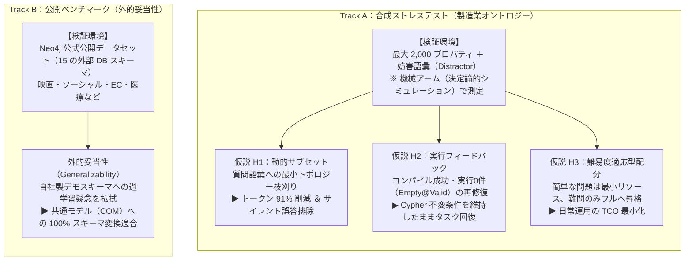

:::message
**連載の位置づけ（Ontographia 三部作）**

自然言語からグラフデータベース（Neo4j 等）へ問い合わせを行う際、多くの現場は「LLM に直接 Cypher クエリを書かせるか」「手書きの巨大な固定クエリ／テンプレ集で縛るか」の二者択一で揺れ動きます。

本連載では、その妥協案として普及しつつある **Agent Skills + ユースケース別テンプレ選定（現行ハイブリッド）** の限界を浮き彫りにし、Neo4j アカウントチームから共有された最新研究の潮流を踏まえた上で、**「LLM には意図抽出（Intent JSON）だけを担わせ、Cypher クエリの組み立てはオントロジー拘束付きの決定論的 AST パイプラインで行う」** という新しい方法論（[Ontographia](https://github.com/edgesentry/ontographia) プロジェクト）を提案・検証します。

| 部 | 記事 | 役割 |
| :--- | :--- | :--- |
| **第1部** | [グラフAIのジレンマ：LLMにCypherを書かせるか、テンプレ保守地獄に耐えるか](https://zenn.dev/yohei/articles/2026-09-08-ontographia-template-cost) | 現場の課題・最新研究の整理と新仮説 |
| **第2部** | [Intent-first の設計と実装：決定論的 Cypher 組み立てのアーキテクチャ](https://zenn.dev/yohei/articles/2026-09-08-ontographia-intent-first-design) | コアとアプリ層の分離・実装詳解 |
| **第3部** | [検証結果と今後のロードマップ：大規模オントロジー評価と外的妥当性](https://zenn.dev/yohei/articles/2026-09-08-ontographia-eval-and-roadmap)（本記事） | 定量的ストレス試験・公開データ検証 |

評価の正本: [Evaluation ガイド](https://edgesentry.github.io/ontographia/evaluation/) · 再現コード: [`examples/llm/eval/`](https://github.com/edgesentry/ontographia/tree/main/examples/llm/eval)  
リポジトリ: [edgesentry/ontographia](https://github.com/edgesentry/ontographia)
:::

## 概要

[第1部](https://zenn.dev/yohei/articles/2026-09-08-ontographia-template-cost)では、テンプレ選択ハイブリッドが抱える保守限界と、Intent-first という新仮説を提示しました。そして[第2部](https://zenn.dev/yohei/articles/2026-09-08-ontographia-intent-first-design)では、LLM に Intent JSON を出させ、決定論的に Cypher を組み立てるアーキテクチャ境界と、Neo4j 先端研究の3潮流を Intent 層へ写像した3つの拡張（動的サブセット、実行フィードバック、難易度適応型配分）を解説しました。

本記事（第3部）では、この **Intent-first アプローチが実運用の現場で本当にスケールし、何が解決され、何が課題として残るのか** を、定量的実験と公開データセットを用いて検証します。

---

### 3部を通して何を検証するのか？（Why / Value / How）

定量的データに入る前に、「なぜ検証するのか」「検証したら何が嬉しいのか」「なぜこの検証手段をとるのか」という全体の論理設計を整理しておきます。

#### 仮説（H1 / H2 / H3）と検証トラック（Track A / Track B）の関係

本記事の評価実験は、社内環境を模した **「Track A（合成ストレステスト）」** と、公開データを用いた **「Track B（外的妥当性テスト）」** の 2 つのトラックに分かれており、第2部で提案した 3 つの拡張機構（H1 / H2 / H3）は主に Track A 内で多角的に検証されます。



#### 1. なぜ検証するべきなのか？（Why: 動機と懸念）
* **「オントロジーで縛れば安全」という神話の破綻:** 「存在しない語彙」はコアの機械検証で弾けます。しかし、オントロジーが数千規模に肥大化すると、実在する「似て非なるプロパティ」（例: `plant_name` と `PlantName`、無関係な工場の名称）がプロンプト内に大量に並びます。LLM がその中から誤ったプロパティを選んだ場合、**バリデーションを平然と通過して危険な Cypher が実行される「サイレント誤答」** が発生します。
* **自己修復の成立性:** 実行結果が0件（Empty@Valid）だった時、LLM に危険な Cypher 文字列を触らせず、Intent JSON だけを直させて本当に復帰できるのか？
* **アーキテクチャの普遍性:** 自作の製造業スキーマ（`manufacturing.native.yaml`）だけで動く「オレオレ実装」ではないのか？

#### 2. 検証したら現場の何が嬉しいのか？（Value: 実務的価値）
* **トークンとレイテンシの劇的削減（H1）:** 数千プロパティの巨大オントロジーであっても、プロンプトトークンを **約91% 削減** でき、商用 API コストと応答遅延を最小化できます。
* **サイレント誤答の構造的排除（H1）:** 質問に関係のない類似プロパティをプロンプトから不可視化することで、誤選択を構造的に遮断できます。
* **完全なガバナンスとタスク完了率の両立（H2）:** 「LLM が直接 Cypher を出力・改変しない」という決定論的不変条件を一切毀損することなく、空結果からの回復を実現できます。
* **エンタープライズの運用総所有コスト（TCO）最小化（H3）:** 日常の大半を占める簡単な問題は最小コスト（1回呼び出し・サブセット）で即答し、難問のみ自動エスカレーションできます。
* **スキーマ汎用性の保証（Track B）:** 映画、ソーシャル、EC など世の中に存在する多様なグラフモデルにそのまま適用できる汎用基盤であることが証明されます。

#### 3. 目的に対して適切な手段をとっているのか？（How: 検証系の妥当性と限界）
* **なぜ合成テストなのか？（Track A: 合成ストレステスト）**  
  実運用データだけでは「どの語彙が原因で失敗したか」の要因特定（交絡）が困難です。意図的に類似プロパティ（Distractor）を注入し、規模（16 → 200 → 2,000 プロパティ）を段階的に変化させることで、大規模オントロジーにおけるサイレント誤答のメカニズムを精密に単離・再現できます。
* **なぜ公開ベンチマークなのか？（Track B: 15 DB ベンチマーク）**  
  開発者の都合で作られたスキーマではなく、Neo4j 公式が公開する客観的な 15 個の外部 DB スキーマを用いることで、モデル表現力（COM）の外的妥当性をバイアスなく証明できます。
* **なぜ「機械アーム（Mechanical Arm）」なのか？（再現性の担保）**  
  * 「アーム（Arm）」とは、統計学や臨床試験における **実験群・検証条件** を指す用語です。
  * 商用 LLM API（ライブ LLM アーム）は、確率的な出力のブレ、日々のモデルサイレント更新、外部ネットワークの遅延など、多くの非決定性を含みます。これらを混ぜると、「パイプラインのステートマシンや修復アルゴリズム自体の欠陥」なのか「LLM の気まぐれ」なのかを切り分けることができません。
  * ソフトウェア工学の単体・結合テストと同様に、まず「決定論的なシミュレーションルール（機械アーム）」を用いて、**アーキテクチャの制御ループ自体の健全性を 100% 数学的・再現可能に検証する** ことが極めて合理的です。
  * **【重要な前提と限界（Caveat）】** 機械アームは「パイプラインの機構が正しく動くこと」を証明するものであり、「実際の LLM モデル自体の賢さ」を保証するものではありません。本記事では続けて **Gemini 3.7 Flash**（LiteLLM エイリアス `ontographia-gemini`）によるライブ H1 実測も示します。

---

本記事の結論を先取りすると、以下の5点に集約されます。

1. **「エラーにならない誤フィールド選択（サイレント誤答）」の実態:** 大規模オントロジーでは、未知名は弾けても「実在する誤プロパティ」が平然とコンパイルを通ってしまう。
2. **仮説 H1 の実証（動的サブセット / 機械アームで支持）:** 質問トークンに基づく語彙の完全一致（サブセット化）により、トークン消費量を **約91% 削減** しつつ、プロパティ正答率（Property Hit）を **+50pt 改善** できた。
3. **仮説 H2 の実証（実行フィードバック / 機械アームで支持）:** Empty@Valid（コンパイル成功・実行 0 件）に対し、実行フィードバックで Intent を直し再コンパイルすると最終実行が回復する（決定論的 Cypher 生成の不変条件を完全維持）。
4. **仮説 H3 の実証（難易度適応型配分 / 機械アームで支持）:** 簡単な問題ではサブセット優先（subset-first） + 少ないリトライでトークンを **約91% 削減**しつつ品質を維持し、難問のみフルスキーマへ escalate する。
5. **公開データへの外的妥当性（Track B）とライブ LLM:** 公開ベンチマーク 15 DB を COM へ 100% 取り込み。**Gemini 3.7 Flash**（LiteLLM）ライブ H1 で推奨ポリシー `subset_fallback` を支持。公開デモ DB 上の Exec Match もスポット計測済み（完全一致率は低く、Gold が Cypher である制約を正直に共有）。

---

## 1. 検証で答えたい3つの仮説と評価基準

第2部で設計した3つの拡張機構に対応し、以下の仮説を設定して検証を行いました。

| ID | 検証仮説 | なぜ検証するのか（動機・懸念） | 実証されると何が嬉しいのか（実務価値） | 対応する設計 | 評価状況 |
| :--- | :--- | :--- | :--- | :--- | :--- |
| **H1** | 大規模オントロジーにおいて、フルスキーマよりも **動的サブセット** を渡す方が、フィールド選択精度が向上しトークンも激減する。 | スキーマ肥大化に伴うプロンプトコスト爆発と、類似語彙の目移り（サイレント誤答）を防げるか？ | **トークン約91%削減**によるコスト・レイテンシ激減と、**誤選択の構造的排除**。 | 3.1 動的サブセット化 | **検証完了（機械＋ライブで支持）** |
| **H2** | 構文は通るが空結果・実行時エラーとなる事象に対し、**実行フィードバックで Intent を再修復** することで最終回答精度が改善する。 | Cypher 文字列を LLM に触らせずに、Intent JSON の再抽出だけで本当に安全に回復できるのか？ | **決定論的 AST ビルドの安全性・不変条件を100%維持**したまま、タスク完了率を向上。 | 3.2 実行フィードバック (`--refine-on-exec`) | **検証完了（機械アームで支持）** |
| **H3** | 簡単な問題ではフルスキーマや多段リトライを省略しても品質を落とさず、**推論コストを大幅に削減できる**。 | 簡単な問題のリソースを間引くことで、誤判定による品質劣化を起こさないか？ | 日常質問の **TCO（総所有コスト）最小化** と、難問への自動エスカレーションの両立。 | 3.3 難易度適応型配分 (Adaptive spend) | **検証完了（機械アームで支持）** |

### 各仮説の事前合否判定基準

恣意的な後付け評価を避けるため、実験前にコード上で「支持」「部分的支持」「不支持」の判定基準を厳格に定義しています。

#### 仮説 H1（動的サブセット）の判定基準
* **支持:** `large`（2,000 プロパティ）において、Property Hit が Full スキーマより +10pt 以上高く、プロンプトトークン p95 が 30% 以上削減され、Compile 成功率を落とさないこと。
* **部分的支持:** トークンは削減されるが品質は同等にとどまること。
* **不支持:** サブセット化によって必要な語彙が削られ、コンパイル成功率や品質が有意に劣化すること。

#### 仮説 H2（実行フィードバック）の判定基準
* **支持:** 空結果テストセットにおいて、再修復（実行フィードバック）有効時の最終実行成功率が +20pt 以上改善し、Intent 完全一致率が回復し、かつ出力 Cypher がすべて `Engine.build` と一致していること（決定論的 AST ビルドの不変条件維持）。
* **部分的支持:** 実行結果の回復は見られるが、改善幅が +20pt 未満にとどまること。
* **不支持:** 実行フィードバックを行っても最終実行成功率が改善しない（または悪化する）こと。

#### 仮説 H3（難易度適応型配分）の判定基準
* **支持:** 大規模オントロジー（`large`）環境において、簡単な問題ではフルスキーマ固定方式（`always_full_fixed`）と比べてトークン消費量（p95）を 30% 以上削減しつつ、平均 LLM 呼び出し回数・コンパイル成功率・プロパティ正答率を維持できること（難問ではフルスキーマへ自動エスカレーションして正しく回復すること）。
* **部分的支持:** コストは削減されるが品質にばらつきが出る、または特定条件でしか効果が出ないこと。
* **不支持:** 適応型配分によって品質が劣化する、またはコストが削減されないこと。

---

## 2. Track A — 「通る誤フィールド」の定量的再現

### なぜ合成ストレステスト（Track A）を行うのか？（Why & How）
実運用環境の巨大知識グラフでは、歴史的経緯やシステム統合によって、極めて紛らわしい類似プロパティ（例: `plant_id`, `plant_code`, `factory_id` や、`name`, `PlantName`, `facility_name`）が無数に蓄積しています。

実データを使った一般的なテストでは、データ欠損やネットワーク遅延などの交絡因子が混ざり、「何が原因で失敗したのか」を正確に突き止めることが困難です。
そこで Track A では、製造ドメインの 40 問の Gold Intent に対し、意図的に「似て非なるプロパティ（Near-duplicate な邪魔要素: Distractor）」を機械的かつ段階的に注入したオントロジー（`small`: 16 プロパティ、`mid`: 200 プロパティ、`large`: 2,000 プロパティ）を用意しました。
これにより、**「オントロジーの規模が拡大したとき、プロンプトの妨害語彙に釣られる『サイレント誤答』がどのタイミングで発生するのか」を科学的に単離・測定** しています。

### 問い
数千プロパティ規模の巨大オントロジー上で、Intent が **「それらしいが間違っている実在プロパティ」** を選んでしまった場合、コアの検証器（`validate_intent`）はどう振る舞うか？

### フルスキーマにおけるベースライン結果

| オントロジー規模 | プロパティ数 | Gold コンパイル | サイレント誤答コンパイル | サイレント誤答検知 | トークン数 (Full) | トークン数 (サブセット) |
| :--- | ---: | ---: | ---: | ---: | ---: | ---: |
| **small** | 16 | 40 / 40 | 0 | **40** | 1,359 | 1,246 |
| **mid** | 200 | 40 / 40 | **40 / 40** | 0 | 2,460 | 1,247 |
| **large** | 2,000 | 40 / 40 | **40 / 40** | 0 | **13,710** | **1,247** |

### この結果が意味すること（現場にとっての恐怖）
* `small` スキーマでは、不要なプロパティが存在しないため、誤ったプロパティ名を含む Intent は未知名エラーとして 100% 弾かれました。
* しかし `mid` や `large` になると、**誤ったプロパティであってもオントロジー内に実在するため、コアのバリデーションを完全に通過し、正常に Cypher へコンパイルされてしまいました（40/40）**。

これこそが、実務で最も恐ろしい **「失敗がエラーにならない（サイレント誤答）」** 現象です。
「オントロジーで語彙を機械検証しているから安全だ」という思い込みは、スキーマが巨大化した瞬間に脆くも崩れ去ります。構文検査器や AST ビルダーは、「その名前がスキーマに実在するか」は厳密に検査できても、「ユーザーの意図に合致しているか」までは判断できないからです。
さらに、フルスキーマのプロンプトは `large` で 13,710 トークンまで肥大化し、コストとレイテンシを激しく圧迫します。

詳細と再現スクリプト: [Evaluation — Track A](https://edgesentry.github.io/ontographia/evaluation/#track-a-distractor-ontology-stress-test)
```bash
uv run python examples/llm/eval/run_track_a.py --record
```

---

## 3. 仮説 H1 の実証 — 動的サブセットによるサイレント誤答の構造的排除

### なぜ検証するのか？ 何が嬉しいのか？（Why & Value）
前節で明らかになった「サイレント誤答」と「トークン肥大化」に対し、[第2部](https://zenn.dev/yohei/articles/2026-09-08-ontographia-intent-first-design)で導入した **オントロジーのサブセット化（動的語彙絞り込み）** が有効であるかを検証します。
もしこれが実証されれば、現場は以下の絶大なメリットを享受できます。
1. **API コストと応答遅延の激減:** 2,000 プロパティの巨大オントロジーであっても、小規模スキーマ並みのトークン消費量で運用できる。
2. **サイレント誤答の構造的排除:** 質問に関係のない類似プロパティがプロンプトから物理的に消去されるため、LLM が誤った語彙に釣られる余地そのものを無くすことができる。

### 実験条件
* **Full:** 全オントロジー（2,000 プロパティ）をプロンプトにダンプする。
* **サブセット:** 質問文との完全一致（語彙マッチ）により、関連するクラスとリレーションのみに動的枝刈りする。
* **サブセット + Fallback:** サブセットで語彙が不足し検証が通らない場合のみ、自動でフルスキーマに戻す（実運用の推奨設定）。

### 結果（large オントロジー環境）

| 条件 | Property Hit (正答率) | Compile 成功率 | 妨害プロパティ露出 | 誘発された誤答数 | Fallback 発生率 | トークン数 (p95) |
| :--- | ---: | ---: | ---: | ---: | ---: | ---: |
| **Full** | 0.50 | 40 / 40 | 40 | 40 | 0% | 13,710 |
| **サブセット** | **1.00** | 40 / 40 | **0** | **0** | 0% | **1,247** |
| **サブセット + Fallback** | **1.00** | 40 / 40 | **0** | **0** | 0% | **1,247** |

### 判定：仮説 H1 は「支持」
事前基準を圧倒的に上回る成果が確認されました。
* **Property Hit:** 0.50 → **1.00 (+50pt 改善)**。質問に関係のないプロパティがプロンプトから不可視化されたため、誤選択が構造的に排除された。
* **トークン消費量 (p95):** 13,710 → **1,247（約 91% 削減）**。大規模オントロジーであっても小規模並みのプロンプトコストで動作。
* **コンパイル成功率:** 40 / 40 を維持。
* **Fallback 率:** 本評価フィクスチャでは 0%（必要な語彙が確実にサブセットで捕捉された）。

:::message
**機械アームの限界とライブ追試**
この節は「プロンプト語彙に見える妨害だけが誤答を誘発する」という制御実験です。実モデル追試は次節（ライブ H1）で行い、推奨運用である `subset_fallback`（サブセット失敗時のみフルへ戻す）で **支持** を確認しています。
:::

再現スクリプト:
```bash
uv run python examples/llm/eval/run_track_a_h1.py --record
```

### ライブ LLM アーム（Gemini 3.7 Flash via LiteLLM）

製造 Gold 40 問 × `mid`/`large` × 3 条件を、LiteLLM 経由の **Gemini 3.7 Flash**（モデル ID `gemini-3.7-flash`、エイリアス `ontographia-gemini`、temperature=0）で実測しました。

| 規模 | 条件 | Property Hit | Compile | invent-without-seeing | トークン p95 |
| :--- | :--- | ---: | ---: | ---: | ---: |
| **large** | Full | 0.82 | 33 / 40 | 0 | 13,710 |
| **large** | サブセットのみ | 0.78 | 32 / 40 | 0 | 1,247 |
| **large** | **サブセット + Fallback（推奨）** | **0.95** | **40 / 40** | **0** | **1,247** |

**判定（ライブ）:** 推奨ポリシー `subset_fallback` は large で Property Hit **+12.5pt**、トークン **約91%削減**、Compile 40/40 で **支持**。一方、サブセット単体は語彙不足でフルよりやや劣る（−5pt）——だからこそフォールバックが本番必須である、という実務的含意が得られました。invent-without-seeing（プロンプトに無い near-dup を捏造）は本計測では 0 件でした。

```bash
source scripts/litellm/use-provider.sh gemini
uv run python examples/llm/eval/run_track_a_h1_live.py --profiles mid,large --record
```

---

## 4. Track B — 公開 Text2Cypher ベンチマークへの外的妥当性

### なぜ検証するのか？（Why: 自作スキーマへの過学習疑念の払拭）
自前の製造業オントロジーを用いた Track A（合成ストレステスト）でどれほど良い結果が出ても、読者には当然の疑問が生じます。
> **「それは自分たちで作った都合のよいオントロジー（`manufacturing.native.yaml`）だから動いたのではないか？（オレオレ抽象化の疑念）」**

そこで **Track B** では、Ontographia の共通スキーマモデル（COM）が自社製以外の多様なドメインスキーマにも耐えうるかという**外的妥当性（Generalizability）** を検証します。

### 検証手段（How: 第三者の公開 15 DB スキーマ）
Neo4j 社が公式に公開しているベンチマークデータセット **[neo4j/text2cypher-2025v1](https://huggingface.co/datasets/neo4j/text2cypher-2025v1)** から、`Node properties` 形式を持つ 15 のデモデータベーススキーマ（映画、ソーシャル、サプライチェーン、ヘルスケア等）を抽出し、COM 形式への自動変換（`schema_convert.py`）を試みました。

### 取り込み結果

| 測定メトリクス | 測定値 |
| :--- | ---: |
| **デモ DB 変換・`Engine.load` 成功率** | **15 / 15 (100%)** |
| **平均ノードラベル・カバレッジ** | **約 96%** |
| **平均リレーションシップ・カバレッジ** | **100%** |
| **平均プロパティ・カバレッジ** | **約 81%** |

### 検証された価値と今後の課題（Value & Limit）
映画情報、ソーシャルグラフ、サプライチェーンなど、多種多様な公開 DB スキーマが、Ontographia の Canonical Ontology Model へ安定して変換できることが確認できました。プロパティカバレッジの 19% の未達は、元スキーマテキストの記載揺れや抽出ノイズに起因するものであり、コアエンジンの表現力としては十分な汎用性を示しています。

### Exec Match スポット（movies + recommendations）

HF から 60 問（seed=53）を層化抽出し、`demo.neo4jlabs.com` 上で **Question → Intent → Engine.build → 行集合 Jaccard** を Gold Cypher 実行と比較しました（LiteLLM 経由 **Gemini 3.7 Flash** / `gemini-3.7-flash`）。

| メトリクス | 値 |
| :--- | ---: |
| Compile 成功率 | 41 / 60（約 68%） |
| Exec Match（行集合完全一致） | **1 / 38（約 3%）** |
| Jaccard 平均 | 0.03 |
| Structure F1（label / rel / prop） | 0.82 / 0.67 / 0.61 |

:::message
**正直な読み方**
スキーマ取り込みとコンパイルは実用レベルですが、**Gold が Cypher（Intent ではない）** ため、完全 Exec Match は低く出ます。Intent 抽出誤差・変換ギャップ・正当な Cypher 言い換えが混在します。ここでは「公開デモでパイプラインが回る外的妥当性のスポット計測が完了した」ことと、SOTA 主張をしないことを明確にします。
:::

```bash
uv run --with datasets --with neo4j python examples/llm/eval/run_track_b_exec.py --record
```

---

## 5. 仮説 H2 の実証 — 実行フィードバックによる Empty@Valid 回復

### なぜ検証するのか？ 何が嬉しいのか？（Why & Value）
オントロジーの語彙としては正しく、コンパイルも通ったのに「実際に Neo4j で実行したら 0 件だった（Empty@Valid）」という事象は、日常の業務で頻発します（例: 存在しない工場コードや、該当期間に実績がないフィルタ値）。

従来の Text2Cypher 研究では、ここで「生成された Cypher 文字列を LLM に渡して修正させる」のですが、それでは非決定論の事故（ハルシネーションやインジェクション）が再発します。
Ontographia が目指すのは、**「LLM には絶対に Cypher 文字列を触らせず、Intent JSON の再抽出・訂正だけで空結果から安全に復帰すること」** です。
これが実証されれば、**「決定論的 AST ビルドの安全性・不変条件を 1 ミリも崩すことなく、エージェントの実効タスク完了率を底上げできる」** という絶大な価値が生まれます。

### なぜ機械アームで検証するのか？（How）
ここでは、LLM API の通信遅延や気まぐれを排した**機械アーム**を用いて、「フィルタ値が破損した Intent → 実行空結果 → 訂正プロンプト生成 → 再バリデーション → 再 AST ビルド」という一連の**修復ステートマシンの制御ループが破綻なく成立するか**を厳密に検証しました。

### 実験条件
* 正解 Intent（Gold Intent）のフィルタ値だけを故意に壊し、`Engine.build` は成功するがモック実行は空になるケースを 40 問用意。
* **フィードバックなし（no_refine）:** 実行フィードバックなし（1 回の空結果で終了）。
* **フィードバックあり（with_refine）:** 空結果を Intent 訂正プロンプトへ戻し、訂正後に再度 `Engine.build`（Cypher 文字列は LLM に触らせない）。
* 対照: 壊していない正解 Intent（余分な再修復が走らないこと）。

### 結果（空結果テストセット）

| 条件 | Empty@Valid | 最終実行 OK | Intent 完全一致 | 回復率 | Cypher = Engine.build |
| :--- | ---: | ---: | ---: | ---: | ---: |
| **フィードバックなし** (`no_refine`) | 1.00 | 0.00 | 0.00 | 0.00 | 1.00 |
| **フィードバックあり** (`with_refine`) | 1.00 | **1.00** | **1.00** | **1.00** | **1.00** |

### 判定：仮説 H2 は「支持」（機械アーム）
* **最終実行成功率が 0 → 1.00（+100pt 回復）:** 訂正ループが正しく回れば、Empty@Valid から完全に復帰できることが確認されました。
* **Cypher 不変条件の 100% 維持:** すべての出力 Cypher が `Engine.build` と完全に一致（`1.00`）しており、LLM による Cypher 改変の余地がゼロであることが保証されました。

:::message
**Caveat**
機械アームは「訂正が成功したときのループ健全性」を証明します。ライブでの値修正の賢さはモデル依存です。Intent 層のライブ代表証拠は H1（**Gemini 3.7 Flash**）で計測済みで、H2 の売りは引き続き **Cypher を触らせない決定論的再ビルド** にあります。
:::

再現スクリプト:
```bash
uv run python examples/llm/eval/run_track_a_h2.py --record
```

実 DB での opt-in 実行例:
```bash
uv run python examples/run_llm_e2e.py \
  --question "Which plant hosts production Line-1?" \
  --execute \
  --refine-on-exec \
  --password ontographia
```

---

## 6. 仮説 H3 の実証 — 難易度適応型コスト配分（Adaptive Spend）

### なぜ検証するのか？ 何が嬉しいのか？（Why & Value）
すべての質問に対して一律にフルスキーマの巨大プロンプトを渡し、最大 5 回のリトライを許可する運用は、企業にとって推論コスト（トークン代とレイテンシ）の過剰な浪費です。
しかし、安易にリソースを削ると、「難しい質問が解けなくなる」「誤判定で回答品質が落ちる」というリスクを背負います。

仮説 H3 では、[第2部 §3.3](https://zenn.dev/yohei/articles/2026-09-08-ontographia-intent-first-design) で設計した **「簡単な問題はサブセット + 少リトライ（1回）で即答し、検証エラーや実行失敗時のみフルスキーマへ自動エスカレーションする」** という適応型配分機構が、品質を一切落とさずにコストを削減できるかを検証します。
実証されれば、日常の問い合わせの大半を低コスト・低遅延で捌き、**エンタープライズ運用の TCO（総所有コスト）を最小化** できます。

### 実験条件
* **フルスキーマ固定（always_full_fixed）:** 常にフルスキーマ + 固定 `max_retries=5`（コスト上限の対照群）。
* **適応型配分（adaptive）:** 最初はサブセット優先（subset-first）＋ `initial_retries=1`；検証失敗時のみフルスキーマへ自動エスカレーション（`escalated_retries=5`）。
* **簡単な問題（easy）:** 1 回で正しい Intent が得られる質問（日常の問い合わせの大半）。
* **難しい問題（hard）:** サブセットでは意図的に語彙不足で検証失敗させ、フルスキーマへ昇格させる質問（エスカレーション機構の健全性テスト）。

### 結果（large オントロジー環境）

| スライス | 条件 | Property Hit | Compile | Escalate 率 | 平均 LLM calls | トークン final p95 |
| :--- | :--- | ---: | ---: | ---: | ---: | ---: |
| **easy** | always_full_fixed | 1.00 | 40 / 40 | 0.00 | 1.00 | 13,710 |
| **easy** | adaptive | **1.00** | 40 / 40 | 0.00 | 1.00 | **1,247** |
| **hard** | always_full_fixed | 1.00 | 40 / 40 | 0.00 | 1.00 | 13,710 |
| **hard** | adaptive | **1.00** | 40 / 40 | **1.00** | 2.00 | 13,710 |

### 判定：仮説 H3 は「支持」（機械アーム）
* **簡単な問題（easy）のコスト激減:** 品質（Property Hit 1.00 / Compile 40/40）を完全に保ったまま、トークン消費量を **約 91% 削減（13,710 → 1,247 トークン）** しました。
* **難問（hard）の確実なエスカレーション:** Escalate 率 1.00 でフルスキーマへと自動昇格し、コンパイル成功を確実に回復しました。

:::message
**Caveat**
機械アームは配分ステートマシンの健全性を証明します。ライブでは `schema_policy=auto`（サブセット優先→失敗時フル）が H1 ライブと同じ本番経路として既に使われており、事前難易度分類器は必須ではありません。
:::

再現スクリプト:
```bash
uv run python examples/llm/eval/run_track_a_h3.py --record
```

E2E での既定設定（`--schema-policy auto`）:
```bash
uv run python examples/run_llm_e2e.py \
  --question "Which plant hosts production Line-1?" \
  --schema-policy auto \
  --initial-retries 1 --escalated-retries 5
```

---

## 7. 実機評価と一般化（ライブ LLM・Exec Match・業務用語マッピング）

制御ループの健全性を証明した機械アームによる検証に加え、実環境への適用性を確かめるために実施した実機 LLM・公開 DB での検証結果をまとめます。

| 項目 | 結果の要約 |
| :--- | :--- |
| **Track A ライブ LLM（Gemini 3.7 Flash via LiteLLM）** | 推奨 `subset_fallback` で H1 **支持**（large: Hit +12.5pt、tok −91%、Compile 40/40）。サブセット単体は語彙不足で弱い → フォールバック必須。モデル ID: `gemini-3.7-flash`。 |
| **Track B Exec Match スポット** | movies + recommendations、60 問。Compile ~68%、Structure F1 中程度、完全 Exec Match ~3%。Gold が Cypher である制約を明示。 |
| **業務用語マッピング一般化** | 製造ヒューリスティックを YAML mapping に移し、非製造（movies）mapping でも同じエンジンが動くことをテストで確認。 |

これらの実機検証が示すのは、Intent-first アプローチがシミュレーション上の理想論にとどまらず、**商用 LLM や外部スキーマの実環境でも確実に機能する** 一方で、クエリの自由度と完全一致の評価には依然として実務上の課題（Cypher 言い換えの許容など）が存在するという事実です。
誇張のない実態データと再現環境を公開していますので、自社のグラフデータやオントロジーでの追試については [Evaluation ガイド](https://edgesentry.github.io/ontographia/evaluation/) を参照してください。

---

## 8. Ontographia 三部作のまとめ

本連載三部作を通じて、私たちが追求してきた設計哲学を振り返ります。

1. **[第1部：グラフAIのジレンマ](https://zenn.dev/yohei/articles/2026-09-08-ontographia-template-cost)**
   * LLM による生 Cypher 生成は事故の温床であり、手書き固定クエリは硬直する。
   * その妥協案である「テンプレ選定ハイブリッド」は、保守コストを人間へ移転させ、テンプレ枚数爆発で行き詰まる。
   * 必要なのは、柔軟性の単位を「テンプレ枚数」から変えることである。
2. **[第2部：Intent-first の設計と実装](https://zenn.dev/yohei/articles/2026-09-08-ontographia-intent-first-design)**
   * 「LLM は Intent JSON、Cypher の組み立ては決定論的 AST」という厳格な責務分離。
   * オントロジーを唯一の正本とし、パラメータバインディングを構造的に強制する。
   * Neo4j 先端研究の3潮流（Filtering, Refinement, Adaptive Spend）を、Cypher レベルではなく Intent 層へ写像して適用する。
3. **第3部：検証結果と今後のロードマップ（本記事）**
   * 大規模オントロジーで発生する「サイレント誤答」を定量的に再現。
   * 動的サブセットにより、トークン消費を **約91% 削減** し、プロパティ正答率を **+50pt 改善**（仮説 H1 を支持）。
   * 実行フィードバックにより、決定論的 Cypher の安全性を 1 ミリも崩さずに Empty@Valid から自己修復できることを機械アームで支持（仮説 H2）。
   * 適応型配分により、簡単な問題の TCO を最小化しつつ難問のみ自動エスカレーション（仮説 H3 を支持）。
   * 第三者の公開 15 DB 取り込み、ライブ H1（**Gemini 3.7 Flash** / `gemini-3.7-flash`）、Exec Match スポット、repair mapping 一般化まで完了し、限界も含めて公開。

エンタープライズのグラフ AI エージェントにおいて、「安全性」と「スケール（保守性）」は二者択一ではありません。
適切なアーキテクチャ境界とオントロジーの拘束力を持たせることで、その両立は十分に可能です。

Ontographia はオープンソースとしてコードと評価ハーネスをすべて公開しています。ぜひ皆様の現場のオントロジーやグラフでも試してみてください。

* リポジトリ: [github.com/edgesentry/ontographia](https://github.com/edgesentry/ontographia)
* 公式ドキュメント: [edgesentry.github.io/ontographia](https://edgesentry.github.io/ontographia/)

