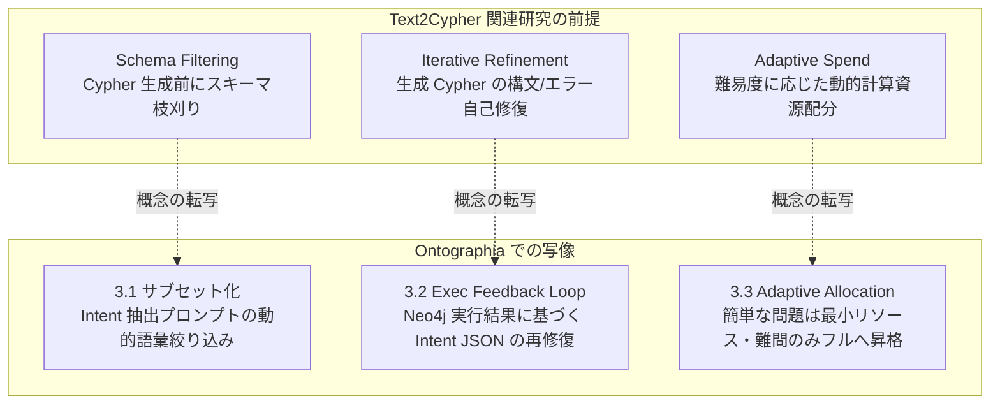

:::message
**連載の位置づけ（Ontographia 三部作）**

自然言語からグラフデータベース（Neo4j 等）へ問い合わせを行う際、多くの現場は「LLM に直接 Cypher クエリを書かせるか」「手書きの巨大な固定クエリ／テンプレ集で縛るか」の二者択一で揺れ動きます。

本連載では、その妥協案として普及しつつある **Agent Skills + ユースケース別テンプレ選定（現行ハイブリッド）** の限界を浮き彫りにし、Neo4j アカウントチームから共有された最新研究の潮流を踏まえた上で、**「LLM には意図抽出（Intent JSON）だけを担わせ、Cypher クエリの組み立てはオントロジー拘束付きの決定論的 AST パイプラインで行う」** という新しい方法論（[Ontographia](https://github.com/edgesentry/ontographia) プロジェクト）を提案・検証します。

| 部 | 記事 | 役割 |
| :--- | :--- | :--- |
| **第1部** | [グラフAIのジレンマ：LLMにCypherを書かせるか、テンプレ保守地獄に耐えるか](https://zenn.dev/yohei/articles/2026-09-08-ontographia-template-cost) | 現場の課題・最新研究の整理と新仮説 |
| **第2部** | [Intent-first の設計と実装：決定論的 Cypher 組み立てのアーキテクチャ](https://zenn.dev/yohei/articles/2026-09-08-ontographia-intent-first-design)（本記事） | コアとアプリ層の分離・実装詳解 |
| **第3部** | [検証結果と今後のロードマップ：大規模オントロジー評価と外的妥当性](https://zenn.dev/yohei/articles/2026-09-08-ontographia-eval-and-roadmap) | 定量的ストレス試験・公開データ検証 |

プロジェクト公開ドキュメント: [edgesentry.github.io/ontographia](https://edgesentry.github.io/ontographia/)  
リポジトリ: [edgesentry/ontographia](https://github.com/edgesentry/ontographia)
:::

## 概要

[第1部](https://zenn.dev/yohei/articles/2026-09-08-ontographia-template-cost)では、自然言語からグラフデータベース（Neo4j）へ問い合わせる際、Agent Skills を用いたテンプレ選択ハイブリッドが「安全」に見えても、柔軟性の単位がテンプレ枚数に縛られ、保守コストが人間へ移転する構造的な壁を指摘しました。また、Neo4j コミュニティの最新研究（Schema Filtering や Iterative Refinement）が「LLM に生 Cypher を書かせる前提の事後修正」である限界も整理しました。

本記事（第2部）では、この課題を根本から解消するために設計されたオープンソースプロジェクト **[Ontographia](https://github.com/edgesentry/ontographia)** のアーキテクチャと実装を解説します。

Ontographia の核心は、明確な **「関心の分離と責務境界」** にあります。

* **自然言語の柔軟性は「Intent JSON」で吸収する:** LLM には Cypher を 1 文字も書かせず、探索意図の抽出のみを担わせる。
* **クエリの組み立てとガバナンスは「100% 決定論」で行う:** オントロジー検証を通過した Intent のみを AST 経由で Cypher（Cypher 25 等）へコンパイルし、値はすべて `$param_N` にバインドする。
* **LLM 呼び出しやプロンプト制御、DB 実行ループは「コア外（アプリ／エージェント層）」に置く:** エンジン本体は LLM 非依存・ドライバ非依存の決定論的コンパイラとして保ち、最新研究の知見（Schema Filtering や Refinement）は Intent 層へ写像して適用する。

---

## 1. 第1部の問いへの回答：Intent-first パイプライン

> **「テンプレ枚数に比例しないまま、自然言語への追従と、決定論的な Cypher 実行・ガバナンスを両立できないか？」**

Ontographia が導き出した回答は以下のパイプラインです。

```text
[オントロジー定義 (YAML / Turtle)]
          │
          ▼
   Adapter → COM (Canonical Ontology Model)
          │
          ├──────────────────────────────┐
          │ (語彙スキーマの提供)           │ (語彙の厳密検証)
          ▼                              ▼
  [アプリ層: LLM]                 [コア: validate_intent]
   質問 ──▶ Intent JSON ─────────▶ 合格? ──(No)──▶ 検証エラー (アプリ層へ返却)
                                         │ (Yes)
                                         ▼
                                  [コア: build_ast]
                                         │
                                         ▼
                                  [コア: Emitter]
                                         │
                                         ▼
                                 { query, params }
                              (例: Cypher 25 + $param_0)
                                         │
                                         ▼
                                   [(Neo4j 実行)]
```

このパイプラインは、大きく以下の6つのステップで進行します。

1. **オントロジーの正規化（COMの構築）:**  
   YAML や Turtle などで記述されたオントロジー定義を Adapter 経由で読み込み、内部の正規化表現である **COM（Canonical Ontology Model）** を構築します。これがシステム全体の語彙の正本となります。
2. **語彙スキーマの提供と Intent 抽出（アプリ層）:**  
   COM から導出された語彙制約（Intent JSON Schema）をプロンプトに載せて LLM に渡します。LLM はユーザーの自然言語の質問を受け取り、Cypher ではなく探索意図を表す **Intent JSON** を構造化抽出します。
3. **厳格な語彙検証（コア: `validate_intent`）:**  
   抽出された Intent JSON をコアエンジンが検査します。「指定されたクラスやリレーション、プロパティがオントロジーに実在するか」を機械的にチェックし、未知の語彙や不正な結合はここで完全に遮断します。検証エラー時はアプリ層へ差し戻し、LLM による再抽出やリトライを促します。
4. **中間表現への変換（コア: `build_ast`）:**  
   検証を通過した Intent のみを、クエリ言語の方言に依存しない **Query AST**（抽象構文木）へと変換します。この際、フィルタ条件の値（ユーザー入力値）はクエリ文字列から完全に切り離され、自動的にパラメータ（`$param_0` 等）として分離されます。
5. **決定論的クエリの生成（コア: `Emitter`）:**  
   AST を走査し、指定された方言（既定は Neo4j 向けの Cypher 25）の安全なクエリ文字列とパラメータ辞書のペア `{ query, params }` を決定論的に emit します。同じ入力であれば常に 100% 同一の出力が得られます。
6. **データベース実行（アプリ層）:**  
   完成したクエリとパラメータを Neo4j ドライバに渡し、安全に実行します。

### なぜこれでテンプレ地獄が消えるのか
従来のハイブリッド方式では、「サプライヤ一覧用テンプレ」「再帰的 BOM 展開用テンプレ」といったように、**クエリのパターンごとに Cypher 文字列を人間が事前作成**していました。

Intent-first では、探索の開始クラス（`start`）、辿るリレーション（`traverse`）、絞り込み条件（`filter`）、出力項目（`return`）を、構造化された JSON のフィールドの組み合わせで表現します。並べ替え（`order_by`）、件数の制御（`limit` / `skip`）、`optional` フラグも任意で指定できます。

v0.1.5 以降、Intent JSON の未知のキーは検証エラーになり、問題のフィールド名がエラーに含まれます（それ以前は黙って無視されていました）。たとえば `filters` というタイポは、それ以前は絞り込み条件が落ちたままビルドが通っていましたが、v0.1.5 では検証で弾かれます。

方言名も同様で、Python と FFI / Go バインディングは未知の方言をエラーにし、以前のように `cypher25` へ黙ってフォールバックしません。

オントロジーが定義する語彙の範囲内であれば、LLM は探索パターンをこれらのフィールドの組み合わせとして表現できます。そのため、**新しい探索パターンに対応するためにテンプレを追加する必要がありません**。

---

## 2. 設計原則：何をコアに置き、何を外に置くか

Ontographia の設計原則（[Architecture ガイド](https://edgesentry.github.io/ontographia/architecture/)）は、決定論と安全性を極限まで高めるために研ぎ澄まされています。

| 設計原則 | 含意とアーキテクチャ上の決定 |
| :--- | :--- |
| **Ontology が唯一の正本** | クラス名、リレーション名、プロパティ名は COM（Canonical Ontology Model）に定義されたもの以外一切認めない。 |
| **LLM は Intent、Cypher ではない** | スキーマ制約付き JSON（Intent）を機械検証して初めて、クエリ生成パイプラインが起動する。 |
| **決定論的パラメータバインド** | ユーザー入力値やフィルタ値は必ず `$param_N` に切り離す。クエリ文字列への埋め込みは構造上不可能にする。 |
| **同一入力・同一出力の再現性** | 同じオントロジー + Intent + 方言であれば、常に同一の `{ query, params }` を出力する。 |
| **コアとアプリ層の厳格な分離** | コア（Rust 製 `ontographia-core`）にはネットワーク、LLM API、Neo4j ドライバを一切持ち込まない。 |

### なぜコアに LLM やドライバを入れないのか
多くの AI ツールキットは、エンジン内部に LLM 呼び出しや DB コネクタを統合しがちです。しかし Ontographia はそれを固く拒否しています（[What is intentionally outside the core](https://edgesentry.github.io/ontographia/architecture/#what-is-intentionally-outside-the-core)）。

* **検証可能性とテスト容易性:** コアが純粋な決定論的コンパイラであれば、AST とクエリ生成のテストを、LLM もデータベースも使わずに CI で実行できます。トークン代はかからず、LLM の応答をモックする必要もありません。
* **セキュリティ保証:** 「LLM が直接 Cypher 文字列を書き換えることは絶対にない」という保証が、言語境界・クレート境界によって物理的に担保されます。
* **マルチ言語展開:** コアが軽量かつ純粋なロジックであるため、Python、Go、WebAssembly などの言語バインディングを薄いラッパーとして安全に提供できます。

#### コア外の実装をあえて `examples` に用意している意図
プロンプトの生成、LLM 呼び出し、Neo4j ドライバによる実行、スキーマの動的サブセット化や実行フィードバックといった機能は、プロダクションごとのフレームワーク（LangChain、LlamaIndex、自社製エージェント基盤など）の自由度に委ねるべき領域であり、**コアライブラリ自体のスコープからは意図的に外しています**。

しかし、完全に切り離してしまうと「アプリ層を含めた End-to-End（E2E）の統合テストや実環境での効果検証」を行うことができません。また、利用するエンジニアにとっても「コアライブラリを実際にどう呼び出してエージェントへ組み込めばよいのか」が見えにくくなります。

そのため Ontographia では、リポジトリの [`examples/`](https://github.com/edgesentry/ontographia/tree/main/examples) フォルダ（特に `examples/llm/`）に、コア外の Python 実装をオープンに用意しています。これにより、**コアの決定論性を一切損なわずに E2E 統合テストを厳密に検証できる環境を確保しつつ、開発者にとっての『生きたコアライブラリの使い方リファレンス』を提供する** という意図を持たせています。

:::message
**主要コンポーネントの用語定義**

* **COM (Canonical Ontology Model):** 複数形式（native YAML, OWL, RDF 等）のオントロジーを正規化した内部データモデル。
* **Intent JSON:** 探索意図（どのノードから、どの関係を辿り、どう絞り込んで何を返すか）を記述する JSON 仕様。
* **Query AST:** 方言に依存しない形で設計した、安全なクエリ中間表現。GQL への対応も想定した構造にしている。
* **Emitter:** AST を走査し、特定の方言（既定の Cypher 25、または Cypher 5）の安全なクエリ文字列とパラメータ辞書を出力する生成器。GQL 向けの Emitter はプロトタイプ段階である。
:::

---

## 3. 最新研究を「Intent 層」へ写像した3つの拡張

[第1部](https://zenn.dev/yohei/articles/2026-09-08-ontographia-template-cost)で紹介した Neo4j の関連研究（Schema Filtering、Iterative Refinement、Difficulty-Adaptive Spend）は非常に有用ですが、いずれも LLM に Cypher を書かせる前提でした。

Ontographia では、これら先端研究のエッセンスを **アプリ層（`examples/llm/`）における Intent 生成の改善** へと鮮やかに写像しています。



### 3.1 オントロジーのサブセット化 + フルスキーマフォールバック
大規模なエンタープライズオントロジーでは、何百・何千というクラスやプロパティが存在します。これらをすべてプロンプトに載せると、トークン消費が爆発するだけでなく、LLM が「似て非なるプロパティ」を誤選択する原因になります。

そこで Ontographia のアプリ層（`examples/llm/subset.py`）では、ユーザーの質問に含まれるトークンとオントロジーの要素名との **完全一致（大小文字無視・複数形正規化）** を行い、関係するクラス間の最小トポロジー（Relationship Closure）を抽出して、プロンプトに渡すオントロジーを大幅に圧縮します。

サブセット段階で Intent の抽出や検証が失敗した場合は、フルスキーマに切り替えて抽出をやり直します。この切り替えは、サンプルアプリのパイプライン（`examples/llm/pipeline.py`）の `schema_policy` で制御しており、pip パッケージや Rust コアの機能ではありません。

`schema_policy` は `auto`（既定）、`subset`、`full` の三つの値を取ります。`auto` ではまずサブセットで抽出を試み、サブセット段階で抽出の失敗、`validate_intent` による検証の失敗、リペア中の例外のいずれかが起きると、フルスキーマに切り替えます。質問に一致する語彙が見つからずサブセットが空になった場合は、最初からフルスキーマを使います。

### 3.2 実行結果フィードバックによる Intent 訂正
オントロジーの語彙的には正しくコンパイル（`Engine::build`）できたとしても、「実際に Neo4j で実行したら 0 件だった（Empty Result）」、あるいは「データ型変換で Neo4j ドライバがエラーを返した」というケースが発生します。

従来の Text2Cypher 研究ではここで「Cypher 文字列を LLM に渡して直させる」のですが、それでは非決定論の事故が再発します。

Ontographia のサンプルアプリ（`examples/llm/exec_feedback.py`）では、**Neo4j の実行結果（0 件またはエラー情報）を LLM に渡し、Cypher ではなく Intent JSON を修正させます**。この修正ループは、`--execute --refine-on-exec` を指定したときだけ動作します。

修正された Intent は、再びコアの `validate_intent` と AST コンパイルを通ります。そのため、修正を繰り返しても、実行される Cypher は常にコアの決定論的な生成を経たものになります（LLM が Cypher 文字列を直接書き換える経路はありません）。修正は既定で最大 2 回（`--max-exec-refines` で変更可能）で、常にフルスキーマを使い、修正後の Intent が検証を通らなかった時点でループを止めます。

### 3.3 難易度適応型コスト配分（Adaptive Spend）
業務で投げられる質問のすべてが複雑な結合を要するわけではありません。日常の問い合わせの大半は単純な単一ノード参照や浅い探索であり、最初からフルスキーマの巨大プロンプトを渡し、多段リトライ（5回等）のバジェットを確保するのは推論コスト（トークン代とレイテンシ）の過剰な浪費です。

そこでサンプルパイプライン（`examples/llm/pipeline.py`。`examples/run_llm_e2e.py` から呼び出す）では、**最初は軽量なサブセットと最小のリトライ回数（`initial_retries=1`）で抽出を試み、サブセット段階が失敗したときだけフルスキーマに切り替えてリトライ回数を増やす（`escalated_retries=5`）** という配分にしています。切り替えの条件は 3.1 と同じで、抽出・検証・リペアのいずれかの失敗です。Neo4j での実行失敗（エラーや 0 件）はこの切り替えの対象ではなく、3.2 の実行フィードバックループで扱います。

この配分は、日常の簡単な質問ではトークン消費とレイテンシを抑え、難しい質問にだけ多くのリトライを割り当てることを狙っています。効果の定量的な評価は第3部で扱います。

---

## 4. Agent Skills の役割はどう変わるか

Intent-first アプローチを導入することで、エージェント基盤における Skills（ツール定義）の責務は劇的にシンプルになります。

| 項目 | 従来のテンプレ選定ハイブリッド | Intent-first (Ontographia) |
| :--- | :--- | :--- |
| **LLM のタスク** | どの Cypher テンプレを呼ぶべきかの分類 | 自然言語から **Intent JSON** への構造化 |
| **開発者の保守対象** | 増え続ける Cypher テンプレカタログ | **オントロジーの定義（COM）** と抽出プロンプト |
| **スキーマ変更時の対応** | 全テンプレの洗い出し、修正、回帰テスト | オントロジーを更新するだけ（語彙検証が自動追従） |
| **新しい質問への追従** | 新しいテンプレの作成・レビューが必要 | オントロジーの語彙範囲内であれば **即座に対応** |
| **クエリの安全性** | テンプレ作成者の腕に依存 | **AST とバインディングにより構造的に完全保証** |

エージェント開発者は、もはや「似たような Cypher テンプレを量産してプロンプトのルーティングを微調整する」という不毛な作業から解放されます。

---

## 5. ミニマムな実装と動かし方

Ontographia はソースコードからビルドする必要はありません。Homebrew 経由で CLI が即座に導入できるほか、Python、Go、Rust の各エコシステム向けにパッケージが正式リリースされています。

| 言語 / ツール | インストール方法 | 備考 |
| :--- | :--- | :--- |
| **CLI** | `brew install ontographia` | Homebrew で一発導入（`cargo install ontographia-cli`、GitHub Releases にもバイナリあり） |
| **Python** | `pip install ontographia` | PyPI 公開済み（Linux, macOS arm64, Windows 対応） |
| **Go** | `go get github.com/edgesentry/ontographia/bindings/go` | cgo / FFI バインディング |
| **Rust** | `cargo add ontographia-core ontographia-adapters` | crates.io に `ontographia-core` / `ontographia-adapters` / `ontographia-schema` / `ontographia-cli` を公開 |

ここでは、公式リポジトリ [**edgesentry/ontographia**](https://github.com/edgesentry/ontographia) に同梱されている製造ドメインのサンプルデータを使って、実際に動作を確認してみましょう。

まずはリポジトリをクローンして移動します。

```bash
git clone https://github.com/edgesentry/ontographia.git
cd ontographia
```

### CLI による決定論的クエリビルド
Homebrew で CLI をインストールすれば、リポジトリ内のサンプルオントロジー（[`examples/manufacturing.native.yaml`](https://github.com/edgesentry/ontographia/blob/main/examples/manufacturing.native.yaml)）とサンプル Intent（[`examples/sample_intent.json`](https://github.com/edgesentry/ontographia/blob/main/examples/sample_intent.json)）を渡すだけで、安全な Cypher 25 が出力されます。

サンプル Intent は、製品 SKU `SPX-100` を構成する部品（Part）のサプライヤ（Supplier）名を返す探索を表しています。

```json
{
  "start": { "class": "Product", "alias": "product" },
  "traverse": [
    {
      "relationship": "has_part",
      "direction": "out",
      "to": { "class": "Part", "alias": "part" }
    },
    {
      "relationship": "supplied_by",
      "direction": "out",
      "to": { "class": "Supplier", "alias": "supplier" }
    }
  ],
  "filter": [
    { "alias": "product", "property": "sku", "op": "eq", "value": "SPX-100" }
  ],
  "return": [
    { "alias": "supplier", "property": "name", "as_name": "supplier_name" }
  ],
  "limit": 20,
  "optional": false
}
```

```bash
# Homebrew によるインストール
brew tap edgesentry/tap
brew install ontographia

# 決定論的ビルドの実行（リポジトリ同梱のサンプルデータを使用）
ontographia build \
  --ontology examples/manufacturing.native.yaml \
  --intent examples/sample_intent.json \
  --json
```

出力される結果:
```json
{
  "params": {
    "param_0": "SPX-100"
  },
  "query": "CYPHER 25\nMATCH (product:Product)-[:has_part]->(part:Part)-[:supplied_by]->(supplier:Supplier)\nFILTER product.sku = $param_0\nRETURN supplier.name AS supplier_name\nLIMIT 20"
}
```

SKU の値 `SPX-100` はクエリ文字列に含まれず、`param_0` として別に渡されています。

### Python からの E2E 実行（LLM 抽出 → ビルド → Neo4j 実行）
リポジトリの `examples/` ディレクトリには、自然言語の質問から LLM で Intent を抽出し、Neo4j まで一気通貫で実行するサンプルスクリプト（[`examples/run_llm_e2e.py`](https://github.com/edgesentry/ontographia/blob/main/examples/run_llm_e2e.py)）が用意されています。これはアプリ層を含めた E2E 統合テストを検証するための実装であると同時に、コアライブラリ（Python パッケージ）を自社システムやエージェントへどう組み込めばよいかを示すリファレンス実装になっています。

```bash
# 依存関係のセットアップ（uv を使用）
uv sync

# 自然言語からの実行（Neo4j 実行 + 実行フィードバック修正を有効化）
uv run python examples/run_llm_e2e.py \
  --question "Find all suppliers providing parts to Plant-1" \
  --execute \
  --refine-on-exec \
  --password ontographia
```

エンドツーエンドの詳しい手順や Neo4j コンテナのセットアップ手順は、公式ドキュメントの [Neo4j walkthrough](https://edgesentry.github.io/ontographia/end-to-end-neo4j/) を参照してください。

---

## まとめ（第2部）

* **境界線の厳格化:** 自然言語の受け口は Intent JSON、Cypher の組み立ては決定論的 AST。この分離が安全とスケールを両立する鍵である。
* **コアの軽量性と独立性:** LLM や Neo4j ドライバをあえてコアに入れないことで、100% の検証可能性と堅牢なセキュリティを実現した。
* **最新研究の Intent 層への写像:** Schema Filtering は「プロンプトの動的サブセット化」へ、Iterative Refinement は「実行結果に基づく Intent 再修復」へ、Difficulty-Adaptive Spend は「難易度適応型コスト配分」へと昇華させた。

しかし、この Intent-first 設計は、実際の現場規模の巨大なオントロジー（数千プロパティ）や、公開 Text-to-Cypher ベンチマークで本当に通用するのでしょうか？

続く第3部では、数千プロパティのストレス試験（Track A）と公開データセット（Track B）を用いた**客観的かつ定量的な検証結果**を包み隠さず公開します。

👉 **[Ontographia 第3部：検証結果と今後のロードマップ へ進む](https://zenn.dev/yohei/articles/2026-09-08-ontographia-eval-and-roadmap)**
