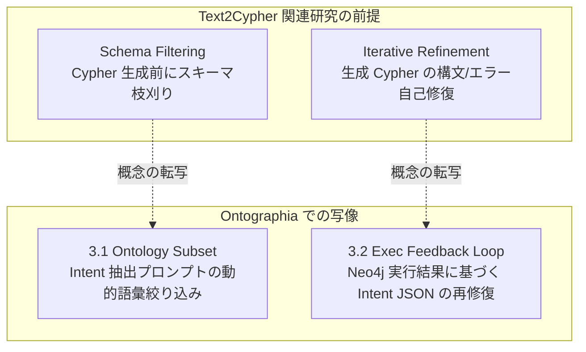

:::message
**連載の位置づけ（Ontographia 三部作）**

自然言語からグラフデータベース（Neo4j 等）へ問い合わせを行う際、多くの現場は「LLM に直接 Cypher クエリを書かせるか」「手書きの巨大な固定クエリ／テンプレ集で縛るか」の二者択一で揺れ動きます。

本連載では、その妥協案として普及しつつある **Agent Skills + ユースケース別テンプレ選定（現行ハイブリッド）** の限界を浮き彫りにし、Neo4j アカウントチームから共有された最新研究の潮流を踏まえた上で、**「LLM には意図抽出（Intent JSON）だけを担わせ、Cypher クエリの組み立てはオントロジー拘束付きの決定論的 AST パイプラインで行う」** という新しい方法論（[Ontographia](https://github.com/edgesentry/ontographia) プロジェクト）を提案・検証します。

| 部 | 記事 | 役割 |
| :--- | :--- | :--- |
| **第1部** | [グラフAIのジレンマ：LLMにCypherを書かせるか、テンプレ保守地獄に耐えるか](https://zenn.dev/yohei/articles/2026-09-08-ontographia-template-cost) | 現場の課題・最新研究の整理と新仮説 |
| **第2部** | [Intent-first の設計と実装：決定論的 Cypher 組み立てのアーキテクチャ](https://zenn.dev/yohei/articles/2026-09-08-ontographia-intent-first-design)（本記事） | コアとアプリ層の分離・実装詳解 |
| **第3部** | [検証結果と今後のロードマップ：大規模オントロジー評価と外的妥当性](https://zenn.dev/yohei/articles/2026-09-08-ontographia-eval-and-roadmap) | 定量的ストレス試験・公開データ検証 |

プロジェクト公開ドキュメント: [edgesentry.github.io/ontographia](https://edgesentry.github.io/ontographia/)  
リポジトリ: [edgesentry/ontographia](https://github.com/edgesentry/ontographia)
:::

## 概要

[第1部](https://zenn.dev/yohei/articles/2026-09-08-ontographia-template-cost)では、自然言語からグラフデータベース（Neo4j）へ問い合わせる際、Agent Skills を用いたテンプレ選択ハイブリッドが「安全」に見えても、柔軟性の単位がテンプレ枚数に縛られ、保守コストが人間へ移転する構造的な壁を指摘しました。また、Neo4j コミュニティの最新研究（Schema Filtering や Iterative Refinement）が「LLM に生 Cypher を書かせる前提の事後修正」である限界も整理しました。

本記事（第2部）では、この課題を根本から解消するために設計されたオープンソースプロジェクト **[Ontographia](https://github.com/edgesentry/ontographia)** のアーキテクチャと実装を解説します。

Ontographia の核心は、明確な **「関心の分離と責務境界」** にあります。

* **自然言語の柔軟性は「Intent JSON」で吸収する:** LLM には Cypher を 1 文字も書かせず、探索意図の抽出のみを担わせる。
* **クエリの組み立てとガバナンスは「100% 決定論」で行う:** オントロジー検証を通過した Intent のみを AST 経由で Cypher（Cypher 25 等）へコンパイルし、値はすべて `$param_N` にバインドする。
* **LLM 呼び出しやプロンプト制御、DB 実行ループは「コア外（アプリ／エージェント層）」に置く:** エンジン本体は LLM 非依存・ドライバ非依存の決定論的コンパイラとして保ち、最新研究の知見（Schema Filtering や Refinement）は Intent 層へ写像して適用する。

---

## 1. 第1部の問いへの回答：Intent-first パイプライン

> **「テンプレ枚数に比例しないまま、自然言語への追従と、決定論的な Cypher 実行・ガバナンスを両立できないか？」**

Ontographia が導き出した回答は以下のパイプラインです。

```text
[オントロジー定義 (YAML / Turtle)]
          │
          ▼
   Adapter → COM (Canonical Ontology Model)
          │
          ├──────────────────────────────┐
          │ (語彙スキーマの提供)           │ (語彙の厳密検証)
          ▼                              ▼
  [アプリ層: LLM]                 [コア: validate_intent]
   質問 ──▶ Intent JSON ─────────▶ 合格? ──(No)──▶ 検証エラー (アプリ層へ返却)
                                         │ (Yes)
                                         ▼
                                  [コア: build_ast]
                                         │
                                         ▼
                                  [コア: Emitter]
                                         │
                                         ▼
                                 { query, params }
                              (例: Cypher 25 + $param_0)
                                         │
                                         ▼
                                   [(Neo4j 実行)]
```

### なぜこれでテンプレ地獄が消えるのか
従来のハイブリッド方式では、「サプライヤ一覧用テンプレ」「再帰的 BOM 展開用テンプレ」といったように、**クエリのパターンごとに Cypher 文字列を人間が事前作成**していました。

Intent-first では、探索の開始クラス（`target`）、辿るリレーション（`traversals`）、絞り込み（`filters`）、出力項目（`returns`）が、構造化された JSON の組み合わせとして表現されます。
オントロジーが定義する語彙の組み合わせ空間全体を LLM が表現できるため、**テンプレを 1 枚も追加することなく、無数の探索パターンに即座に対応可能**になります。

---

## 2. 設計原則：何をコアに置き、何を外に置くか

Ontographia の設計原則（[Architecture ガイド](https://edgesentry.github.io/ontographia/architecture/)）は、決定論と安全性を極限まで高めるために研ぎ澄まされています。

| 設計原則 | 含意とアーキテクチャ上の決定 |
| :--- | :--- |
| **Ontology が唯一の正本** | クラス名、リレーション名、プロパティ名は COM（Canonical Ontology Model）に定義されたもの以外一切認めない。 |
| **LLM は Intent、Cypher ではない** | スキーマ制約付き JSON（Intent）を機械検証して初めて、クエリ生成パイプラインが起動する。 |
| **決定論的パラメータバインド** | ユーザー入力値やフィルタ値は必ず `$param_N` に切り離す。クエリ文字列への埋め込みは構造上不可能にする。 |
| **同一入力・同一出力の再現性** | 同じオントロジー + Intent + ダイアレクトであれば、ミリ秒単位で完全に同一の `{ query, params }` を出力する。 |
| **コアとアプリ層の厳格な分離** | コア（Rust 製 `ontographia-core`）にはネットワーク、LLM API、Neo4j ドライバを一切持ち込まない。 |

### なぜコアに LLM やドライバを入れないのか
多くの AI ツールキットは、エンジン内部に LLM 呼び出しや DB コネクタを統合しがちです。しかし Ontographia はそれを固く拒否しています（[What is intentionally outside the core](https://edgesentry.github.io/ontographia/architecture/#what-is-intentionally-outside-the-core)）。

* **検証可能性とテスト容易性:** コアが純粋な決定論的コンパイラであれば、CI 上で数万件の AST / クエリ生成テストをミリ秒単位で回せます。LLM のトークン代やモックの複雑さに悩まされません。
* **セキュリティ保証:** 「LLM が直接 Cypher 文字列を書き換えることは絶対にない」という保証が、言語境界・クレート境界によって物理的に担保されます。
* **マルチ言語展開:** コアが軽量かつ純粋なロジックであるため、Python、Go、WebAssembly などの言語バインディングを薄いラッパーとして安全に提供できます。

:::message
**主要コンポーネントの用語定義**

* **COM (Canonical Ontology Model):** 複数形式（native YAML, OWL, RDF 等）のオントロジーを正規化した内部データモデル。
* **Intent JSON:** 探索意図（どのノードから、どの関係を辿り、どう絞り込んで何を返すか）を記述する JSON 仕様。
* **Query AST:** Cypher や GQL 等の方言に依存しない、安全なクエリ中間表現。
* **Emitter:** AST を走査し、特定バージョン（Cypher 25, Cypher 5 等）の安全なクエリ文字列とパラメータ辞書を出力する生成器。
:::

---

## 3. 最新研究を「Intent 層」へ写像した2つの拡張

[第1部](https://zenn.dev/yohei/articles/2026-09-08-ontographia-template-cost)で紹介した Neo4j の関連研究（Schema Filtering や Iterative Refinement）は非常に有用ですが、LLM に Cypher を書かせる前提でした。

Ontographia では、これら先端研究のエッセンスを **アプリ層（`examples/llm/`）における Intent 生成の改善** へと鮮やかに写像しています。



### 3.1 Ontology Subset + フルスキーマフォールバック
大規模なエンタープライズオントロジーでは、何百・何千というクラスやプロパティが存在します。これらをすべてプロンプトに載せると、トークン消費が爆発するだけでなく、LLM が「似て非なるプロパティ」を誤選択する原因になります。

そこで Ontographia のアプリ層（`examples/llm/subset.py`）では、ユーザーの質問に含まれるトークンとオントロジーの要素名との **Exact-match（大小文字無視・複数形正規化）** を行い、関係するクラス間の最小トポロジー（Relationship Closure）を抽出して、プロンプトに渡すオントロジーを大幅に圧縮します。

もし Subset で Intent 検証（`validate_intent`）が通らなかった場合は、自動的にフルスキーマへフォールバックします（`schema_policy=auto`）。

### 3.2 実行結果フィードバックによる Intent 訂正
オントロジーの語彙的には正しくコンパイル（`Engine::build`）できたとしても、「実際に Neo4j で実行したら 0 件だった（Empty Result）」、あるいは「データ型変換で Neo4j ドライバがエラーを返した」というケースが発生します。

従来の Text2Cypher 研究ではここで「Cypher 文字列を LLM に渡して直させる」のですが、それでは非決定論の事故が再発します。

Ontographia（`examples/llm/exec_feedback.py`）では、**Neo4j の実行結果（0件またはエラー情報）をコンテキストにして、LLM に「Intent JSON」を再修正させます**。
修正された Intent は再びコアの `validate_intent` と AST コンパイルを通るため、**Cypher 文字列の安全性を 1 ミリも毀損することなく、実行結果に応じた自己修復ループ（Refine）を実現**しています。

---

## 4. Agent Skills の役割はどう変わるか

Intent-first アプローチを導入することで、エージェント基盤における Skills（ツール定義）の責務は劇的にシンプルになります。

| 項目 | 従来のテンプレ選定ハイブリッド | Intent-first (Ontographia) |
| :--- | :--- | :--- |
| **LLM のタスク** | どの Cypher テンプレを呼ぶべきかの分類 | 自然言語から **Intent JSON** への構造化 |
| **開発者の保守対象** | 増え続ける Cypher テンプレカタログ | **オントロジーの定義（COM）** と抽出プロンプト |
| **スキーマ変更時の対応** | 全テンプレの洗い出し、修正、回帰テスト | オントロジーを更新するだけ（語彙検証が自動追従） |
| **新しい質問への追従** | 新しいテンプレの作成・レビューが必要 | オントロジーの語彙範囲内であれば **即座に対応** |
| **クエリの安全性** | テンプレ作成者の腕に依存 | **AST とバインディングにより構造的に完全保証** |

エージェント開発者は、もはや「似たような Cypher テンプレを量産してプロンプトのルーティングを微調整する」という不毛な作業から解放されます。

---

## 5. ミニマムな実装と動かし方

Ontographia はソースコードからビルドする必要はありません。Homebrew 経由で CLI が即座に導入できるほか、Python、Go、Rust の各エコシステム向けにパッケージが正式リリースされています。

| 言語 / ツール | インストール方法 | 備考 |
| :--- | :--- | :--- |
| **CLI** | `brew install ontographia` | Homebrew で一発導入（GitHub Releases にもバイナリあり） |
| **Python** | `pip install ontographia` | PyPI 公開済み（Linux, macOS arm64, Windows 対応） |
| **Go** | `go get github.com/edgesentry/ontographia/bindings/go` | cgo / FFI バインディング |
| **Rust** | `cargo add ontographia-core` | crates.io 公開済み |

ここでは、公式リポジトリ [**edgesentry/ontographia**](https://github.com/edgesentry/ontographia) に同梱されている製造ドメインのサンプルデータを使って、実際に動作を確認してみましょう。

まずはリポジトリをクローンして移動します。

```bash
git clone https://github.com/edgesentry/ontographia.git
cd ontographia
```

### CLI による決定論的クエリビルド
Homebrew で CLI をインストールすれば、リポジトリ内のサンプルオントロジー（[`examples/manufacturing.native.yaml`](https://github.com/edgesentry/ontographia/blob/main/examples/manufacturing.native.yaml)）とサンプル Intent（[`examples/sample_intent.json`](https://github.com/edgesentry/ontographia/blob/main/examples/sample_intent.json)）を渡すだけで、即座に安全な Cypher 25 が出力されます。

```bash
# Homebrew によるインストール
brew tap edgesentry/tap
brew install ontographia

# 決定論的ビルドの実行（リポジトリ同梱のサンプルデータを使用）
ontographia build \
  --ontology examples/manufacturing.native.yaml \
  --intent examples/sample_intent.json \
  --json
```

出力される結果（抜粋）:
```json
{
  "query": "MATCH (plant:Plant) WHERE plant.id = $param_0 RETURN plant.name AS name",
  "params": {
    "param_0": "PLANT-01"
  }
}
```

### Python からの E2E 実行（LLM 抽出 → ビルド → Neo4j 実行）
リポジトリの `examples/` ディレクトリには、自然言語の質問から LLM で Intent を抽出し、Neo4j まで一気通貫で実行するサンプルスクリプト（[`examples/run_llm_e2e.py`](https://github.com/edgesentry/ontographia/blob/main/examples/run_llm_e2e.py)）が用意されています。

```bash
# 依存関係のセットアップ（uv を使用）
uv sync

# 自然言語からの実行（Neo4j 実行 + 実行フィードバック修正を有効化）
uv run python examples/run_llm_e2e.py \
  --question "Find all suppliers providing parts to Plant-1" \
  --execute \
  --refine-on-exec \
  --password ontographia
```

エンドツーエンドの詳しい手順や Neo4j コンテナのセットアップ手順は、公式ドキュメントの [Neo4j walkthrough](https://edgesentry.github.io/ontographia/end-to-end-neo4j/) を参照してください。

---

## まとめ（第2部）

* **境界線の厳格化:** 自然言語の受け口は Intent JSON、Cypher の組み立ては決定論的 AST。この分離が安全とスケールを両立する鍵である。
* **コアの軽量性と独立性:** LLM や Neo4j ドライバをあえてコアに入れないことで、100% の検証可能性と堅牢なセキュリティを実現した。
* **最新研究の Intent 層への写像:** Schema Filtering は「プロンプトの動的 Subset 化」へ、Iterative Refinement は「実行結果に基づく Intent 再修復」へと昇華させた。

しかし、この Intent-first 設計は、実際の現場規模の巨大なオントロジー（数千プロパティ）や、公開 Text-to-Cypher ベンチマークで本当に通用するのでしょうか？

続く第3部では、数千プロパティのストレス試験（Track A）と公開データセット（Track B）を用いた**客観的かつ定量的な検証結果**を包み隠さず公開します。

👉 **[Ontographia 第3部：検証結果と今後のロードマップ へ進む](https://zenn.dev/yohei/articles/2026-09-08-ontographia-eval-and-roadmap)**

