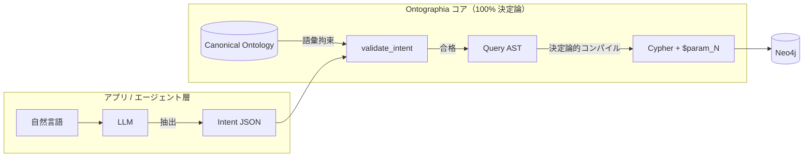

:::message
**連載の位置づけ（Ontographia）**

自然言語からグラフデータベース（Neo4j 等）へ問い合わせを行う際、多くの現場は「LLM に直接 Cypher クエリを書かせるか」「手書きの巨大な固定クエリ／テンプレ集で縛るか」の二者択一で揺れ動きます。

本連載では、その妥協案として普及しつつある **Agent Skills + ユースケース別テンプレ選定（現行ハイブリッド）** の限界を浮き彫りにし、Neo4j アカウントチームから共有された最新研究の潮流を踏まえた上で、**「LLM には意図抽出（Intent JSON）だけを担わせ、Cypher クエリの組み立てはオントロジー拘束付きの決定論的 AST パイプラインで行う」** という新しい方法論（[Ontographia](https://github.com/edgesentry/ontographia) プロジェクト）を提案・検証します。

| 部 | 記事 | 役割 |
| :--- | :--- | :--- |
| **第1部** | [グラフAIのジレンマ：LLMにCypherを書かせるか、テンプレ保守地獄に耐えるか](https://zenn.dev/yohei/articles/2026-09-08-ontographia-template-cost)（本記事） | 現場の課題・最新研究の整理と新仮説 |
| **第2部** | [Intent-first の設計と実装：決定論的 Cypher 組み立てのアーキテクチャ](https://zenn.dev/yohei/articles/2026-09-08-ontographia-intent-first-design) | コアとアプリ層の分離・実装詳解 |
| **第3部** | [検証結果と今後のロードマップ：大規模オントロジー評価と外的妥当性](https://zenn.dev/yohei/articles/2026-09-08-ontographia-eval-and-roadmap) | 定量的ストレス試験・公開データ検証 |
| **第4部** | [リリース後の再評価](https://zenn.dev/yohei/articles/2026-10-22-ontographia-release-findings) | 公開パッケージでの追試 |

プロジェクト公開ドキュメント: [edgesentry.github.io/ontographia](https://edgesentry.github.io/ontographia/)
:::

## 概要

製造業の部品表（BOM）、サプライチェーンの多段追跡、品質保証、企業内の複雑な知識グラフ――ビジネスの現場では、「関係性（リレーション）」を辿るグラフ構造の探索を自然言語で行いたいという需要が急速に高まっています。

しかし、**「Neo4j に投げる Cypher クエリを LLM に直接生成させる（Text-to-Cypher）」** 運用を本番環境で成立させるのは極めて困難です。構文ミスや存在しないラベル・プロパティの捏造（スキーマハルシネーション）、プロンプトインジェクション、さらには Cartesian Product（デカルト積）による意図しない DB 高負荷など、安全性とガバナンスの壁が立ちはだかるからです。

このリスクを回避するため、現場では **「あらかじめ承認済みの Cypher テンプレを多数用意し、Agent Skills を使って LLM に『どのテンプレを使うか』を選ばせてパラメータを埋め込む」** というハイブリッド構成がよく採られます。

一見、これは「LLM の分類能力」と「固定クエリの安全性」を両立した賢明な中間解に見えます。しかし運用を続けていくと、現場のボトルネックは「LLM のハルシネーション」から **「人間による Cypher テンプレの保守・追加コストの爆発」** へと静かに移転します。

本記事（第1部）では、現行のハイブリッド手法が直面する構造的な課題を解剖し、Neo4j アカウントチームから共有された最新の関連研究を整理した上で、**「非決定論の危険を排除しつつ、テンプレを増やさずにスケールさせる」ための新しい仮説（Intent-first）** を提示します。

---

## 1. 現場が直面する3つのアプローチ

自然言語からグラフクエリを導出するアプローチは、大きく分けて次の3通りが存在します。

### 1.1 100% 非決定論（生 Text-to-Cypher）
LLM にグラフスキーマとユーザーの自然言語入力を渡し、Cypher クエリをゼロから直接書かせるアプローチです。

* **メリット:** 圧倒的な表現力と柔軟性。どんな質問に対しても、モデルが自律的に MATCH 句や WHERE 句を構築できる。
* **現場の痛み:**
  * **スキーマハルシネーション:** 実在しないノードラベル、誤ったリレーション名、微妙に名前の違うプロパティ（例: `plant_id` なのに `plantId` や `factory_code` と出力）を平気で捏造する。
  * **構文・実行エラー:** カンマの抜けや括弧の不一致、型不一致などのエラーが一定確率で発生する。
  * **セキュリティとインジェクション:** フィルタ値が文字列として直接 Cypher に埋め込まれ、値のエスケープや権限ガバナンスが極めて困難。
  * **DB 破綻クエリ:** ラベル指定を欠いたフルスキャンや巨大なデカルト積（無制限の多段ホップ）を生成し、本番 DB をハングアップさせる危険がある。

プロトタイプでは動いても、ミッションクリティカルな業務システムにそのまま本番投入することはまず許容されません。

### 1.2 100% 決定論（手書き Cypher / 固定クエリ）
エンジニアが事前に最適化・インデックス設計した Cypher クエリをコード内にハードコードし、パラメータだけを安全に差し替えるアプローチです。

* **メリット:** 100% の実行安全性、予測可能性、監査性、および安定したパフォーマンス。
* **現場の痛み:**
  * **自然言語追従の欠如:** ユーザーの質問の揺らぎや、「少し条件を追加したい」「並べ替えを変えたい」といった日常的な要望に一切対応できない。
  * UI のフォーム入力と変わらず、生成 AI エージェントとしての価値を提供できない。

### 1.3 現行ハイブリッド（Agent Skills + テンプレ選定）
上記の両極端を避けるため、現在多くの現場が選択しているのがこのハイブリッドアプローチです。

1. 業務で想定されるユースケースごとに、承認済みの **固定 Cypher テンプレ** を作成する。
2. Agent Skills（ツール定義やシステムプロンプト）に各テンプレの役割とパラメータ仕様を登録する。
3. ユーザーの質問に対し、LLM は「どのスキル／テンプレを呼び出すべきか」を分類（Function Calling / Tool Calling）し、引数（パラメータ）を抽出する。
4. 確定したテンプレにパラメータを安全にバインドして Neo4j で実行する。

この方式は、生 Cypher 生成に比べて構文エラーやインジェクションのリスクを大幅に抑制でき、分類タスク自体は LLM の得意領域であるため、一見すると「実用的な落としどころ」に思えます。

---

## 2. ハイブリッドが直面する「テンプレ保守の壁」

しかし、このハイブリッド運用が半年、1年と経過するにつれて、現場は深刻な閉塞感に直面します。

### 柔軟性の単位が「テンプレ枚数」に縛られている
ハイブリッド方式において、エージェントが回答できる質問のバリエーションは、**事前に用意されたテンプレの枚数と 1:1 で比例**します。

* 「部品 A の一次サプライヤを知りたい」→ テンプレ 1
* 「部品 A の二次サプライヤまで再帰的に展開したい」→ テンプレ 2
* 「国内工場に限定して部品 A の供給元を一覧したい」→ テンプレ 3
* 「特定サプライヤが停止したときの影響 SKU を出したい」→ テンプレ 4

ビジネスの現場では、質問のフィルタ条件、探索の深さ、集計の軸、ソート順などの組み合わせが無数に存在します。ユーザーが少しでも新しい聞き方をするたびに、開発チームには「新規テンプレの作成依頼」が届きます。

### スキーマ変更に伴う回帰コスト
オントロジーやグラフスキーマは生き物です。業務の拡大に伴い、ノードラベルのリネーム、中間リレーションの追加、プロパティの分離・統合が日常的に発生します。

スキーマが 1 箇所変更されると、開発者は以下を行わなければなりません。
1. 数十〜数百枚に膨らんだ Cypher テンプレ群から、影響を受けるテンプレを人手で洗い出す。
2. Cypher 文字列を書き換え、レビューを通す。
3. Agent Skills のプロンプト説明文（LLM に選ばせるためのメタデータ）を修正する。
4. 別のテンプレと分類境界が曖昧になっていないか、分類テストをやり直す。

```text
【問題の移転】
LLM に生 Cypher を書かせると「生成時のハルシネーション」に悩まされる。
　　↓ リスク回避のためにテンプレ化
ハイブリッドにすると「人間によるテンプレ追加・保守・回帰テスト」に殺される。
```

つまり現行ハイブリッドは、**非決定論の危険を減らす代償として、システムの保守コストをそのまま開発者のテンプレ管理業務へ移転しただけ**なのです。

---

## 3. Neo4j アカウントチームから学んだ最新研究・取り組み

この「Text-to-Cypher の非決定論リスク」と「テンプレ保守コスト」の板挟みは、世界中のグラフデータベース現場共通の課題です。実際、Neo4j 社のアカウントチームや研究開発コミュニティからも、このジレンマに対処するための先進的な研究や取り組みが共有されています。

代表的な潮流として、以下の3つのアプローチが挙げられます。

| 研究・取り組み | 主要文献 / 出典 | アプローチの骨子 |
| :--- | :--- | :--- |
| **Schema Filtering** | Ozsoy (2025)<br>[_Enhancing Text2Cypher with Schema Filtering_](https://arxiv.org/abs/2505.05118) | 大規模スキーマをプロンプトに入れると LLM が混乱するため、完全一致・NER・類似度検索でスキーマを動的に枝刈りしてプロンプトへ投入する。 |
| **Iterative Refinement** | Neo4j Developer Blog (2025)<br>[_Explore iterative refinement for Text2Cypher_](https://neo4j.com/blog/developer/iterative-refinement-for-text2cypher/) | 生成された Cypher に対し、構文チェッカー、CyVer（形式検証）、Neo4j 実行エラーフィードバックを組み合わせ、Verify → Correct の自己修復ループを回す。 |
| **Difficulty-Adaptive Spend** | [Wang et al. (NAACL 2025 Findings)](https://aclanthology.org/2025.findings-naacl.383/)<br>[Damani et al. (ICLR 2025)](https://arxiv.org/abs/2410.04707) | 質問の難易度（事前・事後）を判定し、易しい質問には少ない計算量（1回の生成）で済ませ、難問にのみ多段リトライや豊富なスキーマ計算資源を動的に配分する。 |

### これらの研究の意義と現場視点での限界
これらの研究は、Text-to-Cypher の実用精度を引き上げる上で非常に示唆に富んでいます。
特に、**「プロンプトに全スキーマをダンプすると誤選択が増える（Schema Filtering の動機）」** や **「1回で完璧なクエリを出そうとせず、検証器や実行結果からフィードバックを得て修正する（Iterative Refinement の動機）」** という洞察は、現場の実態と完全に一致しています。

しかし、これらの研究には共通する大前提があります。それは、**「LLM が最終的な Cypher 文字列を直接出力する」** という点です。

LLM に生の Cypher クエリを書かせている限り、どれほど洗練されたフィルタや事後検証ループを組んでも、以下の根本問題は解消されません。
1. **「エラーにならない誤クエリ」の素通り:** 構文的には完全に正しく、Neo4j もエラーを返さないが、業務的にまったく無意味な結合やプロパティを選択したクエリ（サイレント誤答）は形式検証をすり抜ける。
2. **パラメータ分離の難しさ:** フィルタ条件の値が依然としてクエリ文字列内に埋め込まれる余地があり、決定論的なパラメータバインドの保証が難しい。
3. **監査性と再現性:** 同じ質問に対して時系列でまったく同じ Cypher が発行される保証がなく、セキュリティ監査やパフォーマンストラブルシューティングが複雑化する。

つまり、最新研究のアプローチは「LLM に Cypher を書かせる」という前提に立った **対症療法（事後修正の高度化）** であり、エンタープライズが求める「完全な決定論・ガバナンス」と「自然言語の柔軟性」を根底から調和させるには、もう一段踏み込んだパラダイムシフトが必要です。

---

## 4. 現行方法論の比較（問題の全体地図）

ここで、ここまでに挙げたアプローチと、本連載で提案する新方法論（Intent-first）を、実運用の評価軸で比較整理してみましょう。

| 比較軸 | 100% 決定論<br>(固定クエリ) | 100% 非決定論<br>(生 Text-to-Cypher) | 現行ハイブリッド<br>(Skills + テンプレ選定) | 研究系 Text-to-Cypher<br>(Filtering + Refine) | **提案手法：Intent-first**<br>(Ontographia) |
| :--- | :--- | :--- | :--- | :--- | :--- |
| **NL への柔軟性** | ✕（ほぼ皆無） | ◎（非常に高い） | △（テンプレの範囲内） | ○（高い） | **◎（語彙空間内で自在）** |
| **構文・Injection 安全性** | ◎（完全保証） | ✕（脆弱・事故多発） | ○（テンプレにより担保） | △（事後検査頼み） | **◎（AST生成で完全保証）** |
| **スキーマハルシネーション** | なし | 頻発 | なし | 軽減されるが残存 | **なし（語彙検証で完全遮断）** |
| **保守コストの単位** | クエリ枚数 | プロンプト職人技 | **テンプレ枚数の爆発** | 検査器・検証ルールの保守 | **オントロジー（正本）のみ** |
| **実行の決定論・監査性** | ◎（100% 決定論） | ✕（非決定論） | ○（テンプレ単位で追跡） | △（試行錯誤による変動） | **◎（100% 決定論的 emit）** |
| **LLM の責務** | なし | Cypher 全文の生成 | テンプレ ID の分類 | Cypher 生成＋自己修正 | **意図（Intent JSON）の抽出のみ** |

現場が本当に求めているのは、次の2つの両立です。

> **「非決定論の危険（ハルシネーション、構文エラー、インジェクション）を徹底的に排除したい」**  
> **「しかし、クエリやテンプレの保守コストは増やしたくない。安全かつスケールさせたい」**

---

## 5. 新たな提案：Intent-first という仮説

このジレンマを打ち破るために、私たちは柔軟性の単位を「テンプレの枚数」から変える必要があると考えました。

それが、本プロジェクト **Ontographia** が提示する **「Intent-first」** の仮説です。



### コアの着想
1. **LLM の責務を「意図抽出（Intent JSON）」に限定する:**
   LLM には Cypher クエリを 1 文字も書かせません。「開始ノード」「辿るリレーション」「絞り込み条件」「取得したい項目」を抽象化した構造化 JSON（Intent）の抽出のみを担わせます。
2. **オントロジーを語彙の「唯一の正本（Single Source of Truth）」とする:**
   Intent に含まれるクラス名、リレーション名、プロパティ名がオントロジー定義に存在するかを、機械的に厳密バリデーションします。存在しない語彙は 1 つたりとも先へ通しません。
3. **AST 経由で 100% 決定論的に Cypher を組み立てる:**
   検証を通過した Intent のみを方言中立な AST（Query AST）に変換し、安全な Cypher（Cypher 25 等）へ決定論的に emit します。フィルタ条件の値はすべて自動的に `$param_N` にバインドされ、文字列連結によるインジェクションの余地をゼロにします。
4. **最新研究のインサイトを「Intent 層」へ写像する:**
   Neo4j の最新研究（Schema Filtering や Iterative Refinement）の知見を無駄にはしません。ただし、それを Cypher レベルで行うのではなく、「LLM に渡すオントロジーの部分集合（サブセット）の選定」や「Neo4j 実行結果に応じた Intent JSON の修復」として、**アプリ層（Intent 境界）** に適用します。

この構成をとることで、ユーザーの多様な自然言語は **オントロジーが定義する語彙の組み合わせ空間** で受け止めることができます。ユースケースごとの固定テンプレを 1 枚も増やすことなく、かつ生の Cypher 生成が持つ危険を 100% 排除した状態で、安全にシステムをスケールさせることが可能になります。

---

## 6. 本連載のロードマップ

本連載三部作では、この Intent-first アプローチの全貌を、設計・実装から定量的検証まで余すところなく公開します。

* **[Ontographia 第2部 - Intent-first の設計と実装：決定論的 Cypher 組み立てのアーキテクチャ](https://zenn.dev/yohei/articles/2026-09-08-ontographia-intent-first-design)**
  * 「なぜ LLM をコアに入れないのか」というアーキテクチャの責務境界。
  * Canonical Ontology Model（COM）、Intent JSON Schema、AST、パラメータバインディングの実装詳細。
  * Neo4j 先端研究の3潮流（Filtering, Refine, Adaptive Spend）を Intent 層へ写像する3つの拡張設計。
* **[Ontographia 第3部 - 検証結果と今後のロードマップ：大規模オントロジー評価と外的妥当性](https://zenn.dev/yohei/articles/2026-09-08-ontographia-eval-and-roadmap)**
  * 巨大オントロジーで未知名は弾けても「実在する誤プロパティ」を平然と通してしまう「サイレント誤答」の実態。
  * 3つの仮説（H1: 動的サブセットによるトークン91%削減と誤答排除、H2: 実行フィードバックによるEmpty@Validの自己修復、H3: 難易度適応型配分によるTCO最小化）の定量的実証（Track A）。
  * Neo4j 公式の公開 15 DB ベンチマークを用いた外的妥当性の検証（Track B）と、機械アームからライブ LLM へ繋ぐ誠実なロードマップ。

---

## まとめ（第1部）

* 自然言語からグラフへの問い合わせにおいて、**生 Text-to-Cypher は危険すぎ、固定クエリは硬直すぎる**。
* その妥協案である **現行ハイブリッド（テンプレ選定）は、保守コストをテンプレカタログへ移転させただけであり、スケールしない**。
* Neo4j 最新研究（Schema Filtering / Iterative Refinement）は有用だが、Cypher 直接生成を前提とした対症療法に留まる。
* 必要なのは、**「LLM は Intent JSON、Cypher の組み立ては決定論」** という責務の再定義である。

続く第2部では、この Intent-first を具現化するアーキテクチャ設計と実装を詳しく解説します。決定論性を担保する Rust 製コア、Python や Go 向けにパッケージ化された薄いバインディング、そしてコア外の LLM 連携・実行ループを担う `examples` の Python 実装について紹介します。

👉 **[Ontographia 第2部：Intent-first の設計と実装 へ進む](https://zenn.dev/yohei/articles/2026-09-08-ontographia-intent-first-design)**

