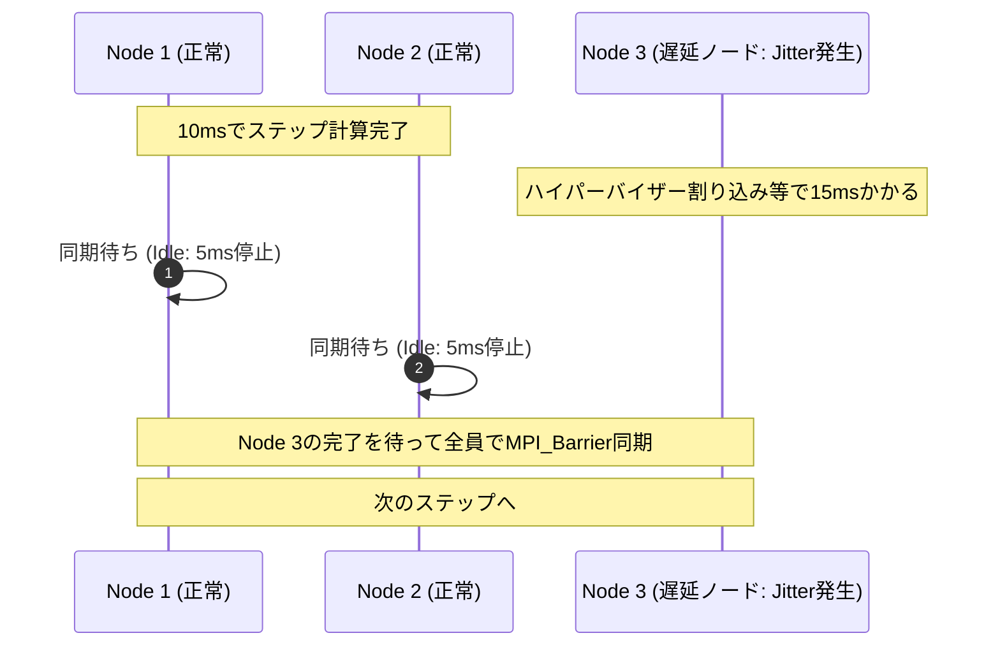

:::message
**連載：Google Cloud での HPC ワークロード設計ベストプラクティス（全2回）**

Web/API向けに最適化されたクラウドエンジニアの「成功体験」をそのまま持ち込むと、HPC基盤はなぜ破綻するのか？ その物理特性とメカニズムを理解し、Google Cloudの既存機能を適切に組み合わせて解決するまでの実践ガイドです。

| 回 | 記事 | 主なテーマ |
| :--- | :--- | :--- |
| **第1回（前編）** | 本記事 | WebとHPCの根本的違い、典型的な6つの罠とハマる理由、基盤が満たすべき4大要件 |
| **第2回（後編）** | [Google Cloudの既存機能を組み合わせて罠を突破する](2026-09-25-hpc-workload-design-part2-google-cloud) | 罠を回避するGCP機能の組み合わせ（Compute/Network/Storage/Orchestration） |
:::

## 1. 導入：Web/APIエンジニアが素直にHPCを設計すると失敗する

パブリッククラウドの普及によって、インフラ設計のスタンダードは確立されました。「ステートレス」「水平スケール（Scale-out）」「疎結合」「マルチAZ冗長化」「マネージドサービスの活用」——。これらはWebアプリケーションやAPIサーバー、マイクロサービスを安定運用するための「黄金律」です。

しかし、近年急速に需要が高まっている科学技術計算、製造業シミュレーション、そして大規模AI/LLMの分散学習基盤（HPC：High Performance Computing）を構築する際、**この「クラウドの常識」に素直に従ってインフラを組むと、システムは確実に機能不全に陥ります。**

* 「耐障害性のためにマルチゾーンにノードを分散したら、ノード間通信遅延で計算時間が10倍に伸びた」
* 「負荷に応じてMIG（Managed Instance Group）でオートスケールさせたら、計算途中でノードが追加・削除されてMPIプロセスが全滅した」
* 「共通ストレージとしてマネージドNAS（NFS）を置いたら、数百ノードが一斉にアクセスした瞬間にメタデータが枯渇して全ノードがハングアップした」
* 「安価なSpot VMを使ったら、48時間走らせた計算が最後の数分で水泡に帰した」

なぜ、Webの世界では「ベストプラクティス」とされる手法が、HPCでは「最悪のアンチパターン」に変貌してしまうのでしょうか？

本記事（前編）では、以下の論理展開でこのギャップを解き明かします。
1. **前提：Webサーバと比較したHPCワークロードの根本的な特徴**
2. **クラウドエンジニアが直面する典型的な6つの罠と、罠にハマる理由**
3. **それを踏まえてHPCワークロード基盤が満たすべき4大要件**
4. **第2回（後編）への橋渡し：Google Cloudの既存機能でどう解決するか**

まずは、前提となる「WebサーバとHPCワークロードの根本的な違い」から見ていきましょう。

---

## 2. 前提：Webサーバと比較したHPCワークロードの特徴

### 2.1 HPCワークロードは大きく分けて2種類ある：違いの認識がすべての出発点

HPC（High Performance Computing：高性能計算）とは、一般的なWebサーバや単一のコンピュータでは処理しきれない膨大な計算（流体解析、気象予測、分子シミュレーション、大規模AI学習など）を、多数の計算ノードを束ねて超並列に処理するシステム基盤の総称です。

このHPCワークロードは、処理の進め方やノード間の通信パターンの違いによって、大きく以下の **2種類** に分類されます。この2つの違いを正しく識別できているかどうかが、クラウドインフラ設計の成否を分ける決定的な出発点となります。

1. **疎結合ワークロード（HTC: High Throughput Computing / 自明並列・Embarrassingly Parallel）**
2. **密結合ワークロード（Tightly Coupled / MPI型）**

| 分類 | 疎結合ワークロード（HTC / 自明並列） | 密結合ワークロード（Tightly Coupled / MPI型） |
| :--- | :--- | :--- |
| **代表例** | ・数万パターンのパラメータスタディ ・創薬バーチャルスクリーニング（分子ドッキング） ・モンテカルロシミュレーションの試行分散 ・ゲノム配列解析（BLAST等） | ・流体解析（CFD: OpenFOAM / Fluent） ・構造解析（FEM: LS-DYNA / Abaqus） ・気象予測・気候モデル（WRF） ・LLMの大規模分散学習（Megatron / AllReduce） |
| **ノード間通信** | **なし（独立実行）** 各タスクが完結しており、プロセス間のリアルタイム通信は不要 | **超高頻度・超低遅延（マイクロ秒単位）** 計算ステップごとに全ノードが境界値交換や集約同期を行う |
| **障害の影響** | **局所的** 1タスクが落ちても、そのタスクだけ再実行すればよい | **致命的（All-or-Nothing）** 1ノードが脱落・遅延した瞬間にクラスタ全体が停止する |
| **Web流の適用** | **非常に相性が良い** メッセージキュー、Spot VM、コンテナ、水平オートスケールがそのまま機能する | **最悪のアンチパターンになる** Webの常識を適用すると、レイテンシとジッターで破綻する |

#### なぜこの違いを認識する必要があるのか？

クラウドエンジニアにとって、この2種類の区別は死活問題です。

もし自社のワークロードが **「疎結合（HTC）」** であれば、Webやデータエンジニアリングで培ったアプローチ（Cloud Batch、Pub/Sub、Spot VM、Kubernetes）がそのまま驚くほど綺麗にハマり、安価で広大なスケールアウト環境を素早く構築できます。

**しかし、同じ「HPC」「シミュレーション」「分散計算」という看板を掲げていても、それが「密結合（MPI型）」だった場合、これまでの常識はすべて裏目に出ます。**

「疎結合と同じ感覚で、Spot VMをオートスケールさせ、マネージドNFSをマウントし、マルチAZで冗長化すればいいだろう」と考えた瞬間に、密結合特有の物理的制約と真っ向から衝突し、後述する悲劇（6つの罠）をすべて踏み抜くことになるのです。

したがって、**「これからクラウドに載せようとしているHPCは、疎結合（HTC）なのか？ それとも密結合（MPI）なのか？」** を最初に見極め、密結合であればインフラの設計思想を根本から切り替える必要があります。

### 2.2 Webサーバ vs 密結合HPC：8つの決定的違い

前述の通りHPCには「疎結合（HTC）」も存在しますが、疎結合はタスク同士が独立しており、WebやAPIワークロードの設計思想（水平スケール、分散配置、部分故障の許容）と非常に近いため、クラウドでも比較的素直に動かせます。したがって、ここでは一旦脇に置きます。

Webエンジニアがクラウド上で最も激しいパラダイムシフトと設計の壁に直面するのは、設計思想が根本から異なる **「密結合（MPI型）ワークロード」** です。両者を並べて比較すると、インフラのあらゆる設計前提が「真逆」であることが分かります。

| 観点 | Web / API ワークロード | HPC ワークロード（密結合） |
| :--- | :--- | :--- |
| **1. 実行モデル** | **リクエスト駆動・ステートレス** クライアントのHTTP要求に応答（ミリ秒〜秒） | **ジョブ駆動・ステートフル** スケジューラに投入し、数時間〜数日間リソースを独占占有 |
| **2. 結合度** | **疎結合（Loose Coupling）** ノード間は無通信。状態は外部DBへ外出し | **超密結合（Tight Coupling）** 全ノードがMPI/RDMAでマイクロ秒オーダーの高頻度通信 |
| **3. 耐障害性** | **縮退運転（Graceful Degradation）** 1台死んでもLBが切り離し、他ノードで処理継続 | **All-or-Nothing / Checkpoint** 1台脱落した瞬間にジョブ全体が異常終了 |
| **4. スケーリング** | **動的オートスケール** 負荷に応じて1台ずつ動的に増減 | **静的一括プロビジョニング** 指定ノード数（例: 64台）を同時確保・アトミック割り当て |
| **5. ネットワーク** | **平均スループット重視** 10ms〜100msの遅延は許容。冗長性優先 | **超低遅延（μs）＆ジッター極小** テールレイテンシのブレがクラスタ全体を停止させる |
| **6. ノード配置** | **マルチゾーン/リージョン分散** データセンター障害への耐性を最優先 | **単一ゾーン・同一ラックスイッチ近接配置** 物理的距離を極小化し、ホップ数を削る |
| **7. CPU/メモリ** | **オーバーコミット・仮想コア共有** ハイパースレッディング有効、時分割多重 | **物理コア専有・SMT無効・NUMAアライン** L3キャッシュ・メモリ帯域を特定プロセスが100%占有 |
| **8. ストレージ** | **RDBMS / オブジェクトストレージ** S3/GCSやマネージドDB、結果整合性 | **POSIX共有並列ファイルシステム** 数千プロセスが一斉に同一領域へ高スループット読み書き |

### 2.3 物理的制約：「Straggler問題」と「N-to-1 I/O」

この根本的な違いを生み出しているのが、HPC特有の2つの物理的制約です。

#### ① Straggler（落ちこぼれノード）問題とバリア同期の数理
流体解析や気象予測、AIのAllReduceでは、全ノードが計算ステップごとに互いの計算結果を突き合わせる **バリア同期（MPI_Barrier）** を行います。

$$T_{\text{step}} = \max(t_1, t_2, \dots, t_N) + t_{\text{comm}}$$

この式が示す通り、クラスタ全体の計算時間は **「最も遅い1台のノード」によって完全に律速** されます。

たった1台のノードで、OSカーネルの割り込みや他テナントの影響によるわずか **5ミリ秒** の遅れ（Jitter）が生じただけで、**残り99台のノードがCPU使用率0%でその1台を待つ** ことになります。Webのように「平均レイテンシが良ければp99の多少のブレは許容する」という妥協が一切通用しません。

#### ② N-to-1 バーストI/O と Millions of Small Files
HPCの長時間ジョブでは、ノード障害に備えて一定間隔でメモリ状態を共有ディスクへダンプする **チェックポイント** を行います。数百台のノード（数千並列プロセス）が一斉に同一ファイルへ数十〜数百GB/sで書き込む「N-to-1バースト」が発生します。また、メッシュデータや解析入力は数百万個の極小ファイルで構成されることが多く、極限のメタデータIOPSが求められます。

---

## 3. 典型的な6つの罠と、罠にハマる理由

これらのHPCの特性を知らないWebエンジニアが、Webの常識をそのまま持ち込むとどうなるか。典型的な6つの罠と、**「なぜWebエンジニアはそう設計してしまうのか（Webの正義）」**、そして **「なぜHPCでは破綻するのか（罠にハマる理由）」** を対比して整理します。

### 罠1：【配置】可用性のためにマルチゾーンに分散配置する
* **Webエンジニアがそう設計する理由（Webの常識）**:
  単一障害点（SPOF）を排除し、ゾーン障害（データセンター障害）に耐えられるよう、インスタンスを複数AZに均等分散するのはクラウドの基本作法だから。
* **なぜHPCでは破綻するのか（ハマる理由）**:
  同一ラック内通信が **数マイクロ秒** であるのに対し、ゾーン間通信は光ファイバー長や中継ルーターによって **1〜2ミリ秒** の遅延が生じる。反復計算で毎秒数千回のバリア同期を行うMPIでは、実行時間の90%以上がパケットのゾーン間往復待ちになり、計算が全く終わらなくなる。

### 罠2：【スケール】負荷に応じてMIG（Auto-scaling）で動的増減させる
* **Webエンジニアがそう設計する理由（Webの常識）**:
  リクエスト負荷の高まりに合わせてインスタンスを自動追加し、不要になったら破棄してコストを最適化するのがクラウドの弾力性（Elasticity）だから。
* **なぜHPCでは破綻するのか（ハマる理由）**:
  MPIプログラムは起動時に参加ノード一覧（Hostfile）を確定し、通信トポロジを固定する。計算途中でノードが増えても取り込めず、スケールインで1台でもVMが落とされた瞬間に通信途絶エラー（SIGSEGVやConnection Reset）を検知してジョブ全体が道連れ終了する。

### 罠3：【ストレージ】共有ストレージとして単一マネージドNAS（NFS）を置く
* **Webエンジニアがそう設計する理由（Webの常識）**:
  全ノードから共通のスクリプトや成果物を読み書きしたい場合、マネージドなNFSボリューム（Filestore等）をマウントするのが最も手軽で安全だから。
* **なぜHPCでは破綻するのか（ハマる理由）**:
  標準NFSは単一のメタデータコントローラで処理を行う。数千プロセスが一斉に数百万個の微小ファイルを `stat` したり、数百GBのチェックポイントを一斉に書き込んだ瞬間、NFSのメタデータキューが溢れ、全ノードでD-state（Uninterruptible Sleep）のI/O待ちが発生してクラスタ全体がフリーズする。

### 罠4：【コスト】コスト削減のためにSpot VMをそのまま採用する
* **Webエンジニアがそう設計する理由（Webの常識）**:
  定価の60〜80%引きで使えるSpot VM（旧プリエンプティブルVM）を使えば、大幅にインフラコストを圧縮できるから。
* **なぜHPCでは破綻するのか（ハマる理由）**:
  Webや疎結合ワークロードなら1台落ちても他のノードが肩代わりできるが、密結合HPCはAll-or-Nothing。100台で48時間走るジョブの場合、48時間の間にいずれか1台がプリエンプトされる確率はほぼ100%。チェックポイントやスケジューラ連携の設計がなければ、計算が完了することは永遠にない。

### 罠5：【仮想化】vCPUとコンテナで柔軟に詰め込む
* **Webエンジニアがそう設計する理由（Webの常識）**:
  vCPUを時分割共有し、ハイパースレッディング（SMT）を有効にして、Kubernetes等でリソースを限界まで高密度に詰め込む（Bin-packing）ことがコスト効率を高める正義だから。
* **なぜHPCでは破綻するのか（ハマる理由）**:
  1つの物理コア上で2つの論理スレッドを動かすと、L1/L2キャッシュの追い出し（Cache Trashing）と浮動小数点演算パイプラインの競合が発生する。プロセスが物理コアに専有されていないため、オンプレミスの物理マシンと比較して半分以下の性能しか出ない。

### 罠6：【運用】ハイパーバイザーの無停止Live Migrationに安心する
* **Webエンジニアがそう設計する理由（Webの常識）**:
  クラウド事業者のホスト保守時でもVMが無停止で別物理ホストへ移行するLive Migrationは、Webサービスにとってはダウンタイムをゼロにする最高の機能だから。
* **なぜHPCでは破綻するのか（ハマる理由）**:
  Live Migration中に発生する数十ミリ秒のCPU一時停止（Stun time）により、極限のマイクロ秒単位で同期し合っているMPIプロセスのハートビートが途絶する。相手ノードが「ピアノードが死んだ」と判断してクラスタ全体が自死する。

---

## 4. それを踏まえたHPCワークロード基盤で満たすべき要件

これらの罠を踏まないために、HPC基盤（特に密結合MPI環境）には以下の **4大要件** が課されます。

### ① Compute要件：性能均一性とJitterの徹底排除
* **物理コア専有**: ハイパースレッディング（SMT）を無効化し、1スレッド/プロセスを1つの物理コアに専有させる。
* **NUMA考慮**: CPUソケットとメモリチャネルのローカル性を維持し、リモートメモリアクセスによる遅延悪化を防ぐ。
* **保守時の一時停止排除**: ライブマイグレーションによるマイクロスタックを許容せず、停止を明示的に制御する。

### ② Network要件：物理的近接性とプロトコル最適化
* **Compact近接配置**: クラスタ内のノード群を物理的に同一のラック、同一のTop-of-Rack（ToR）スイッチ配下に集約する。
* **高帯域・ジャンボフレーム**: パケット処理数（PPS）を削減し、ノード間通信の実効帯域（数十〜数百Gbps）を確保する。
* **低レイテンシスタック**: カーネル割り込みをバイパスするドライバ（gVNIC/IDPFやRDMA）を採用する。

### ③ Storage要件：並列ファイルシステムと4階層分離
* **分散メタデータエンジン**: メタデータ操作が単一コントローラに集中しない並列ファイルシステム（DAOS、Lustre等）の採用。
* **役割に応じた階層化**: 超高速なScratch（ローカル/バースト領域）、安定したShared（`/home`）、安価で巨大なArchive（オブジェクトストレージ）を明確に分離する。

### ④ Orchestration要件：アトミック一括排他予約とフォールトトレランス
* **ジョブキューイング**: リソース（例: 64ノード）が完全に揃った瞬間にアトミックにノード群を割り当て、ジョブ終了時に回収する。
* **障害検知と再スケジューリング**: ノード障害時に速やかに最新のチェックポイントから再起動する自動化機構を組み込む。

---

## 5. 第2回（後編）への橋渡し：Google Cloudの既存機能でどう解決するか？

「仮想化されたパブリッククラウド上で、これほどシビアな要件を満たすことなど本当に可能なのか？」

**結論から言えば、Google Cloud の既存機能を適切に組み合わせることで、オンプレミスの専用スーパーコンピュータに匹敵する環境を完全に構築できます。**

| 領域 | 第1回で特定した課題・罠 | 第2回（後編）で解説するGoogle Cloudの解決策 |
| :--- | :--- | :--- |
| **Compute** | ・マルチAZ配置によるノード間通信遅延 ・Live Migration時のマイクロジッター ・SMT/vCPU共有によるキャッシュ競合 | **Compact Placement Policy**（同一ラックスイッチ集約） ＋ **`on-host-maintenance: TERMINATE`** ＋ **`H3` マシンシリーズ**（88物理コア専有・DDR5） |
| **Network** | ・標準ネットワークの帯域不足 ・パケットヘッダ・カーネル処理によるCPU負荷 | **Tier_1 ネットワーキング**（最大200Gbps） ＋ **`gVNIC / IDPF`**（Titanium ASICオフロード） ＋ **Jumbo Frames**（VPC MTU 8896） |
| **Storage** | ・単一マネージドNAS（NFS）のメタデータ枯渇 ・N-to-1バーストチェックポイント時のI/Oストール | **`Parallelstore`**（Managed DAOS: 数千万IOPS） ＋ アクセス特性に応じた **4階層ストレージ戦略** |
| **Orchestration** | ・Web流MIG動的オートスケールによるジョブ破壊 ・Spot VM中断による計算全損 ・手動構築による環境不均一・設定ミス | **Slurm on Google Cloud**（キュー駆動Bulk VM一括確保） ＋ **Spotフォールトトレランス**（`--requeue` ＆ シグナルトラップ） ＋ **Cluster Toolkit（`ghpc`）** によるYAML Blueprint自動化 |

続く **[第2回（後編）](2026-09-25-hpc-workload-design-part2-google-cloud)** では、Google Cloud公式ドキュメントやアーキテクチャガイドを引用しながら、これら4つの解決策を具体的なパラメータ、Terraform/Blueprintコードとともに徹底解説します。

さらに、「自社のワークロードが疎結合（HTC）か密結合（MPI）か」に応じた、**Google Cloud Batch** と **Slurm** の実践的な使い分け基準も提示します。

*(後編へ続く)*
