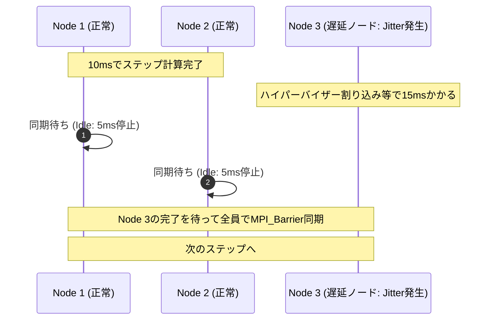

:::message
**連載：Google Cloud での HPC ワークロード設計ベストプラクティス（全2回）**

Web/API向けに最適化されたクラウドエンジニアの「成功体験」をそのまま持ち込むと、HPC基盤はなぜ破綻するのか？ その物理特性とメカニズムを理解し、Google Cloudの既存機能を適切に組み合わせて解決するまでの実践ガイドです。

| 回 | 記事 | 主なテーマ |
| :--- | :--- | :--- |
| **第1回（前編）** | 本記事 | WebとHPCの根本的違い、典型的な6つの罠とハマる理由、基盤が満たすべき4大要件 |
| **第2回（後編）** | [Google Cloudの既存機能を組み合わせて罠を突破する](2026-09-25-hpc-workload-design-part2-google-cloud) | 罠を回避するGCP機能の組み合わせ（Compute/Network/Storage/Orchestration） |
:::

## 1. 導入：Web/APIの設計パターンとHPCの物理制約

パブリッククラウドの普及によって、Webインフラ設計の基本原則は確立されました。「ステートレス」「水平スケール（Scale-out）」「疎結合」「マルチAZ冗長化」「マネージドサービスの活用」は、WebアプリケーションやAPIサーバーを安定運用するための標準的な手法です。

しかし、科学技術計算、製造業シミュレーション、大規模AI/LLMの分散学習基盤（HPC：High Performance Computing）を構築する際、この原則をそのまま適用すると、期待した性能が出ないばかりかジョブの異常終了を招きやすくなります。

* 耐障害性のためにマルチゾーンへノードを分散した結果、ノード間通信遅延により計算時間が大幅に延伸した。
* 負荷に応じてMIG（Managed Instance Group）でオートスケールさせた結果、計算途中のノード増減によりMPIプロセス全体が異常終了した。
* 共通ストレージとしてマネージドNAS（NFS）を接続した結果、数百ノードが一斉にアクセスした瞬間にメタデータ処理が逼迫し、全ノードでI/O待ちによるハングアップが発生した。
* Spot VMを採用した結果、長時間の計算完了直前にノードが中断され、最初から再計算を余儀なくされた。

Webインフラで推奨されるパターンがHPCで機能しない理由は、物理的な結合度と同期メカニズムの違いにあります。本稿では、HPCワークロード特有の物理特性、クラウド設計者が直面しやすい6つの問題、そして基盤が満たすべき要件を順に整理します。

---

## 2. 前提：Webサーバと比較したHPCワークロードの特徴

### 2.1 HPCワークロードの2分類：疎結合と密結合

HPC（High Performance Computing：高性能計算）とは、一般的なWebサーバや単一のコンピュータでは処理しきれない膨大な計算（流体解析、気象予測、分子シミュレーション、大規模AI学習など）を、多数の計算ノードを束ねて超並列に処理するシステム基盤の総称です。

HPCワークロードは、処理方式とノード間の通信パターンによって、大きく以下の2種類に分類されます。

1. **疎結合ワークロード（HTC: High Throughput Computing / 自明並列・Embarrassingly Parallel）**
2. **密結合ワークロード（Tightly Coupled / MPI型）**

| 分類 | 疎結合ワークロード（HTC / 自明並列） | 密結合ワークロード（Tightly Coupled / MPI型） |
| :--- | :--- | :--- |
| **代表例** | ・数万パターンのパラメータスタディ ・創薬バーチャルスクリーニング（分子ドッキング） ・モンテカルロシミュレーションの試行分散 ・ゲノム配列解析（BLAST等） | ・流体解析（CFD: OpenFOAM / Fluent） ・構造解析（FEM: LS-DYNA / Abaqus） ・気象予測・気候モデル（WRF） ・LLMの大規模分散学習（Megatron / AllReduce） |
| **ノード間通信** | **なし（独立実行）** 各タスクが完結しており、プロセス間のリアルタイム通信は不要 | **高頻度・超低遅延（マイクロ秒単位）** 計算ステップごとに全ノードが境界値交換や集約同期を行う |
| **障害の影響** | **局所的** 1タスクが落ちても、そのタスクだけ再実行すればよい | **全体停止（All-or-Nothing）** 1ノードが脱落・遅延した瞬間にクラスタ全体が停止する |
| **Web流の適用** | **適合しやすい** メッセージキュー、Spot VM、コンテナ、水平オートスケールがそのまま機能する | **適用できない** レイテンシの揺らぎ（Jitter）によりクラスタ全体が待機状態に陥る |

#### ワークロード種別を見極める意義

クラウド上でHPC基盤を設計する際、最初に対象ワークロードの通信特性を見極める必要があります。

タスク間に依存のない「疎結合（HTC）」であれば、Cloud BatchやSpot VM、Kubernetesによる分散処理といったWebやデータ基盤のアプローチを転用できます。安価かつ柔軟なスケールアウト環境を迅速に構築可能です。

一方で、ノード間で高頻度通信を行う「密結合（MPI型）」では、後述するレイテンシや同期の制約から、従来のクラウド設計パターンを適用すると性能劣化や異常終了を招きます。密結合ワークロードを対象とする場合は、インフラの設計思想を根本から切り替える必要があります。

### 2.2 Webサーバ vs 密結合HPC：8つの決定的違い

Webシステムと密結合HPCでは、インフラの設計前提が多くの領域で対照的となります。両者の特性を並べて整理します。

| 観点 | Web / API ワークロード | HPC ワークロード（密結合） |
| :--- | :--- | :--- |
| **1. 実行モデル** | **リクエスト駆動・ステートレス** クライアントのHTTP要求に応答（ミリ秒〜秒） | **ジョブ駆動・ステートフル** スケジューラに投入し、数時間〜数日間リソースを独占占有 |
| **2. 結合度** | **疎結合（Loose Coupling）** ノード間は無通信。状態は外部DBへ外出し | **超密結合（Tight Coupling）** 全ノードがMPI/RDMAでマイクロ秒オーダーの高頻度通信 |
| **3. 耐障害性** | **縮退運転（Graceful Degradation）** 1台死んでもLBが切り離し、他ノードで処理継続 | **All-or-Nothing / Checkpoint** 1台脱落した瞬間にジョブ全体が異常終了 |
| **4. スケーリング** | **動的オートスケール** 負荷に応じて1台ずつ動的に増減 | **静的一括プロビジョニング** 指定ノード数（例: 64台）を同時確保・アトミック割り当て |
| **5. ネットワーク** | **平均スループット重視** 10ms〜100msの遅延は許容。冗長性優先 | **超低遅延（μs）＆ジッター極小** テールレイテンシのブレがクラスタ全体を停止させる |
| **6. ノード配置** | **マルチゾーン/リージョン分散** データセンター障害への耐性を最優先 | **単一ゾーン・同一ラックスイッチ近接配置** 物理的距離を極小化し、ホップ数を削る |
| **7. CPU/メモリ** | **オーバーコミット・仮想コア共有** ハイパースレッディング有効、時分割多重 | **物理コア専有・SMT無効・NUMAアライン** L3キャッシュ・メモリ帯域を特定プロセスが100%占有 |
| **8. ストレージ** | **RDBMS / オブジェクトストレージ** S3/GCSやマネージドDB、結果整合性 | **POSIX共有並列ファイルシステム** 数千プロセスが一斉に同一領域へ高スループット読み書き |

### 2.3 物理的制約：「Straggler問題」と「N-to-1 I/O」

この根本的な違いを生み出しているのが、HPC特有の2つの物理的制約です。

#### ① Straggler（落ちこぼれノード）問題とバリア同期の数理
流体解析や気象予測、AIのAllReduceでは、全ノードが計算ステップごとに互いの計算結果を突き合わせる **バリア同期（MPI_Barrier）** を行います。

$$T_{\text{step}} = \max(t_1, t_2, \dots, t_N) + t_{\text{comm}}$$

この式が示す通り、クラスタ全体の計算時間は **「最も遅い1台のノード」によって完全に律速** されます。

たった1台のノードで、OSカーネルの割り込みや同一物理ホスト上の競合によって数ミリ秒の遅延（Jitter）が生じただけで、同期バリア（MPI_Barrier）において他の全ノードが待機状態となります。Webシステムのように「平均レイテンシが良好であればp99のブレは許容する」という運用は成り立ちません。

#### ② N-to-1 バーストI/O と Millions of Small Files
HPCの長時間ジョブでは、ノード障害に備えて一定間隔でメモリ状態を共有ディスクへダンプする **チェックポイント** を行います。数百台のノード（数千並列プロセス）が一斉に同一ファイルへ数十〜数百GB/sで書き込む「N-to-1バースト」が発生します。また、メッシュデータや解析入力は数百万個の極小ファイルで構成されることが多く、高いメタデータIOPSが求められます。

---

## 3. 典型的な6つの問題と発生要因

Webインフラの前提をそのままHPC（特に密結合環境）に持ち込んだ場合に生じる典型的な問題と、その発生要因を対比して整理します。

### 問題1：【配置】マルチAZへの分散配置
* **Webインフラの前提**:
  単一障害点（SPOF）を排除し、ゾーン障害に耐えられるよう、インスタンスを複数AZに均等分散する。
* **HPCで破綻する要因**:
  同一ラック内通信が数マイクロ秒であるのに対し、ゾーン間通信は光ファイバー長や中継機器によって1〜2ミリ秒の遅延が生じる。反復計算ごとに毎秒数千回のバリア同期を行うMPIでは、実行時間の大半がゾーン間のパケット往復待ちとなり、計算性能が大幅に低下する。

### 問題2：【スケール】MIG（オートスケーリング）による動的増減
* **Webインフラの前提**:
  負荷の高まりに合わせてインスタンスを自動追加し、不要になったら破棄してリソース効率を最適化する。
* **HPCで破綻する要因**:
  MPIプログラムは起動時に参加ノード一覧（Hostfile）を確定し、通信トポロジを固定する。計算途中でノードが増加しても通信網に取り込めず、スケールインで1台でもVMが停止した瞬間に通信途絶エラー（SIGSEGVやConnection Reset）が発生し、ジョブ全体が連鎖的に異常終了する。

### 問題3：【ストレージ】単一マネージドNAS（NFS）への依存
* **Webインフラの前提**:
  全ノードから共通のスクリプトや成果物を読み書きするため、マネージドなNFSボリューム（Filestore等）をマウントする。
* **HPCで破綻する要因**:
  標準NFSは単一のメタデータコントローラで処理を行う。数千プロセスが一斉に大量の微小ファイルを走査（`stat`）したり、数百GBのチェックポイントを一斉に書き込んだ場合、メタデータキューが飽和する。結果として全ノードでD-state（Uninterruptible Sleep）のI/O待ちが発生し、クラスタ全体がハングアップする。

### 問題4：【コスト】耐障害設計を伴わないSpot VMの採用
* **Webインフラの前提**:
  通常料金から大幅に割り引かれたSpot VMを採用し、インフラコストを圧縮する。
* **HPCで破綻する要因**:
  密結合HPCはAll-or-Nothingの特性を持つ。100台構成で数十時間連続稼働するジョブでは、実行中にいずれかのノードが停止（プリエンプト）される確率が極めて高くなる。定期的な状態保存（チェックポイント）やスケジューラによる再投入の設計がなければ、計算を完了まで進めることは困難となる。

### 問題5：【仮想化】vCPUとSMTによる過密集約
* **Webインフラの前提**:
  vCPUを時分割共有し、ハイパースレッディング（SMT）を有効にして、リソースを高密度に集約する。
* **HPCで破綻する要因**:
  同一物理コア上で2つの論理スレッドを動かすと、L1/L2キャッシュの追い出し（Cache Thrashing）や浮動小数点演算パイプラインの競合が発生する。プロセスが物理コアに専有されていない場合、オンプレミスの物理専用機と比較して大幅な性能劣化を招く。

### 問題6：【運用】ハイパーバイザーの無停止Live Migrationへの依存
* **Webインフラの前提**:
  物理ホストの保守時でもVMが無停止で移行するLive Migrationにより、ダウンタイムをゼロにする。
* **HPCで破綻する要因**:
  Live Migration中に発生する数十ミリ秒のCPU一時停止（Stun time）により、マイクロ秒単位で同期しているノード間のハートビートが途絶する。他ノードが接続切断と判定することで、クラスタ全体のジョブが強制終了する。

---

## 4. HPCワークロード基盤が満たすべき4つの要件

これらの問題を回避するため、密結合HPC環境には以下の4要件が求められます。

### ① Compute要件：性能均一性とJitterの排除
* **物理コア専有**: ハイパースレッディング（SMT）を無効化し、1スレッド/プロセスを1つの物理コアに専有させる。
* **NUMA考慮**: CPUソケットとメモリチャネルのローカル性を維持し、リモートメモリアクセスによる遅延悪化を防ぐ。
* **保守時の一時停止排除**: ライブマイグレーションによるマイクロスタックを許容せず、停止を明示的に制御する。

### ② Network要件：物理的近接性とプロトコル最適化
* **Compact近接配置**: クラスタ内のノード群を物理的に同一のラック、同一のTop-of-Rack（ToR）スイッチ配下に集約する。
* **高帯域・ジャンボフレーム**: パケット処理数（PPS）を削減し、ノード間通信の実効帯域（数十〜数百Gbps）を確保する。
* **低レイテンシスタック**: カーネル割り込みをバイパスするドライバ（gVNIC/IDPFやRDMA）を採用する。

### ③ Storage要件：並列ファイルシステムと4階層分離
* **分散メタデータエンジン**: メタデータ操作が単一コントローラに集中しない並列ファイルシステム（DAOS、Lustre等）を採用する。
* **役割に応じた階層化**: 超高速なScratch（ローカル/バースト領域）、安定したShared（`/home`）、安価で巨大なArchive（オブジェクトストレージ）を明確に分離する。

### ④ Orchestration要件：アトミック一括排他予約とフォールトトレランス
* **ジョブキューイング**: リソース（例: 64ノード）が完全に揃った段階でアトミックにノード群を割り当て、ジョブ終了時に回収する。
* **障害検知と再スケジューリング**: ノード障害時に速やかに最新のチェックポイントから再起動する自動化機構を組み込む。

---

## 5. 第2回（後編）への接続：Google Cloud の機能マッピング

仮想化されたパブリッククラウド上であっても、ハードウェア専有、物理近接配置、超並列ファイルシステム、バッチオーケストレーションを適切に組み合わせることで、密結合HPCのシビアな通信・I/O要件を満たす基盤を構成できます。

| 領域 | 本稿で整理した課題 | 第2回（後編）で解説するGoogle Cloudの構成要素 |
| :--- | :--- | :--- |
| **Compute** | ・マルチAZ配置によるノード間通信遅延 ・Live Migration時のマイクロジッター ・SMT/vCPU共有によるキャッシュ競合 | **Compact Placement Policy**（同一ラックスイッチ集約） ＋ **`on-host-maintenance: TERMINATE`** ＋ **`H3` マシンシリーズ**（88物理コア専有・DDR5） |
| **Network** | ・標準ネットワークの帯域不足 ・パケットヘッダ・カーネル処理によるCPU負荷 | **Tier_1 ネットワーキング**（最大200Gbps） ＋ **`gVNIC / IDPF`**（Titanium ASICオフロード） ＋ **Jumbo Frames**（VPC MTU 8896） |
| **Storage** | ・単一マネージドNAS（NFS）のメタデータ枯渇 ・N-to-1バーストチェックポイント時のI/Oストール | **`Parallelstore`**（Managed DAOS: 数千万IOPS） ＋ アクセス特性に応じた **4階層ストレージ戦略** |
| **Orchestration** | ・Web流MIG動的オートスケールによるジョブ破壊 ・Spot VM中断による計算全損 ・手動構築による環境不均一・設定ミス | **Slurm on Google Cloud**（キュー駆動Bulk VM一括確保） ＋ **Spotフォールトトレランス**（`--requeue` ＆ シグナルトラップ） ＋ **Cluster Toolkit（`ghpc`）** によるYAML Blueprint自動化 |

続く **[第2回（後編）](2026-09-25-hpc-workload-design-part2-google-cloud)** では、これら4つの領域について、パラメータ設定やBlueprint（Terraform）定義を交えながら具体的な構築手順を解説します。また、ワークロードが疎結合か密結合かに応じた、**Google Cloud Batch** と **Slurm** の実践的な選択基準についても述べます。

*(後編へ続く)*
