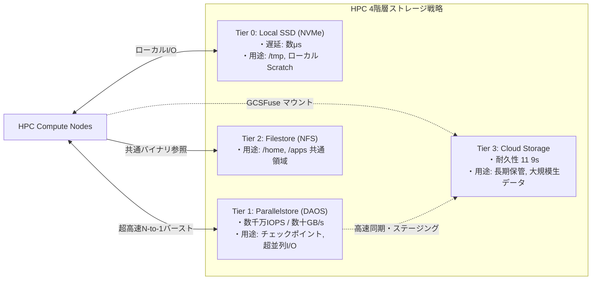
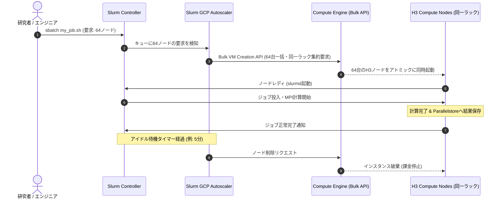
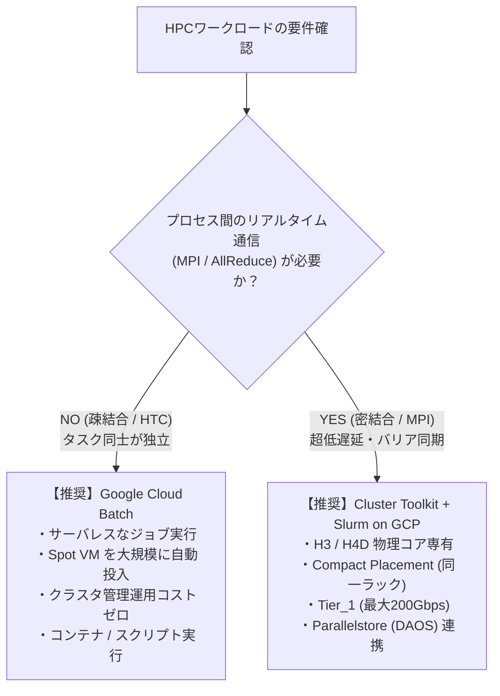

:::message
**連載：Google Cloud での HPC ワークロード設計ベストプラクティス（全2回）**

Web/API向けに最適化されたクラウドエンジニアの「成功体験」をそのまま持ち込むと、HPC基盤はなぜ破綻するのか？ その物理特性とメカニズムを理解し、Google Cloudの既存機能を適切に組み合わせて解決するまでの実践ガイドです。

| 回 | 記事 | 主なテーマ |
| :--- | :--- | :--- |
| **第1回（前編）** | [クラウドエンジニアが直面する罠とHPCの本質](2026-09-25-hpc-workload-design-part1-fundamentals) | クラウドエンジニアが陥る6つの罠、HPCの特徴とWeb/APIの決定的ギャップ、満たすべき4大要件 |
| **第2回（後編）** | 本記事 | 罠を回避するGCP機能の組み合わせ（Compute/Network/Storage/Orchestration） |
:::

## 1. はじめに：前編の「罠」をGoogle Cloudでどう解くか？

[第1回（前編）](2026-09-25-hpc-workload-design-part1-fundamentals) では、Web/APIインフラの常識（マルチAZ冗長化、動的オートスケール、マネージドNFS、vCPU仮想化、Live Migration）をそのままHPCに持ち込むと、以下の **6つの致命的な罠** に嵌ることを明らかにしました。

* **罠1【配置】可用性のためのマルチAZ分散配置** ➔ ゾーン間通信遅延によりバリア同期が崩壊し、計算時間が激増する
* **罠2【スケール】MIGによる動的オートスケール** ➔ 計算途中のノード追加・削除によりMPIプロセス全体が道連れ終了する
* **罠3【ストレージ】共有ストレージとしての単一マネージドNAS（NFS）依存** ➔ 数千プロセスのメタデータ集中とN-to-1バーストでI/O完全ストール
* **罠4【コスト】チェックポイント設計なきSpot VM採用** ➔ All-or-Nothing特性により1台の中断で数十時間の計算が全損する
* **罠5【仮想化】vCPUとコンテナによる高密度詰め込み** ➔ SMTとNUMA無視によるキャッシュ競合・メモリ帯域の取り合いで性能半減
* **罠6【運用】ハイパーバイザーの無停止Live Migrationへの安心** ➔ 数十msのマイクロスタックでMPIハートビートが途絶・クラスタ自死

HPCの物理特性（密結合・Straggler問題・N-to-1バーストI/O）を満たすために、オンプレミスのような専用スーパーコンピュータをイチから自作する必要はありません。

**Google Cloud には、これらの課題を解決するための強力なビルディングブロックがすでに揃っています。**

後編となる本記事では、Google Cloudの公式ドキュメントやアーキテクチャガイドを引用しながら、**「既存の機能をどのように適切に組み合わせることで、前編の罠を回避し、オンプレミスに匹敵するHPC基盤を実現するか」** を具体的に解説します。

---

## 2. Compute編：「マルチAZ・Live Migration・vCPU仮想化の罠」を突破する

Webエンジニアが最初に直面する「罠1（マルチAZ遅延）」「罠5（vCPU競合）」「罠6（Live Migration）」を、Google Cloudのコンピュート機能の組み合わせで解決します。

| 直面する罠（前編の課題） | 発生する問題 | Google Cloud での解決アプローチ |
| :--- | :--- | :--- |
| **罠1【配置】マルチAZ分散配置** | ゾーン間通信遅延（数ms）によりバリア同期が崩壊する | **`Compact Placement Policy`**<br>物理的に同一ラックスイッチ配下にVMを集約（Colocation） |
| **罠5【仮想化】vCPU詰め込みとSMT** | ハイパースレッディングによるL1/L2キャッシュ競合と性能半減 | **`H3` マシンシリーズ**（SMT無効・88物理コア専有・DDR5）<br>※他シリーズの場合は `--threads-per-core: 1` |
| **罠6【運用】Live Migrationへの安心** | 移行時のマイクロ停止（数十ms）によるハートビート途絶・自死 | **`--maintenance-policy=TERMINATE`**<br>無停止移行を無効化し、クリーンな終了とスケジューラ再実行へ |

### 2.1 Compact Placement Policy で同一ラックスイッチに集約する

「耐障害性のためにマルチAZに配置する（罠1）」を回避し、ノード間レイテンシをマイクロ秒オーダーに抑え込むために、Google Cloud の **Compact Placement Policy（近接配置ポリシー）** を適用します。

> **公式ドキュメント引用:**
> *“A compact placement policy specifies that your VM instances are placed physically close together inside the data center to reduce network latency. Compact placement policies are ideal for tightly coupled HPC workloads and high-performance distributed computing.”*
> — [Google Cloud Documentation: Define placement policies](https://cloud.google.com/compute/docs/instances/placement-policies)

```hcl
# TerraformによるCompact Placement Policyの定義
resource "google_compute_resource_policy" "hpc_compact_policy" {
  name   = "hpc-compact-placement"
  region = "us-central1"
  
  group_placement_policy {
    collocation  = "COLLOCATED"
    vm_count     = 64 # 同一ラックスイート内に集約するノード数
  }
}
```

このポリシーをインスタンス作成時に指定することで、基盤側は物理的に同一のラックまたは同一のTop-of-Rack（ToR）スイッチ配下のホストにVMを集約配置（Colocation）します。これにより、ゾーンをまたいだルーティング遅延を完全に排除できます。

### 2.2 H3 マシンタイプで物理コア専有とDDR5帯域を確保する

「vCPUを柔軟に割り当てて詰め込む（罠5）」を回避するには、HPC専用に設計された **H3 マシンシリーズ** を採用するのが最短ルートです。

> **公式ドキュメント引用:**
> *“The H3 machine series is designed for compute-intensive High-Performance Computing (HPC) workloads like computational fluid dynamics (CFD), molecular dynamics, and weather forecasting. H3 VMs are powered by 4th Gen Intel Xeon Scalable processors (Sapphire Rapids) and DDR5 memory.”*
> — [Google Cloud Compute Engine Documentation: H3 machine series](https://cloud.google.com/compute/docs/compute-optimized-machines#h3_series)

* **物理コア1:1マッピング（SMT無効化済み）**: `h3-standard-88` は、88個の物理コアがそのまま88個のvCPUとして割り当てられています。ハイパースレッディングが無効化されているため、スレッド間でのキャッシュ競合（Cache Trashing）が原理的に発生しません。
* **DDR5 メモリ**: CFDや気象予測など、メモリ帯域幅が性能上限を決めるワークロードで圧倒的なスループットを発揮します。
* **他シリーズでの代替**: C3 や C2 を使用する場合は、作成時に明示的に `--threads-per-core=1` を指定してSMTを無効化します。

### 2.3 `TERMINATE` ポリシーでLive Migrationのマイクロジッターを排除する

「無停止のLive Migrationに安心する（罠6）」を回避するため、HPCクラスタのノードには明示的に **マイグレーションの無効化** を設定します。

> **公式ドキュメント引用:**
> *“For tightly coupled HPC workloads, the brief latency jitter introduced by live migration can disrupt node-to-node synchronization and cause MPI timeouts. To avoid this, configure the host maintenance policy to terminate instead of migrate.”*
> — [Best practices for running tightly coupled HPC applications](https://cloud.google.com/architecture/best-practices-for-tightly-coupled-hpc-applications)

```bash
# メンテナンス発生時にLive Migrationを行わず終了（TERMINATE）させる
gcloud compute instances create hpc-node-01 \
    --zone=us-central1-a \
    --machine-type=h3-standard-88 \
    --maintenance-policy=TERMINATE \
    --restart-on-failure \
    --resource-policies=projects/MY_PROJECT/regions/us-central1/resourcePolicies/hpc-compact-placement
```

密結合HPCでは、Live Migrationによる数十ミリ秒の「一時スタック」で全ノードが同期エラーを起こすよりも、ノードをクリーンに終了させ、後述するジョブスケジューラ（Slurm）の仕組みで最新チェックポイントから健全なノードを使って自動再起動する方がはるかに安全です。

---

## 3. Network編：「通常ネットワークとTCPオーバーヘッドの罠」を突破する

Straggler（落ちこぼれノード）を生み出すネットワーク遅延の揺らぎ（Jitter）や帯域不足を、Google Cloudのネットワークスタックの最適化によって解決します。

### 3.1 Tier_1 高帯域ネットワーキング（最大200Gbps）

Compute Engine では、デフォルトの帯域上限を超えて最大 200 Gbps のネットワーク性能を引き出す **Tier_1 ネットワーキング** が利用可能です。

```bash
# Tier_1 ネットワーキングを有効化してVMを作成
gcloud compute instances create hpc-node-01 \
    --machine-type=h3-standard-88 \
    --network-performance-configs=total-egress-bandwidth-tier=TIER_1
```

AllReduce や Halo Exchange（境界値交換）など、ノード間で大量のデータが飛び交うHPCアプリケーションにおいて、ネットワーク帯域の飽和によるパケットドロップを防止します。

### 3.2 gVNIC と IDPF によるCPUオフロード

仮想NICには、レガシーな VirtIO ではなく、Google のカスタム ASIC（Titanium IPU）に最適化された **gVNIC（Google Virtual NIC）** または **IDPF（Infrastructure Data Path Function）** を採用します。パケット送受信処理がハードウェアにオフロードされ、仮想化オーバーヘッドが最小限に抑えられます。

### 3.3 Jumbo Frames（MTU 8896）の設定

HPCノードが接続するVPCネットワークでは、MTU（Maximum Transmission Unit）を標準の 1460/1500 から **8896 バイト（Jumbo Frames）** に拡大します。

```bash
# MTU 8896 のHPC専用VPCを作成
gcloud compute networks create hpc-vpc \
    --subnet-mode=custom \
    --mtu=8896
```

1パケットあたりのデータ量が約6倍になるため、ネットワークカードやOSカーネルが処理しなければならないパケット数（PPS: Packets Per Second）が大幅に激減し、ノードのCPU負荷軽減と実効帯域の向上が同時に得られます。

### 3.4 LinuxカーネルパラメータのHPCチューニング

Google Cloud公式の [hpc-tools](https://github.com/GoogleCloudPlatform/hpc-tools) や HPC VM イメージでは、以下のような低遅延カーネルチューニングが推奨されています。

```ini
# /etc/sysctl.d/99-hpc-network.conf

# 1. TCPバッファサイズの拡大（広帯域・低遅延通信でのウィンドウ枯渇防止）
net.core.rmem_max = 134217728
net.core.wmem_max = 134217728
net.ipv4.tcp_rmem = 4096 87380 67108864
net.ipv4.tcp_wmem = 4096 65536 67108864

# 2. ビジーポーリングの有効化（割り込み遅延を排除し、パケット到着を直接ポーリング）
net.core.busy_read = 50
net.core.busy_poll = 50

# 3. 輻輳制御アルゴリズム
net.ipv4.tcp_congestion_control = bbr
```

さらに、プロセスがメモリをロックして予期せぬスワップ（Jitterの温床）が発生するのを防ぐため、`/etc/security/limits.conf` で `memlock` を無制限に設定します。

```text
# /etc/security/limits.conf
* soft memlock unlimited
* hard memlock unlimited
* soft nofile 1048576
* hard nofile 1048576
```

---

## 4. Storage編：「マネージドNAS（NFS）メタデータ枯渇の罠」を突破する

「共有ストレージとして単一のマネージドNAS（NFS）に頼る（罠3）」を解決するには、アクセス特性に応じた **4階層ストレージ戦略** を導入します。



### 4.1 Parallelstore（Managed DAOS）の導入

前編で指摘した「数千プロセスのN-to-1チェックポイントバースト」と「数百万微小ファイル（Millions of Small Files）問題」を根本から解決するのが、Google Cloud の **Parallelstore** です。

> **公式ドキュメント引用:**
> *“Parallelstore is a fully managed parallel file system based on DAOS (Distributed Asynchronous Object Storage) architecture. It is designed to deliver ultra-high IOPS and massive throughput for demanding HPC and AI/ML workloads, eliminating storage bottlenecks during training and simulation.”*
> — [Google Cloud Documentation: Parallelstore overview](https://cloud.google.com/parallelstore/docs/overview)

#### なぜ従来のNFSやLustreではなくDAOSなのか？
* **カーネルバイパスアーキテクチャ**: DAOSはOSカーネルのVFSやブロックレイヤを経由せず、ユーザー空間ライブラリ（libfabric）を通じてNVMeストレージと直接通信します。
* **分散メタデータエンジン**: 1台のメタデータサーバーに負荷が集中する従来のNFSと異なり、メタデータ自体が全ストレージターゲットにシャーディングされます。数百万個の微小ファイルを一斉に `stat` しても、メタデータキューが詰まることはありません。
* **Cloud Storage との連携**: Parallelstoreは一時的な超高速キャッシュ（Burst Buffer）として機能し、Cloud Storage との間でデータを高速に一括同期（Hydration/Export）できます。

### 4.2 4つの階層の役割分担

| 階層 | サービス | 代表的なマウント先 | 役割とベストプラクティス |
| :--- | :--- | :--- | :--- |
| **Tier 0: Scratch** | Local SSD (NVMe) | `/tmp`, `/scratch/local` | ノード単体で完結する中間ファイル。インスタンス停止で消去 |
| **Tier 1: Hot/Burst** | **Parallelstore (DAOS)** | `/mnt/parallel` | ジョブ実行中の全ノード共有入出力、**チェックポイントの一斉ダンプ** |
| **Tier 2: Warm/Shared**| Filestore (Enterprise/SSD) | `/home`, `/apps/modules` | ユーザーのホームディレクトリ、環境設定、コンパイル済み共通ライブラリ |
| **Tier 3: Cold/Archive**| Cloud Storage (GCS) | `/mnt/gcs` (GCSFuse) | 実験データの恒久保存、大元データセットの保管、結果の長期アーカイブ |

この階層分離を徹底することで、「数千プロセスのI/Oバーストでホームディレクトリ（NFS）が巻き込まれて全員がログイン不能になる」といった惨劇を完全に防ぐことができます。

---

## 5. Orchestration編：「Web流オートスケールとSpot全滅の罠」を突破する

「Web流の動的オートスケールによるジョブ全滅（罠2）」と「Spot VM採用による計算全損（罠4）」を、HPC専用のオーケストレーションツールとフォールトトレランス設計で解決します。

### 5.1 Slurm on Google Cloud：キュー駆動型のBulkプロビジョニング

HPCの世界標準スケジューラである **Slurm** と Google Cloud は、公式の統合プラグイン（`schedmd-slurm-gcp-v6`）を提供しています。



### なぜWeb標準の Managed Instance Group（MIG）を使ってはいけないのか？

クラウドエンジニアであれば、「複数台のVMをグループ化してオートスケーリングさせるなら、Compute Engine 標準の **Managed Instance Group（MIG）** を使うのが最も自然ではないか？」と考えるでしょう。

実際、タスク間に依存関係のない **疎結合（HTC）** ワークロードであれば、Spot VM を束ねた MIG をジョブワーカーとして利用することは有効な選択肢です。

**しかし、密結合（MPI型）ワークロードにおいて、Web流のステートレスMIGを採用することは絶対に避けるべきです。** 理由は3つあります。

1. **スケーリングトリガーの根本的ミスマッチ（メトリクス駆動 vs キュー駆動）**:
   * **MIG**: CPU使用率やロードバランサトラフィックなど「過去の負荷メトリクスの平均値」が閾値を超えたときに、後追いで1台ずつ増減させる。
   * **HPC**: 「いま投入されたジョブが64ノードを要求している」という **ジョブキュー駆動**。計算が始まる前に指定ノード数が100%揃っていなければならず、実行中にCPU負荷が下がったからといって途中でノードを削減されるとMPI全体がクラッシュする。
2. **近接配置（Compact Placement）とのライフサイクルの不一致**:
   * 同一ラックスイッチ配下（Compact Placement）に64ノードを集約配置するには、ラックの空き容量を **「64台同時にアトミックに」** 抑える必要があります。
   * MIGのように1台ずつ順次プロビジョニングすると、途中で同一ラックのスロットが枯渇し、離れたラックにノードが分散配置（断片化）されて通信遅延が爆死します。
3. **ノードのアイデンティティ管理（ランダム名 vs 固定Hostfile）**:
   * MIGはステートレスVMをランダムサフィックス（例: `hpc-node-a1b2`）で使い捨てます。
   * 一方、MPIアプリケーションは起動時に参加全ノードのホスト名一覧（`hostfile`）を確定し、ノード間での相互名前解決やパスワードレスSSH通信を前提とします。

このため、Google Cloud は密結合HPCのオーケストレーションとして MIG ではなく、**Compute Engine の `Bulk VM Creation API` を直接叩く Slurm 公式プラグイン** を提供・推奨しています。

* **アトミック一括確保**: ジョブが必要とするノード数（例: 64台）を `Bulk VM Creation API` で同一の Compact Placement グループ内に一斉に立ち上げる。全台が揃うまでジョブを開始しない。
* **完全破棄によるコスト最適化**: ジョブが終了し、一定のアイドル時間（例: 5分）が経過したノードは自動的に安全に削除される。待機コストはゼロになり、オンプレミスのような巨大な待機電力を排除できる。

### 5.2 Spot VM のフォールトトレランス設計

コストを最大80%削減できる Spot VM をHPCで安全に運用するためには、**スケジューラとアプリケーションの連携** が不可欠です。

1. **Slurm の自動再投入（Requeue）設定**:
   ノードがプリエンプト（強制停止）された際、Slurmがジョブをエラー終了させず、自動的に待機キューへ戻して別のノード群で再実行させます。
   ```bash
   # ジョブスクリプト内での設定
   #SBATCH --requeue
   ```
2. **停止前30秒のシグナルトラップ（Graceful Checkpointing）**:
   Compute Engine の Spot VM は、停止の **30秒前** に ACPI シャットダウンシグナルを発行します。シミュレーションコード側でこのシグナル（SIGTERM等）をハンドリングし、メモリ上の直前状態を Parallelstore に緊急ダンプして終了します。再投入されたジョブはそのチェックポイントから再開するため、計算の損失は最大でも数分間に抑えられます。

### 5.3 Cluster Toolkit（`ghpc`）による宣言的インフラ構築

ここまで解説した「Compact Placement」「Tier_1」「MTU 8896」「Parallelstore」「Slurm」を手作業でコンソールからポチポチ設定するのは、人為的ミスの温床です。

Google Cloud が提供するオープンソースツール **Cluster Toolkit（`ghpc`）** を使用すれば、クラスタ全体を1つの YAML Blueprint として宣言的に定義・デプロイできます。

> **公式ドキュメント引用:**
> *“The Cluster Toolkit is an open-source tool that makes it easy to deploy high-performance computing (HPC) environments on Google Cloud using Infrastructure as Code (IaC). You define your cluster using a YAML blueprint, and the toolkit generates and applies Terraform modules adhering to Google Cloud best practices.”*
> — [Google Cloud Documentation: Cluster Toolkit overview](https://cloud.google.com/cluster-toolkit/docs/overview)

#### Blueprint の定義例（`hpc-cluster.yaml`）

```yaml
blueprint_name: production-hpc-cluster

vars:
  project_id: my-gcp-project
  deployment_name: hpc-cluster
  region: us-central1
  zone: us-central1-a

deployment_groups:
  - group: primary
    modules:
      # 1. 低遅延 VPC ネットワーク (Jumbo Frames MTU 8896)
      - id: network
        source: modules/network/vpc
        settings:
          mtu: 8896

      # 2. 共有ホームディレクトリ (Filestore)
      - id: homefs
        source: modules/file-system/filestore
        use: [network]
        settings:
          filestore_tier: BASIC_SSD
          size_gb: 2560

      # 3. 超並列バーストストレージ (Parallelstore / DAOS)
      - id: scratchfs
        source: modules/file-system/parallelstore
        use: [network]
        settings:
          capacity_gb: 12000

      # 4. Slurm コントローラ
      - id: slurm_controller
        source: community/modules/scheduler/schedmd-slurm-gcp-v6-controller
        use: [network, homefs, scratchfs]

      # 5. H3 コンピュートノードパーティション (Compact Placement 自動適用)
      - id: h3_partition
        source: community/modules/compute/schedmd-slurm-gcp-v6-partition
        use: [network, slurm_controller]
        settings:
          partition_name: h3-compute
          max_node_count: 64
          machine_type: h3-standard-88
          enable_placement: true  # Compact Placement Policy を自動設定
          bandwidth_tier: tier_1  # Tier_1 ネットワーキング (200Gbps) を自動設定
```

デプロイはコマンド2行で完了します。Toolkit が内部で最適な Terraform コードを生成し、Google Cloud のベストプラクティスを漏れなく適用してくれます：

```bash
# Blueprint からデプロイメントコードを生成
ghpc create blueprints/hpc-cluster.yaml -w /work/hpc-deployment

# クラスタを一括プロビジョニング
ghpc deploy /work/hpc-deployment
```

### 5.4 疎結合（HTC）ならどうする？：Google Cloud Batch との使い分け

ここまで密結合（MPI型）のクラスタ設計を中心に解説してきましたが、前編で整理した通り、HPCには **「疎結合（HTC / 自明並列）」** のワークロードも数多く存在します。

もしあなたのワークロードが、プロセス間通信を行わないパラメータスタディやモンテカルロシミュレーション、遺伝子解析などの疎結合である場合、**Slurm クラスタを常設・構築する必要すらありません。**

Google Cloud には、フルマネージドなバッチジョブ実行サービスである **Google Cloud Batch** が提供されています。



| 比較項目 | Google Cloud Batch（疎結合・HTC向け） | Slurm on Google Cloud（密結合・MPI向け） |
| :--- | :--- | :--- |
| **主な用途** | パラメータ探索、モンテカルロ、レンダリング、ゲノム解析 | 流体解析（CFD）、構造解析（FEM）、気象予測、LLM分散学習 |
| **通信要件** | 不要（タスク間通信なし） | 必須（マイクロ秒オーダー・同一ラック近接配置） |
| **インフラ管理** | **不要（完全マネージド）**<br>コントローラVMの管理やOS保守は一切不要 | **必要（半マネージド）**<br>Slurmコントローラやパーティションの定義が必要 |
| **Spot VM親和性** | **極めて高い**<br>落ちたタスクだけを自動で再試行（リトライ）可能 | **設計が必要**<br>Slurm `--requeue` と緊急チェックポイントが必須 |
| **ストレージ** | Cloud Storage（GCS）中心で十分 | Parallelstore（DAOS）やローカルSSDが必須 |

「自社のワークロードがどちらに属するのか」を最初に見極め、疎結合であれば **Google Cloud Batch** でシンプルに済ませ、密結合であれば **Cluster Toolkit ＋ Slurm ＋ H3 ＋ Parallelstore** の組み合わせで堅牢なスーパーコンピュータ環境を立ち上げる。この使い分けができることこそが、クラウドを使いこなすアーキテクトの真価です。

---

## 6. まとめ：Webエンジニアのための「GCP機能マッピング・チートシート」

前編・後編を通じて解説した「罠」と「HPCの特徴」、そして「Google Cloudの解決機能」の対応関係を総括表としてまとめます。

| レイヤ | クラウドエンジニアが直面する罠 | HPCの物理的特徴・要求 | Google Cloud でのベストプラクティス組み合わせ |
| :--- | :--- | :--- | :--- |
| **Compute** | 可用性のためのマルチAZ分散配置 | マイクロ秒単位の低遅延通信 | **`Compact Placement Policy`（`COLLOCATED`）** |
| | vCPU仮想化とコンテナ詰め込み | 物理コア専有・キャッシュ競合防止 | **`H3` マシンシリーズ**（または `--threads-per-core: 1`） |
| | Live Migration によるマイクロ停止 | ハートビート途絶・ノード自死の防止 | **`--maintenance-policy=TERMINATE`** |
| **Network** | 標準ネットワークとTCPの遅延・帯域不足 | 高帯域・割り込みオーバーヘッド削減 | **`Tier_1 ネットワーキング`（最大200Gbps）** ＋ **`gVNIC/IDPF`** |
| | パケットヘッダによるCPU負荷 | PPS削減と実効帯域の向上 | VPC の **`MTU = 8896`（Jumbo Frames）** |
| | ソケットバッファの枯渇・割り込み遅延 | Jitterの排除と決定論的通信 | **Linux カーネルチューニング**（`busy_poll`、`memlock unlimited`） |
| **Storage** | 単一マネージドNAS（NFS）への依存 | N-to-1バーストI/O、大量微小ファイル | **`Parallelstore`（Managed DAOS）** による超並列I/O |
| | ストレージ競合によるホーム停止 | 役割に応じたアクセス分離 | **4階層ストレージ戦略**（Local SSD / Parallelstore / Filestore / GCS） |
| **Orchestration** | Web流の動的オートスケール（MIG） | トポロジアウェアな静的一括割り当て | **`Slurm on Google Cloud`**（Bulk VMプロビジョニング） |
| | Spot VM の中断による計算全損 | All-or-Nothingへの耐性確保 | Slurm **`--requeue`** ＋ 30秒前シグナルトラップによる緊急チェックポイント |
| | 手作業構築による設定ミス・不均一 | 宣言的で再現性のある基盤構築 | **`Cluster Toolkit`（`ghpc`）** による YAML Blueprint 自動化 |

Web/APIシステムで培ったクラウドの知見は無駄ではありません。ただし、HPCという「超密結合・同期型」の世界に足を踏み入れるときは、Webの常識を一度アンラーンし、HPCの物理特性に向き合う必要があります。

Google Cloud の既存機能を正しく理解し、適切に組み合わせることで、クラウドの弾力性とスーパーコンピュータ並みの計算性能を両立した次世代の計算基盤を構築してください。

---

### 公式参考リンク
* [Google Cloud Architecture Center: Best practices for running tightly coupled HPC applications on Compute Engine](https://cloud.google.com/architecture/best-practices-for-tightly-coupled-hpc-applications)
* [Google Cloud Compute Engine Documentation: H3 machine series](https://cloud.google.com/compute/docs/compute-optimized-machines#h3_series)
* [Google Cloud Documentation: Cluster Toolkit overview](https://cloud.google.com/cluster-toolkit/docs/overview)
* [Google Cloud Documentation: Parallelstore overview](https://cloud.google.com/parallelstore/docs/overview)
* [Google Cloud Documentation: Define placement policies](https://cloud.google.com/compute/docs/instances/placement-policies)
* [GitHub: GoogleCloudPlatform/cluster-toolkit](https://github.com/GoogleCloudPlatform/cluster-toolkit)
* [GitHub: GoogleCloudPlatform/hpc-tools](https://github.com/GoogleCloudPlatform/hpc-tools)
