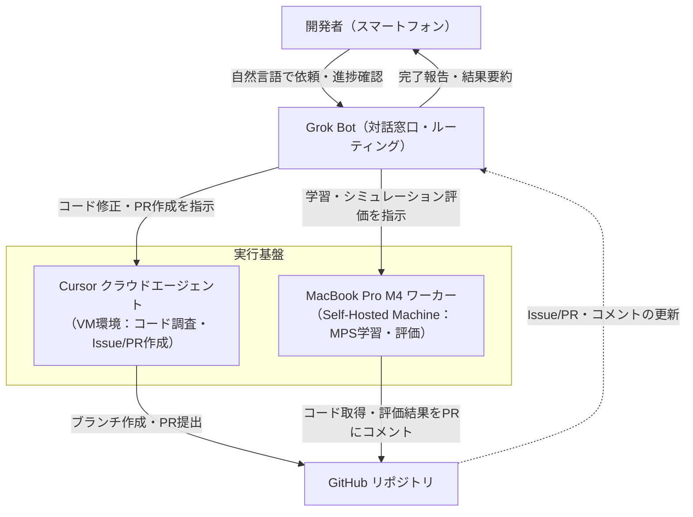

## 1. 卓上ロボット開発における一人運用の負荷

スマートフォンのチャットから一言指示を出すだけで、クラウドエージェントがコードを調査・修正して PR を作り、自宅の Mac がバックグラウンドで学習を回し、GitHub 上で評価結果を確認できる。本記事では、この開発フローを Grok Bot と Cursor（Cloud Agent / Self-Hosted Machine）を組み合わせて構築した実践記録を紹介します。

筆者は現在、オープンソースの卓上ロボットアーム「[SO-101](https://github.com/TheRobotStudio/SO-ARM100)」を用い、模倣学習フレームワークである [Hugging Face LeRobot](https://github.com/huggingface/lerobot) を使って動作ポリシーの学習を進めています。しかし、個人開発で「バグ修正 → テスト → 学習ジョブ投入 → シミュレーション評価」のサイクルを手動で回し続けるのは大きな負担です。コードの微修正やプロセスの監視といった定型作業に手を取られると、ポリシーの振る舞い分析やデータ収集の改善といった本来注力すべき判断に集中できなくなってしまいます。

そこで本構成では、窓口となる対話インターフェースに Grok Bot を使い、コードの調査や修正には [Cursor Cloud Agents](https://cursor.com/docs/cloud-agent) を、GPU を用いたモデル学習とシミュレーション評価には自宅の MacBook Pro M4 上で常駐する [Cursor Self-Hosted Machine](https://cursor.com/docs/cloud-agent/self-hosted/choose-runtime) を割り当てました。

この構成を導入したことで、外出先からスマートフォンで修正を指示し、自宅の Mac で学習を走らせ、帰宅中や移動中に GitHub 上で評価結果を確認できるようになりました。本記事の対象は、シミュレーション環境における ACT（Action Chunking with Transformers）ポリシーの学習と評価です。エージェントの役割分担、実行環境の選定理由、運用ルール、直面した課題とその対処法を順に説明します。実機 SO-101 への物理展開は次回の記事で扱います。

## 2. システム全体の構成と責務の分離

全体の協調動作は、チャット窓口、クラウド上のコーディング環境、ローカルマシンの実行環境、そして共有ストレージとしての GitHub リポジトリの4要素で成立しています。



各構成要素が担う役割は以下のとおりです。

- **Grok Bot（窓口・ルーティング）**: 開発者からの自然言語指示を受け取り、作業内容に応じてクラウドエージェントかローカルワーカーのどちらを起動するか判断します。実行中は進捗を確認し、ジョブ完了時に要約をチャットへ返信します。
- **Cursor クラウドエージェント（コード変更・管理）**: Cursor が管理するクラウド VM 上で動作し、リポジトリのコード調査、バグ修正、テスト実行、Issue や Pull Request（PR）の作成、マージコンフリクトの解消を担当します。
- **MacBook Pro M4 上の Cursor エージェント（計算処理ワーカー）**: 開発者のローカルマシン上でバックグラウンド動作するセルフホストワーカー（Cursor 公式ドキュメント上の名称は「My Machines」）です。エージェントの思考や判断ループ自体は Cursor のクラウド側で処理され、ターミナルコマンドの実行やファイル編集といったツール実行のみを手元の Mac で行います。これにより、PyTorch の MPS（Metal Performance Shaders）バックエンドを利用したローカルでのモデル学習とシミュレーション評価を実行できます。
- **GitHub**: すべての成果物（コミット、PR、評価ログ、評価結果コメント）を集約する単一の真実源（Single Source of Truth）として機能します。

## 3. 計算リソースの選定：学習をどこで実行するか

エージェントをクラウドとローカルに分けた最大の理由は、Cursor クラウドエージェントの実行環境（VM）に GPU が割り当てられていない点にあります。クラウドエージェントはコードの編集や静的解析、軽量な単体テストにはぴったりですが、GPU がないのでモデルの学習を回すことはできません。そのため、学習はエージェントの外にある GPU リソースに任せる設計が必要になります。

学習を実行する基盤には、大きく分けて二つの選択肢が存在します。

| 選択肢 | 代表的な基盤 | メリット | デメリット・考慮点 |
| :--- | :--- | :--- | :--- |
| **クラウド GPU** | [Modal](https://modal.com/)、[RunPod](https://www.runpod.io/) など | 必要なときだけ高性能 GPU（A100/H100 等）を利用可能。マシンの電源管理が不要 | 起動ごとの従量課金が発生する。環境イメージの同期やデータ転送の設計が必要 |
| **ローカル GPU** | 自宅の Mac（Apple Silicon MPS）、NVIDIA GPU 搭載機 | 手持ちのマシンを使えば追加の計算費用が 0 円。データの外部転送が不要 | マシンを常時起動しておく必要がある。計算能力は手持ち機材のスペックに依存する |

手持ちに専用の NVIDIA GPU マシンがない場合でも、Apple Silicon 搭載の Mac であれば [PyTorch の MPS（Metal Performance Shaders）バックエンド](https://pytorch.org/docs/stable/notes/mps.html) を介して内蔵 GPU を利用できます。今回対象とする LeRobot の ACT ポリシー（シミュレーション環境）の学習は、MacBook Pro M4 の MPS 上で約 1,500 ステップに約 30 分、5,000 ステップの本格学習には約 2 時間半ほどかかります。

したがって本構成では、追加の GPU 費用を発生させず、かつ手元にあるリソースを有効活用するため、自宅の MacBook Pro をセルフホストワーカーとして常駐させる方式を採用しました。コーディング側のクラウドエージェントは「Auto」モードで運用することで X Subscription（Premium、月額 $30）の枠内に収め、学習側も手元の Mac を使うため追加のクラウド GPU 費用はかかりません。サブスクリプション枠の範囲内であれば、追加コストを抑えながら開発ループを回せます（外部モデルを明示指定した場合の課金仕様については第8章で詳述します）。

## 4. Grok Bot による指示受付と自律運用の境界

Grok Bot は、開発者と二種類のエージェントの間を取り持つオーケストレーターとして機能します。開発者がスマートフォンのチャット画面から「閉ループ評価でグリッパーが閉じる前に腕が上昇してしまう問題を調べて修正してほしい」あるいは「PR #{PR番号} のコードを取り込んで、シミュレーションで 5,000 ステップ学習して結果を報告してほしい」と入力すると、Grok Bot が作業の性質を判定し、適切なエージェントに命令を発行します。

5,000 ステップの本格学習とシミュレーション評価には約 2 時間半ほどかかります。長時間のジョブに対しては、エージェントによる約 15 分ごとの定期的な進捗確認や完了通知を組み合わせていますが、プロセスの実態を確実に把握するために手元の端末でログやプロセスを補助的に確認する場面も交えながら運用しています。

自律エージェントの意図しない挙動を防ぐため、運用プロンプトには明確なルールを埋め込んでいます。

- **Issue 作成の制限**: リポジトリの調査や質問への回答にとどまる場合は Issue を立てず、コード変更を伴う作業に限り Issue と PR を作成させる。
- **モデル選択の固定**: クラウドエージェントのモデルには外部モデルを名前で指定せず、原則として「Auto」モードを使用させる（費用の予期せぬ増加を防ぐため。詳細は第8章）。

一方で、すべての判断をエージェントに委ねているわけではありません。PR の最終的なマージ判断と、MacBook 上の物理的・最終的な動作確認は、必ず人間の開発者が実施する境界線（Human-in-the-Loop）を維持しています。

## 5. クラウドエージェントによるコーディングと保守の自律化

クラウドエージェントにコーディングを指示する際は、指示の曖昧さを排す必要があります。指示文には「目的」「完了条件（Done の定義）」「やってはいけないこと（制約事項）」の3点を構造化して記述します。

```text
【目的】
シミュレーション評価環境において、グリッパーが物体を把持する前にアームが上昇を開始し、
タスクが失敗する事象の原因を特定して修正してください。

【完了条件】
1. 該当する制御ロジックの不具合箇所を特定し、Issue を作成すること。
2. 修正用のトピックブランチを作成し、把持完了判定のステート遷移を修正すること。
3. 既存の単体テストがすべて通過することを確認し、PR を作成すること。

【やってはいけないこと】
- モデルのアーキテクチャ定義やハイパーパラメータは変更しないでください。
- main ブランチに直接プッシュしないでください。
```

この指示に基づき、クラウドエージェントはコードベースを探索し、把持完了判定のしきい値とステートマシンの遷移条件に不整合がある事実を突き止めました。エージェントは原因を整理した Issue を発行したうえで、状態遷移フラグの更新順序を修正するコミットを行い、PR を提出しました。

また、シミュレーション評価時の例外停止や環境トラブルの調査・修正にもエージェントが役立ちました。macOS 上でシミュレーション評価スクリプトを実行中にプロセスが停止する事象が発生した際、エージェントにログ解析を依頼したところ、`faulthandler` を有効化して異常終了時のスタックトレースを捕捉しやすくする対応を行ってくれました。さらに、不要な GUI 依存を外して環境を安定させるため、`opencv-python` を `opencv-python-headless` へ置き換える依存関係の修正 PR も作成してくれました。また、複数タスクを並行して依頼した結果として PR 間にコンフリクトが生じた場合も、コンフリクトが発生した後にエージェントへ最新の `main` の取り込みと競合解消を依頼することで解決できています。

## 6. MacBook ワーカーによるモデル学習とシミュレーション評価

ローカルの計算処理は、MacBook Pro M4 上で常駐する [Cursor Self-Hosted Machine（My Machines）](https://cursor.com/docs/cloud-agent/self-hosted/choose-runtime) が担当します。ワーカーはローカルリポジトリの所定ディレクトリを作業領域とし、Cursor のコントロールプレーンと HTTPS のアウトバウンド接続で通信するため、自宅ルーターのポート開放やインバウンド用 VPN の設定は不要です。

ワーカーが実行する学習ジョブは、Hugging Face LeRobot を用いた ACT（Action Chunking with Transformers）ポリシーの学習です。ACT は [Zhao らの研究（2023）](https://arxiv.org/abs/2304.13705) で提案された模倣学習手法であり、複数ステップの行動（チャンク）をまとめて予測することで動作の滑らかさとタスク成功率を高めます。本環境では、PyTorch のデバイス指定に `mps` を与えて実行します。

```bash
# LeRobot CLI による学習コマンド例
lerobot-train \
    --dataset.repo_id=local/so101_pick_place_sim \
    --policy.type=act \
    --policy.device=mps \
    --steps=5000 \
    --output_dir=outputs/train/act_so101_mps
```

※ 上記は LeRobot 公式 CLI（`lerobot-train`）を用いたコマンド例です。実際のリポジトリ構成や自作スクリプトに応じて呼び出し方は適宜調整します。

学習の進捗は、ワーカーが出力するログと生成されるチェックポイントファイルを通じて確認されます。5,000 ステップの学習が完了すると、ワーカーは続けて 2 つの評価モードを実行します。

1. **教師強制評価（Teacher Forcing / Offline Validation）**:
   検証用データセットの観測画像と関節角度を入力し、モデルが出力した行動チャンクと正解行動との間の絶対誤差（L1 損失）を計算します。
2. **閉ループシミュレーション評価（Closed-Loop Rollout）**:
   シミュレータ環境内でモデルにロボットアームを逐次制御させ、物体を指定位置へ運搬・整列できるかどうかのタスク成功率や位置誤差を計測します。

評価が完了すると、ワーカーは結果を集計し、該当 PR に Markdown 表形式でコメントを自動投稿します。

ロボットの模倣学習では、オフラインの予測誤差（Teacher Forcing）だけでなく、実際に環境を動かした際の位置合わせや把持の成否（閉ループ評価）を揃えて確認することが不可欠です。そのため、プロンプト指示によって以下の 4 つの指標をセットで PR コメントに出力させる形式としています。

| 評価指標 | 評価内容 | 単位 / 基準 | 集計の目的 |
| :--- | :--- | :--- | :--- |
| **検証 L1 損失 (val_l1_loss)** | 教師強制による軌道予測の絶対誤差 | 無次元（小さいほど良い） | オフラインでの学習収束の確認 |
| **位置合わせ成功率 (Alignment Rate)** | 物体の目標位置への位置合わせ完了割合 | ％（大きいほど良い） | 最終タスク到達度の判定 |
| **アーム位置誤差 (Position Error)** | 目標位置と到達位置との空間距離誤差 | mm（小さいほど良い） | アーム動作の精度測定 |
| **把持成功率 (Grasp Success Rate)** | グリッパーによる物体の安定把持割合 | ％（大きいほど良い） | 把持制御の成功判定 |

このようにシミュレーション評価の集計結果を GitHub の PR コメントへ集約させることで、開発者は手元のターミナルに張り付くことなく、スマートフォンの GitHub アプリを開くだけで修正の有効性を確認できるようになります。

## 7. 開発体験における実質的な変化

この3者協調体制を組んだことで、開発作業の進め方には顕著な変化が生じました。

第一に、開発サイクルの物理的な拘束が解消された点です。従来はデスクの前に座り、エディタでコードを直し、学習スクリプトを叩いてログを眺める必要がありました。本構成では、外出先や移動中のわずかな合間にスマートフォンの Grok から「把持の判定ロジックを修正して学習を回しておいて」と指示を出すだけで、帰宅する頃には GitHub 上に修正コードと評価結果の双方が揃っています。

第二に、実行先を細かく意識せずに頼める点です。コードの調査や修正であればクラウドエージェント、GPU を使う学習やシミュレーション評価であれば手元の Mac ワーカーというように、開発者が自然言語で Grok Bot に依頼するだけで、Grok Bot 側が作業内容に応じて適切なエージェントを選んで起動してくれます。

第三に、追加の計算機費用を抑えながら学習サイクルを維持できる点です。クラウド GPU インスタンスを長時間借りっぱなしにした場合の課金不安や、環境構築のオーバーヘッドを抱えることなく、手元の M4 Mac の計算余力をバックグラウンドで無駄なく活用する運用が定着しました。

## 8. 実践で直面した課題と運用の回避策

実運用を継続する過程では、ツール同士の連携やインフラ特性に起因する摩擦がいくつか生じました。以下に、実際に直面した課題とその対処法を整理します。

### 長時間プロセスの進捗確認と手動介入
ローカルワーカーで数時間に及ぶ学習を走らせる際、バックグラウンドプロセスの進捗状況や正常動作をエージェント側だけで完全に自動把握するのはまだ難しさがありました。実際には、手元のターミナルで `pgrep` やログファイル（`tail`）の出力を自分で確認し、その結果をチャットに貼り付けて Grok Bot と状況を共有しながら進める場面が多くありました。完全な自律監視に至る前の、こうした手動確認のステップが運用の現実として残っています。

### 並行 PR 間でのマージコンフリクト
クラウドエージェントに複数の修正を同時に依頼すると、それぞれが `main` から分岐した独立ブランチを作成するため、後からマージする PR でコンフリクトが発生することがありました。これに対して事前に厳密な予防ルールを設けるのではなく、コンフリクトが発生した後にエージェントに対して「main の変更を取り込んでコンフリクトを解消してほしい」と依頼することで、差分の解消と PR の更新をスムーズに任せることができました。

### 指示の曖昧さと完了条件の明確化
エージェントへの依頼文が曖昧だと、意図と異なる箇所のコードを書き換えてしまったり、不要なリファクタリングが混入したりすることがありました。第 5 章で触れたように、「目的」「完了条件（Done の定義）」「やってはいけないこと（制約事項）」を構造化して明記することで、手戻りを大幅に減らせました。

### モデル指定と課金構造の落とし穴
個人プランにおけるエージェント運用では、モデル選択によって課金経路が切り替わる点に留意が必要です。具体的には、「Auto」モードを選択した場合は Cost モードとして動作し、X Subscription（Premium、月額 $30）のサブスクリプション枠から消費されます。
しかし、ここで Claude、GPT、Gemini といった外部モデルを名前で直接指定すると、サブスクリプション枠の対象外となり、API の定価に基づいた前払いクレジットから別途引き落とされる仕様になっています。意図しない費用の発生を防ぐため、クラウドエージェントの設定は「Auto」のまま運用するのが安全です。

### チャット形態による機能差
Grok の対話インターフェースには 1 対 1 の個別チャットとグループチャットが存在しますが、外部ツールの呼び出しやバックグラウンドエージェント連携の挙動に差異があり、意図した自動実行がトリガーされない事象を経験しました。運用の安定化を図るため、開発指示と監視の窓口は検証済みの 1 対 1 チャットに統一しています。

## 9. まとめと次回予告

本記事で試したワークフローは、窓口（Grok Bot）、コード修正（Cursor Cloud Agent）、計算処理（MacBook Self-Hosted Worker）の3つに役割を分けることで、個人のロボット開発の手間を大きく減らせることを示しています。

自律運用のコツは、エージェントに何でも丸投げするのではなく、**各ツールの物理的な制約（GPU の有無、課金体系、接続経路）に合わせて役割をきれいに切り分けること**にあります。コード調査や PR 作成はクラウドに任せ、重い学習とシミュレーションは手元の M4 Mac に引き受けてもらい、最後のマージと動作確認は人間が責任を持つ。この境界線を引いておくだけで、一人でも無理なく開発サイクルを回し続けられます。

次回は、本記事で学習・検証した ACT ポリシーのチェックポイントを、シミュレーション環境から卓上ロボットアーム「SO-101」の実機へ展開し、実世界のカメラ画像とサーボモーター制御を組み合わせて物体を把持させる実践プロセスを解説します。

---

## 付録

### A. エージェントへの指示プロンプト例

#### コーディング依頼プロンプト（クラウドエージェント向け）
```text
【作業目的】
閉ループシミュレーション評価スクリプト（scripts/eval_closed_loop.py）実行時に、
タイムアウトで失敗したエピソードの挙動ログを分析し、
グリッパーの開閉状態とアーム軌道の遷移ロジックを修正してください。

【制約・ルール】
- 変更理由と修正方針を Issue に簡潔に記載すること。
- main ブランチからトピックブランチを切って作業すること。
- モデルのハイパーパラメータやネットワーク構成は変更しないこと。
```

#### 学習・評価依頼プロンプト（MacBook ワーカー向け）
```text
【作業目的】
PR #{PR_NUMBER} のブランチをローカルにチェックアウトし、
SO-101 のシミュレーションデータセットを用いて ACT ポリシーの学習と評価を実行してください。

【実行手順】
1. デバイスに 'mps' を指定し、5000 ステップの学習を実行する。
2. 学習完了後、オフライン L1 損失の算出と、20 エピソードの閉ループシミュレーション評価を実施する。
3. 評価指標（val_l1_loss、位置合わせ率、アーム位置誤差、把持成功率）を Markdown 表に整形し、PR #{PR_NUMBER} にコメント投稿する。
```

### B. 主要用語の解説

- **ACT (Action Chunking with Transformers)**:
  ロボットの連続的な動作軌道を複数ステップのひとかたまり（チャンク）として一度に予測する模倣学習モデル。予測のばらつきを抑え、高精度なマニピュレーションを可能にします。
- **MPS (Metal Performance Shaders)**:
  Apple Silicon の GPU 機能を macOS 上のフレームワークから利用するためのバックエンド。PyTorch では `torch.device("mps")` を指定することで、CUDA と同様にハードウェアアクセラレーションを有効化できます。
- **閉ループ評価 (Closed-Loop Evaluation)**:
  モデルが出力した動作によって環境（シミュレータまたは実機）の状態が変化し、その変化した観測画像やセンサ値を次の入力として逐次的に制御を進める評価手法。誤差の累積に対する頑健性を測定できます。
- **教師強制 (Teacher Forcing)**:
  系列データの学習・評価において、モデルの過去の予測値ではなく、正解データ（教師データ）の観測と行動を各ステップの入力として与える手法。モデル自身の蓄積誤差を切り離して単一ステップの予測精度を測る指標となります。

### C. 公式リファレンス・参考リンク

- **Cursor 公式ドキュメント**
  - [Cloud Agents Overview](https://cursor.com/docs/cloud-agent)
  - [Self-Hosted Machines / Cloud Agents](https://cursor.com/docs/cloud-agent/self-hosted/choose-runtime)
  - [Rules for AI](https://cursor.com/docs/rules)
- **Hugging Face LeRobot & ロボティクス**
  - [huggingface/lerobot (GitHub)](https://github.com/huggingface/lerobot)
  - [LeRobot Documentation](https://huggingface.co/docs/lerobot)
  - [SO-100 / SO-101 ロボットアーム仕様](https://github.com/TheRobotStudio/SO-ARM100)
  - 論文：[Learning Fine-Grained Bimanual Manipulation with Low-Cost Hardware (Zhao et al., 2023 / ACT)](https://arxiv.org/abs/2304.13705)
- **PyTorch 公式**
  - [PyTorch MPS Backend Documentation](https://pytorch.org/docs/stable/notes/mps.html)
