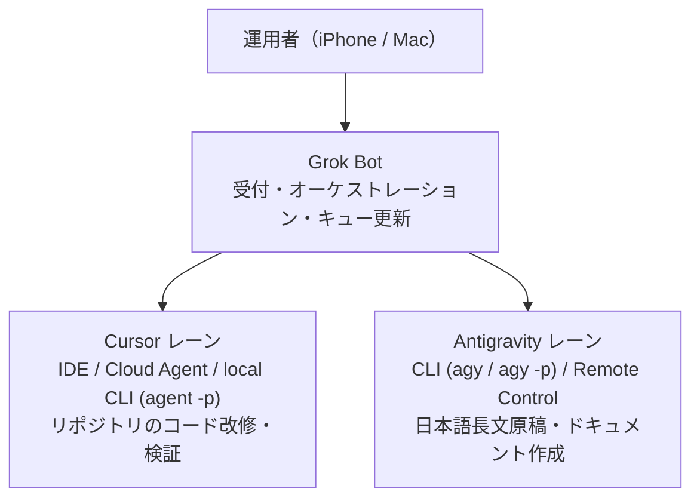

:::message
**連載「Grok・Cursor・Antigravityで個人のAI運用を組む」（全3部予定）**

複数のAIエージェントを個人の実務で使い分けるための運用設計を、3部構成で整理します。

* **第1部：なぜこの構成か**（本記事）——現状の各ツールの守備範囲、運用を構造化した動機、3層に分ける理由
* **第2部：キュー・レーン・並列制御・最小限の許可設計**（公開予定）——タスクキューの運用、競合回避、コマンド許可の絞り込み
* **第3部：`grok-bot-ops` リポジトリと最小構成の導入手順**（公開予定）——テンプレートリポジトリの構成と手元で動かす手順

汎用化した運用テンプレートと設定群は、公開リポジトリ [yohei1126/grok-bot-ops](https://github.com/yohei1126/grok-bot-ops) で管理しています。
:::

## 複数のAI実行面を抱えたときに起きること

日常のコード改修、技術記事の執筆、調査タスクのそれぞれに異なるAIエージェントを導入すると、作業の立ち上がりは速くなります。しかし、動かせるエージェントの数が増えるほど、人間側の認知負荷と管理コストが膨らみます。本記事では、Grok Botを入り口（オーケストレーションUI）に据え、リポジトリのコード改修をCursor、日本語の長文執筆をAntigravityに分担させる3層構成を採る理由を述べます。

複数のAI実行面を無秩序に併用したときに直面するのは、単なるツールの切り替え手間ではありません。まず、どのツールにどの作業を任せたかという所有権が曖昧になります。チャット画面のあちこちに未完了の指示が散らばり、どのブランチをどのエージェントが触っているかを人間が記憶し続けなければなりません。

次に、実行時の許可（Approval）をめぐる摩擦が生じます。自律的に動くエージェントに広い権限を与えれば事故のリスクが高まり、逆に安全を優先して毎回人間の承認を挟めば、非同期で進めておきたい作業が承認待ちで止まります。さらに、各サービスに課金枠や利用上限があるなかで、得意領域の異なるモデルに手当たり次第に重いタスクを投げると、固定費と従量課金の双方が無駄に膨らみます。

## 現在動かしている3つの実行面と役割

これらの問題に対処するため、現在は役割の異なる3つのツールを組み合わせて運用しています。各ツールの宣伝ではなく、実務でどの機能を使い、どこに境界を引いているかを整理します。

### Grok Bot：受付窓口とオーケストレーションUI

Grok Botは、iPhoneとMacの双方からアクセスできる単一の受付窓口として使っています。外出先や移動中に思いついた修正指示、調査依頼、記事の構成案は、すべてまずGrok Botに投げます。

Grok Botの役割は、対話相手にとどまりません。定期実行（Routines）や外部サービス連携（Connectors）を通じてタスクキューの状態を更新し、後続の実行レーンへ渡す指示書（タスクカード）を整えます。人間が複数のIDEやターミナルを直接開いて回るのではなく、Grok Botをオーケストレーションの起点に固定することで、作業の入り口を一本化しています。

### Cursor：コード改修の主力レーン

リポジトリ内のコード変更、テスト実行、小〜中規模の実装タスクにはCursorを割り当てています。手元のMacで対話的に詰める場面ではCursor IDEを使い、独立した改修を非同期で走らせる場面ではクラウド上のコーディングエージェントやローカルCLI（`agent` / `cursor-agent` の `agent -p` によるヘッドレス実行）を使い分けます。

特にローカルCLIの `agent -p` は、定型化された指示を与えてブランチ作成から変更のコミット、ドラフトPRの作成までを非対話で進める用途に向いています。リポジトリの構造理解や複数ファイルにまたがる修正において、応答速度と消費コストのバランスが安定している点が、コードレーンとして採用している理由です。

### Antigravity CLI：日本語長文ドキュメントの専任レーン

Zennの技術記事や長文の設計ドキュメントなど、日本語の文章品質が問われるタスクには、Google/Gemini系の実行レーンであるAntigravity CLI（`agy` およびヘッドレス実行の `agy -p`）を使っています。

Antigravityは、プロンプトで与えた文章規範スキルや構成案を読み込み、まとまった分量の日本語原稿を一気に書き上げる作業に適しています。また、人間が途中で方針を監督したい場面ではRemote Control機能を併用し、非同期で原稿の下書きだけを進めたい場面では `agy -p` に切り替えます。

## なぜ運用を構造化しなければならなかったか

これら3つのツールを手元に揃えただけでは、冒頭で挙げた混乱は収まりませんでした。運用ルールと役割分担を明文化するに至ったのは、実務で次の4つの失敗を繰り返したためです。

第一に、作業の重複によるコストと時間の浪費です。チャットで議論した内容を別のエージェントに引き継ぐ際、前提条件や制約を毎回書き直すことになり、同じリポジトリ調査を複数のモデルに二重に行わせていました。

第二に、ヘッドレス実行時のソフト拒否（Soft-deny）と権限の摩擦です。`agent -p` や `agy -p` を非対話で走らせるとき、シェル演算子を含む複合コマンドや許可リスト外の操作が混ざると、エージェントは安全側に倒れて実行を停止します。無制限に権限を広げれば止まらなくなりますが、個人の開発環境でそれを許容するわけにはいきません。止まった理由を後からログで追いかけ、手動で再開する手間に時間を奪われていました。

第三に、エージェント同士の衝突です。同じローカルのワーキングツリーに対して、別々のセッションから同時にブランチ切り替えやファイル編集を走らせた結果、変更が混ざって作業ツリーが壊れる事故が起きました。「1つのチェックアウトに対して同時に書き込むエージェントは1つだけ」という原則を機械的に守らせる仕組みが必要でした。

第四に、チャット履歴が意図せず未整理のバックログと化す現象です。思いつきの相談と、実際にリポジトリへ反映すべき確定タスクが同じチャットスレッドに混在するため、数日経つと「何が終わっていて、何が未着手か」をスレッドを遡って探す羽目になっていました。

## なぜこの3層構成に落ち着いたのか

こうした摩擦を減らすには、「どの種類の仕事をどのレーンに流すか」をあらかじめ固定しておくのが早道です。現在の構成は、各ツールの性能差と課金体系の特性を突き合わせたトレードオフの結果として落ち着いています。

| レーン | 主な担当タスク | 採用の決め手 | 運用上の制約 |
| :--- | :--- | :--- | :--- |
| **Grok Bot** | 受付、タスク整理、ルーチン実行、キュー更新 | モバイル/デスクトップ両対応のUI、アシスタント群の費用と入口の集約 | リポジトリの直接編集や長文の一括生成は下流レーンへ委譲する |
| **Cursor** | コード改修、テスト、リファクタリング、定型PR作成 | リポジトリ探索の速さ、コード変更に対するコストとレイテンシの適合 | 日本語の長文記事を厳しい文体制約つきで書く用途には向かない |
| **Antigravity (Gemini)** | 日本語技術記事、長文設計書の執筆・推敲 | 長文構成の維持、日本語の文章規範スキルに従った執筆品質 | コードベース全体の細かい反復改修ではCursorほどの軽快さが出ない |

日本語の長文ドキュメントをAntigravity（Geminiレーン）に寄せているのは、パラグラフライティングや冗長表現の排除といった細かい日本語の文章規範をスキルとして読ませたとき、最も破綻少なく最後まで書き切れるためです。もしコード改修と同じレーンで長文記事まで賄おうとすると、手直し（推敲）の往復回数が増え、結果として人間のレビュー時間もトークン消費もかさみます。

逆に、日常のリポジトリ改修や設定ファイルのメンテナンスをCursorレーンに寄せているのは、ファイル群の横断検索から差分作成、リンターの実行までの往復が速く、試行錯誤あたりのコスト効率が良いためです。

そして、これらの上流にGrok Botを置いているのは、人間のインターフェースを単一のチャットUIに束ねるためだけではありません。日常の雑多な調査、スケジュール確認、タスクキューの整理といったアシスタント業務をGrok Bot側の枠内に集約することで、下流のCursorやAntigravityの消費枠を「実際に成果物（コードや原稿）をコミットする本番実行」だけに温存できます。

もちろん、この構成にも限界はあります。ヘッドレス実行（`agent -p` / `agy -p`）では許可されていないコマンド形でソフト拒否が起きるため、事前にコマンドを1実行1コマンドの単純な形に分解しておく指示が欠かせません。また、ローカル環境で動かす以上、1つのチェックアウトにつき同時に1つのWriterしか動かせない制約は残りますし、エージェントに迷いなく走らせるためのタスクカード（指示の定型化）を人間またはGrok Botが用意する手間もゼロにはなりません。それでも、入り口と実行レーンを分離したことで、場当たり的なツール切り替えと手戻りは大幅に減りました。

## 第1部で扱わないこと

本記事では、3つのツールを組み合わせる全体像と、それぞれの役割分担の理由に絞って説明しました。実際にこの構成を回すための具体的な運用ルールには踏み込んでいません。

具体的には、タスクキュー（Todoist）のラベル設計、同時実行を防ぐロックファイルの扱い、`agent -p` や `agy -p` でソフト拒否を起こさないための最小限の許可リスト（Allow-list）のレシピは、続く第2部で扱います。また、設定ファイルをどのようにリポジトリへ切り出し、読者が自分の環境に合わせて最小構成を立ち上げるかの手順やリポジトリの運用ルールは、第3部で解説します。

## 次のステップ

実際のタスクキューの回し方や、エージェント同士の衝突・権限エラーを防ぐ具体的な制御方法に関心がある方は、次回公開予定の第2部をお待ちください。すでに手元で複数のCLIエージェントを動かしており、設定ファイルや運用ドキュメントの骨格を先に確認したい場合は、公開リポジトリ [yohei1126/grok-bot-ops](https://github.com/yohei1126/grok-bot-ops) のREADMEを一読してみてください。
