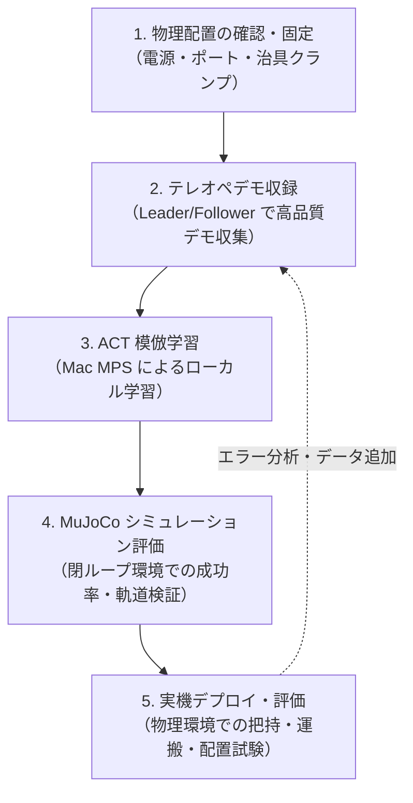

## 1. 簡単なはずのタスクが、実機では動かない

「スポンジをグリッパで掴み、隣の紙の上に置く」。

人間にとっては意識するまでもない極めて単純な作業です。シミュレーション環境（MuJoCo）上でも、教示データを集めて模倣学習（Imitation Learning）のモデルを訓練すれば、驚くほどスムーズに紙の上へスポンジを運ぶ軌道を再現できます。

しかし、訓練したモデルを現実の卓上ロボットアームに送り込んだ途端、事態は一変します。

アームはスポンジの手前で空振りを繰り返し、あるいは端をかすめて弾き飛ばし、運良く掴めたとしても紙の手前で手放してしまう――。なぜシミュレーションで綺麗に解けていたタスクが、現実世界ではこれほど呆気なく崩れてしまうのでしょうか。

最大の原因は、制御アルゴリズムの性能差以前に存在した「物理の壁」でした。USBポートの認識順、電源アダプタの電圧仕様、スポンジ・紙・アーム・カメラのわずかな位置ずれ。実機環境では、配置がわずか数センチ狂うだけで、モデルから見た視覚情報は「学習時に一度も見たことがない異常事態」に変貌します。

本記事でお伝えしたい核心はシンプルです。

> **スポンジを掴んで紙に置く、という簡単な作業であっても、実機ではポート・電源・スポンジ・紙・アーム・カメラの配置がわずかにずれるだけで失敗します。机の上の物理配置をあらかじめ規格化して固定し、テレオペでデモを集め、模倣学習でモデルを訓練し、シミュレーションで挙動を評価してから実機へ戻る。この愚直な改善ループを確立したことで、ようやく安定した動作へ辿り着きました。**

本稿では、オープンソースの卓上ロボットアーム「SO-101」と模倣学習フレームワーク「LeRobot」を用い、実機とシミュレータの往復で筆者が直面したリアルな物理トラブルと、それを乗り越えた設計・改善ループを共有します。

## 2. 取り組んでいたこと：SO-101 と ACT による卓上マニピュレーション

筆者は現在、東京大学松尾研究室の公開講座（Physical AI 応用編）の受講をひとつの契機として、実機ロボットを用いた模倣学習のパイプライン構築に取り組んでいます。

対象としたロボットは、低コストで再現可能な卓上オープンソースロボットアーム「SO-101（Feetech STS3215 サーボモータ駆動）」です。手先位置を人間が直感的に操作できる Leader アーム（教示側）と、同じ姿勢を追従して作業を行う Follower アーム（実行側）の 2 機を用意し、Hugging Face が開発を主導する模倣学習ライブラリ [LeRobot](https://github.com/huggingface/lerobot) を組み合わせています。

方策モデルには、現在ロボット操作の模倣学習で広く使われている **ACT（Action Chunking with Transformers）** を採用しました。トップカメラとアーム手首（リスト）カメラの 2 系統の画像入力、および各関節の現在角度（Qpos）を入力とし、一連の連続アクション（チャンク）を予測・出力します。

本プロジェクトの全コード、環境構築スクリプト、再現手順書は以下のリポジトリおよびドキュメントサイトに OSS としてまとめて公開しています。

- リポジトリ: [yohei1126/lerobot-so101-pick-and-place](https://github.com/yohei1126/lerobot-so101-pick-and-place)
- 日本語ドキュメント: [SO-101 ピック＆プレース ドキュメント (JA)](https://yohei1126.github.io/lerobot-so101-pick-and-place/ja/)

実際の動作の様子は、以下の YouTube 動画で公開しています。

@[youtube](hYQggz5CilA)
*動画リンク: [YouTube - SO-101 Pick and Place](https://youtu.be/hYQggz5CilA)*

## 3. 実機で直面した「物理の壁」

ロボット学習の論文やチュートリアルを読んでいると、損失関数（Loss）の収束やモデル構造の工夫に目が向きがちです。しかし、実機を机の上に置いて動かし始めた初日に筆者を打ちのめしたのは、機械学習とは全く無縁に見える「配線・電源・幾何配置」の泥臭いトラブルでした。

### 3.1 電源電圧とポート番号の落とし穴

SO-101 を Leader/Follower 構成で組む場合、2 台のアーム基板と 2 台のカメラ（トップカメラと手首カメラ）をホスト PC（筆者の環境では MacBook Pro M4）に接続します。ここで最初の落とし穴が現れました。

1. **電源アダプタの電圧取り違えリスク**  
   Follower アームのサーボモータ（STS3215）は 12V で駆動します。一方、Leader アーム側は 5V 仕様（7.4V サーボを 5V で駆動）です。この 2 つの DC アダプタを取り違えて Follower に 5V を差すと、トルク不足でアームが自重に負けて垂れ下がります。逆に Leader に 12V を印加すればサーボの破損に直結します。  
   さらに厄介なのは、「DC プラグを抜いていても、USB バスパワーだけで基板上の赤色 LED が点灯する」という点でした。一見すると給電されているように見えるため、モータが脱力している原因が電源抜けなのか通信不良なのかの切り分けに時間を要しました。
2. **macOS におけるシリアルポート名の変動**  
   Linux であれば `udev` ルールを記述してベンダー ID やシリアル番号から固定のシンボリックリンク（`/dev/ttyUSB_so101_follower` など）を生成できます。しかし macOS にはその仕組みがありません。USB ハブの抜き差しや Mac のスリープ復帰のたびに、`/dev/tty.usbmodem5B8E1163071` のような動的パスが変化することがありました。
3. **OpenCV のカメラ Index 逆転**  
   トップカメラ（Logicool C920）と手首カメラ（USB2.0 WebCam）を同時に起動した際、OS 側の認識順によって OpenCV のデバイス番号（`index 0` と `index 1`）が入れ替わる現象が発生しました。カメラが入れ替わると、モデルから見れば「天井カメラの視界に手首カメラの映像が流し込まれる」ことになり、当然ながら一切の操作が成立しなくなります。

### 3.2 空間配置のブレ：数センチのズレが命取りになる

配線と通信が疎通したあとに立ちはだかったのが、机の上の空間配置です。

人間なら、スポンジが右に 5 cm 寄っていようが、机の端に置かれていようが無意識に手を伸ばせます。しかし、少数の実機デモで学習した模倣学習モデルにとって、視野内における物体の位置や大きさのズレは致命的です。

- **アーム基部の揺れ:** Follower アームが机の上に置かれているだけだと、急制動時にアーム自身の慣性トルクで土台が数ミリずつ動いてしまいます。
- **カメラ画角の変動:** クリップ式のフレキシブルアーム（VIJIM LS08）で固定したトップカメラは、触れたりケーブルを引っ張ったりするだけで微妙に傾き、画角が変わってしまいます。
- **対象物（スポンジ・紙）の曖昧な配置:** 「だいたいこの辺」と目分量でスポンジや紙を置いてデモを収録すると、学習データ内の目標位置に大きな分散が生じ、ポリシーが迷走します。

### 3.3 物理配置の規格化（140 × 70 cm テーブル契約）

これらの問題を根絶するために導入したのが、**「物理配置の規格化」**でした。

机を幅 140 cm × 奥行 70 cm の専用作業台に固定し、各機材の固定位置をメジャーで測定して文書化（コントラクト化）しました。

- **アーム基部:** 頑丈な C クランプ（DELIXI 製）を用い、机の縁に完全に固定。
- **Leader / Follower の間隔:** 左端・右端からの距離をミリ単位で規定。
- **トップカメラ位置:** 机の右端・手前から 16 cm の位置に固定アームを固定し、紙・スポンジ・Follower アームの可動域全体が収まる画角を定義。
- **スポンジと紙の位置:** 紙（縦 30 cm × 横 20 cm）とスポンジ（11 cm × 6 cm）を机の手前・右端からの距離で厳密にマーキング。

このように「机の上の物理状態を環境仕様として固定する」ことで、ようやく「昨日取ったデータと今日のモデル検証」が同じ前提で比較できるようになりました。

```
+-------------------------------------------------------------+
|                  140 cm × 70 cm テーブル                     |
|                                                             |
|   [Leader 基部]               [Follower 基部]               |
|    (5V / Cクランプ固定)         (12V / Cクランプ固定)        |
|                                                             |
|                   [紙 (Goal)]     [スポンジ (Start)]         |
|                   (20×30 cm)       (6×11 cm)                |
|                                                             |
|                                            [Top Camera]     |
|                                            (C920 / 右端固定)|
+-------------------------------------------------------------+
```

## 4. 改善ループ：配置固定から実機検証へ

物理配置が規格化されたことで、ソフトウェアと機械学習の改善サイクルを健全に回せるようになりました。構築したパイプラインは以下の 5 ステップです。



### シミュレーション評価と実機成功の「非対称性」

この改善ループを回す中で強く実感したのが、**シミュレーション上の評価指標と実機における視覚的成功の非対称性**です。

MuJoCo シミュレータ上における評価では、物体の幾何学的な座標が数値として完全に把握できます。そのため、「スポンジの中心座標とゴールの目標座標とのユークリッド距離が閾値に入ったか」「オイラー角の傾きが許容範囲内か」といった幾何的条件で論理的に成功判定を下せます。

しかし実機における「成功」は、はるかに非対称で曖昧です。

- **接触力学の不確実性:** スポンジ特有の弾性と摩擦係数により、グリッパの挟み込みが甘いと持ち上げ時に滑り落ちます。逆に強く挟みすぎると変形して離す際に指先へ粘着します。
- **視覚情報のノイズ:** トップカメラや手首カメラの視界には、作業部屋の照明の反射、作業者の手の影、周囲の環境光の変化が直接入り込みます。
- **終端挙動のシビアさ:** ゴールゾーンである紙の上まで運べても、グリッパが開く瞬間にスポンジが転がり、紙の外へ飛び出してしまうケースがあります。

この非対称性があるからこそ、「いきなり実機で動かして一喜一憂する」のをやめました。

まずシミュレーション環境で閉ループ評価を回し、ACT モデルが過学習を起こさずに適切な軌道を出力できているか（アクションチャンク間のチャタリングがないか、不自然な特異点に引っ張られていないか）を確認します。シミュレータ上で安定した挙動が確認できたチェックポイントのみを実機に投入する運用を徹底することで、無駄な実機トラブルシューティングの時間を大幅に削減できました。

## 5. MacBook Pro (M4) / MPS によるローカル学習環境

本プロジェクトの学習計算基盤には、手元の **MacBook Pro（Apple M4 チップ）** を使用しました。

PyTorch の **MPS（Metal Performance Shaders）** バックエンドを利用することで、CUDA 環境のデスクトップマシンやクラウドインスタンスを立ち上げることなく、手元のノート PC 上で ACT の学習とシミュレーション評価を完結させています。

```bash
# ACT 学習の実行例（MPS デバイスの指定）
python -m port_pick_align.train \
  --dataset.root=$HOME/data/lerobot_dataset \
  --policy.type=act \
  --device=mps \
  --batch_size=8 \
  --training.steps=50000
```

数万ステップ程度の模倣学習であれば、M4 のユニファイドメモリと GPU コアによって、個人開発のイテレーションとして実用的な速度で学習ジョブが完了します。

もちろん、大規模な Vision-Language-Action（VLA）モデルをゼロからファインチューニングするような用途では大容量 VRAM を積んだクラウド GPU が必要になります。しかし、卓上ピック＆プレースのようなタスクで「物理配置を調整し、テレオペでデモを追加し、すぐに学習を回して確認する」という現場密着型の試行錯誤においては、ファンも静かで消費電力の少ないローカル Mac 上で閉じた開発環境を維持できるメリットは非常に大きいと感じています。

## 6. 限界と次の一手

物理配置の固定とシミュレーション・実機の改善ループによって、所定の配置における「スポンジを掴んで紙の上に置く」動作の再現性は格段に向上しました。

しかし、現在の構成にも明確な限界が存在します。

1. **ドメインランダム化への耐性**  
   現状のモデルは特定の固定配置と照明環境に強く依存しています。スポンジの初期位置を大きく変えたり、背景の紙の色が変わったりすると、把持成功率は低下します。
2. **接触フィードバックの欠落**  
   現在の SO-101 は位置制御（Qpos）のみに依存しており、グリッパに圧力センサや触覚フィードバックがありません。「スポンジが滑り落ちそうになったら強く握り直す」といった動的な適応は依然として困難です。
3. **長期的な信頼性**  
   サーボモータの温度上昇に伴うトルク低下や、3D プリント部品の経年劣化によるバックラッシュの増加など、ハードウェア側のドリフトに対する継続的な補正が必要です。

### 次のステップ：OSS とドキュメントで試す

本リポジトリでは、今回紹介した物理配置のコントラクト定義、LeRobot を用いたデータセット変換、ACT 学習スクリプト、実機 bring-up 手順書をすべて公開しています。

実機ロボットの学習や Physical AI に興味を持たれた方は、ぜひ以下のステップで実際に触れてみてください。

1. **まずは動作の全体像を動画で見る**  
   実機 SO-101 がどのようにスポンジを把持して紙へ配置しているか、一連の流れを [YouTube 動画（デモ映像）](https://youtu.be/hYQggz5CilA) でご確認いただけます。  
   *(※映像中の BGM には Content ID の安全性が確認された素材を使用しています)*
2. **リポジトリをクローンしてスモークテストを動かす**  
   実機アームが手元になくても、MuJoCo シミュレータによる環境疎通テストがすぐに実行できます。
   ```bash
   git clone https://github.com/yohei1126/lerobot-so101-pick-and-place.git
   cd lerobot-so101-pick-and-place
   python3.12 -m venv .venv
   source .venv/bin/activate
   pip install -e "port_pick_align/[simulation,training,dev]"

   # パイプライン疎通スモークテスト
   ./scripts/e2e_pipeline_smoke.sh
   ```
3. **ドキュメントサイトで bring-up 手順を確認する**  
   電源投入前の安全チェックリストや、モータにトルクを入れずに接続と通信を確認するドライラン（dry-run）手順は、日本語ドキュメントに網羅しています。  
   👉 [SO-101 実機 bring-up 手順書 (JA)](https://yohei1126.github.io/lerobot-so101-pick-and-place/ja/real_robot_bringup/)

物理デバイスを相手にする開発は、思い通りにいかない泥臭いトラブルの連続です。しかし、配置を固定し、観測を揃え、シミュレーションと実機を往復するループが繋がった瞬間に、自律して動くアームの姿は何物にも代えがたい達成感を与えてくれます。本稿が、同じように卓上ロボットや実機 AI の「物理の壁」に向き合うエンジニアの一助になれば幸いです。
