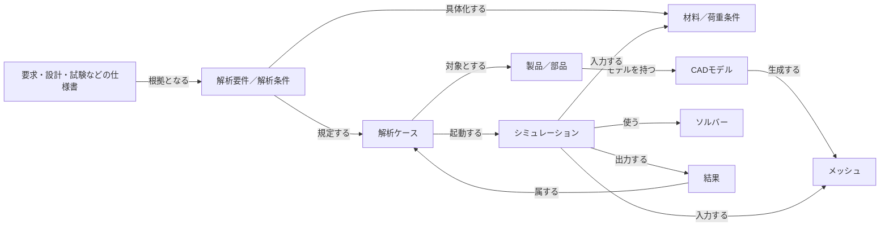

# 発表原稿: MLOps 勉強会 — なぜグラフか

**対応企画:** `[plan-mlops-meetup-meaning-layer-graph-talk.md](./plan-mlops-meetup-meaning-layer-graph-talk.md)`  
**スライド:** `slides/mlops-meaning-layer-2026/talk.md`（Marp。口頭は各枚末尾の HTML コメント＝Presenter ノート）  
**旧スライド（対比）:** `slides/mlops-meaning-layer-2026/_talk.md`  
**持ち時間:** 20 分  
**ペース:** **だいたい 1 枚 ≈ 1 分**（本編 ≈17 枚＋Title。おまけは本編後）  
**書き方:** 各枚に **スライド（画面）** と **口頭**（≈1分）。正本は本ファイル。スライドへ同期するときは画面＝本文、口頭＝ノート。

---

## 0. タイトル（立ち上げのみ・十数秒）

### スライド（画面）

# AIエージェントの知識表現と推論に、なぜグラフが使われるのか

記号的AIの復権とニューラルAIとの統合

**大西 洋平** · MLOps/LLMOps/AgentOps 勉強会

### 口頭（≈15秒）

> 大西です。今日は、エージェントに知識を渡すときなぜグラフが話題になるか、地図を共有します。実装の How は深く扱いません。詳細は Zenn、サンプルは GitHub にあります。

---

## 1. 本発表の概要

**枠:** ≈1 分  
**狙い:** 聴講者に「何を話すか／なぜ話すか／何を持ち帰るか」を最初に提示する。発表者個人の経緯ではなく、今日の問いと判断軸を優先する。

### スライド（画面）

## 本発表の概要

| | |
| --- | --- |
| **何を発表するのか？** | 知識グラフ／オントロジーが再び注目される背景と、AIエージェントで活用するための**判断軸**を整理する |
| **なぜ発表するのか？** | RAGや既存システムとの関係、古典的AIから続く技術の系譜を整理し、**期待と役割の混同を避ける**ためである |
| **何を持ち帰ってほしいか？** | 知識グラフは万能でも必須でもない。自社の課題に必要か、人間がどこまで設計すべきかを判断する**視点** |

### 口頭（≈1分）

> 今日は、知識グラフやオントロジーがなぜ再び注目されているのかを、RAGや既存システムとの関係、古典的AIからの系譜とともに整理します。実装の詳細ではなく、どのような課題で必要になるのか、どこを人間が設計すべきか、判断するための地図を共有します。知識グラフは万能でも必須でもありません。自社の課題に照らして使うかどうかを考える視点を持ち帰ってください。

---

## 2. Databricks / Snowflake が発表したもの

**枠:** ≈1 分  
**狙い:** 公開情報上「何が起きたか」だけ。**RDB→セマンティックビュー路線**をはっきりさせる。用語の定義は次枚。製品デモ・アルゴリズム詳細はしない。

### スライド（画面）

## 2026年、Databricks / Snowflake が発表したもの


|        | Snowflake        | Databricks                   |
| ------ | ---------------- | ---------------------------- |
| 意味レイヤー | **Cortex Sense** | **Genie Ontology**（OntoRank） |
| カタログ   | Horizon          | Unity Catalog                |
| エージェント | CoWork / CoCo など | Genie One など                 |

ざっくりいうと、**RDB／カタログの利用履歴から定義を裁定し、エージェントへ注入**する路線。  
≠ 人手で全社オントロジーを先に書く　≠ Text-to-SQL 丸投げ

### 口頭（≈1分）

> では、彼らが発表したことを、公開情報の範囲でだけ紹介します。単語の厳密な定義は次のスライドで揃えます。
>
> Snowflake はセマンティックレイヤーを扱う機能として Cortex Sense、Databricks 側は Genie Ontology です。入口はウェアハウスとカタログで、クエリや BI、メタデータからビジネス定義の断片を取り出し、利用統計でどれを信じるか裁定し、エージェントの文脈に注入する——ざっくり **RDB からセマンティックビューへ** の路線です。人手で全社オントロジーを先に書くのでも、Text-to-SQL 丸投げでもありません。経緯で言った「半自動でオントロジーが作れるなら知識グラフ構築が楽になる」は、この発表を見て立てた仮説です。詳細なアルゴリズムや製品操作は今日は扱いません。このあとしばらくは自分側——関係探索の地図を見ます。PF 側には後半で戻ります。

---

## 3. オントロジーと知識グラフとは何か

**枠:** ≈1 分  
**狙い:** このあと使う言葉を揃える。系譜の長い話はしない。グラフ一般との違いも一言。

### スライド（画面）

## オントロジーと知識グラフ


| 用語         | 何か                            |
| ---------- | ----------------------------- |
| **グラフ**    | ノードとエッジの **構造一般**（道路網も SNS も） |
| **知識グラフ**  | 業務の実体と、意味のある関係を載せた **実態**     |
| **オントロジー** | 許される概念・関係の **設計図・物差し**（型・制約）  |

例: 「部品 —使われる→ 製品」は許可。「サプライヤー —使われる→ 製品」は型としておかしい、と止められるのが物差し側。

### 口頭（≈1分）

> ここで言葉を揃えます。グラフというのは、点と線で関係を表す構造の一般名です。道路網もグラフです。知識グラフは、そのうち業務の実体と意味のある関係を載せたもので、実態・データの側です。オントロジーは、どんな概念があり、どんな関係が許されるか、という設計図や物差しです。RDB でいえば、オントロジーがスキーマ寄り、知識グラフがレコード寄り、とざっくり捉えてください。さっきの「関連オントロジーを LLM に渡すと組み立てやすい」は、物差しがあると取り出し方が揃いやすい、という意味でした。このあと「オントロジー自動構築」と言うときも、OWL 公理を全部機械が書く、とは限らず、エージェント向けの意味の型・定義を用意する話だ、と捉えて聞いてください。

---

## 4. 例: SPDM の簡易オントロジー

**枠:** ≈1 分  
**狙い:** 画面は図（オントロジーの型）だけ。自然文の読み上げは口頭。SoR置き場の列挙はしない。

### スライド（画面）

## 例: SPDM の簡易オントロジー（製造業）

**SPDM** = Simulation Process and Data Management



（スライドでは `spdm-ontology.mmd` → `spdm-ontology.svg` に書き出して埋め込み。Marp は Mermaid 非対応のため CDN script は使わない。読み下しは口頭／Presenter ノートのみ）

**主だった関係の読み下し（口頭用・画面には出さない）**

- 仕様書は解析要件／解析条件の**根拠となる**。解析条件は解析ケースを**規定する**。解析条件は材料／荷重条件へ**具体化する**
- 製品／部品は CAD モデルを**持つ**。解析ケースは製品／部品を**対象とする**。CAD モデルはメッシュを**生成する**
- 解析ケースはシミュレーションを**起動する**。シミュレーションはメッシュと材料／荷重条件を**入力し**、ソルバーを**使い**、結果を**出力する**。結果は解析ケースに**属する**

### 口頭（≈1分・4点）

> 一点目。製造業の SPDM——数値シミュレーションの手順と結果を扱う領域——の **オントロジー**を例にします。画面は図だけです。読み下すと、こうです。仕様書は解析要件／解析条件の根拠となる。解析条件は解析ケースを規定する。解析条件は材料／荷重条件へ具体化する。製品／部品は CAD モデルを持つ。解析ケースは製品／部品を対象とする。CAD モデルはメッシュを生成する。解析ケースはシミュレーションを起動する。シミュレーションはメッシュと材料／荷重条件を入力し、ソルバーを使い、結果を出力する。結果は解析ケースに属する。
>
> 二点目。今読み上げた文章と図の **型と関係**がオントロジー＝物差し。具体の部品Aの実行結果が知識グラフ＝実態です。
>
> 三点目。現場ではワークフローや CAE やストレージなど **SoR はバラ**にあります。だからこの型の知識グラフで関係を統合する、というのが動機です。
>
> 四点目。だからといって既存システムを消す話ではない——その前に、用語が揃ったので私の立場をはっきりさせます。

---

## 5. 発表者の立場

**枠:** ≈1 分  
**狙い:** オントロジ／KG の定義と SPDM 例のあとで、発表者の路線（何をしていて何をしていないか）を線引きする。

### スライド（画面）

## 発表者の立場

- LLM以前から、**グラフ探索が有効な問題**にグラフDBを使ってきた
- グラフDBの**品質管理に必要な道具**として、スキーマと制約（＝オントロジ）を定義し始めた
- SoRをつなぐ知識体系、という意味では Palantir に**近いかもしれない**（手法・ツールは使っていない）
- Snowflake / Databricks の「RDB利用履歴からの自動構築」とも**違う**
- **W3C標準（RDF・OWL）も使っていない**

### 口頭（≈1分）

> 用語と例で物差しのイメージができたので、私の立場を表明します。出発点は LLM 以前のグラフ探索です。品質管理の道具としてオントロジを使い始めました。SoR をつなぐ関心では Palantir に近いかもしれませんが、手法も製品も使っていません。さきほどの PF の利用履歴からの自動構築とも、RDF／OWL とも違います。今日は効く場所と隣の路線を分ける地図です。

---

## 6. グラフは既存システムを置き換えない

**枠:** ≈1 分  
**狙い:** SPDM の直後に釘を刺す。一時期の「KGがあれば SaaS／SoR を不要にできる」論を否定。グラフは関連付け・統合のために存在する。置き場の分担も一言。

### スライド（画面）

## グラフは既存システムを置き換えない

一時期囁かれた論:

> 知識グラフがあれば、SaaS や SoR を **置き換えられる／不要にできる**

**そんなことはありません。**


|            |                                      |
| ---------- | ------------------------------------ |
| **やらないこと** | 既存の SaaS／SoR／RDB／ストレージを消して、全部をグラフに移す |
| **やること**   | バラバラに存在するシステム・データを **関連付け・統合**する     |


SPDM だと、置き場は例えばこう（本体は各 SoR のまま）:


| 置き場（SoR／基盤）         | 何を置くか（例）                          |
| ------------------- | --------------------------------- |
| **ワークフロー管理**        | 解析ケースの進行、承認、タスク状態                 |
| **CAD／PDM**         | CAD モデル本体、版管理                     |
| **数値シミュレーション（CAE）** | ジョブ定義、ソルバー設定、実行ログ                 |
| **オブジェクトストレージ**     | メッシュ／結果ファイル（大容量バイナリ）              |
| **文書管理 or ベクトル**    | 要求・設計・試験などの **仕様書本文**（意味検索）       |
| **グラフ**             | 上記の **ID と関係**だけ（部品↔ケース↔実行↔結果↔仕様） |


→ グラフは置き換えではなく、**統合のための足場**

### 口頭（≈1分）

> ここで一文、はっきり言います。知識グラフがあれば SaaS や SoR を置き換えられる、不要にできる——そういう議論が一時期囁かれました。**そんなことはありません。** グラフは既存のシステムを置き換えません。むしろ、バラバラに存在したシステムやデータを関連付けて、統合するために存在します。
>
> さっきの SPDM で言うと、例えばこうです。ワークフロー管理には解析ケースの進行や承認を置く。CAD や PDM にはモデル本体と版を置く。CAE 側にはジョブやソルバー設定、実行ログを置く。メッシュや結果の大容量ファイルはオブジェクトストレージ。仕様書の本文は文書管理やベクトルで意味検索する。グラフが持つのは、それらの **ID と関係**——部品とケースと実行と結果と仕様をたどれるようにする部分だけです。ワークフローやストレージを消す話ではありません。次は、ほかの取り出し方との地図——いつグラフが候補になるか——を見ます。

---

## 7. RAG の地図 — いつグラフが候補になるか

**枠:** ≈1 分  
**狙い:** 地図を置く＋「どれが最新でどれが古い」言説を否定。知識グラフRAGも置き換えない。適材適所で総動員。KGはつなぐ・統合・関係探索。

### スライド（画面）

## RAG／知識取得の地図（得意／苦手）


| 手法                        | 得意              | 苦手になりやすい         |
| ------------------------- | --------------- | ---------------- |
| **ベクトル**                  | 似た文書・仕様書の意味検索   | 厳密な論理関係の多段追跡     |
| **RDB / SQL・セマンティック層**    | 集計・定型の正確な数値     | アドホックな多ホップ       |
| **Agentic Search**（リンク巡回） | ゆるい文書網の探索       | 大規模構造化・厳格な ID 連鎖 |
| **知識グラフ**                 | **関係の連鎖・経路の説明** | 構築・保守コスト（必須ではない） |


言説になりがち:

> 「ベクトルRAGは古い → いまは Agentic Search → いや知識グラフだ」

**知識グラフRAGも、何かを置き換えない。**  
→ **適材適所で総動員**し、適材を適所に置く  

知識グラフをRAGに使う場所（例）:

- システムやデータを **つなげて全体を統合**する  
- **関係を探索**する（多段のたどり・経路の説明）

詳細は Zenn（strategy2）

### 口頭（≈1分）

> 運営から依頼いただいた記事の芯でもあるので、地図だけ置きます。似た文書ならベクトル。正確な集計なら RDB やセマンティック層。リンクを辿る文書網ならエージェントの巡回検索。知識グラフが効きやすいのは、厳密な関係を多段で辿り、経路を説明したいときです。
>
> もう一点。「ベクトルRAGは古い、いまは Agentic Search だ、いや知識グラフだ」——みたいな言説もありますが、**知識グラフRAGも何かを置き換えません。** むしろ適材適所でこれらを総動員し、適材を適所に配置する。知識グラフをRAGに使うのは、システムやデータをつなげて全体を統合する、関係を探索するところです。前のスライドと同じで、置き換えではなく統合の道具です。必須でもなく（次で述べます）、ファイルや RDB、仮想グラフで足りるならそれでよい。詳しくは Zenn にあります。

---

## 8. グラフである必要はあるか — 必須ではない

**枠:** ≈1 分  
**狙い:** **常にグラフである必要はない。** 選択肢は増えている。規模・複雑さで選ぶ。設定ファイルから物理グラフDBまでスペクトラム。

### スライド（画面）

## 常にグラフである必要はない

**選択肢はどんどん増えている** — 規模や複雑さによる

```text
軽い ←————————————————————————→ 重い
設定ファイルに書く
   → RDB＋ポインタ（外部キー）＋SQL
      → RDB上の仮想グラフ（PostgreSQL／DWH など）
         → 物理グラフDBを構築
```


| やり方         | 向くとき（ざっくり）              |
| ----------- | ----------------------- |
| **設定ファイル**  | 関係が少なく、人が読んでメンテできる      |
| **RDB＋SQL** | 結合パスが既知・定型で足りる          |
| **仮想グラフ**   | グラフ的に見たいが専用DBなしで済ませたい   |
| **物理グラフDB** | 関係が大規模・複雑で、多段探索を高速に回したい |


製造業の SPDM のように組み合わせが爆発する領域では、物理グラフDBを選ぶことも多い  
——ただし **最初から必須、ではない**

### 口頭（≈1分）

> ここで大事なことを言います。**常にグラフである必要はありません。** しかも選択肢はどんどん増えています。判断は規模や複雑さによります。関係が少なく人が読めるなら、設定ファイルに書いておけばよい。RDB にポインタを持って SQL でもよい。グラフ的に見たいだけなら、PostgreSQL や DWH 上の **仮想グラフ**もある。そこまで行って、関係が大きく複雑で多段探索を速く回したいとき、**物理グラフDBを構築する**、という幅があります。設定ファイルに書いておくところから、物理グラフDBまで様々です。
>
> 製造業の SPDM のように組み合わせが爆発する領域では、結果として物理グラフDBを選ぶことも多い。でも最初から必須、ではない。グラフを選ぶなら、そこに載っている資産がある——次は、なぜ知識表現と推論にグラフを使うのか、を見ます。

---

## 9. なぜ知識表現と推論にグラフを使うのか — 古典からの蓄積を使える

**枠:** ≈1 分  
**狙い:** 「なぜ知識表現と推論にグラフか」。流行りではなく、(1) 古典からの知識表現・推論の蓄積 (2) **グラフアルゴリズムが使える**、の二点。

### スライド（画面）

## なぜ知識表現と推論にグラフを使うのか — 古典からの蓄積を使える

### 1. **知識表現・推論の蓄積** — 古典的 AI／セマンティック Web の資産に乗れる

- **古典哲学**:「存在・概念・関係」で世界を整理する発想（オントロジーの語源）
- **古典的 AI（1970s〜）**: **意味ネットワーク**／フレーム。概念をノード、関係をエッジで表現
- **2000年代**: **セマンティック Web**。**RDF**（三つ組）・**OWL**（より厳密な意味・制約）

### 2. **グラフアルゴリズムが便利** — 探索・重要度・クラスタを定石で使える

- 最短経路、中心性（PageRank 等）、コミュニティ検出
- SQL 手書きより格段に楽

### 口頭（≈1分）

> ここまでは、システムを作る際のグラフやオントロジの使いどころを中心に話しました。物理グラフDBは常に必要ではありません。それでも、なぜAIの知識表現と推論にグラフが選ばれるのでしょうか。大きな理由は、古典的な研究からの蓄積を利用できることです。利点は少なくとも二つあります。
>
> 一つ目は、**古典的 AI からの知識表現と推論の研究蓄積を使える**こと。概念と関係で世界を書く発想は古典哲学にもあり、古典的 AI では意味ネットワークやフレーム、2000年代にはセマンティック Web の RDF や OWL として標準化が進みました。数学的・論理的に知識を扱う理論が、すでに載っている、ということです。
>
> 二つ目は、**グラフアルゴリズムが便利**なこと。最短経路、中心性、コミュニティ検出など、関係の上で回りたい定石がそのまま使えます。同じことを SQL の再帰や手書きでやるより、簡単ですし、便利です。
>
> つまりグラフは、知識表現・推論と解析の両方で既存資産に乗りやすい形です。ただし、この系譜は一度挫折しています。次は、セマンティック Web の挫折を見ます。

---

## 10. なぜ過去10年ほど聞かなかったか — セマンティック Web の挫折

**枠:** ≈1 分  
**狙い:** いま話題なのに長く静かだった理由＝2000年代セマンティック Web（オントロジー最大のアプリ）が普及せず失望。二壁（知識獲得／計算）で廃れた、と短く。

### スライド（画面）

## 過去10年、なぜオントロジが話題にならなかったか

- 2000年代、オントロジー最大のアプリ＝**セマンティック Web** が普及せず、 **オントロジーへの失望**が生まれたから
- セマンティック Webの目標 - 世の中の知識を **数学的・論理的に厳密に書きさえすれば、機械が推論する**


| 壁        | 内容                                  |
| -------- | ----------------------------------- |
| **知識獲得** | 全ての知識を人力で厳密に書き続けるには、労力が足りない         |
| **計算**   | 厳密推論は重い。当時のコンピュータでは実務規模で回せないことが多かった |

（口頭で補強可: 知識獲得ボトルネック／表舞台から消えた）

### 口頭（≈1分）

> 現代で、知識グラフやオントロジーが再び話題になっています。しかし、過去10年ほど、ほとんど聞かなかったのはなぜか。それは、2000年代にオントロジーの最大のアプリであるセマンティック Web という技術が全く普及せず、オントロジーに対する失望が生まれたからです。
>
> セマンティック Web を簡単に説明すると、世の中の知識を数学的・論理的に厳密に書きさえすれば、機械が推論できる、というものでした。理論的には素晴らしい。でも、全ての知識を人力で厳密に書き続けるには労力が足りない——知識獲得の壁がありました。もう一つは、厳密推論は計算が重く、当時のコンピュータでは実務規模で回せないことが多かった、という計算資源・計算量の壁です。よって廃れました。次は、そのあとでもグラフが消えていない話——Google の知識グラフに進みます。

---

## 11. Google 知識グラフの成功（2010年代）

**枠:** ≈1 分  
**狙い:** 前の挫折のあとに「終わっていない」を示す。成功の芯は **統計・機械処理・アルゴリズム・巨大分散**。人力依存はスケールしない、という対比。挫折の再説明はしない（9で済）。

### スライド（画面）

## Google 知識グラフは成功した（2010年代〜）

（通常スライド内: 左に小さめ画像 `google-kg.png` ／ 右に本文）

- 概念のグラフ構造を構築する。検索キーワードに関連する概念を**芋づる式**に引っ張り、より深い文脈の検索結果を出せる
- 人力で全集を書くのではなく、**統計・機械処理・分散**でスケールした
- 厳密定義の書き続けではなく、**機械側が主力**（キュレーションは最小）

### 口頭（≈1分）

> じゃあグラフによる知識は終わったのかというと、そうではありません。2010年代、Google の知識グラフは成功しました。知識グラフとは何か。概念のグラフ構造を作り、検索キーワードに関連する概念を芋づる式に引っ張り、より深い文脈の検索結果を出せるようにするものです。左の図がそのイメージです。
>
> なぜ成功したか。ポイントは、統計処理、機械処理、アルゴリズム、そして巨大な分散システムというアプローチが強かった、ということです。Web 規模のシグナルから半自動で実体と関係を集め、権威付けや結線を機械で回す。人手のキュレーションがゼロだったわけではありませんが、**人力に長く頼る部分はスケールしない**——そこを主戦場にしなかったのが、前のセマンティック Web 寄りと違うところです。次は、なぜ今また着目されているか、を見ます。

---

## 12. なぜ今また着目されるか — 記号 × ニューラル

**枠:** ≈1 分  
**狙い:** 挫折したオントロジー／Google以外に大成功が少なく聞こえたKGが、なぜ再び着目されるか。記号的AIの弱点をニューラルAI（LLM）が補う＋双方向の補完（獲得とグラウンディング）。残る壁は次へ。

### スライド（画面）

## なぜ今また着目されているか

- 古典的 AI 時代の **記号的 AI** の弱点を、 **ニューラル AI（LLM）** が補えるようになった
- LLMで知識の獲得・構築がスムーズになる
- 構築した知識構造で推論の妥当性を検証（**グラウンディング**）


|         | **記号的 AI**              | **ニューラル AI（LLM）** |
| ------- | ----------------------- | ----------------- |
| **たとえ** | コンクリート（硬い）              | スポンジ／粘土（柔らかい）     |
| **強み**  | 厳密・正確・再現しやすい            | 柔軟・それっぽく使える       |
| **弱み**  | 融通が効かない／管理コストが高い        | 厳密性に欠ける／間違う       |
| **例**   | ルール、RDF/OWL、KG上の決定論的クエリ | **LLM**           |

（口頭で補強: 補完関係／必須ではない／壁は次）

### 口頭（≈1分）

> 一度は挫折したオントロジー。Google 以外では、大々的な成功例をそれほど聞かなかった知識グラフ。なぜ今また着目されているか。自分の見立てでは、古典的 AI の時代の記号的 AI の弱点を、ニューラル AI——つまり LLM——が補えるようになったからです。
>
> 昔の記号的 AI は、硬く、厳密で正確、再現しやすい。一方で融通が効かず、管理コストが高い。LLM を代表とするニューラル AI は、柔らかい、柔軟、それっぽく使える。ただ厳密性に欠け、間違う。両者は正反対の性質なので、補完関係にあり、組み合わせるとうまくいきそうです。LLM を使えば知識の獲得・構築がスムーズになる。構築した知識構造は、LLM の推論の妥当性検証——グラウンディング——に使える。ただし前半どおり必須ではなく、獲得の壁が消えたわけでもない——次です。

---

## 13. 獲得・構築・保守に、またボトルネック

**枠:** ≈1 分  
**狙い:** 獲得側にボトルネックがある。LLMは楽になるが誤りうる→人手の下書き・レビューで労力。エキスパート厳密書きはスケールしない＝セマンティック Web と同じ型。

### スライド（画面）

## 形を変えて残る、知識獲得ボトルネック

- **LLM を使う** と楽になる。しかし、LLMは **間違えるかもしれない**
- 人手の下書き・レビューを入れると、**労力がかかる**
- **エキスパートが厳密にオントロジを書く** と正しさは上がるが、**スケールしない**
- どちらも重く、**セマンティック Web と同じ問題**に陥る

### 口頭（≈1分）

> さっき、LLM で知識の獲得・構築はスムーズになる、と言いました。それでも **ボトルネックはあります**。LLM を使うと楽にはなります。しかし間違っているかもしれないので、人手での下書きやレビューが必要になり、労力がかかります。一方で、エキスパートが厳密に書こうとするとスケールしない。結局、セマンティック Web と同じ問題に陥ります。
>
> そこで現代のプラットフォームが取り出したのが、次のやり方です。

---

## 14. PF 再訪 — Google と同じ構成が、いまも続く

**枠:** ≈1 分  
**狙い:** Snowflake/Databricks＝PFに溜まった統計・履歴からオントロジーを自動構築し、AIが推論できるようにする。Googleと同型。現代でもこの構成が続いている。

### スライド（画面）

## Snowflake / Databricks も、Google と同じアプローチ


|         | Google（2010年代） | Snowflake / Databricks（2026）|
| ------- | -------------- | ------------------------------- |
| **材料**  | Web のリンク・利用など  | カタログ上のクエリ・BI・メタデータ |
| **やり方** | 統計・機械処理・分散で半自動 | 利用統計で定義を裁定し注入 |
| **狙い**  | 人が全集を書かずにスケール  | 獲得ボトルネックを迂回し、**AI が推論できる状態**を作る |

（口頭で補強: 約25年で一周／主に定義側／関係グラフ全集までは解いていない）

### 口頭（≈1分）

> 最初に紹介した Snowflake の Cortex Sense、Databricks の Genie Ontology に戻ります。彼らは、Google と同じように、プラットフォームに溜まった統計情報や履歴からオントロジーを自動構築し、AI が推論できるようにしています。Web リンクがカタログの利用ログに変わっただけで、**統計・機械処理でスケールさせる構成は、現代でも続いています**。
>
> LLM 下書きに人手を載せ続ける道とも、OWL を人が全部書く道とも違う。獲得の壁を、PF の利用シグナルで迂回する道です。ざっくり約25年で一周、と見てください。ただし効くのは主に定義の側です。関係探索の知識グラフを、人が全集で書き続ける問題まで一気に解いたわけではありません。次に、だからといって全部自動でもない、という現実を置きます。

---

## 15. まだ始まったばかり — 人間のモデリングは続く

**枠:** ≈1 分  
**狙い:** PF自動はベンダー／プラットフォーム依存で全員の恩恵ではない。人間モデリングは残る。自動化領域でも全自動ではない可能性／機械へのヒント出しも残る。Google類推は短く。

### スライド（画面）

## されど人間がオントロジーをモデリングする時代は続く

- Googleが **アルゴリズムで知識グラフを自動構築** したが、それでも人間のキュレーションは残った
- 2026年、特定ベンダーが **PF依存**でオントロジー自動構築を出し、世間に広がりつつあるが、**全員が恩恵を受けるわけではない**（他製品は未対応）

いま残る／残りそうな人間の仕事:

1. **モデリングする領域**は残る（型・線引き・競争領域の正しさ）
2. 自動化されている領域でも、**すべてが自動になるとは限らない**
3. 人間が機械に **ヒントを与えて自動化をスムーズにする**仕事も残るかもしれない

### 口頭（≈1分）

> PF によるオントロジー構築は、まだ始まったばかりです。Google では機械側がアルゴリズムを使い、知識グラフを自動構築しました。いまと同じで、機械が進んでも人間側は残りました。
>
> いまは、特定のベンダーがプラットフォーム依存の技術としてオントロジーを自動構築する機能を出し、世間に普及しつつあります。それ以外の製品は対応していないので、**全ての人が恩恵を受けるわけではありません。** 人間がモデリングする領域は残ります。また、自動化されている領域でも、すべてが自動化されるわけではないかもしれません。人間が機械にヒントをあげて、自動化をスムーズにする仕事も残るかもしれません。では、現代のデータエンジニアリングの道具としてのオントロジー——自分のやり方——を一言置きます。

---

## 16. 現代のデータエンジニアリングの道具としてのオントロジー

**枠:** ≈1 分  
**狙い:** 中身は3点に絞る。YAMLでスキーマ・制約 → Pydantic自動生成で入力検証 → 投入後Cypher非同期検証。

### スライド（画面）

## 現代のデータエンジニアリングの道具としてのオントロジー

オントロジー＝グラフの **スキーマと制約がこうあるべき** という定義（YAML）

```text
YAML（スキーマ・制約）
   ↓ 自動生成
Pydantic モデル ──▶ 入力データをバリデーション
   ↓
グラフDB へ投入
   ↓ 非同期
Cypher ──▶ グラフが壊れていないことを検証
```

→ オントロジは哲学論ではなく、データ基盤の維持管理を楽にする **DE の道具** （詳細・コードは GitHub／Zenn）

### 口頭（≈1分・3点）

> タイトルどおり、**現代のデータエンジニアリングの道具としてのオントロジー**です。実際やっていることは三点です。
>
> 一点目。オントロジーは、グラフのスキーマと制約事項がこうなるべきだ、を **YAML で定義**できるようにしています。二点目。そこから **Pydantic モデルを自動生成**し、入力データをバリデーションしています。三点目。データをグラフDBに投入したあと、グラフが壊れていないことを確認するため、**Cypher で非同期に検証**しています。コードは GitHub にあります。ではまとめです。

---

## 17. まとめ — 持ち帰り

**枠:** ≈1 分  

### スライド（画面）

## 持ち帰り（3点）

1. **KG＋オントロジーがあると推論しやすい** — だが獲得・構築・保守にボトルネック（LLM支援でも残る）
2. **PFは Google と同じ構成（まだ始まったばかり）** — ベンダーPF依存の自動も進むが、人間のモデリング／ヒント出しは続く
3. **置き換えない／DEの道具** — グラフは既存や他RAGを消さない。オントロジーは YAML→Pydantic→Cypher でスキーマ・制約・検証に使う

### 口頭（≈1分）

> まとめます。一点目、知識グラフとオントロジーができると推論はしやすい。しかし獲得・構築・保守にボトルネックがあり、LLMがあっても消えていません。二点目、Snowflake や Databricks は Google と同じように、PF の統計や履歴からオントロジーを自動構築し始めています。ただまだ始まったばかりで、全員の恩恵ではなく、**人間がモデリングする時代は続きます**。三点目、グラフは既存システムやほかのRAG手法を置き換えません。オントロジーは YAML でスキーマと制約を書き、Pydantic と Cypher で検証する——データ維持を楽にする道具として使う、という話です。

---

## 18. CTA — Zenn と GitHub

**枠:** ≈30〜45 秒  

### スライド（画面）

## 詳細は連載とサンプルへ

| -------------------------- | -------------------------------------------------------------------------------------------------------------------------------------------------------------- |
| **1** 仮想グラフ                | [https://zenn.dev/yohei/articles/2026-05-30-vkg-strategy-what](https://zenn.dev/yohei/articles/2026-05-30-vkg-strategy-what)                                   |
| **2** 論理フェデレーション           | [https://zenn.dev/yohei/articles/2026-06-06-supply-chain-impact-analysis-agent](https://zenn.dev/yohei/articles/2026-06-06-supply-chain-impact-analysis-agent) |
| **3** 定義の信頼（Genie / Sense） | [https://zenn.dev/yohei/articles/2026-06-17-databricks-genie-ontology-ontorank](https://zenn.dev/yohei/articles/2026-06-17-databricks-genie-ontology-ontorank) |
| **4** 現代のKGとオントロジー         | [https://zenn.dev/yohei/articles/2026-06-28-kg-ontology-redefinition](https://zenn.dev/yohei/articles/2026-06-28-kg-ontology-redefinition)                     |
| **GitHub（サンプル）** | [https://github.com/yohei1126/supply-chain-impact-analysis-agent](https://github.com/yohei1126/supply-chain-impact-analysis-agent) |

（締めの「ご清聴」は続く「おわり」スライドへ）

### 口頭（≈30〜45秒）

> 続きは Zenn の連載にあります。シーズン1は仮想グラフ、シーズン2は論理フェデレーション、シーズン3は定義をどう信頼するか、シーズン4は現代の知識グラフとオントロジー——それぞれ第1部へのリンクを載せています。YAML や Pydantic、Neo4j まわりのサンプルは GitHub の supply-chain-impact-analysis-agent にあります。ご清聴ありがとうございました。

---

## おまけ（本編後・時間があれば）

本編は **18（CTA）＋おわり** まで。以下は標準20分では話さない／質疑・延長用。

（画面の橋渡し: 「おわり（時間があれば／質疑）」）

## おまけ A. Palantir — 複数 SoR の統合とオントロジー（本編の SPDM との接続）

**枠:** 本編外・質疑や時間が余ったとき（≈1 分）  
**狙い:** 本編から外した先例。複数の System of Record をオントロジーでつなぐ、という点で本編 4 の SPDM と同型。デモや製品論はしない。

### スライド（画面）

## おまけ: Palantir のオントロジー（先例）

**やっていること（ざっくり）**  
陸・海・空・宇宙など **異系統のデータを統合**し、作戦立案に使う——**統合の物差し**としてのオントロジー


|        | **Palantir（先例）**              | **本編の SPDM 例**        |
| ------ | ----------------------------- | --------------------- |
| **動機** | 複数 SoR／ドメインのデータを一つの意味でつなぐ     | 部品・条件・実行・結果・仕様を関係でつなぐ |
| **共通** | オントロジー＝バラバラな系統をまたぐ **統合の物差し** | 同左（製造シミュレーション側の小さな型）  |


→ エンタープライズでオントロジーが話題になるときによく出る先例  
→ 本編では話題を絞るため外した。つながりはこの一点だけ押さえる

### 口頭（≈1分）

> 本編では省略した先例です。エンタープライズでオントロジーが再び話題になるとき、よく引き合いに出るのが Palantir です。さきほど立場で述べたとおり、複数の System of Record やドメインのデータをオントロジーでつなぐ、という意味では私の関心と近いです。ただし手法も製品も違います。陸・海・空・宇宙といった、もともと別系統のデータを、オントロジーで統合して作戦を立案する、という意味で **統合の物差し** として使われてきました。本編の SPDM の例も、複数系統に分かれがちなデータを関係の型でつなぐ、という点では同型です。製品の細部は今日は扱いません。

---

## おまけ B. 推論の理論の例（古典〜セマンティック Web）

**枠:** 本編外・質疑や時間が余ったとき（≈1〜2 分）  
**狙い:** 「推論」の代表例。本編の 9（なぜ知識表現と推論にグラフか）の補足。数理の証明や OWL DL の計算量には深入りしない。（旧おまけ A）

### スライド（画面）

## 推論の理論の例（ごく簡易）


| 例                 | 何をするか                    | イメージ                       |
| ----------------- | ------------------------ | -------------------------- |
| **属性の継承**         | is-a の連鎖から性質を導く          | 部品A is-a 金属部品 → 密度の扱いを引き継ぐ |
| **前向き／後ろ向き推論**    | If-Then 規則を適用／目標から前提をたどる | 「温度超過なら要再設計」を事実に適用         |
| **記述論理（OWL の基盤）** | 概念の包含・矛盾を形式的に判定          | 「この型定義は矛盾していないか」           |
| **三つ組（RDF）**      | 主語・述語・目的語で事実を書く          | 〈シミュレーション003, 出力する, 結果X〉         |


ポイント: グラフ（ネットワーク）表現は、こうした **記号的な推論手続きと相性がよい**  
（ただし厳密推論のスケール限界は、本編で触れたセマンティック Web 挫折の種でもある）

### 口頭（≈1〜2分）

> 本編の「なぜ知識表現と推論にグラフを使うのか」の補足です。推論の例を四つだけ挙げます。一つ目は属性の継承。is-a の連鎖をたどって性質を引き継ぎます。二つ目はルールベースの前向き・後ろ向き推論。条件が揃えば結論を出したり、目標から必要な前提を逆にたどったりします。三つ目は OWL の基盤にある記述論理で、概念の包含や矛盾を形式的に見ます。四つ目は RDF の三つ組で、事実を主語・述語・目的語として書き、機械が扱えるようにします。
>
> いずれも、「関係でつながった記号」の上で手続きが定義されてきた、という意味でグラフと相性がよいです。厳密に書き続ける・大規模に回すコストが挫折につながった、という本編の話ともつながります。

---

## おまけ C. 2つの文脈を混同しない

**枠:** 本編外・質疑や時間が余ったとき（≈1 分）  
**狙い:** 本編から外したラベル付け。経緯の入口（関係探索／グラフDB）と PF（定義）を①／②で分ける。

### スライド（画面）

## ここまでの話は、実は 2 文脈

同じ「オントロジー／グラフ」でも、**動機が違う** — 混ぜない  
（経緯の起点と、PF 発表の路線のラベル付け）


|               | **① 定義・セマンティックビュー**         | **② 関係探索**                    |
| ------------- | --------------------------- | ----------------------------- |
| **問い**        | 「売上」はどれか。どの定義を信じるか          | 部品→条件→実行→結果をどう辿るか             |
| **入口の例**      | PF（経緯4・2・13）＝ RDB → セマンティック | 自分（経緯1）＝グラフ探索領域 → グラフDB／KG    |
| **今日すでに出した例** | Sense / Genie の自動構築         | 4 の SPDM、6 の RAG 地図で「関係が要るとき」 |
| **手段**        | 利用統計で定義を裁定しエージェントへ          | 知識グラフ＋物差し（必要なら。必須ではない）        |


→ 経緯どおり、**自分の起点は主に ②、PF 発表は主に ①**  
→ 本編13は ①、本編4〜7は ②（5は「置き換えない」の釘）。経緯5の「オントロジー半自動→KGが楽」は、①が進むと②の構築も楽になる、という交差の仮説  
言葉が同じなので、頭の中でラベルを分けておく

### 口頭（≈1分）

> ここで一度だけ、地図にラベルを貼ります。新しい話ではありません。経緯の入口と、PF の路線に名前を付けるだけです。
>
> 一つ目は、定義やセマンティックビューの揺れをどう信じるか——Sense や Genie、RDB から定義を揃える側はこっちです。二つ目は、バラバラのデータを関係で辿るか——数年前からグラフDBを置いてきた側で、SPDM や RAG 地図の「グラフが候補」もこっちです。PF と同じ構成が続く、と言ったのは主に一つ目。自分の話が長かったのは二つ目側からです。最初に言った「オントロジーが半自動なら知識グラフ構築が楽になる」は、①が進むと②の構築も楽になる、という交差の仮説でした。言葉は似ているので、混ぜないでください。本編では時間の都合で省略し、まとめでは置き換えない／必須ではない、に寄せています。

---

## 付記: 枚数と余裕


| 範囲        | 枚                                       |
| --------- | --------------------------------------- |
| 0 タイトル    | 1                                       |
| 1〜17 本編   | 17                                      |
| **本編合計**  | **18**                                  |
| おまけ       | A: Palantir／ B: 推論の理論例／ C: 2文脈（いずれも本編外） |
| 最大20までの余裕 | おまけを入れるとほぼ上限                            |


