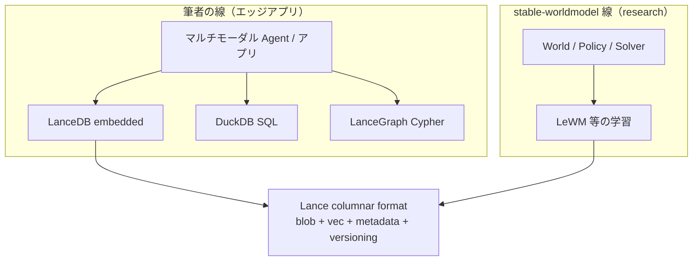
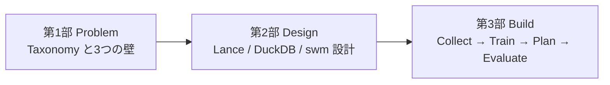

# World Model × Lance 企画メモ（独立シリーズ）

**Graph RAG / オントロジー / 知識グラフ / Graph Contract / Season 0–3 とは完全に別アーク。**  
クロスリンク・用語の受け渡し・伏線は **書かない**。

| 既存連載 | 本シリーズ |
| :--- | :--- |
| 知識の結合・フェデレーション・本番信頼 | **世界モデル research とマルチモーダル data infra** |
| Neo4j, Bridge Keys, Evidence on Graph Contract | Lance, LanceDB, DuckDB, stable-worldmodel |

**関連素材（ローカル）**

| パス | 内容 |
| :--- | :--- |
| `raw/lancedb/2605.21800.md` | stable-worldmodel 論文（arXiv:2605.21800） |
| `raw/lancedb/stable-worldmodel-*.md` | LanceDB ブログ要約 |
| `raw/lancedb/make-your-sql-workflows-multimodal-with-lancedb-x-duckdb.md` | DuckDB × Lance 実践 |
| `raw/lancedb/newsletter-may-2026.md` | 2026-05 ニュースレター（swm / DuckDB / コスト） |
| `instructions/LANCE.md` | 製造 ML 向け Lance ユースケース草案（任意参照） |

**外部**

| URL | 内容 |
| :--- | :--- |
| [galilai-group/stable-worldmodel](https://github.com/galilai-group/stable-worldmodel) | 論文 OSS |
| [lance-format/lance-graph](https://github.com/lance-format/lance-graph) | Cypher on Lance（第2部で任意） |
| [World Labs — Taxonomy of World Models](https://www.worldlabs.ai/blog/taxonomy-of-world-models) | Fei-Fei Li 陣営の機能分類（2026-06） |

---

## 1. 目的と執筆動機

### 1.1 目的

LanceDB / LanceGraph / DuckDB を掘り下げる過程で、**Big Tech のデータヘビー路線**（sim / RL / 動画）と **LeCun 系 JEPA の Planner research**（LanceDB 共著の stable-worldmodel）の関係を整理した。その結果を **実装者視点の3部作** として記録する。

**Season 0–3 のゴール（概念 OS / Graph Contract / 本番信頼）とは独立。** 読者はマルチモーダル ML・ロボティクス・data infra 寄りを想定。

### 1.2 執筆動機（筆者メモ）

#### 当初の理解

| 路線 | イメージ |
| :--- | :--- |
| **Google 等 Big Tech** | 動画など **データヘビー**。デジタルツインで sim → 強化学習。AI ロボット向けの **Simulator + Planner** スタック |
| **LeCun / JEPA** | ピクセル再生成しない **軽量な潜在 dynamics**。計画（MPC）向き。**エッジ AI で使える** イメージ |
| **並行していた作業** | 世界モデルとは **別問題** として、真マルチモーダル **エッジアプリ** に LanceDB / LanceGraph / DuckDB で取り組んでいた |

#### 論文を見て起きた疑問

Yann LeCun と **LanceDB チーム**（Ayush Chaurasia）の共著 [arXiv:2605.21800](https://arxiv.org/abs/2605.21800) が出た。**何が起きているのか** — エッジ向け data plane と world model research が同じ会社・同じフォーマットに収斂したのか。

#### 判明したこと（本シリーズの thesis）

| 誤解しやすい解釈 | 実際 |
| :--- | :--- |
| LeCun が LanceDB 製品に乗った | LeCun は JEPA / 世界モデル理論側。**LanceDB チームは storage / I/O 層の共著** |
| エッジ向け Lance が world model 専用になった | **同じ Lance フォーマット** が、エッジアプリの data plane と research の trajectory store **両方** に効いている |
| 世界モデル = エッジアプリ開発の延長 | **接続点はフォーマット層**。上のアプリ層（Agent / SQL / Cypher）は **別** |

**驚きの正体:** エッジ用に選んだ **マルチモーダル・レイクハウス** が、LeCun 系 world model research でも **同じ I/O 問題の答え** になっていた — という **フォーマット層の収斂**。



#### JEPA の「軽量」の意味（整理）

| 軽い | 重い（まだ） |
| :--- | :--- |
| **潜在空間で dynamics**（ピクセル再生成しない） | 学習は GPU（論文: H200） |
| **計画時 latency**（DINO-WM 比 ~50×、192-dim latent） | 大量 trajectory の **I/O**（MP4 / HDF5 が詰む） |
| **MPC で test-time planning** | sim 上の FoV 評価基盤 |

→ **「端末1台で学習から計画まで完結するエッジ AI 製品」** ではなく、**表現と planning はコンパクトだが research パイプラインは data + GPU を食う**。エッジ向け LanceDB（組み込み・ローカル検索）は **別プロダクト線**。

#### 本シリーズが答える問い

> **同じ Lance 上で、アプリ data plane（LanceDB / DuckDB / LanceGraph）と Planner research（swm）が何を共有し、何を共有しないか**

- **共有する:** フォーマット（random access blob + vec + metadata）、versioning、S3 / HF 直読み、drift 回避（bytes と embedding の同居）
- **共有しない:** World / Policy / Solver ループ、Gym + FoV 評価、LeWM 学習パイプライン → **第3部 Build の主題**
- **第3部でやらない:** エッジアプリへの swm 直接移植（Future Reading）。推論 latency は軽いが **学習パイプラインは別物**

#### 第1部への反映

第1部冒頭（または §4.1 直前）に **「なぜこの記事を書くか」** として上記を短く要約する。Google = 動画だけではなく sim/RL、LeCun = Planner research + Lance I/O、筆者 = エッジ data plane — 三つが **Lance 層で交差** した、という導入。

---

## 2. 「世界モデル」混乱の地図（第1部の核）

同じ語 **world model** で、出力するものが違う。Fei-Fei Li（World Labs, 2026-06）の [Functional Taxonomy](https://www.worldlabs.ai/blog/taxonomy-of-world-models) は、この混乱を **機能** で切るうえで本シリーズの第1部の骨格に使う。

### 2.1 POMDP ループ（共通の骨格）

World Labs が RL 由来で整理するループ:

```text
agent → action → state → observation → agent …
```

「世界モデル」と呼ばれるものは、このループの **異なる射影**（どの変数を出力するか）として理解できる。

### 2.2 三機能 + 本シリーズでの位置づけ

| 機能 | 出力 | 品質の契約 | 代表例 | 本シリーズ |
| :--- | :--- | :--- | :--- | :--- |
| **Renderer** | 観測（pixels） | 見た目の忠実度 | Veo、Genie 3、動画 WM | 第1部で **対比** のみ |
| **Simulator** | 状態（geometry / physics） | 構造が inspect 可能 | Marble（3DGS + collision）、Omniverse 系 | 第1部で **用語整理**；第3部の Gym 環境は **小型 simulator** |
| **Planner** | 行動（actions） | 目標に対する制御 | LeWM + MPC、VLA、TD-MPC2 | **第2–3部の主役**（stable-worldmodel） |

World Labs の主張（要約）:

- 三つは **同じ空間理解の異なる投影** で、いずれかだけでは不十分。
- **Simulator が renderer と planner を繋ぐ要**（3D 幾何・物理アノテーションは web 動画より桁違いに希少）。
- 長期像は **render / simulate / plan を切り替えられる unified foundation model**。

### 2.3 Fei-Fei Li の Spatial AI をどう位置づけるか

**Spatial Intelligence** = LLM の「言語だけ」では足りない、**3D 空間・物理・時間** を扱う能力（[From Words to Worlds](https://drfeifei.substack.com/p/from-words-to-worlds-spatial-intelligence), 2025）。

| 観点 | Fei-Fei Li / World Labs | Google 動画生成路線 | LeCun / stable-worldmodel |
| :--- | :--- | :--- | :--- |
| **問題意識** | 言語は reality の lossy compression | インタラクティブ・映像体験 | 潜在 dynamics + 制御・汎化評価 |
| **主な成果物** | Marble（永続 3D 世界）、World API | Veo、Genie（フレーム列） | LeWM、JEPA 系 + **research 基盤** |
| **Taxonomy 上の居場所** | Simulator（＋ renderer 出力）を **製品の芯** | ほぼ **Renderer** | **Planner** + 評価用 **simulator（Gym）** |
| **本番の勝負所** | クリエイティブ・シミュレーション基盤 | デモの見栄え | 再現性・OOD 評価・I/O スループット |
| **Lance スタックとの接点** | 学習データ（動画・深度・3D）の **curation / バージョン管理** | 同上（生成側は別） | 論文が **Lance を default data layer** と明言 |

**本シリーズでの書き方:**

- Fei-Fei Li を「Google と同じ生成派」とは **混同しない**。Spatial AI は **3D・物理・インタラクション** が主題で、Taxonomy では planner も明示的に位置づける。
- ただし **本シリーズの Build は stable-worldmodel（Planner research stack）** に寄せる。Marble / World API の製品レビューには **しない**。
- 第1部末尾で 1 節:「Taxonomy を知ったうえで、なぜ swm + Lance 側を深掘りするか」— **research の再現性と I/O が先に詰まっている** から（論文 §3.1）。

### 2.4 Big Tech 路線（Renderer + Simulator + Planner）

Genie / Veo だけ見ると **Renderer**（動画・フレーム生成）に見えるが、Google / DeepMind 全体は **データヘビー + sim + RL** のスタックでもある。

| 層 | 例 | Taxonomy |
| :--- | :--- | :--- |
| データ | Web 動画、ロボットログ、sim rollout | — |
| 観測生成 | Veo、Genie | **Renderer** |
| シミュレーション | 物理 sim、デジタルツイン | **Simulator** |
| 制御 | RT 系、RL、プランニング | **Planner** |

筆者の当初理解（§1.2）の **「デジタルツイン → 強化学習」** はこの **Simulator + Planner** 側。LeCun / swm との差は **スケールとインフラの置き方** であり、目的の対立ではない。

Genie 等は Taxonomy 上 **Renderer** として第1部で具体例にする：**入力 action に応じてフレームを生成** するが、**明示的 3D 構造を持たない**（World Labs の「上空から見れば完璧、街を走ると崩れる」例）。

本シリーズでは「動画を生成する＝世界を理解した」ではない、を第1部で示す。**Fei-Fei 路線は Renderer 批判と同型だが、出口は Simulator 統合** である点を区別する。

### 2.5 四路線の整理（§1.2 要約表）

| 路線 | データ | 計算 | ねらい | Lance との関係 |
| :--- | :--- | :--- | :--- | :--- |
| **Big Tech sim + RL**（Google 等） | 海量（動画・sim・ロボログ） | クラウド GPU + sim farm | ロボット / AV の Planner | 学習データ curation・versioning |
| **Spatial AI**（Fei-Fei / World Labs） | 3D・物理アノテーション（希少） | クラウド生成 | Simulator（Marble） | 同上 |
| **JEPA / swm**（LeCun + LanceDB） | trajectory（中規模 sim） | research GPU、S3 直読み | **Planner + 再現可能評価** | **論文で default 採用** |
| **筆者のエッジアプリ** | 現場の画像・センサー・ログ | 端末 / エッジ | 検索・推論・Agent memory | **プロダクト採用済み** |

### 2.6 stable-worldmodel が埋める穴（Planner + infra）

論文 arXiv:2605.21800（Yann LeCun 共著、Ayush Chaurasia / LanceDB 共著）:

| 論点 | 内容 |
| :--- | :--- |
| **Planner** | World / Policy / Solver；MPC（CEM, MPPI 等） |
| **Simulator（評価）** | ~150 環境 + **Factors of Variation**（visual / geometric / physical） |
| **Data** | MP4・HDF5 の限界 → **Lance**（Push-T: local 4,815 vs MP4 1,331 samples/sec；S3 HDF5 9 vs Lance 3,184） |
| **結果** | in-distribution 成功率高いが **FoV で急落**（再現可能に「脆さ」を測れる） |

→ **Spatial AI の長期像（unified model）** とは別レイヤの、**今すぐ research で回る Planner 基盤 + データ層** として位置づける。

---

## 3. シリーズ全体像

### メインタイトル（案）

**動画を生成しない世界モデル — Lance スタックで research の穴を埋める**

### 3部構成



| 部 | サブタイトル（案） | 型 | 読後に持ち帰るもの |
| :--- | :--- | :--- | :--- |
| **第1部** | Renderer・Simulator・Planner — 同じ語の別物と research の3つの壁 | Problem | Taxonomy；I/O・再現性・OOD 評価 |
| **第2部** | trajectory 向き storage と SQL クエリ面 | Design | Lance / LanceDB / DuckDB；World・Policy・Solver |
| **第3部** | stable-worldmodel で回す再現可能ループ | Build | pusht.lance → LeWM → CEM → FoV eval |

---

## 4. 第1部：Problem — Taxonomy と3つの壁

### 4.1 セクション案

1. **はじめに** — 執筆動機（§1.2）：エッジ data plane と swm の **フォーマット層収斂**（Graph 系列とは無関係と明言）
2. **Spatial AI と World Labs Taxonomy** — Renderer / Simulator / Planner（§2 要約）
3. **Big Tech（sim/RL） vs Fei-Fei 路線 vs JEPA 路線** — 混同の解消表（Google = 動画だけではない）
4. **research の3ボトルネック**（論文 §3.1）
   - 実装の断片化（CEM が5論文で再実装）
   - **Data I/O**（MP4 decode、HDF5 on S3）
   - 標準化された **OOD / FoV** 評価の欠如
5. **数字で見る I/O 壁** — Fig.3 表（HDF5 / MP4 / Lance）
6. **FoV で計画が崩れる** — LeWM 50.8% → agent color 12% 等（§4.2）
7. **本シリーズのスコープ宣言** — Marble 製品論・Graph RAG には踏み込まない

### 4.2 第1部で触れる参考文献

- World Labs, [A Functional Taxonomy of World Models](https://www.worldlabs.ai/blog/taxonomy-of-world-models) (2026-06)
- Fei-Fei Li, [From Words to Worlds: Spatial Intelligence](https://drfeifei.substack.com/p/from-words-to-worlds-spatial-intelligence) (2025)
- stable-worldmodel 論文 §3.1, §4.2

---

## 5. 第2部：Design — マルチモーダル data infra

### 5.1 セクション案

1. **trajectory データの要件** — 連続時間ブロック + random access（論文 §3.1 Data Bottlenecks）
2. **Lance フォーマット** — columnar、blob、versioning、S3 直読み
3. **LanceDB** — bytes + embedding + metadata 同居；zero-copy evolution
4. **DuckDB × Lance** — namespace、`lance_vector_search()`、drift 問題（`raw/lancedb/make-your-sql-*`）
5. **stable-worldmodel 3抽象** — World / Policy / Solver；Alg.1 ループ
6. **（任意）LanceGraph** — Cypher + vector on Lance。**KG シリーズとは無関係** として「別 query 面」1節まで
7. **（任意）製造 ML** — `LANCE.md` の異常検知・LeRobot（応用例1節、短く）

### 5.2 Design で対比するモデル（軽く）

| モデル | 系譜 | swm にある |
| :--- | :--- | :--- |
| DINO-WM | frozen encoder + latent plan | ○ |
| PLDM | multi-term JEPA anti-collapse | ○ |
| LeWM | SIGReg、2 loss、高速 | ○（主 baseline） |
| TD-MPC2 | decoder-free + reward | ○ |

---

## 6. 第3部：Build — 再現可能パイプライン

### 6.1 セクション案

1. **環境** — `pip install stable-worldmodel`、GPU / Docker 方針
2. **Collect** — `world.collect(..., dataset_path="pusht.lance")`
3. **Train** — LeWM；S3 / `hf://buckets/...` URI（ブログ・論文）
4. **Plan** — `CEMSolver` + `MPCPolicy`
5. **Evaluate** — `options={"variation": ["agent.size", "background.color"]}`
6. **（任意）DuckDB** — 同じ catalog を SQL で分析（第2部の続き）
7. **結果の読み方** — 成功率高い ≠ OOD に強い

### 6.2 コンパニオン repo（案）

Season 2 supply-chain repo **とは別リポジトリ**。

```text
worldmodel-lance-demo/   # 仮称
├── collect_pusht.py
├── train_lewm.sh          # または論文 script への thin wrapper
├── evaluate_fov.py
├── duckdb/                # 任意: ABO サブセット再現
└── README.md
```

### 6.3 第3部でやらないこと

- Marble / World API のハンズオン
- Neo4j / Graph Contract
- ODS / フェデレーション
- **エッジアプリへの swm 直接移植**（§1.2 — 学習パイプラインは別物。Future Reading）

---

## 7. 執筆上の線引き

### やること

- World model **Taxonomy**（Fei-Fei Li 含む）の実装者向け整理
- stable-worldmodel + Lance 数値の **再現可能な引用**
- Problem / Design / Build の3部完結
- `raw/lancedb/` を根拠にした要約（宣伝記事の転載ではない）

### やらないこと

- オントロジー / TBox / Bridge Keys / Season 0–3 への言及
- LanceGraph を「Graph RAG 第2季」として売る
- world model 万能論・AGI 予言
- Marble 製品レビュー・World Labs 投資論

---

## 8. 推奨執筆順

1. 第1部（Taxonomy + 3壁 — Fei-Fei Li 節をここで厚く）
2. 第2部（Lance / DuckDB / swm 設計）
3. 第3部（Build + コンパニオン）

---

## 9. 成功基準

- [ ] 読者が **フォーマット層の収斂**（エッジ data plane × swm research）を理解できる
- [ ] 読者が **Renderer / Simulator / Planner** を区別できる
- [ ] Fei-Fei Li Spatial AI が **Google 動画生成と同列ではない** ことが伝わる
- [ ] stable-worldmodel が **Planner research + Lance data layer** だと理解できる
- [ ] MP4 vs Lance の **I/O 数値** を記事内で再現引用できる
- [ ] 第3部または repo で **FoV evaluate が1本** 動く
- [ ] Season 0–3 を知らなくても **シリーズ単体で成立** する

---

## 10. 未決事項

- [ ] メインタイトル・サブタイトル確定
- [x] **入口記事（2部）**
  - 前編: `articles/2026-07-06-multimodal-data-foundation-lance-duckdb.md` — Lance 採用理由・論文 empirics
  - 後編: `articles/2026-07-13-multimodal-lance-duckdb-query-surfaces.md` — LanceDB × DuckDB query 面
  - 企画: `plan-multimodal-lance-duckdb-article.md`。ODS 言及なし
- [ ] LanceGraph 節を第2部に入れるか（調査素材は `raw/` 未収録）
- [ ] World Labs Taxonomy 原文を `raw/lancedb/` にアーカイブするか
- [ ] コンパニオン repo 名・公開タイミング
- [ ] `season-wm-part{1,2,3}-outline.md` を起票するか
- [ ] `AGENTS.md` / `README.md` に **別アーク1行** を足すか（Season 企画とは分離表記）

---

## 11. 関連ドキュメント（本アーク内のみ）

- [LANCE.md](./LANCE.md) — 製造 ML 向け草案（任意）
- `raw/lancedb/` — 論文・ブログアーカイブ

**既存 KG 連載（参照しないが、リポジトリ共存）**

- `instructions/season0-ontology-kg-series-plan.md`
- `instructions/season3-trusted-federation-series-plan.md`
