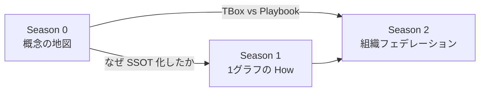
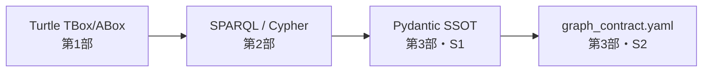

# Season 0 企画メモ：知識グラフとオントロジーの源流

## 1. 目的

Season 1（仮想グラフ → エージェント → 変更管理）および Season 2（組織分断 → 論理フェデレーション → 実装）は **実務の How が先** に進んでいる。読者が Season 1 第3部の「オントロジー再定義」や Season 2 の「Graph Contract」を理解するには、**古典的オントロジー / 知識グラフの概念地図** が不足しがちである。

Season 0 は **実装記事ではなく概念整理の3部作** とし、以下を達成する。

- 古典的オントロジー、TBox/ABox、RDF/OWL、プロパティグラフの **系譜と用語** を整理する
- Season 1・2 で使っている言葉が **古典のどこから来て、何を省略・再定義しているか** を明示する
- 「全部オントロジーに入れる」罠（ビッグバン統合）と、**TBox（What） vs Playbook（How）** の分離を読者に渡す

**Season 0 のゴール:** Season 1 第1部（または Season 1 全体）を読むための **概念 OS のインストール**。製品選定・組織フェデレーションの実装詳細は扱わない。サンプルコードは **概念例として最小限** 載せる（§5 参照）。

---

## 2. シリーズ全体像

### メインタイトル（案）

**知識グラフとオントロジーの源流 — 古典からエンタープライズ実務へ**

### 3部構成と役割

| 部 | サブタイトル（案） | 役割 | 読後に持ち帰るもの |
| :--- | :--- | :--- | :--- |
| **第1部** | オントロジーと知識表現の原点（概念編） | What：古典的オントロジーの地図 | オントロジー / TBox / ABox / DL / セマンティック Web の位置づけ |
| **第2部** | 知識グラフの二つの系譜（構造編） | How it's modeled：2つのグラフ文化 | RDF 系 vs プロパティグラフ系、スキーマの考え方の差 |
| **第3部** | 推論・統合・運用の限界（現実編） | Why Season 1 へ：古典が現場で破綻する理由 | 3段階スコープ（古典 → S1 再定義 → S2 Graph Contract） |

### 読者パス



| 読者タイプ | 推奨ルート |
| :--- | :--- |
| 初学者 | Season 0 全編 → Season 1 → Season 2 |
| Season 1/2 済みの実務者 | Season 0 第3部中心（＋必要なら第1部の用語表） |
| KG 経験者 | 第1部を軽く飛ばし、第2–3部から |

---

## 3. Season 1・2 との接続

### 用語の受け渡し（Season 0 で定義 → 以降で参照）

| 用語 | Season 0 での定義 | Season 1 での展開 | Season 2 での展開 |
| :--- | :--- | :--- | :--- |
| オントロジー | 古典：語彙・関係・制約・（推論） | 再定義：型・制約・利用文脈の SSOT | 狭義語彙＋契約レイヤーへの分離を示唆 |
| TBox / ABox | 用語箱 vs 事例箱 | Pydantic = TBox 寄りの厳格層 | `ontology/schema.py` |
| Playbook | 分析手順・探索テンプレート | Agent Skill | Graph Contract（Federation Joins） |
| 知識グラフ | RDF 系 / LPG 系の二系譜 | 仮想グラフ + 物理グラフ | Neo4j マルチDB |
| 推論 | DL / OWL 推論 | LLM との役割分担 | 決定論的ツール境界 |

### 記事間リンク方針

- Season 0 第3部末尾 → [Season 1 第1部](https://zenn.dev/yohei/articles/2026-05-30-vkg-strategy-what)
- Season 1 各記事冒頭（将来）→ 「用語整理は Season 0 第○部参照」の1行（任意）
- Season 2 第2部 §3 の3段階比較表 → Season 0 第3部で **初出定義**、Season 2 では **参照・短縮** に変更可能

---

## 4. 執筆上の線引き

### Season 0 でやること

- 用語、系譜、限界、Season 1/2 への動機づけ
- 図解（TBox/ABox、RDF triple、LPG、推論 vs LLM）
- **概念例としてのサンプルコード**（Turtle / SPARQL / Cypher 等、§5 参照）
- 参考文献・Further Reading（OWL Primer、DL Handbook 等）

### Season 0 でやらないこと

- **実行可能なコンパニオンリポジトリ**（Docker / Jena / Neo4j セットアップ手順）
- Pydantic / Neo4j / Graph Contract の **本番相当の実装詳細**（Season 1/2 に委譲）
- Snowflake / Databricks 製品比較（Season 1）
- サプライチェーン具体シナリオの長い叙述（Season 2）
- SPARQL / OWL の網羅的チュートリアル
- Agent Skill / MCP のフル定義、推論エンジンの実行ログ

---

## 5. サンプルコード方針

Season 0 にコードを載せる場合、**実行可能なリポジトリ** ではなく、**同じ題材で「古典 → 2系譜 → Season 1/2」が見える短い断片** とする。Season 2 と同じ語彙（`Component`, `Product`, `USED_IN` 等）を全3部で貫き、後続シリーズとの接続を強化する。

### 5.1 基本原則

| 原則 | 内容 |
| :--- | :--- |
| **1概念 = 1スニペット** | 各ブロック 5〜20行。動くことより「何を表しているか」 |
| **題材を固定** | 部品 `COMP-103` → 製品 `PROD-901` のミニ BOM を全3部共通 |
| **実行環境は書かない** | Jena / rdflib / Neo4j のセットアップは載せず Further Reading へ |
| **Season 1/2 は「進化版」** | 第3部のみ Pydantic / YAML を **10行程度の予告** に留める |
| **分量上限** | 記事あたり **150〜250行** 程度まで。それ以上は Season 1/2 の領域 |

### 5.2 共通題材（全3部で使い回す）

```text
# 同一インスタンスを RDF / Cypher / Pydantic で表現する
COMP-103 --USED_IN--> PROD-901
# 第3部用: COMP-103 --SUPPLIED_BY--> SUP-001（sourcing 側のみ）など
```

### 5.3 部別：載せるコードと配置

#### 第1部（概念編）— 3〜4ブロック / Turtle, SPARQL

| 配置 | 言語 | 内容 |
| :--- | :--- | :--- |
| §2 TBox/ABox | Turtle | クラス・プロパティ定義（TBox）と `COMP-103 usedIn PROD-901`（ABox） |
| §4 スタック | SPARQL | Where-Used 最小形（`COMP-103` → `?product`） |
| §5 推論 | 擬似テキスト | 推論器が補完しうる結果の例（エンジン実行はしない） |

**TBox 例（概念）:**

```turtle
@prefix ex:  <http://example.org/bom#> .
@prefix owl: <http://www.w3.org/2002/07/owl#> .

ex:Component a owl:Class .
ex:usedIn a owl:ObjectProperty ;
  rdfs:domain ex:Component ;
  rdfs:range  ex:Product .
```

**ABox 例（概念）:**

```turtle
ex:COMP-103 a ex:Component ;
  ex:usedIn ex:PROD-901 .
ex:PROD-901 a ex:Product .
```

#### 第2部（構造編）— 4〜5ブロック / SPARQL, Cypher, SQL, YAML

| 配置 | 言語 | 内容 |
| :--- | :--- | :--- |
| §2 vs §3 | SPARQL + Cypher | **同じ問い**（`COMP-103` → 親製品）を2系譜で並置 |
| §5 仮想グラフ | SQL | `CREATE VIEW ... JOIN` で単一 DWH 上の論理結合（1例のみ） |
| §6 TBox vs Playbook | YAML | `allowed_edges`（TBox 寄り）と `federation_joins` steps（Playbook 寄り） |

**同じ問い・別の書き方（並置）:**

```sparql
# RDF 系
SELECT ?product WHERE { ex:COMP-103 ex:usedIn ?product . }
```

```cypher
// LPG 系
MATCH (c:Component {id: 'COMP-103'})-[:USED_IN]->(p:Product)
RETURN p.id AS product
```

**Playbook 例（概念 YAML）:**

```yaml
steps:
  - domain: sourcing
    query: supplier_to_components
  - domain: ebom
    query: components_to_products
    input: component_ids
```

#### 第3部（現実編）— 4〜5ブロック / Turtle, Cypher, Python, YAML

| 配置 | 言語 | 内容 |
| :--- | :--- | :--- |
| §2 参照整合性 | Turtle | `COMP-999` が ebom に無い ABox 例 |
| §3 LLM 限界 | Cypher | **悪い例** — 存在しない `Process-[:SUPPLIED_BY]->Supplier` |
| §4 3段階進化 | Python + YAML | Pydantic `ALLOWED_EDGES` → `graph_contract.yaml` を **縦並び** |
| §3 ツール境界 | Python | 決定論的ツール API のみ LLM に見せる概念例 |

**3段階の同じ制約（§4 で縦並び — Season 2 §3 比較表の canonical コード版）:**

```python
# Season 1 再定義（TBox 寄り SSOT・概念例）
ALLOWED_EDGES = {
    "USED_IN": ("Component", "Product"),
    "SUPPLIED_BY": ("Component", "Supplier"),
    "PRODUCED_BY": ("Product", "Process"),
}
```

```yaml
# Season 2 Graph Contract（Playbook/契約寄り・概念例）
bridge_keys: [Component.id, Product.id]
federation_joins:
  - name: supplier_disruption_impact
    steps:
      - {domain: sourcing, via: SUPPLIED_BY, bridge: Component.id}
      - {domain: ebom, via: USED_IN, bridge: Product.id}
```

### 5.4 進化の見せ方（シリーズ横断）



第3部 §4 で上記4形式を **同一題材・同一制約** で並べ、「スコープ拡張」をコードで見せる。Season 2 第2部 §3 の3段階比較表と **対応関係** を本文で明示する。

### 5.5 原案ドキュメントへの反映

各部アウトラインの「コード: なし」は次の方針に更新する。

> **コード:** 概念例のみ（§5.3 参照）。共通題材 `COMP-103` / `PROD-901`。実行環境・リポジトリなし。

---

## 6. 公開方針（案）

| 項目 | 案 |
| :--- | :--- |
| emoji（シリーズ） | 📚 |
| 第1部 emoji | 📖 |
| 第2部 emoji | 🕸️ |
| 第3部 emoji | ⚖️ |
| topics | `ontology`, `knowledgegraph`, `semanticweb`, `rdf`, `neo4j` |
| ファイル名（案） | `2026-XX-XX-ontology-kg-origins.md` / `-2.md` / `-3.md` |
| 公開順 | 第1部 → 第2部 → 第3部（第3部が Season 1 への橋渡し） |

---

## 7. 原案ドキュメント

各部の詳細アウトラインは以下を参照。サンプルコードの配置は **本企画メモ §5** を正とする。

- [第1部原案](./season0-part1-outline.md) — 概念編
- [第2部原案](./season0-part2-outline.md) — 構造編
- [第3部原案](./season0-part3-outline.md) — 現実編

---

## 8. 未決事項

- [ ] メインタイトルの日本語確定（「源流」vs「古典から現代へ」）
- [ ] Season 0 を Season 1 **より前** に公開するか、Season 2 完了後の **バックフィル** として出すか
- [ ] Season 1 既存記事への逆リンクを追記するか（スコープ外なら第3部のみで完結）
- [ ] 第2部で GQL / ISO 標準に触れる深度
- [ ] コンパニオンリポジトリは作らない（概念記事 + 記事内スニペットのみ）方針で合意するか
- [x] 各部原案の「コード: なし」記述を §5.5 に沿って更新するか

---

## 9. 成功基準

- Season 1 第3部 §3① を読む前に、Season 0 第1–3部で **「再定義」の必然性** が説明できる
- Season 2 第2部 §3 の3段階比較表を、Season 0 第3部 **だけ** 読んでも理解できる
- 記事全体が **教科書の網羅性** ではなく **実務シリーズへの入口** として3000–5000字/部程度に収まる（コード断片は §5.1 の行数上限内）
- 第3部 §4 の **同一題材・4形式並置** で、Season 1 Pydantic → Season 2 Graph Contract の進化がコード上も追える

---

## 10. 関連ドキュメント

- [Season 3 企画（索引）](./season3-trusted-federation-series-plan.md)
  - [社内本番運用（Evidence・監査）](./season3-production-trust-series-plan.md)
  - [B2B / ODS 接続](./season3-b2b-ods-connection-plan.md)

---

## 11. シリーズ全体ロードマップ（記録）

| シーズン | 状態 | 一行 |
| :--- | :--- | :--- |
| Season 0 | 企画・原案 | 古典 KG / オントロジーの概念 OS |
| Season 1 | 公開済 | 仮想グラフ → エージェント → Pydantic SSOT |
| Season 2 | 公開済 | 社内論理フェデレーション + Graph Contract + 実装 |
| **Season 3A** | **企画** | 社内本番信頼（Evidence・監査・契約進化） |
| **Season 3B** | **企画** | B2B + [IPA Open Data Spaces](https://www.ipa.go.jp/digital/architecture/reports/open-dataspaces-design-philosophy.html) |
