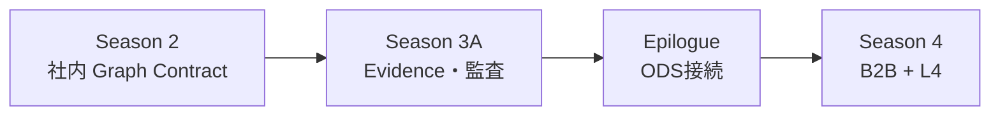

# Season 3 企画メモ（B2B / Open Data Spaces 接続）

社内本番運用（Evidence、監査、契約進化）は別ファイル。

→ [season3-production-trust-series-plan.md](./season3-production-trust-series-plan.md)

テーマ総覧・L4 インサイト・執筆順は索引を参照。

→ [season3-trusted-federation-series-plan.md](./season3-trusted-federation-series-plan.md)

本ファイルは **Season 2 社内論理フェデレーション** から **企業間データスペース** へ拡張する接続案を整理する。

---

## 1. 位置づけ

| 段階 | 内容 | ドキュメント |
| :--- | :--- | :--- |
| **Season 3A** | 社内本番信頼 | [production-trust 別紙](./season3-production-trust-series-plan.md) |
| **Epilogue** | ODS 接続総論（1記事） | **本ファイル §7** |
| **Season 4** | B2B + L4 深掘り（3部作・任意） | **本ファイル §7–8** |

**執筆方針:** Season 3A 完了後、**同一サプライチェーン題材** でサプライヤー / 物流 Partner を1社追加。

---

## 2. 参照文献・素材

### 公式

- [Why Open Dataspaces: 設計思想とアーキテクチャパラダイム（IPA, 2026年4月1日）](https://www.ipa.go.jp/digital/architecture/reports/open-dataspaces-design-philosophy.html)
- ODS-RAM, ODP, 入門ガイド, Developer Guide（関連リンク）

### ローカルアーカイブ

| パス | 内容 |
| :--- | :--- |
| `raw/ods/` | GitBook / IPA 資料 md（L3/L4 ODP、RAM、入門・開発者ガイド等） |
| `analytics/ods/` | OSS 分析（`sdk-for-semantics-overview.md` 等） |

### L4 参照実装（クローン済み）

パス: `/Users/yoheionishi/work/open-dataspaces/`

| リポジトリ | 用途（S3B/Season 4 Build） |
| :--- | :--- |
| `SDK-for-semantics` | Aspect/API/Instance → JSON-LD → DS/Finder 登録 |
| `L4-discovery-service` | `registerDomainApplication` / `findResource` |
| `L4-discovery-finder` | Discovery Service エンドポイント解決 |
| `L4-crawler-service` | SPARQL キャッシュ、RDF Patch（eventual consistency） |
| `L4-sparql-client-sample` | SPARQL クライアント UI 参考 |

**方針（2026-06 更新）:** Partner は **モック API 単体より L4 OSS 参照** を優先。L3/L2 本格連携は Developer Guide 第4章（`SDK-docker-compose`）相当で **別シーズン**。

---

## 3. ODS が解く Governance Complexity

| ODS の問い | 意味 | 本シリーズ既出 |
| :--- | :--- | :--- |
| **Where to get** | データはどこにあるか | S2: ドメイン別 Neo4j / `domains/` |
| **What to mean** | データは何を意味するか | S0–S1: オントロジー SSOT；S2: Graph Contract Identity |
| **Who and How to use** | 誰がどう使えるか | S2: registry；**S3B: Usage Control・社外契約** |

**Serving and Pull:** Season 2 クエリ時論理フェデレーションと同型。S3B では **社外 Data Product への Pull** まで拡張。

---

## 4. DPQM（Double-Product Quanta Model）

| ODS（DPQM） | 本シリーズ | S3B で足すもの |
| :--- | :--- | :--- |
| **Ontology Product** | `ontology/schema.py` + Contract Identity | **社外公開 Ontology Endpoint** |
| **Data Product** | 各ドメイン DB + 決定論的ツール | **Data Endpoint**、CWA 範囲 |
| **AQM** | ebom + routing + sourcing | + サプライヤー / 物流 Partner AQ |

**OWA + 選択的 CWA:** Ontology Product は OWA 寄り、Data Product は CWA 寄り — Season 0 第2部 Open/Closed World のエンタープライズ版。

---

## 5. 三つの柱（OSI / DAD / IUC）

### 5.1 Ontology and Semantic Interoperability（OSI）

| 本シリーズ | OSI 接続 |
| :--- | :--- |
| S0 TBox | Information Model 土台 |
| S1 Pydantic SSOT | Closed 側意味・制約 |
| S2 Graph Contract Identity | **社内** 意味契約 |
| **S3B** | Ontology Product 社外公開、contract versioning |

**記事化:** Graph Contract = 社内 Ontology Product。社外は **Ontology Endpoint** で意味を先にフェデレーション。

**L4 接続:** `SDK-for-semantics` の SAMM / API TTL / Instance 3分割は、Season 0「TBox vs Playbook 分離」の再会として記述可能。

### 5.2 Data Addressability & Discoverability（DAD）

| 本シリーズ | DAD 接続 |
| :--- | :--- |
| S2 Bridge Keys | 社内 Addressability |
| S2 Federation Joins | 社内探索経路 |
| S2 Plan + 決定論的ツール | **2段クエリのミニ版** |
| **S3B** | IRI/Endpoint、社外 Discoverability |

**記事化:** プランナー = Ontology Query 相当、ツール内 Cypher = Data Query 相当（**新パターンではない**）。

**L4 接続:** Finder → DS → `service:xxxRequestUri` 取得が ODP Binding シーケンスの実装側。

### 5.3 Identity and Usage Control（IUC）

| 本シリーズ | IUC 接続 |
| :--- | :--- |
| S2 DB 分離 + ACL | Authorization 内側 |
| S2 Quality Gates | 利用条件の萌芽 |
| S3A Evidence / contract version | Trust by Design の社内先行 |
| **S3B** | Usage Control 契約、Bridge Key 盲信不可 |

**記事化:** Graph Contract に `usage_policy`（目的制限、保持禁止、再提供禁止）。社外 Partner は **Identity Proofing + Usage Contract** 必須。

---

## 6. B2B — Season 2 からの差分

| 観点 | Season 2（社内） | S3B（社外） |
| :--- | :--- | :--- |
| 信頼モデル | 全社 Graph Contract | Trust by Design、契約・監査 |
| 共有 ID | Bridge Keys | 内部 ID 温存、IRI/契約 ID でマッピング |
| 結合 | Federation Joins | Serving/Pull + Usage Control Endpoint |
| 意味 | Pydantic + Contract | Ontology Product 先に交換 |
| エージェント | 社内ツール連鎖 | 2段 Query + Evidence |
| 参照実装 | Neo4j マルチ DB | L4 Discovery + SDK-for-semantics |

**題材:** 自社 3 ドメイン + **サプライヤー Data Product** + **物流 Partner**（ODS 図7 の縮小版）。

---

## 7. 記事構成案

### 7.0 推奨（2026-06 更新）

| 順 | 形式 | 内容 |
| :--- | :--- | :--- |
| 1 | **Season 3A** 3部作 | 社内本番（必須・先） |
| 2 | **Epilogue** 1本 | ODS 三柱マッピング + B2B ギャップ |
| 3 | **Season 4** 3部作 | 需要があれば L4 最小接続まで |

~~C: Season 3 第2–3部に統合~~ — 3A の純度を保つため **非推奨**。

### 7.1 Epilogue（1記事）

**タイトル案:** 「Graph Contract は社内 Ontology Product だった — サプライチェーンエージェントから ODS 三柱へ」

| セクション | 内容 |
| :--- | :--- |
| 動機 | 社内 Graph RAG と ODS は別入口・同型の問い |
| 対応表 | §8 用語統合マップの記事版 |
| ギャップ | Bridge Key 社外共有だけでは IUC 的に不十分 |
| 次の一歩 | Season 4 / L4 OSS 参照の予告 |
| 参照 | IPA 設計思想、`raw/ods/` |

### 7.2 Season 4 3部作（任意）

| 部 | タイトル案 | 主柱 | 副柱 |
| :--- | :--- | :--- | :--- |
| 第1部 Problem | 社外 Graph RAG が破綻する三つの壁 | **IUC** | DAD |
| 第2部 Design | DPQM をエージェント契約に翻訳する | **OSI** | IUC |
| 第3部 Build | Discovery から Pull まで — L4 最小接続 | **DAD** | OSI + IUC |

**第3部 Build ステップ案:**

1. サプライヤー mock を `SDK-for-semantics` で Aspect/API/Instance 定義
2. `registerDomainApplication` → `L4-discovery-service`
3. `L4-discovery-finder` で DS 解決
4. 返却 JSON-LD から Endpoint 取得 → エージェント Pull（L2 stub 可）
5. （余力）`L4-crawler-service` で Patch / 鮮度 — S3A Evidence と接続

### 7.3 スピンオフ（ODS ロードマップへのフィードバック）

| タイトル案 | 要点 |
| :--- | :--- |
| SAMM と API TTL を分ける理由 | SDK 設計判断 × Season 0 |
| Active Discovery と TTL | register/keep-alive vs 常駐 RAG 索引 |
| RDF Patch と分散カタログ | crawler-service の eventual consistency |
| Planner を Discovery クライアントに | Agent × L4（仕様薄い領域の提案） |

---

## 8. 用語統合マップ（ODS 列）

| 層 | S2 | S3A（別紙） | S3B / Epilogue | Season 4 Build |
| :--- | :--- | :--- | :--- | :--- |
| 意味 | Graph Contract Identity | contract version | **Ontology Product / OSI** | SAMM + SDK 登録 |
| 事実 | ドメイン別 DB | Evidence | **Data Product** | Pull + CWA |
| 手順 | Federation Joins | golden Plan | **Ontology Query → Data Query** | Planner + DS |
| 境界 | registry | HITL | **IUC / Usage Control** | `usage_policy` |
| 発見 | Bridge Keys | — | **DAD / IRI / Endpoint** | Finder + DS |
| 信頼 | Quality Gates | Run trace | **Trust by Design** | Evidence 前提 |
| 鮮度 | Quality Gates | SLA Skew | RDF Patch / TTL | crawler-service |

---

## 9. 執筆上の線引き

### やること

- ODS 三柱を Graph Contract / ツール境界への **マッピング**
- 同一サプライチェーン題材で **1 Partner 追加**
- L4 OSS 接続時の **摩擦点の記録**（ロードマップへのフィードバック）
- [IPA 設計思想](https://www.ipa.go.jp/digital/architecture/reports/open-dataspaces-design-philosophy.html) への Further Reading

### やらないこと

- ODP 網羅実装、法務詳細
- IPA / GitBook の逐語解説（`raw/ods` に既存）
- Season 3A（社内本番）の重复
- L3/L2 本格実装（Onboarding SDK は別記事候補）

---

## 10. 未決事項

- [ ] Epilogue を Season 3 第4部 vs 独立 epilogue
- [ ] Season 4 を書くか
- [ ] Season 4 第3部で crawler-service まで触るか
- [ ] Season 3A 完了後に Epilogue 執筆開始

**決定済み（2026-06）:**

- [x] Partner 参照は **L4 OSS 優先**（モック API 単体は避ける）
- [x] 執筆順は **3A → Epilogue → Season 4**
- [x] まず **Epilogue 1本**、深掘りは Season 4

---

## 11. 成功基準

- [IPA ODS](https://www.ipa.go.jp/digital/architecture/reports/open-dataspaces-design-philosophy.html) 読者が本シリーズを **社内 PoC → dataspace への道筋** と理解できる
- Graph Contract / Bridge Keys / ツールが **OSI/DAD/IUC の別名再発明** に見えない
- 「Bridge Key を社外に渡すだけ」が **不十分** と IUC で説明できる
- L4 接続で **仕様外の摩擦** を実装者視点で1つ以上残せている

---

## 12. 関連ドキュメント

- [Season 3 索引・テーマ総覧](./season3-trusted-federation-series-plan.md)
- [Season 3 社内本番運用](./season3-production-trust-series-plan.md)
- [Season 0 企画](./season0-ontology-kg-series-plan.md)
- `analytics/ods/sdk-for-semantics-overview.md`
- `raw/ods/odp-discovery-search-l4-protocol.md`
- `raw/ods/odp-metadata-exchange-l4-protocol.md`
