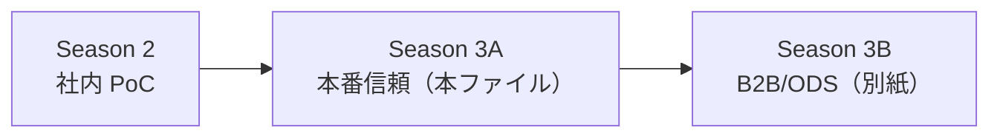

# Season 3 企画メモ（社内本番運用）：観測・監査・進化する契約

B2B フェデレーションおよび [IPA Open Data Spaces](https://www.ipa.go.jp/digital/architecture/reports/open-dataspaces-design-philosophy.html) 接続は別ファイルに整理する。

→ [season3-b2b-ods-connection-plan.md](./season3-b2b-ods-connection-plan.md)

---

## 1. 位置づけ

Season 2 までで **社内** の論理フェデレーション（Graph Contract、Bridge Keys、決定論的ツール、Neo4j マルチ DB 参照実装）が揃った。Season 3（本ファイルの範囲）は **同じ社内境界のまま**、ローカル PoC を **本番で信頼できる運用** に引き上げる。

| シーズン | 境界 | 問い |
| :--- | :--- | :--- |
| Season 2 | 社内・複数ドメイン | どう設計・実装するか |
| **Season 3（本ファイル）** | **社内・本番運用** | どう **観測・監査・進化** させるか |
| Season 3（B2B/ODS 別紙） | 社外・データスペース | どう **社外と接続** するか |



**推奨執筆順:** 本ファイルの3部作を先に完成 → [Epilogue / Season 4](./season3-b2b-ods-connection-plan.md) で B2B/ODS 接続。

### 1.1 ODS への伏線（本編に混ぜない）

3A 本編は社内境界のまま。各章末尾 **1段落** で Epilogue への橋を置く。

| 3A の要素 | Epilogue / ODS での対応 |
| :--- | :--- |
| Quality Gates / SLA Skew | 将来 **Data Product** 品質ラベル |
| contract version | **Ontology Product** 再登録（SDK-for-semantics と同型） |
| Evidence / Run trace | **Trust by Design** の社内先行実装 |
| HITL | **IUC** の社内近似 |

→ 索引 [season3-trusted-federation-series-plan.md](./season3-trusted-federation-series-plan.md)

---

## 2. メインタイトル（案）

**本番で信頼されるエージェント知識基盤 — 観測・監査・進化する契約**

サブタイトルで3部の役割:

| 部 | サブタイトル（案） | 型 |
| :--- | :--- | :--- |
| 第1部 | フェデレーションが本番で破綻する壁（背景編） | Problem |
| 第2部 | 信頼境界と契約進化の設計（設計編） | Design |
| 第3部 | 観測可能なフェデレーションの実装（実装編） | Build |

---

## 3. 第1部：Problem — 本番の5つの壁

Season 2 設計・実装が **ローカル Docker + 手動検証** で止まると、本番投入時に次が顕在化する。

### 3.1 SLA Skew と Quality Gates の現実

- Graph Contract の `quality.on_ingest` / 鮮度ポリシー（例：調達 T+0、BOM T-7）が **設計どおり運用されていない**
- ドメインごと更新頻度の差が、フェデレーション結果の **信頼性ラベル** を曖昧にする
- 「結合は成功したが、古い BOM に基づく誤判断」

**Season 2 接続:** 第2部 §3.2 非同期参照整合性、Quality Gates

### 3.2 非同期監査とアラート疲れ

- `bridge_id_present_in_master` 等の夜間監査が **アラートを出し続ける**
- 修復責任（どのドメインオーナーが直すか）が不明
- 監査なしではフェデレーションが **静かに失敗** する

**Season 2 接続:** 第2部 §3.2、第3部 `quality.on_ingest` 監査スクリプト

### 3.3 説明責任（Evidence）の欠如

- エージェント回答に **根拠チェーン**（どのツール・どの ID・どの DB）が残らない
- 有事分析後の **事後検証・監査・訓練** ができない
- LLM の要約だけでは経営・法務に説明できない

**Season 2 接続:** 第2部 §4 ツール境界、第3部 エージェント連携

**他記事との接続:** Decision / Narration 分離（判断はツール結果、説明は LLM）

### 3.4 契約進化（Contract Evolution）

- Bridge Keys 追加、Federation Joins 変更、Quality Gates 厳格化時の **後方互換**
- Agent Skill 自動生成物との **同期ズレ**
- 「契約 v1 の Plan が v2 で壊れる」

**Season 2 接続:** Graph Contract 4要素、Season 1 SSOT 原則

### 3.5 コスト・SLO・運用負荷

- 多ホップフェデレーションの **latency**
- 有事時の **同時実行・スロットリング**
- 監査・インジェスト・エージェント Run の **運用コスト**

**Season 2 接続:** 第2部 ④ 運用の容易さ（ローカル前提の限界）

---

## 4. 第2部：Design — 信頼境界の設計

### 4.1 Evidence Graph（根拠の構造化）

エージェント 1 Run あたり、最低限記録する **Evidence レコード**（概念）:

| フィールド | 内容 |
| :--- | :--- |
| `run_id` | フェデレーション実行 ID |
| `contract_version` | 参照した Graph Contract 版 |
| `plan` | 呼び出したツール列と入力 ID |
| `tool_results` | 各ツールの構造化 JSON（要約ではない） |
| `bridge_keys_traversed` | 結合に使った ID 列 |
| `freshness_snapshot` | 各ドメインのデータ鮮度メタデータ |
| `narration` | LLM 要約（Evidence とは別ストア推奨） |

### 4.2 Policy-as-Contract（Quality Gates の運用化）

| レイヤ | 役割 |
| :--- | :--- |
| **インジェストゲート** | 書き込み時同期検証（Season 2 既存） |
| **非同期監査** | 夜間 / イベント駆動で参照整合性 |
| **フェデレーション前チェック** | Run 開始前に鮮度・契約適合を確認 |
| **CI** | `graph_contract.yaml` 変更時の golden case 回帰 |

Graph Contract 拡張フィールド（案）:

```yaml
contract:
  version: "1.2.0"
  compatibility: "1.x"
quality:
  on_ingest: [...]
  on_federate:   # 新規：フェデレーション前
    - rule: freshness_within_policy
  on_audit:
    schedule: "0 2 * * *"
    alert_channel: domain-owner
```

### 4.3 Human-in-the-loop（HITL）境界

| 分析種別 | 自動 | 承認要 |
| :--- | :--- | :--- |
| 影響範囲の **列挙** | ○ | |
| 代替調達・工程変更の **推奨** | | ○ |
| 対外アナウンス文案 | | ○（Narration のみ LLM） |

### 4.4 Decision / Narration 分離

- **Decision 層:** 決定論的ツール + Evidence（再現可能）
- **Narration 層:** LLM（Evidence を入力に要約のみ）
- Narration が Decision を **上書き・捏造** しない検証（Evidence 外の数値を出さない）

### 4.5 Contract Versioning 原則

1. **Semantic versioning** — breaking change は major
2. **Skill / ツールは contract version に pin**
3. **Golden federation cases** — 契約変更 PR で必須
4. **Deprecate window** — Bridge Key 変更は並行期間を設ける

---

## 5. 第3部：Build — 観測可能なフェデレーション

Season 2 [コンパニオンリポジトリ](https://github.com/yohei1126/supply-chain-impact-analysis-agent) の **拡張** を前提（Neo4j マルチ DB 構成は維持）。

### 5.1 リポジトリ拡張（案）

```text
├── ontology/contract/
│   └── graph_contract.yaml      # version / on_federate 追加
├── ops/
│   ├── audit/                   # 非同期監査ジョブ
│   ├── golden/                  # フェデレーション回帰ケース
│   └── evidence/                # Run ログスキーマ・保存
├── app/federation/
│   └── analysis.py              # run_id 付与、freshness チェック
└── app/tools.py                 # Evidence 返却
```

### 5.2 実装トピック

| トピック | 内容 |
| :--- | :--- |
| **Run trace** | `run_id` を federation → tools → agent へ伝播 |
| **Contract diff** | PR 時に Federation Joins / Quality Gates の差分表示 |
| **Golden cases** | `golden/supplier_disruption.yaml` → 期待 ID 列 |
| **Audit job** | `bridge_id_present_in_master` 等の定期実行 + アラート |
| **Evidence store** | JSONL / DuckDB テーブル（本番は SIEM 連携想定） |

### 5.3 サンプルコード方針

- Season 2 と同一題材（`COMP-103` / サプライヤー途絶シナリオ）
- **Evidence レコード例**、**contract version pin**、**golden test 1本** を第3部に掲載
- 実行環境は Docker Compose 継続（K8s 本番化は Future Reading）

### 5.4 第3部で扱わないもの（B2B/ODS 別紙へ）

- 社外 Ontology / Data Endpoint
- IRI、Usage Control 契約、Partner モック API
- ODP プロトコル

---

## 6. 代替・拡張軸（B2B/ODS 以外）

Season 3 本編に **部分統合** するか、**spin-off 1部** にするかの記録。

### 6.1 仮想グラフ × 物理グラフ共存（Season 1 統合）

| 項目 | 内容 |
| :--- | :--- |
| **問い** | 単一 DWH 仮想グラフ（S1）と Neo4j マルチ DB（S2）が同時に存在する現実 |
| **第1部への入れ方** | §1 に「財務は DWH ビュー、供給は LPG」の **1節** |
| **設計** | エージェント Plan が **ストアタイプ別ツール** を選択 |
| **優先度** | 中 — B2B より社内本番の方が先 |

### 6.2 Temporal / Event-driven フェデレーション

| 項目 | 内容 |
| :--- | :--- |
| **問い** | 「地震 **前日時点** の影響」再現、BOM 版数、サプライヤーリスクの時系列 |
| **第2部への入れ方** | Quality Gates に **as_of / valid_from** |
| **実装** | Evidence に `as_of_timestamp`、point-in-time クエリ |
| **優先度** | 中 — Quality Gates 本格化とセット |

### 6.3 マルチエージェント / MCP エコシステム

| 項目 | 内容 |
| :--- | :--- |
| **問い** | ドメイン別 Skill が増えたときの **契約とツールのガバナンス** |
| **入れ方** | 第2部 §4 拡張または Future Reading |
| **優先度** | 低 — Season 2 単一エージェント Plan で十分なうちは後回し |

### 6.4 評価・ベンチマーク

| 項目 | 内容 |
| :--- | :--- |
| **問い** | フェデレーション Plan の **正確性・完全性** をどう測るか |
| **入れ方** | 第3部 golden cases + メトリクス（Precision@影響部品 等） |
| **優先度** | 高 — 本番信頼の中核 |

---

## 7. Season 2 第2部「4大コア論点」の本番拡張

| 第2部論点 | Season 2 実装 | Season 3 本番拡張 |
| :--- | :--- | :--- |
| ① データ所有権 | `domains/` + registry | + 契約変更の **ドメインオーナー承認** フロー |
| ② セキュリティ | Neo4j マルチ DB | + Evidence アクセス制御、Run 監査ログ |
| ③ クエリ品質 | 決定論的ツール | + golden 回帰、Evidence 付き回答 |
| ④ 運用容易さ | Docker Compose | + 監査スケジュール、SLO メトリクス、contract CI |

---

## 8. 執筆上の線引き

### やること

- 社内本番の **Problem → Design → Build** 完結
- Season 2 コンパニオンリポジトリ拡張（Evidence、audit、golden、contract version）
- Graph Contract の **運用フィールド** 設計

### やらないこと

- B2B / ODS（別紙）
- 新ストア選定、RAG 本番化、万能 AGI
- 法務・認証プロトコル詳細

---

## 9. 未決事項

- [ ] メインタイトル・サブタイトル確定
- [ ] Evidence store: JSONL / DuckDB / 外部 SIEM のどれを記事で採用するか
- [ ] 仮想グラフ統合（§6.1）を第1部に **1節** 入れるか
- [ ] Temporal（§6.2）を Quality Gates 拡張として **第2部に入れるか**
- [ ] `season3-part1/2/3-outline.md` の起票（本ファイルベース）
- [ ] Epilogue を Season 3 第4部 vs 独立 epilogue（索引 §5 参照）

---

## 10. 成功基準

- Season 2 読者が「PoC の次は **監査と Evidence**」と自然に期待できる
- Graph Contract が **静的設計書** から **進化する運用契約** として読める
- コンパニオンリポジトリに **golden federation test** が1本以上ある
- B2B/ODS 別紙を読まなくても **社内本番** の話として Season 3 単体が成立する

---

## 11. 関連ドキュメント

- [Season 3 索引・テーマ総覧](./season3-trusted-federation-series-plan.md)
- [Season 0 企画](./season0-ontology-kg-series-plan.md)
- [Season 3 B2B / ODS 接続](./season3-b2b-ods-connection-plan.md)
- [supply-chain-neo4j-migration-plan.md](./supply-chain-neo4j-migration-plan.md)
- Season 2 記事3部 + [コンパニオンリポジトリ](https://github.com/yohei1126/supply-chain-impact-analysis-agent)
