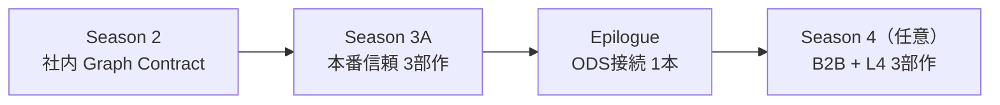

# Season 3 企画メモ（索引・テーマ総覧）

Season 3 の企画は **2ファイル + 本索引** で管理する。2026-06 時点の L4 OSS 調査・ODS 資料整理を反映。

| ファイル | 範囲 |
| :--- | :--- |
| [season3-production-trust-series-plan.md](./season3-production-trust-series-plan.md) | **Season 3A** — 社内本番運用（Evidence、監査、契約進化） |
| [season3-b2b-ods-connection-plan.md](./season3-b2b-ods-connection-plan.md) | **Season 3B / Epilogue / Season 4** — B2B + ODS 接続 |
| **本ファイル** | 執筆順・テーマ案・シリーズと ODS の接点 |

**関連素材（リポジトリ外）**

| パス | 内容 |
| :--- | :--- |
| `raw/ods/` | ODS-RAM / ODP / 入門ガイド / Developer Guide の md アーカイブ |
| `analytics/ods/` | OSS 実装の分析メモ（例: `sdk-for-semantics-overview.md`） |
| `/Users/yoheionishi/work/open-dataspaces/` | L4 参照実装（クローン済み） |

---

## 1. 得られたインサイト（2026-06）

### 1.1 シリーズと ODS は「別入口・同型の問い」

本連載（S0–S2）は **社内 Graph RAG / 論理フェデレーション** の開発課題を整理してきた。ODS（特に L4）は **分散データスペース上の Product 公開・発見** から同じ問いに答える。宣伝記事ではなく **実装者視点のマッピング** が ODS ロードマップへの貢献になる。

| 問い | シリーズ（S0–S2） | ODS |
| :--- | :--- | :--- |
| **Where to get** | Bridge Keys、Federation Joins | DAD — Discovery Finder → DS → Endpoint |
| **What to mean** | `schema.py`、Graph Contract Identity | OSI — SAMM、Ontology Product、JSON-LD |
| **Who / How to use** | registry、Quality Gates | IUC — Usage Control、Trust by Design |
| **2段クエリ** | プランナー → 決定論的 Cypher | Ontology Query → Data Query |
| **OWA / CWA** | TBox vs ドメイン DB | DPQM — Ontology Product vs Data Product |

### 1.2 L4 OSS が S3B の参照実装候補

モック API より、クローン済み L4 リポジトリを **概念実装の参照** に使う（L3/L2 本格実装は別シーズン）。

| リポジトリ | 役割 | ODS 対応 |
| :--- | :--- | :--- |
| `SDK-for-semantics` | SAMM/API/Instance → JSON-LD → DS/Finder 登録 | Metadata Exchange + Discovery クライアント |
| `L4-discovery-service` | DomainApp 登録・findResource（uasl/drone/port） | Discovery and Search |
| `L4-discovery-finder` | DS エンドポイント解決 | Discovery Finder |
| `L4-crawler-service` | SPARQL キャッシュ、RDF Patch、MQTT 通知 | Metadata Exchange（eventual consistency） |
| `L4-sparql-client-sample` | SPARQL UI サンプル | メタデータ取得の参考 |

詳細: `analytics/ods/sdk-for-semantics-overview.md`

### 1.3 Season 3A を先に書く理由

IUC（Usage Control）が「社内 Quality Gates の延長」として読めるのは、**Evidence / contract version / Run trace** を社内で先に実装した後。3A なしで S3B に入ると ODS 接続が仕様解説になりやすい。

### 1.4 ODS ロードマップへの貢献の型

| 貢献 | 記事でのやり方 |
| :--- | :--- |
| **マッピング** | Graph Contract ↔ OSI/DAD/IUC（再発明に見えない対応表） |
| **摩擦の記録** | L4 OSS をサプライチェーン題材で繋いだときの **ギャップ**（Agent×L4 等、仕様に薄い領域） |
| **最小接続** | Discovery → Endpoint 解決 → Pull（2段 Query の再現） |
| **やらない** | ODP 網羅、IPA 逐語解説、法務詳細 |

---

## 2. Season 3 テーマ案（全体像）

### メインタイトル（共通案）

**本番で信頼されるエージェント知識基盤 — 観測・監査・進化する契約**

---

### Season 3A — 社内本番信頼（必須・先に執筆）

**境界:** 社内のまま。B2B/ODS は本編に混ぜない。

| 部 | サブタイトル（案） | 型 | 読後に持ち帰るもの |
| :--- | :--- | :--- | :--- |
| 第1部 | フェデレーションが本番で破綻する壁 | Problem | SLA Skew、監査疲れ、Plan ドリフト等 |
| 第2部 | 信頼境界と契約進化の設計 | Design | contract version、Evidence 設計 |
| 第3部 | 観測可能なフェデレーションの実装 | Build | Run trace、golden test、HITL |

**ODS への伏線（各1段落程度）:** Quality Gates → 将来 Data Product 品質ラベル；contract version → Ontology Product 再登録；Evidence → Trust by Design の社内版。

→ 詳細 [season3-production-trust-series-plan.md](./season3-production-trust-series-plan.md)

---

### Epilogue — ODS 接続総論（3A 直後・1記事）

**推奨:** Season 3 第4部または epilogue として **1本に圧縮**。

**タイトル案:** 「Graph Contract は社内 Ontology Product だった — サプライチェーンエージェントから ODS 三柱へ」

| セクション | 内容 |
| :--- | :--- |
| 三柱マッピング | OSI / DAD / IUC ↔ Graph Contract / Bridge Keys / registry |
| B2B ギャップ | Bridge Key 社外共有だけでは不十分（IUC） |
| 題材拡張 | 自社3ドメイン + サプライヤー1 + 物流 Partner1 |
| Further Reading | IPA 設計思想、`raw/ods/` |

→ 詳細 [season3-b2b-ods-connection-plan.md](./season3-b2b-ods-connection-plan.md) §7

---

### Season 4（任意）— B2B + L4 接続 3部作

Epilogue に需要があれば **新シーズン** として深掘り。

| 部 | タイトル案 | 主柱 | Build で触る OSS |
| :--- | :--- | :--- | :--- |
| 第1部 | 社外 Graph RAG が破綻する三つの壁 | **IUC** | （概念のみ） |
| 第2部 | DPQM をエージェント契約に翻訳する | **OSI** | `SDK-for-semantics`（SAMM/API/Instance 分離） |
| 第3部 | Discovery から Pull まで — L4 最小接続 | **DAD** | DS + Finder + 2段 Query 再現 |

**Graph Contract 拡張案:** `usage_policy`（目的制限、保持禁止、再提供禁止）。

---

### スピンオフ記事（任意・ODS フィードバック向け）

| テーマ | ODS への貢献 |
| :--- | :--- |
| SAMM と API TTL を分ける理由 | SDK 設計判断の開発者向け翻訳（S0 TBox/Playbook 再訪） |
| Active Discovery と TTL | register + keep-alive vs RAG 常駐インデックス |
| RDF Patch と分散カタログ | `L4-crawler-service` の鮮度・順序問題 |
| Planner を Discovery クライアントにする | Agent × L4 統合パターンの提案 |

---

## 3. 推奨執筆順

1. **Season 3A** — production-trust 3部作（Problem / Design / Build）
2. **Epilogue** — ODS 接続 1本
3. **Season 4** — 需要に応じて B2B + L4 3部作
4. **スピンオフ** — 摩擦点が記事化できたものから

---

## 4. 成功基準（Season 3 全体）

- [IPA ODS](https://www.ipa.go.jp/digital/architecture/reports/open-dataspaces-design-philosophy.html) 読者が本シリーズを **社内 PoC → dataspace への道筋** と理解できる
- Graph Contract / Bridge Keys が **OSI/DAD/IUC の別名再発明** に見えない
- 「Bridge Key を社外に渡すだけ」が **不十分** と IUC で説明できる
- L4 OSS 接続で **仕様に書かれていない摩擦** を1つ以上記録できている

---

## 5. 未決事項

- [ ] Epilogue を Season 3 第4部 vs 独立 epilogue
- [ ] Season 4 を書くか（Epilogue 反応待ち）
- [ ] Season 4 第3部で crawler-service まで触るか（DS+Finder のみ vs Patch まで）
- [ ] Season 3A 完了後に Epilogue 執筆開始
