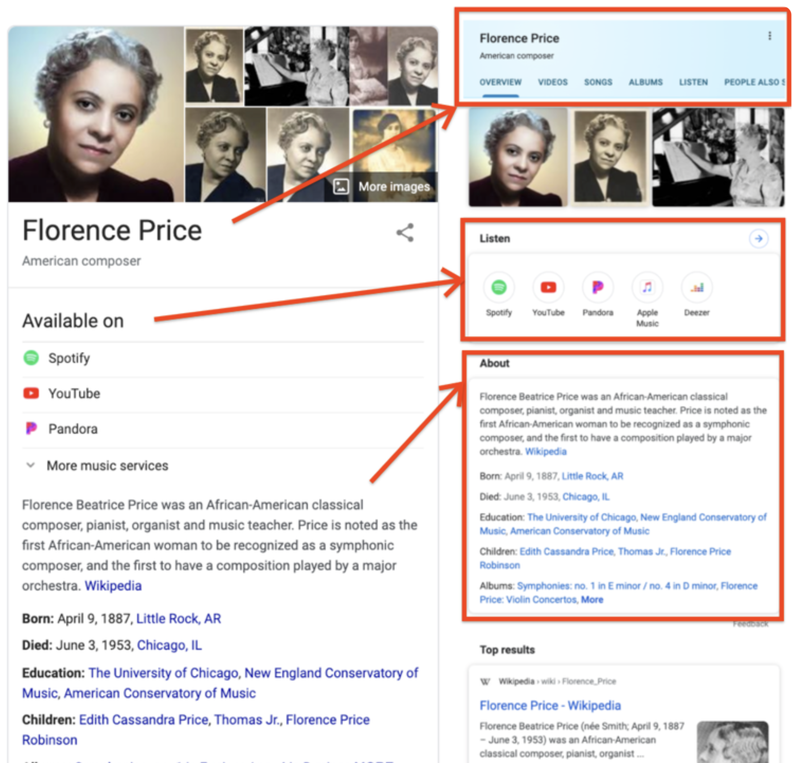

<!--
発表者ノート: 各スライド末尾の HTML コメント（_ で始まらないもの）が口頭原稿。
Marp Presenter ビューで表示できる。
正本（詳細）: instructions/script-mlops-meetup-meaning-layer-graph-talk.md
旧スライド（対比）: slides/mlops-meaning-layer-2026/_talk.md
-->

<!-- _class: lead -->
<!-- _paginate: false -->
<!-- _header: "" -->

# AIエージェントの知識表現と推論に
# なぜグラフが使われるのか

記号的AIの復権とニューラルAIとの統合

**大西 洋平**

MLOps・LLMOps・AgentOps 勉強会

<!--
【口頭】0. タイトル（立ち上げのみ・十数秒）

大西と申します。普段は家電メーカーのDysonでデータとAIのプラットフォームアーキテクトとして働いています。
今日は、AIエージェントの知識表現と推論になぜグラフが使われるのか？記号的AIの復権とニューラルAIとの統合と題しまして発表します。
よろしくお願いします。
-->

---

<!-- _header: "1｜本発表の概要" -->

## 本発表の概要

| | |
| --- | --- |
| **何を発表するのか？** | 古典的AIの時代からある知識グラフ／オントロジーが再び注目される背景と、AIエージェントで活用するための**判断軸**を整理する |
| **なぜ発表するのか？** | 知識グラフやオントロジの概要を理解している人が オントロジや知識グラフに対する過度な期待と関連技術との混同を避けられるようにするため |
| **何を持ち帰ってほしいか？** | 知識グラフ・オントロジは万能でも必須でもない。自社の課題に必要か、人間がどこまで設計すべきかを判断する**視点** |

<!--
【口頭】1. 本発表の概要

知識グラフやオントロジーを最近、目にすることが増えたという方もいらっしゃると思います。
本発表では、これらの技術がなぜ再び注目されているのかを、関連技術との関係や古典的AIからの系譜とともに整理します。
実装の詳細というよりは、どのような課題で必要になるのか、人間が設計すべきはどこか、判断するための考え方を共有します。
私自身は、知識グラフやオントロジは万能でも常に必須な存在ではないと考えています。
本発表では、自社の課題に照らして使うかどうか、使うとしたらどう設計するかを考える視点を持ち帰っていただくことを目標とします。
-->

---

<!-- _header: "2｜Databricks / Snowflake が発表したもの" -->

## 2026年、Databricks / Snowflake がオントロジ自動構築を発表した


|        | Snowflake        | Databricks                   |
| ------ | ---------------- | ---------------------------- |
| オントロジ構築 | **Cortex Sense** | **Genie Ontology**（OntoRank） |
| オントロジのデータソース<br/>（データカタログ）   | Horizon          | Unity Catalog                |
| エージェント | CoWork / CoCo など | Genie One など                 |

- **カタログのメタデータや利用履歴からデータの意味や定義を裁定し、エージェントへ注入**  
- ≠ 人手で全社オントロジーを先に書く
- ≠ Text-to-SQL 丸投げ

<!--
【口頭】2. Databricks / Snowflake が発表したもの

最初に知識グラフやオントロジが、データやAI業界で注目されているという事実関係の紹介のため、 データプラットフォームベンダーである Databricks / Snowflake が今年のサミットで発表した内容を公開情報の範囲で紹介します。
Databricks は今年 Genie Ontology という機能を発表しました。これはプラットフォームに内蔵するデータカタログに蓄積する、メタデータや利用履歴から自社データの意味や定義に相当するオントロジというものを自動構築し、エージェントのコンテキストに注入することで、エージェントがより自社のデータについて深く理解できるようになり、適切にデータを分析できるようにするというものです。
Snowflakeの方は、Databricksよりも先にサミットを開催し、CoWorkというビジネスユーザが直接使うエージェント機能を紹介し、明示的ではありませんが、実はその背後にGenie Ontologyとほぼ同等のことを行う、Cortex Senseという機能の存在をひっそりと紹介していました。
これまでの業界の路線は、どちらかというと、セマンティックビューと呼ばれる、物理テーブルのメタデータとビジネス上のメトリクスをマッピングする定義を人間が事前に用意するというものでした。
つまりは今回の発表は、人間のドメインエキスパートがやっていたマッピングの一部をプラットフォームが半自動でやると宣言していたのだと解釈できます。
私自身はLLMを使いながらグラフDBのスキーマ設計やっていて、その時に事前設計したオントロジをLLMに提示することば、グラフスキーマ設計が楽になるという議論を聞いていました。SnowflakeやDatabricksは、その前提であるオントロジの構築そのものを半自動化することに驚きました。
-->

---

<!-- _header: "3｜オントロジーと知識グラフとは何か" -->

## 知識グラフとオントロジーとは何か？

| 用語         | 何か                            |
| ---------- | ----------------------------- |
| **グラフ**    | 点と線で関係を表す **構造一般**（道路網も SNS も） |
| **知識グラフ**  | 業務の実体と、意味のある関係を載せた **実態**     |
| **オントロジ** | 許される概念・関係の型・制約 (**設計図・物差し**）  |

例:

- 「部品 —使われる→ 製品」は許可。
- 「サプライヤー —使われる→ 製品」は型としておかしい、と止められるのが物差し側。

<!--
【口頭】3. 知識グラフとオントロジーとは何か

ここで冒頭に出てきた用語の意味を解説させてください。
グラフというのは、点と線で関係を表す構造の一般名です。道路網やSNSもグラフです。
これに対して、知識グラフは、業務の実態とその関係をグラフ構造に載せ、そのドメインの知識を表現したものです。
オントロジは、対象領域にどんな概念があり、どんな関係が許されるか、という知識グラフの構造や制約事項を定義したものです。
RDB でいえば、オントロジーがテーブルスキーマ・制約、知識グラフが実際のレコード、と捉えると分かりやすいと思います。
ただし、これは狭義の意味での定義でありますが、世間的には型と実態を分けずにオントロジと呼ぶケースも散見されるので注意してください。
-->

---

<!-- _header: "4｜例: SPDM の簡易オントロジ" -->

## 例: SPDM の簡易オントロジ（製造業）

**SPDM** = Simulation Process and Data Management

設計工程における数値シミュレーションの流れ・条件・結果を一つの枠でつなぐ管理



<!--
【口頭】4. 例: SPDM の簡易オントロジ

実際にオントロジってどういうものか知りたい人も多いと思いますので、ここで具体例を示したいと思います。

製造業でよくある例として SPDM（Simulation Process and Data Management）を紹介します。
これは製品設計時に行う数値シミュレーションの手順と結果を扱う領域を指します。このSPDMを例にしてオントロジーを作るとどうなるでしょうか？

オントロジの特徴は、概念同士を関係でつなぐことにあります。矢印の元が主語、先が目的語、矢印が述語です。よって普通の文章として読み下しができます。
普通の文章として読み下しができることが、言語から言語を予測するLLMとの相性が良いと考えることができます。

例えば、このオントロジを文章として読み下すと、
仕様書は解析要件／解析条件の根拠となる。解析条件は解析ケースを規定する。解析条件は材料／荷重条件へと具体化する。
製品／部品は CAD モデルを持つ。解析ケースは製品／部品を対象とする。CAD モデルはメッシュを生成する。
解析ケースはシミュレーションを起動する。シミュレーションはメッシュと材料／荷重条件を入力し、ソルバーを使い、結果を出力する。
結果は解析ケースに属する。

今読み上げた文章と図にある概念と関係がオントロジーです。
このオントロジを具現化し、実際の部品や実行結果などの事実や知識を埋め込んだものが知識グラフです。

では、なぜ知識グラフでこれら概念を繋ぐのか？その目的の１つが、過去の知見の再利用にあります。
過去に似た部品構成の製品、似た設計、似た条件でどんなシミュレーションをしたか？
似た課題が出た時に過去のプロジェクトではどう対処したのか？
これら過去に実施したことの構造を比較して、類似するケースを探して、今の設計に活かせる知見を引き出します。

過去の知見を再利用すると、一言で言うと簡単に聞こえますが、実際には部品構成が複雑だったり、
シミュレーションの内容を複雑で理解するのに非常に手間がかかります。
そこでAIで自動化できると設計工程が楽になると言うのがSPDMにおける知識グラフの目的の１つです。
-->

---

<!-- _header: "5｜グラフは既存システムを置き換えない" -->

## グラフはデータ統合のための足場である - 既存システムを置き換えない

| 置き場（SoR／基盤）            | 何を置くか（例:SPDM）                            |
| -------------------         | ---------------------------------              |
| **ワークフロー管理システム**    | 解析ケースの進行、承認、タスク状態                   |
| **CAD (Computer-Aided Design)／ <br/>PDM (Product Data Management)** | CAD モデル本体、版管理 |
| **CAE (Computer-Aided Engineering)** | ジョブ定義、ソルバー設定、実行ログ                    |
| **オブジェクトストレージ**      | メッシュ／結果ファイル（大容量バイナリ）               |
| **文書管理 or ベクトル**       | 要求・設計・試験などの **仕様書本文**（意味検索）      |
| **グラフ**                   | 上記の **ID と関係**だけ（部品↔ケース↔実行↔結果↔仕様） |

<!--
【口頭】5. グラフは既存システムを置き換えない

先ほど説明した知識グラフは単独では存在せず、実際には様々なシステムと連動して動き、各システムやデータの関係を統合するのが知識グラフです。そして、その構造を規定するのがオントロジです。

ここでグラフは既存システムを置き換えないとここで解説している理由はは、一時期、知識グラフがあれば SaaS や SoR を置き換えられる、不要にできる。
そういう議論が一時期囁かれました。当然ですが、実際にはそんなことはありません。グラフは既存のシステムを置き換えません。
むしろ、これら適材適所に存在するが、バラバラになっていたシステムやデータを関連付けて、統合するために存在します。

さきほどの SPDM で言うと、ワークフロー管理システムは、解析ケースの進行や承認などのワークフローを担当します。
CAD や PDM にはモデル本体とバージョン管理を担当します。
そのほか、それぞれ別々の役割を担当するシステム群が目的の達成に貢献します。
グラフが持つのは、それらの ID と関係、部品と解析ケースと実行結果と仕様をたどれるようにする部分だけです。
-->

---

<!-- _header: "6｜RAG の地図 — いつグラフが候補になるか" -->

## RAG／知識取得の地図（得意／苦手）

グラフが何かを置き換えると言うより、これら全てを適材適所で総動員する

| 手法                        | 得意              | 苦手になりやすい         |
| ------------------------- | --------------- | ---------------- |
| **ベクトル**                  | 似た文書・仕様書の意味検索   | 厳密な論理関係の多段追跡     |
| **RDB / SQL・セマンティック層**    | 集計・定型の正確な数値     | アドホックな多ホップ       |
| **Agentic Search**（リンク巡回） | ゆるい文書網の探索       | 大規模構造化・厳格な ID 連鎖 |
| **知識グラフ**                 | **関係の連鎖・経路の説明** | 構築・保守コスト（必須ではない） |

<!--
【口頭】6. RAG の地図 — いつグラフが候補になるか

グラフは既存システムを置き換えませんし、LLMへのコンテキスト提供手段としても他を代替するものでもありません。
異なる特性のアプローチを総動員し、必要に応じて適材適所で使い分けるべきでしょう。

意味検索ならベクトルDB。正確な集計なら RDB やセマンティックレイヤー。ローカルの文書検索ならAgentic Searchなどを使えば良いでしょう。
知識グラフが特化するのは、厳密な関係を多段で辿り、経路を説明したいときです。
つまり知識グラフの役割は、システム・データ・知識統合の道具です。
-->

---

<!-- _header: "7｜物理グラフDBである必要はあるか — 必須ではない" -->

## 常に物理グラフDBである必要はない — 規模や複雑さによる

| やり方         | 向くとき（ざっくり）              |
| ----------- | ----------------------- |
| **設定ファイル**  | 関係が少なく、人が読んでメンテできる      |
| **RDB＋SQL** | 結合パスが既知・定型で足りる          |
| **仮想グラフ** <br/>(Spark, PostgreSQL など） | グラフ的に見たいが専用DBなしで済ませたい   |
| **物理グラフDB** | 関係が大規模・複雑で、多段探索を高速に回したい |

<!--
【口頭】7. グラフである必要はあるか — 必須ではない

また、グラフ・グラフと連呼していますが、グラフを常に物理グラフDBに永続化にする必要もないと考えています。
選択肢は設計判断は規模や複雑さによります。
関係が少なく人が読める程度なら、ファイルに書いておけばよい。
RDB にポインタを持って SQL でもよい。
グラフ的に分析したいだけなら、SparkやPostgreSQL の仮想グラフ機能を使い、メモリ上でグラフ分析もできます。
関係が大きく複雑で多段探索を速く回したいとき、物理グラフDBを構築する、という選択肢の幅があります。

製造業の SPDM のように組み合わせが爆発する領域では、結果として物理グラフDBを選ぶことも多いです。
しかし、最初から必須、ではありません。
-->

---

<!-- _header: "8｜なぜ知識表現と推論にグラフを使うのか — 古典からの蓄積を使える" -->

## なぜ知識表現と推論にグラフを使うのか — 古典からの蓄積を使える

### 1. **知識表現・推論の蓄積** — 古典的 AI／セマンティック Web の資産に乗れる

- **古典哲学**:「存在・概念・関係」で世界を整理する発想（オントロジーの語源） 
- **古典的 AI（1970s〜）**: **意味ネットワーク**／フレーム。概念をノード、関係をエッジで表現
- **2000年代**: **セマンティック Web**。**RDF**（三つ組）・**OWL**（より厳密な意味・制約）

### 2. **グラフアルゴリズムが便利** — 探索・重要度・クラスタを定石で使える

- 最短経路、PageRank、コミュニティ検出、類似検索など
- SQL 手書きより格段に楽

<!--
【口頭】8. なぜ知識表現と推論にグラフを使うのか — 古典からの蓄積を使える

ここまでは、システムを作る際のグラフやオントロジの使いどころを中心に話しました。
ここからは、なぜAIの知識表現と推論にグラフが使われるのか歴史的な背景について２つ紹介します。

１つ目は、古典的 AI の時代からの知識表現と推論の研究蓄積を使えることです。
元々、オントロジという概念と関係で世界を書く発想は古典哲学から始まりました。
私が大学生の時の2000年代には、AIの講義で意味ネットワークやフレームという概念を学びましたし、
セマンティック Web という技術が大流行りでした。W3CによってRDF や OWL という技術の標準化が進みました。
数学的・論理的に知識を関係で扱う理論が、すでにそろっている、ということです。

２つ目は、グラフアルゴリズムが便利なこと。知識の関係性のグラフの上で探索するための定石が既に整備されており、
関数としてそのまま使えます。
同じことを SQL の再帰でやるより、簡単ですし、便利です。

つまりグラフは、知識表現・推論と解析の両方で既存資産を有効活用しやすい技術領域だと言えます。
-->

---

<!-- _header: "9｜なぜ過去10年ほど聞かなかったか — セマンティック Web の挫折" -->

## なぜ最近までオントロジ・知識グラフが話題にならなかったか

- 2000年代、オントロジー最大のアプリ＝**セマンティック Web** が普及せず、 **オントロジーへの失望**が生まれたから
- セマンティック Webの目標 - 世の中の知識を **数学的・論理的に厳密に書きさえすれば、機械が推論する**
- 全ての知識を人力で厳密に書き続けるには、労力が足りない
- 厳密推論は重い。当時のコンピュータでは実務規模で回せないことが多かった

<!--
【口頭】9. なぜ過去20年ほど聞かなかったか — セマンティック Web の挫折

現代では、知識グラフやオントロジが再びAIの分野で話題になっていますが、古い技術なのであれば、なぜ過去20年ほど、ほとんど聞かなかったのか。
それは、2000年代にオントロジーの最大のアプリであったセマンティック Web という技術が一般に普及せず、オントロジーに対する失望が生まれたからだと考えます。

セマンティック Web を簡単に説明すると、世界規模に広がったWWW上に展開する世の中の知識に対して、数学的・論理的に厳密にメタデータを書きさえすれば、機械が推論できる、というものでした。
理論的には素晴らしいですが、全ての知識を人力で厳密に書き続けるには労力的に難しい、という知識獲得の壁がありました。
また、厳密な推論は計算が重く、当時のコンピュータでは実務規模で回せないことが多かった、という計算資源の壁もありました。
-->

---

<!-- _header: "10｜Google 知識グラフの成功（2010年代）" -->

## Google 知識グラフは成功した（2010年代〜）

<table class="split"><tr>
<td width="42%">



</td>
<td>

- 概念のグラフ構造を自動構築する。検索キーワードに関連する概念を**芋づる式**に引っ張り、より深い文脈の検索結果を出せる
- 人力で全集を書くのではなく、**統計・機械処理・分散**でスケールした
- 厳密定義の書き続けではなく、**機械側が主力**（キュレーションは最小）

</td>
</tr></table>

<!--
【口頭】10. Google 知識グラフの成功（2010年代）

一方で、グラフによる知識構築は全て失敗で終わったのかというと、そうではありません。
2010年代の知識グラフの成功例としてよく上がるのがGoogleの検索エンジンです。
Googleの検索エンジンでは、裏側で概念のグラフ構造を自動的に作る処理が行われており、検索キーワードに関連する概念を芋づる式に引っ張り、より深い文脈の検索結果を出せるようにしています。

ではなぜGoogleは成功したか。ポイントは、統計処理、機械処理、アルゴリズムなどで知識構築を自動化したこと、システムというアプローチが非常に効率的だったから、ということです。
Web 規模のシグナルから半自動で実体と関係を集め、権威付けや結線を機械で回す。
人手のキュレーションがゼロだったわけではないと思います。しかし、スケールしない人力の作業に依存しないのが、セマンティック Web と違うところです。
-->

---

<!-- _header: "11｜なぜ今また着目されるか — 記号 × ニューラル" -->

## なぜ今また着目されているか

- 古典的 AI 時代の **記号的 AI** の弱点を、 **ニューラル AI（LLM）** が補えるようになった
- LLMで知識の獲得・構築がスムーズになる
- 構築した知識構造で推論の妥当性を検証（**グラウンディング**）

|         | **記号的 AI**              | **ニューラル AI（LLM）** |
| ------- | ----------------------- | ----------------- |
| **例**   | ルール、RDF/OWL、KG上の決定論的クエリ | **LLM**               |
| **たとえ** | コンクリート（硬い）               | スポンジ／粘土（柔らかい）  |
| **強み**  | 厳密・正確・再現しやすい            | 柔軟・それっぽく使える     |
| **弱み**  | 融通が効かない／管理コストが高い      | 厳密性に欠ける／間違う    |

<!--
【口頭】11. なぜ今またグラフとオントロジが着目されるか — 記号 × ニューラル

一度はセマンティックWebで挫折した知識グラフとオントロジーが、なぜ今また着目されているか。
自分の見立てでは、古典的 AI の時代のAI、つまり記号的 AI の弱点を、現代のAIつまりニューラル AI（代表例はLLM）が補えるようになったからです。

RDF・OWLなどの記号的 AI は、厳密で正確、再現しやすい強みがある一方で、融通が効かず、管理コストが高い。
LLM を代表とするニューラル AI は、柔らかい、柔軟でそれっぽく使える。ただ厳密性に欠け、間違うことがある。
両者は正反対の性質なので、補完関係にあります。
LLM を使えば、セマンティックWebの時にボトルネックであった知識の獲得・構築がよりスムーズになります。
構築した知識構造に対して記号的AIによる検証結果（例えば、知識グラフ上の決定論的なクエリ）は、
LLM による推論の妥当性検証（グラウンディング）に使えます。
-->

---

<!-- _header: "12｜獲得・構築・保守に、またボトルネック" -->

## 形を変えて残る、知識獲得ボトルネック

- **LLM を使う** と楽になる。しかし、LLMは **間違えるかもしれない**
- 人手の下書き・レビューを入れると、**労力がかかる**
- **エキスパートが厳密にオントロジを書く** と正しさは上がるが、**スケールしない**                                  
- どちらも重く、**セマンティック Web と同じ問題**に陥る  

<!--
【口頭】12. 獲得・構築・保守に、またボトルネック

LLM で知識の獲得・構築はスムーズになりましたが、それでも ボトルネックはあります。
LLM の結果はハルシネーションによって間違っているかもしれないので、人手での下書きやレビューが必要になり、労力がかかります。
一方で、エキスパートが厳密に全てを書こうとするとスケールしません。結局、セマンティック Web と同じ問題に陥ります。
-->

---

<!-- _header: "13｜PF 再訪 — Google と同じ構成が、いまも続く" -->

## 2010年代と同じ問題構造を解こうとしている

|         | Google 知識グラフ（2010年代） | Snowflake / Databricks オントロジ（2026）|
| ------- | -------------- | ------------------------------- |
| **材料**  | Web のリンク・利用など  | カタログ上のクエリ・BI・メタデータ |
| **やり方** | 統計・機械処理・分散で半自動 | 利用統計で定義を裁定し注入 |
| **狙い**  | 人が全集を書かずにスケール  | 獲得ボトルネックを迂回し、**AI が推論できる状態**を作る |

<!--
【口頭】13. PF 再訪 — Google と同じ構成が、いまも続く

ここで冒頭で紹介した Snowflake の Cortex Sense、Databricks の Genie Ontology に話が戻ります。
彼らは、プラットフォームに溜まった統計情報や履歴からデータの定義や意味をオントロジーとして自動構築し、AI が推論できるようにしています。
Web リンクがカタログの利用ログに変わっただけで、統計・機械処理でスケールさせる構成は、2010年代のGoogleと同じ解決方法が続いています。

LLM に全てやらせる道とも、人間がオントロジを全部書く道とも違います。
人間がプラットフォームを利用した際の履歴や統計情報をシグナルとして、プラットフォームがフィードバックを受けながら知識構造を構築する道を現代に再現する形をとっています。
-->

---

<!-- _header: "14｜まだ始まったばかり — 人間のモデリングは続く" -->

## されど人間がオントロジーをモデリングする時代は続く

- 2026年、特定ベンダーが **PF依存**でオントロジー自動構築を出し、世間に広がりつつあるが、**全員が恩恵を受けるわけではない**（他製品は未対応）
- Googleが **アルゴリズムで知識グラフを自動構築** したが、それでも人間のキュレーションは残った

いま残る／残りそうな人間の仕事:

1. **モデリングする領域**は残る（型・線引き・競争領域の正しさ）
2. 自動化されている領域でも、**すべてが自動になるとは限らない**
3. 人間が機械に **ヒントを与えて自動化をスムーズにする**仕事も残るかもしれない

<!--
【口頭】14. まだ始まったばかり — 人間のモデリングは続く

プラットフォームによるオントロジー構築は、まだ始まったばかりです。
今は、特定のベンダーがプラットフォーム依存の技術としてオントロジーを自動構築する機能を出し、世間に普及しつつあります。
それ以外の製品は対応していないので、全ての人が恩恵を受けるわけではありません。

また、2010年代にGoogleが知識グラフを自動構築したとしても、人間が情報を編集するキュレーションメディアというのが流行ったのを覚えている方は覚えていると思います。
もしオントロジ構築が自動化されたとしても、機械が適切にオントロジを構築できるようにヒントをあげる仕事は続くと思います。
また、機械が利用履歴を元にボトムアップでオントロジ構築を自動化する流れとは並行して、人間のドメインエキスパートがトップダウンでドメインモデリングを行う道はまだ残るのではないでしょうか？
-->

---

<!-- _header: "15｜現代のデータエンジニアリングの道具としてのオントロジー" -->

## （再解釈）現代のデータエンジニアリングの道具としてのオントロジー

```text
YAML（スキーマ・制約）・・・オントロジー＝グラフのスキーマと制約がこうあるべきという定義
   ↓ 自動生成
Pydantic モデル ──▶ 入力データをバリデーション
   ↓
グラフDB へ投入
   ↓ 非同期
Cypher/SHACL ──▶ グラフが壊れていないことを検証
```

- オントロジはデータ・グラフ基盤の維持管理を楽にするデータエンジニアリングの道具
- 詳細・コードは GitHub／Zenn

<!--
【口頭】15. 現代のデータエンジニアリングの道具としてのオントロジー

では、今現在でエンジニアはどうするべきか。
私自身は先ほど紹介したSPDMのようなオントロジを、ドメインエキスパートから提供してもらった情報、システムのデータなどを元に、LLMの支援を受けながら、オントロジを設計しています。

オントロジーには、グラフのスキーマと制約事項がこうなるべきだという情報を YAML 形式で定義できるようにしています。
そこから Pydantic モデルを自動生成し、グラフDBにデータを投入する際の入力データのバリデーションに利用しています。
データをグラフDBに投入したあと、グラフが壊れていないことを確認するため、Cypher/SHACLで非同期に検証しています。

つまりオントロジは哲学論や概念論ではなく、データ基盤の維持管理を楽にするデータエンジニアリングの道具として再解釈しています。
-->

---

<!-- _header: "16｜まとめ — 持ち帰り" -->

## まとめ

1. **知識グラフ＋オントロジーは知識構造と推論に有効な分野がある** — だが獲得・構築・保守にボトルネック（LLM支援でも残る）
2. **PFでの自動オントロジ構築はまだ始まったばかり** — ベンダーPF依存の自動も進むが、人間のモデリング／ヒント出しは続く
3. **置き換えない／DEの道具** — グラフは既存や他RAGを消さない。オントロジーはスキーマ・制約・検証に使う

<!--
【口頭】16. まとめ — 持ち帰り

一点目、知識グラフとオントロジーが知識構造と推論に有効な分野がある。しかし知識獲得・構築・保守にボトルネックがあり、LLMがあっても消えていません。
二点目、Snowflake や Databricks は Google と同じように、プラットフォーム の統計や履歴からオントロジーを自動構築し始めています。ただまだ始まったばかりで、全員の恩恵ではなく、**人間がモデリングする時代は続きます**。
三点目、グラフは既存システムやほかのRAG手法を置き換えず、あくまでもデータを繋ぐ目的で使います。オントロジーはグラフ構築のスキーマ・制約・検証を楽にする道具として使います。
-->

---

<!-- _header: "17｜CTA — Zenn と GitHub" -->

## 詳細は連載とサンプルへ

### Zenn
- **1** 仮想グラフ https://zenn.dev/yohei/articles/2026-05-30-vkg-strategy-what
- **2** 論理フェデレーション https://zenn.dev/yohei/articles/2026-06-06-supply-chain-impact-analysis-agent
- **3** 定義の信頼（Genie / Sense） https://zenn.dev/yohei/articles/2026-06-17-databricks-genie-ontology-ontorank
- **4** 現代のKGとオントロジー https://zenn.dev/yohei/articles/2026-06-28-kg-ontology-redefinition

### GitHub（サンプル）

- https://github.com/yohei1126/supply-chain-impact-analysis-agent

<!--
【口頭】17. CTA — Zenn と GitHub

今回の発表の詳細や続きは、Zenn の連載にあります。シーズン1は仮想グラフ、シーズン2は論理フェデレーション、シーズン3は定義をどう信頼するか、シーズン4は現代の知識グラフとオントロジー。それぞれ第1部へのリンクを載せています。
サンプルコードは GitHub の supply-chain-impact-analysis-agent にあります。
ご清聴ありがとうございました。
-->

---

<!-- _class: lead -->
<!-- _paginate: false -->
<!-- _header: "" -->

## おわり

時間があれば／質疑

ご清聴ありがとうございました

---

<!-- _header: "おまけ A. Palantir — 複数 SoR の統合とオントロジー（本編の " -->

## おまけ: Palantir のオントロジー（先例）

**やっていること（ざっくり）**  
陸・海・空・宇宙など **異系統のデータを統合**し、作戦立案に使う——**統合の物差し**としてのオントロジー


|        | **Palantir（先例）**              | **本編の SPDM 例**        |
| ------ | ----------------------------- | --------------------- |
| **動機** | 複数 SoR／ドメインのデータを一つの意味でつなぐ     | 部品・条件・実行・結果・仕様を関係でつなぐ |
| **共通** | オントロジー＝バラバラな系統をまたぐ **統合の物差し** | 同左（製造シミュレーション側の小さな型）  |


→ エンタープライズでオントロジーが話題になるときによく出る先例  
→ 本編では話題を絞るため外した。つながりはこの一点だけ押さえる

<!--
【口頭】おまけ A. Palantir — 複数 SoR の統合とオントロジー（本編の SPDM との接続）

本編では省略した先例です。エンタープライズでオントロジーが再び話題になるとき、よく引き合いに出るのが Palantir です。陸・海・空・宇宙といった、もともと別系統——要するに複数の System of Record やドメインのデータを、オントロジーで統合して作戦を立案する、という意味で **統合の物差し** として使われてきました。本編の SPDM の例も、複数系統に分かれがちなデータを関係の型でつなぐ、という点では同型です。製品の細部は今日は扱いません。
-->

---

<!-- _header: "おまけ B. 推論の理論の例（古典〜セマンティック Web）" -->

## 推論の理論の例（ごく簡易）


| 例                 | 何をするか                    | イメージ                       |
| ----------------- | ------------------------ | -------------------------- |
| **属性の継承**         | is-a の連鎖から性質を導く          | 部品A is-a 金属部品 → 密度の扱いを引き継ぐ |
| **前向き／後ろ向き推論**    | If-Then 規則を適用／目標から前提をたどる | 「温度超過なら要再設計」を事実に適用         |
| **記述論理（OWL の基盤）** | 概念の包含・矛盾を形式的に判定          | 「この型定義は矛盾していないか」           |
| **三つ組（RDF）**      | 主語・述語・目的語で事実を書く          | 〈シミュレーション003, 出力する, 結果X〉         |


ポイント: グラフ（ネットワーク）表現は、こうした **記号的な推論手続きと相性がよい**  
（ただし厳密推論のスケール限界は、本編で触れたセマンティック Web 挫折の種でもある）

<!--
【口頭】おまけ B. 推論の理論の例（古典〜セマンティック Web）

本編の「なぜ知識表現と推論にグラフを使うのか」の補足です。推論の例を四つだけ挙げます。一つ目は属性の継承。is-a の連鎖をたどって性質を引き継ぎます。二つ目はルールベースの前向き・後ろ向き推論。条件が揃えば結論を出したり、目標から必要な前提を逆にたどったりします。三つ目は OWL の基盤にある記述論理で、概念の包含や矛盾を形式的に見ます。四つ目は RDF の三つ組で、事実を主語・述語・目的語として書き、機械が扱えるようにします。

いずれも、「関係でつながった記号」の上で手続きが定義されてきた、という意味でグラフと相性がよいです。厳密に書き続ける・大規模に回すコストが挫折につながった、という本編の話ともつながります。
-->

---

<!-- _header: "おまけ C. 2つの文脈を混同しない" -->

## ここまでの話は、実は 2 文脈

- 同じ「オントロジー／グラフ」でも、**動機が違う** — 混ぜない 
- Snowflake/Databrick 発表は主に ①**、**自分の起点は主に ②

|               | **① 定義・セマンティックビュー**         | **② 関係探索**                    |
| ------------- | --------------------------- | ----------------------------- |
| **問い**        | 「売上」はどれか。どの定義を信じるか          | 部品→条件→実行→結果をどう辿るか             |
| **入口の例**      | PF（経緯4・2・13）＝ RDB → セマンティック | 自分（経緯1）＝グラフ探索領域 → グラフDB／KG    |
| **今日すでに出した例** | Sense / Genie の自動構築         | 4 の SPDM、6 の RAG 地図で「関係が要るとき」 |
| **手段**        | 利用統計で定義を裁定しエージェントへ          | 知識グラフ＋物差し（必要なら。必須ではない）        |

<!--
【口頭】おまけ C. 2つの文脈を混同しない

ここで一度だけ、地図にラベルを貼ります。新しい話ではありません。経緯の入口と、PF の路線に名前を付けるだけです。

一つ目は、定義やセマンティックビューの揺れをどう信じるか——Sense や Genie、RDB から定義を揃える側はこっちです。二つ目は、バラバラのデータを関係で辿るか——数年前からグラフDBを置いてきた側で、SPDM や RAG 地図の「グラフが候補」もこっちです。PF と同じ構成が続く、と言ったのは主に一つ目。自分の話が長かったのは二つ目側からです。最初に言った「オントロジーが半自動なら知識グラフ構築が楽になる」は、①が進むと②の構築も楽になる、という交差の仮説でした。言葉は似ているので、混ぜないでください。本編では時間の都合で省略し、まとめでは置き換えない／必須ではない、に寄せています。
-->
